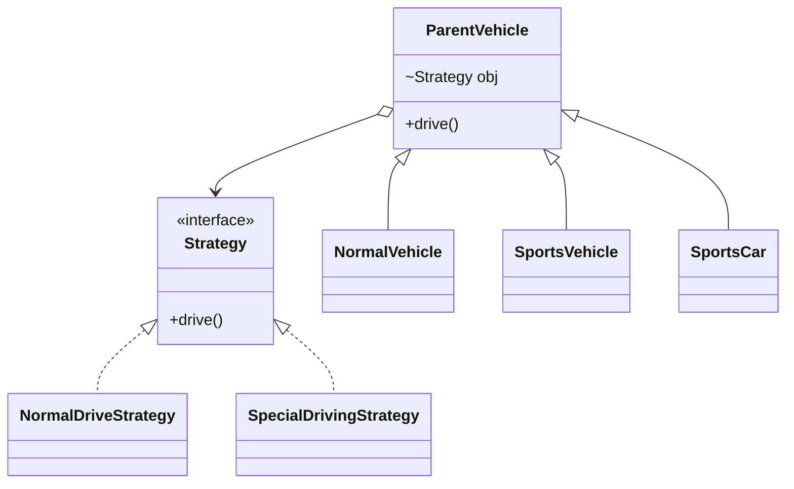

<div align="center">

# ♟️ Strategy Design Pattern

   

*Swap algorithms at runtime behind a common interface.*

</div>

---

## 📑 Table of contents

- [🎯 Intent](#-intent)
- [🧩 The problem & the solution](#-the-problem--the-solution)
- [🔷 Structure](#-structure)
- [👥 Participants](#-participants)
- [🧭 When to use it](#-when-to-use-it)
- [📊 Pros & cons](#-pros--cons)
- [🌍 Real-world examples](#-real-world-examples)
- [💻 Code](#-code)
  - [1. ✅ With Strategy (the solution)](#ex1)
  - [2. ❌ Without Strategy (the problem)](#ex2)

---

## 🎯 Intent

> Define a family of algorithms, **encapsulate each one** and make them interchangeable.

## 🧩 The problem & the solution

| 😣 Problem | 💡 Solution |
|---|---|
| `NormalVehicle`, `SportsVehicle` and `SportsCar` need different `drive()` behaviour. Overriding in subclasses duplicates code (sports car and sports vehicle share the same drive logic). | Pull the behaviour out into a `Strategy` interface (`NormalDriveStrategy`, `SpecialDrivingStrategy`). A vehicle holds a strategy and delegates `drive()` to it. |

## 🔷 Structure



## 👥 Participants

| Role | Responsibility | In this repo |
|---|---|---|
| **Strategy** | Common algorithm interface | `Strategy` |
| **Concrete Strategies** | Individual algorithms | `NormalDriveStrategy`, `SpecialDrivingStrategy` |
| **Context** | Holds a strategy and delegates | `ParentVehicle` |
| **Client** | Chooses the strategy | `Main` |

## 🧭 When to use it

| ✅ Use it when | ⚠️ Avoid it when |
|---|---|
| Many variants of one algorithm | Only one algorithm will ever exist |
| You want to switch behaviour at runtime | Clients should not need to know about strategies |
| To remove long `if/else` or `switch` on a type |  |

## 📊 Pros & cons

| 👍 Pros | 👎 Cons |
|---|---|
| No duplicated code across subclasses | More classes |
| Open/Closed for new algorithms | Client must know the strategies to pick one |
| Runtime switching |  |

## 🌍 Real-world examples

- `Comparator` passed to `Collections.sort()`
- Payment methods (card / UPI / wallet)
- Compression or routing algorithms

---

## 💻 Code

This folder has **2 examples** (13 Java files). Interfaces and abstract classes come first, the class with `main` comes last.

<a id="ex1"></a>

### 1. ✅ With Strategy (the solution)

> Driving behaviour lives in strategy classes; vehicles just delegate.

<details open>
<summary><b>📁 Files in this example</b></summary>

```text
With Following Strategy Design Pattern/
├── Strategy/
│   ├── NormalDriveStrategy.java
│   ├── SpecialDrivingStrategy.java
│   └── Strategy.java
├── Main.java
├── NormalVehicle.java
├── ParentVehicle.java
├── SportsCar.java
└── SportsVehicle.java
```

</details>

#### 📄 `Strategy/Strategy.java`

<sub>interface · 7 lines</sub>

```java
package followingstrategypattern.Strategy;

public interface Strategy {
    void drive();


}
```

#### 📄 `NormalVehicle.java`

<sub>class · 12 lines</sub>

```java
package followingstrategypattern;

import followingstrategypattern.Strategy.NormalDriveStrategy;

public class NormalVehicle extends ParentVehicle{

    NormalVehicle() {
        super(new NormalDriveStrategy());

    }

}
```

#### 📄 `ParentVehicle.java`

<sub>class · 17 lines</sub>

```java
package followingstrategypattern;

import followingstrategypattern.Strategy.Strategy;

public class ParentVehicle {

    Strategy obj;

    ParentVehicle(Strategy obj ){
        this.obj=obj;
    }
    public void drive() {
        obj.drive();

    }

}
```

#### 📄 `SportsCar.java`

<sub>class · 11 lines</sub>

```java
package followingstrategypattern;

import followingstrategypattern.Strategy.SpecialDrivingStrategy;

public class SportsCar extends ParentVehicle {

    SportsCar() {
        super(new SpecialDrivingStrategy());
    }

}
```

#### 📄 `SportsVehicle.java`

<sub>class · 11 lines</sub>

```java
package followingstrategypattern;

import followingstrategypattern.Strategy.SpecialDrivingStrategy;

public class SportsVehicle extends ParentVehicle {

    SportsVehicle() {
        super(new SpecialDrivingStrategy());
    }

}
```

#### 📄 `Strategy/NormalDriveStrategy.java`

<sub>class · 9 lines</sub>

```java
package followingstrategypattern.Strategy;
public class NormalDriveStrategy implements Strategy {

    @Override
    public void drive() {
        System.out.println("normal driving capability");
    }

}
```

#### 📄 `Strategy/SpecialDrivingStrategy.java`

<sub>class · 8 lines</sub>

```java
package followingstrategypattern.Strategy;

public class SpecialDrivingStrategy implements Strategy {
    @Override
    public void drive() {
        System.out.println("special driving capability");
    }
}
```

#### 📄 `Main.java`

<sub>class · 14 lines</sub>

```java
package followingstrategypattern;

public class Main {

    public static void main(String[] args) {
        // TODO Auto-generated method stub
    //	NormalDriveStrategy nds=new NormalDriveStrategy();

        ParentVehicle pv1=new NormalVehicle();
        pv1.drive();

    }

}
```

<details>
<summary><b>▶️ How to compile and run this example</b></summary>

```bash
# run from the repository root
mkdir -p out
find "Behavioural Design Pattern/1. Strategy Design Pattern/With Following Strategy Design Pattern" -name "*.java" -print0 | xargs -0 javac -d out
java -cp out followingstrategypattern.Main
```

</details>

---

<a id="ex2"></a>

### 2. ❌ Without Strategy (the problem)

> Each vehicle subclass overrides `drive()`, so `SportsVehicle` and `SportsCar` duplicate the same logic.

<details open>
<summary><b>📁 Files in this example</b></summary>

```text
Without Following Strategy Design Pattern/
├── Main.java
├── NormalVehicle.java
├── SportsCar.java
├── SportsVehicle.java
└── Vehicle.java
```

</details>

#### 📄 `NormalVehicle.java`

<sub>class · 8 lines</sub>

```java
package withoutfollowing;

public class NormalVehicle extends Vehicle{

    public void drive() {
        System.out.println("normal driving capabiliy");
    }
}
```

#### 📄 `SportsCar.java`

<sub>class · 9 lines</sub>

```java
package withoutfollowing;

public class SportsCar extends Vehicle{

    public void drive() {
        System.out.println("special driving capabiliy");
    }

}
```

#### 📄 `SportsVehicle.java`

<sub>class · 9 lines</sub>

```java
package withoutfollowing;

public class SportsVehicle extends Vehicle{

    public void drive() {
        System.out.println("special driving capabiliy");
    }

}
```

#### 📄 `Vehicle.java`

<sub>class · 8 lines</sub>

```java
package withoutfollowing;

public class Vehicle {
    public void drive() {
        System.out.println("normal driving capabiliy");
    }

}
```

#### 📄 `Main.java`

<sub>class · 16 lines</sub>

```java
package withoutfollowing;
public class Main {
    public static void main(String[] args) {
        Vehicle v=new Vehicle();
        v.drive();

        Vehicle sv=new SportsVehicle();
        sv.drive();

        Vehicle sc= new SportsCar();
        sc.drive();

        Vehicle nv=new NormalVehicle();
        nv.drive();
    }
}
```

<details>
<summary><b>▶️ How to compile and run this example</b></summary>

```bash
# run from the repository root
mkdir -p out
find "Behavioural Design Pattern/1. Strategy Design Pattern/Without Following Strategy Design Pattern" -name "*.java" -print0 | xargs -0 javac -d out
java -cp out withoutfollowing.Main
```

</details>

---

<div align="center">

[📚 All patterns](../PATTERNS.md) &nbsp;·&nbsp; [Observer ▶](../2.%20Observer%20Design%20Pattern/README.md)

</div>
