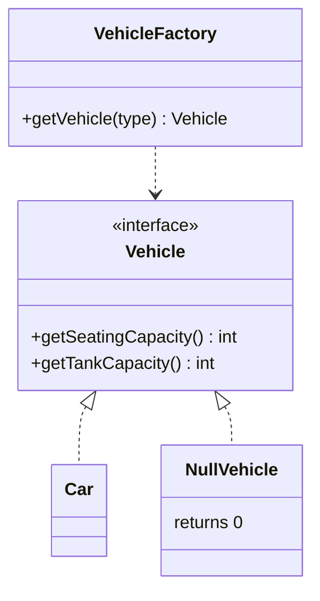

<div align="center">

# 🫥 Null Object Design Pattern

   

*Replace `null` with an object that does nothing.*

</div>

---

## 📑 Table of contents

- [🎯 Intent](#-intent)
- [🧩 The problem & the solution](#-the-problem--the-solution)
- [🔷 Structure](#-structure)
- [👥 Participants](#-participants)
- [🧭 When to use it](#-when-to-use-it)
- [📊 Pros & cons](#-pros--cons)
- [🌍 Real-world examples](#-real-world-examples)
- [💻 Code](#-code)
  - [1. ❌ Problem - `NullPointerException`](#ex1)
  - [2. ❌ Solution 1 - manual `if (vehicle != null)`](#ex2)
  - [3. ✅ Solution 2 - Null Object](#ex3)

---

## 🎯 Intent

> Provide an object that implements the expected interface with **neutral, do-nothing behaviour** instead of using `null`.

## 🧩 The problem & the solution

| 😣 Problem | 💡 Solution |
|---|---|
| A factory returns `null` for unknown vehicles, so every caller has to write `if (vehicle != null)` or risk a `NullPointerException`. | Return a `NullVehicle` that implements `Vehicle` with empty / default behaviour. Callers use it exactly like a real vehicle. |

## 🔷 Structure



## 👥 Participants

| Role | Responsibility | In this repo |
|---|---|---|
| **Abstract Object** | The interface callers rely on | `Vehicle` |
| **Real Object** | Normal behaviour | `Car` |
| **Null Object** | Safe, do-nothing behaviour | `NullVehicle` |
| **Factory** | Returns a real or null object | `VehicleFactory` |

## 🧭 When to use it

| ✅ Use it when | ⚠️ Avoid it when |
|---|---|
| Many callers do `null` checks | Absence is an error that must be reported |
| A 'nothing' value has a sensible default behaviour | Hiding a failure would make debugging harder |

## 📊 Pros & cons

| 👍 Pros | 👎 Cons |
|---|---|
| No `null` checks or NPEs | Can hide real problems |
| Cleaner client code | Extra class per interface |
| Default behaviour in one place |  |

## 🌍 Real-world examples

- `Collections.emptyList()`
- `Optional` (related idea)
- No-op loggers (`NOPLogger`)

---

## 💻 Code

This folder has **3 examples** (7 Java files). Interfaces and abstract classes come first, the class with `main` comes last.

<a id="ex1"></a>

### 1. ❌ Problem - `NullPointerException`

> `printVehicleDetails` calls methods on the vehicle and blows up when the vehicle is `null`.

<details open>
<summary><b>📁 Files in this example</b></summary>

```text
Problem/
└── printVehicleDetails.java
```

</details>

#### 📄 `printVehicleDetails.java`

<sub>class · 8 lines</sub>

```java
public class printVehicleDetails {

    private static void printVehichleDetail(Vehicle vehicle){
        System.out.println("Seating Capacity: "+vehicle.getSeatingCapacity());
        System.out .println("Fuel Tank Capacity: "+vehicle.getTankCapacity());
    }
    //IT will throw NULL Pointer Exception when Vehicle object is NULL
}
```

---

<a id="ex2"></a>

### 2. ❌ Solution 1 - manual `if (vehicle != null)`

> Works, but the same guard must be repeated at every call site.

<details open>
<summary><b>📁 Files in this example</b></summary>

```text
Solution 01 Manually/
└── Solution1.java
```

</details>

#### 📄 `Solution1.java`

<sub>class · 10 lines</sub>

```java
public class Solution1 {
        private static void printVehichleDetail(Vehicle vehicle){
            if(vehicle!=null){
                System.out.println("Seating Capacity: "+vehicle.getSeatingCapacity());
                System.out .println("Fuel Tank Capacity: "+vehicle.getTankCapacity());
            }

        }
        //IT will Avoid the NULL Pointer Exception when Vehicle object is NULL but suppose if there were so many large code base then there we have to put at everywhere this if condition
}
```

---

<a id="ex3"></a>

### 3. ✅ Solution 2 - Null Object

> `VehicleFactory` returns `NullVehicle` instead of `null`.

<details open>
<summary><b>📁 Files in this example</b></summary>

```text
Solution 02 of Above Problem is Null Object DP/
├── Vehicle/
│   ├── Car.java
│   ├── NullVehicle.java
│   └── Vehicle.java
├── Main.java
└── VehicleFactory.java
```

</details>

#### 📄 `Vehicle/Vehicle.java`

<sub>interface · 7 lines</sub>

```java
package LowLevelDesign.HandleNullObject.Vehicle;

public interface Vehicle {

    int getTankCapacity();
    int getSeatingCapacity();
}
```

#### 📄 `Vehicle/Car.java`

<sub>class · 16 lines</sub>

```java
package LowLevelDesign.HandleNullObject.Vehicle;

import LowLevelDesign.HandleNullObject.Vehicle.Vehicle;

public class Car implements Vehicle {

    @Override
    public int getTankCapacity() {
        return 40;
    }

    @Override
    public int getSeatingCapacity() {
        return 5;
    }
}
```

#### 📄 `Vehicle/NullVehicle.java`

<sub>class · 16 lines</sub>

```java
package LowLevelDesign.HandleNullObject.Vehicle;

import LowLevelDesign.HandleNullObject.Vehicle.Vehicle;

public class NullVehicle implements Vehicle {

    @Override
    public int getTankCapacity() {
        return 0;
    }

    @Override
    public int getSeatingCapacity() {
        return 0;
    }
}
```

#### 📄 `VehicleFactory.java`

<sub>class · 19 lines</sub>

```java
package LowLevelDesign.HandleNullObject;

import LowLevelDesign.HandleNullObject.Vehicle.Car;
import LowLevelDesign.HandleNullObject.Vehicle.NullVehicle;
import LowLevelDesign.HandleNullObject.Vehicle.Vehicle;

public class VehicleFactory {


    static Vehicle getVehicleObject(String typeOfVehicle){

        if("Car".equals(typeOfVehicle)) {

            return new Car();
        }

        return new NullVehicle();
    }
}
```

#### 📄 `Main.java`

<sub>class · 18 lines</sub>

```java
package LowLevelDesign.HandleNullObject;

import LowLevelDesign.HandleNullObject.Vehicle.Vehicle;

public class Main {

    public static void main(String []args){


        Vehicle vehicle = VehicleFactory.getVehicleObject("Bike");
        printVehicleDetails(vehicle);
    }

    private static void printVehicleDetails(Vehicle vehicle) {
            System.out.println("Seating Capacity: " + vehicle.getSeatingCapacity());
            System.out.println("Fuel Tank Capacity: " + vehicle.getTankCapacity());
    }
}
```

<details>
<summary><b>▶️ How to compile and run this example</b></summary>

```bash
# run from the repository root
mkdir -p out
find "Behavioural Design Pattern/10. Null Object Design Pattern/Solution 02 of Above Problem is Null Object DP" -name "*.java" -print0 | xargs -0 javac -d out
java -cp out LowLevelDesign.HandleNullObject.Main
```

</details>

---

<div align="center">

[◀ Mediator](../9.%20Mediator%20Design%20Pattern/README.md) &nbsp;·&nbsp; [📚 All patterns](../PATTERNS.md) &nbsp;·&nbsp; [Iterator ▶](../11.%20Iterator%20Design%20Pattern/README.md)

</div>
