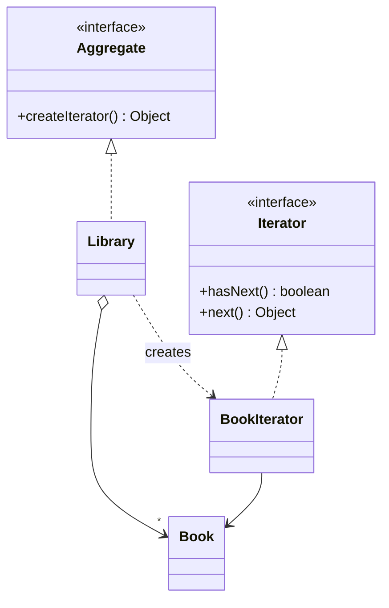

<div align="center">

# 🔁 Iterator Design Pattern

   

*Traverse a collection without exposing its internals.*

</div>

---

## 📑 Table of contents

- [🎯 Intent](#-intent)
- [🧩 The problem & the solution](#-the-problem--the-solution)
- [🔷 Structure](#-structure)
- [👥 Participants](#-participants)
- [🧭 When to use it](#-when-to-use-it)
- [📊 Pros & cons](#-pros--cons)
- [🌍 Real-world examples](#-real-world-examples)
- [💻 Code](#-code)
  - [1. 💡 Custom iterator - Book and Library](#ex1)
  - [2. 💡 JDK example - `LinkedHashSet`](#ex2)

---

## 🎯 Intent

> Provide a way to **access the elements of an aggregate sequentially** without exposing its underlying representation.

## 🧩 The problem & the solution

| 😣 Problem | 💡 Solution |
|---|---|
| A `Library` stores books in an array, but clients should not depend on that. Changing it to a list or tree must not break callers. | The library creates a `BookIterator` that knows how to walk the books and exposes `hasNext()` / `next()`. |

## 🔷 Structure



## 👥 Participants

| Role | Responsibility | In this repo |
|---|---|---|
| **Iterator** | Traversal interface | `Iterator` |
| **Concrete Iterator** | Tracks the position | `BookIterator` |
| **Aggregate** | Declares `createIterator()` | `Aggregate` |
| **Concrete Aggregate** | The collection | `Library` |
| **Element** | Stored items | `Book` |

## 🧭 When to use it

| ✅ Use it when | ⚠️ Avoid it when |
|---|---|
| Expose a uniform way to traverse different collections | A simple `for` loop over a plain array is enough |
| Hide the internal structure of a collection |  |

## 📊 Pros & cons

| 👍 Pros | 👎 Cons |
|---|---|
| Single Responsibility: traversal separated from storage | Overkill for simple collections |
| Multiple simultaneous traversals | Can be slightly slower than direct indexing |
| Uniform interface |  |

## 🌍 Real-world examples

- `java.util.Iterator` and for-each loops
- Database cursors / `ResultSet`
- File-system walkers

---

## 💻 Code

This folder has **2 examples** (7 Java files). Interfaces and abstract classes come first, the class with `main` comes last.

<a id="ex1"></a>

### 1. 💡 Custom iterator - Book and Library

> A hand-written `Iterator` / `Aggregate` pair over a `Library` of `Book`s.

<details open>
<summary><b>📁 Files in this example</b></summary>

```text
Iterator Design Pattern with Book and Library/
├── Aggregator/
│   ├── Aggregate.java
│   └── Library.java
├── Book/
│   └── Book.java
├── Iterator/
│   ├── BookIterator.java
│   └── Iterator.java
└── Client.java
```

</details>

#### 📄 `Aggregator/Aggregate.java`

<sub>interface · 5 lines</sub>

```java
package Aggregator;

public interface Aggregate {
    Object createIterator();
}
```

#### 📄 `Iterator/Iterator.java`

<sub>interface · 6 lines</sub>

```java
package Iterator;

public interface Iterator {
    boolean hasNext();
    Object next();
}
```

#### 📄 `Aggregator/Library.java`

<sub>class · 19 lines</sub>

```java
package Aggregator;


import java.util.Iterator;
import java.util.List;
import Book.Book;
import Iterator.BookIterator;


public class Library implements Aggregate{
    private  List<Book> booksList;
    public Library(List<Book>booksList){
        this.booksList=booksList;
    }
    @Override
    public Iterator createIterator() {
        return (Iterator) new BookIterator(booksList);
    }
}
```

#### 📄 `Book/Book.java`

<sub>class · 19 lines</sub>

```java
package Book;

public class Book {
    private int price;
    private String bookName;

    public Book(int price, String bookName) {
        this.price = price;
        this.bookName = bookName;
    }

    public int getPrice() {
        return price;
    }

    public String getBookName() {
        return bookName;
    }
}
```

#### 📄 `Iterator/BookIterator.java`

<sub>class · 27 lines</sub>

```java
package Iterator;

import java.util.List;
import Book.Book;


public class BookIterator implements Iterator{
private final List<Book> books;
private int index=0;

    public BookIterator(List<Book> books) {
        this.books = books;
    }

    @Override
    public boolean hasNext() {
        return index<books.size();
    }

    @Override
    public Object next() {
        if(this.hasNext()) {
            return books.get(index++);
        }
        return null;
    }
}
```

#### 📄 `Client.java`

<sub>class · 26 lines</sub>

```java
import Aggregator.Library;
import Book.Book;

import java.util.Arrays;
import java.util.Iterator;
import java.util.List;

public class Client {
    public static void main(String [] args){
        List<Book>bookList= Arrays.asList(
             new Book(100,"Science")  ,
             new Book(200,"Maths"),
             new Book(300,"GK"),
             new Book(400,"Drawing")
        );

        Library lib=new Library(bookList);
        Iterator iterator=lib.createIterator();

        while(iterator.hasNext()){
            Book book=(Book) iterator.next();
            System.out.println(book.getBookName());
        }

    }
}
```

<details>
<summary><b>▶️ How to compile and run this example</b></summary>

```bash
# run from the repository root
mkdir -p out
find "Behavioural Design Pattern/11. Iterator Design Pattern/Iterator Design Pattern with Book and Library" -name "*.java" -print0 | xargs -0 javac -d out
java -cp out Client
```

</details>

---

<a id="ex2"></a>

### 2. 💡 JDK example - `LinkedHashSet`

> Using the built-in iterator of `LinkedHashSet`.

<details open>
<summary><b>📁 Files in this example</b></summary>

```text
LinkedHashSetEmapleForIteratorDp/
└── LinkedHashSetExample.java
```

</details>

#### 📄 `LinkedHashSetExample.java`

<sub>class · 20 lines</sub>

```java
import java.util.Iterator;
import java.util.LinkedHashSet;
import java.util.Set;

public class LinkedHashSetExample {
    public static void main(String []args){
        Set<Integer> intSet=new LinkedHashSet<>();
        intSet.add(2);
        intSet.add(77);
        intSet.add(82);
        intSet.add(63);
        intSet.add(5);

        Iterator<Integer>iterable=intSet.iterator();
        while(iterable.hasNext()){
            int val=iterable.next();
            System.out.println(val);
        }
    }
}
```

<details>
<summary><b>▶️ How to compile and run this example</b></summary>

```bash
# run from the repository root
mkdir -p out
find "Behavioural Design Pattern/11. Iterator Design Pattern/LinkedHashSetEmapleForIteratorDp" -name "*.java" -print0 | xargs -0 javac -d out
java -cp out LinkedHashSetExample
```

</details>

---

<div align="center">

[◀ Null Object](../10.%20Null%20Object%20Design%20Pattern/README.md) &nbsp;·&nbsp; [📚 All patterns](../PATTERNS.md) &nbsp;·&nbsp; [Visitor ▶](../12.%20Visitor%20Design%20Pattern/README.md)

</div>
