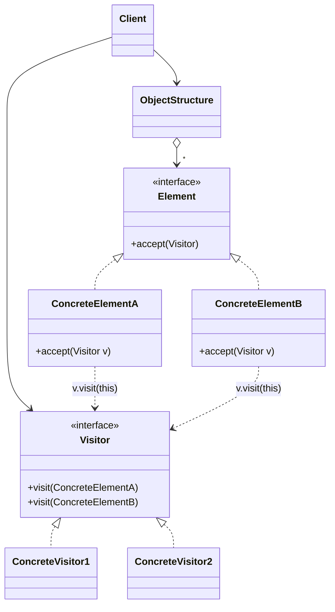

<div align="center">

# 🧳 Visitor Design Pattern

   

*Add new operations to a set of classes without modifying them.*

</div>

---

## 📑 Table of contents

- [🎯 Intent](#-intent)
- [🧩 The problem & the solution](#-the-problem--the-solution)
- [🔷 Structure](#-structure)
- [👥 Participants](#-participants)
- [🧭 When to use it](#-when-to-use-it)
- [📊 Pros & cons](#-pros--cons)
- [🌍 Real-world examples](#-real-world-examples)
- [💻 Code](#-code)
  - [1. ❌ Problem - every operation lives inside every class](#ex1)
  - [2. ✅ Solution 1 - Shopping cart visitors](#ex2)
  - [3. ✅ Solution 2 - File system visitors](#ex3)
  - [4. ✅ Solution 3 - Geometric shapes](#ex4)
  - [5. ✅ Solution 4 - Expression tree (visitor that returns a value)](#ex5)
  - [6. ✅ Solution 5 - Bank accounts](#ex6)

---

## 🎯 Intent

> Represent an operation to be performed on the elements of an object structure. Visitor lets you **define a new operation without changing the classes** of the elements it works on.

## 🧩 The problem & the solution

| 😣 Problem | 💡 Solution |
|---|---|
| A shopping cart holds `Book`, `Fruit` and `Electronics`. Tax, shipping, JSON export, discounts... each new operation means opening **every** item class and adding another method, mixing business rules into model classes and breaking Open/Closed. | Move each operation into its own **visitor** class with one `visit()` method per element type. Items only get a tiny `accept(visitor)` method, once. New operation = new visitor class, and none of the item classes change. |

## 🔷 Structure



## 👥 Participants

| Role | Responsibility | In this repo |
|---|---|---|
| **Visitor** | Declares a `visit()` method for every concrete element type | `ItemVisitor`, `FileSystemVisitor` |
| **Concrete Visitor** | One operation implemented for all element types, can keep state while traversing | `TaxVisitor`, `ShippingVisitor`, `JsonExportVisitor`, `SizeCalculatorVisitor`, `CountVisitor`, `ExtensionSearchVisitor` |
| **Element** | Declares `accept(Visitor)` | `Item`, `FileSystemElement` |
| **Concrete Element** | Implements `accept()` by calling `visitor.visit(this)` | `Book`, `Fruit`, `Electronics`, `File`, `Directory` |
| **Object Structure** | Collection or tree that lets visitors walk the elements | `List<Item>` cart, `Directory` |
| **Client** | Creates visitors and applies them to the structure | `Main` |

## 🧭 When to use it

| ✅ Use it when | ⚠️ Avoid it when |
|---|---|
| The structure has many **different element classes** and you need many **unrelated operations** on them | Element classes change often: every new element type forces a change in **every** visitor |
| The element classes are **stable**, but new operations are added often | There is only one or two operations (a plain method is simpler) |
| You want related logic in one class instead of scattered across all elements | Elements cannot expose enough state for the visitor without breaking encapsulation |
| An operation must collect results across a whole structure (totals, reports, exports) |  |

## 📊 Pros & cons

| 👍 Pros | 👎 Cons |
|---|---|
| Open/Closed: add operations without touching element classes | Adding a new element class means updating all visitors |
| Single Responsibility: one operation per visitor class | Elements must expose their data to visitors |
| Visitors can accumulate state while walking the structure | Double dispatch is less intuitive for beginners |
| Works across elements that share no common base behaviour |  |

## 🌍 Real-world examples

- **JDK - `java.nio.file.FileVisitor` / `SimpleFileVisitor`:** `Files.walkFileTree()` calls `visitFile`, `preVisitDirectory`... so you can delete, copy or search a tree without writing the walk
- **JDK - `javax.lang.model.element.ElementVisitor` and `TypeVisitor`:** annotation processors (Lombok-style tools, Dagger, MapStruct) walk classes, methods and fields of the compiled model
- **Bytecode - ASM `ClassVisitor` / `MethodVisitor`:** frameworks such as Spring, Hibernate and Mockito read and rewrite class files by visiting each class, field and instruction
- **Compilers, linters, formatters:** an AST (ANTLR `ParseTreeVisitor`, JavaParser `VoidVisitor`, Eclipse JDT `ASTVisitor`) is visited for type-checking, code generation, style checks and refactoring
- **Spring - `BeanDefinitionVisitor`:** resolves `${placeholders}` in every property of every bean definition
- **Document export:** one document tree (heading, paragraph, table, image) exported to HTML, PDF and Markdown, with one visitor per format
- **E-commerce:** tax, shipping, discount and insurance rules over cart items of different kinds (this folder, Solution 1)
- **Banking / insurance:** interest, fees and statements over savings, current and loan accounts or policies (this folder, Solution 5)
- **Cloud cost and security reports:** one visitor walks VMs, disks, databases and buckets to total the cost or flag risky settings
- **Games:** apply damage, healing or buffs differently to warriors, mages and buildings without bloating each unit class
- **UI toolkits:** a visitor walks the widget tree to render it, run accessibility audits or collect form values

---

## 💻 Code

This folder has **6 examples** (48 Java files). Interfaces and abstract classes come first, the class with `main` comes last.

<a id="ex1"></a>

### 1. ❌ Problem - every operation lives inside every class

> `Book`, `Fruit` and `Electronics` each carry `getTax()` and `getShippingCost()`. A new operation (like JSON export) forces edits in all three, and they share no common type.

> ### 🔍 What are `accept()` and `visit()` doing? (double dispatch)
>
> Java chooses an overloaded method using the **compile-time type** of the argument. In `visitor.visit(item)` where `item` is typed `Item`, Java cannot pick `visit(Book)` or `visit(Fruit)`, so this does not compile.
>
> The trick is two calls:
> 1. `item.accept(visitor)` - resolved at runtime to the real element (`Book.accept`)
> 2. inside it, `visitor.visit(this)` - here `this` is statically a `Book`, so `visit(Book)` is chosen
>
> The method that runs depends on **both** the element type and the visitor type, hence *double dispatch*.

<details open>
<summary><b>📁 Files in this example</b></summary>

```text
Problem/
├── Book.java
├── Electronics.java
├── Fruit.java
└── Main.java
```

</details>

#### 📄 `Book.java`

<sub>class · 18 lines</sub>

```java
public class Book {
    private String name;
    private double price;

    public Book(String name, double price) {
        this.name = name;
        this.price = price;
    }

    public String getName() { return name; }
    public double getPrice() { return price; }

    // operation 1 lives inside the class
    public double getTax() { return price * 0.05; }

    // operation 2 lives inside the class
    public double getShippingCost() { return 40; }
}
```

#### 📄 `Electronics.java`

<sub>class · 19 lines</sub>

```java
public class Electronics {
    private String name;
    private double price;
    private int warrantyInYears;

    public Electronics(String name, double price, int warrantyInYears) {
        this.name = name;
        this.price = price;
        this.warrantyInYears = warrantyInYears;
    }

    public String getName() { return name; }
    public double getPrice() { return price; }
    public int getWarrantyInYears() { return warrantyInYears; }

    public double getTax() { return price * 0.18; }

    public double getShippingCost() { return 150; }
}
```

#### 📄 `Fruit.java`

<sub>class · 18 lines</sub>

```java
public class Fruit {
    private String name;
    private double pricePerKg;
    private double weightInKg;

    public Fruit(String name, double pricePerKg, double weightInKg) {
        this.name = name;
        this.pricePerKg = pricePerKg;
        this.weightInKg = weightInKg;
    }

    public String getName() { return name; }
    public double getPrice() { return pricePerKg * weightInKg; }

    public double getTax() { return 0; }

    public double getShippingCost() { return 10 * weightInKg; }
}
```

#### 📄 `Main.java`

<sub>class · 17 lines</sub>

```java
public class Main {
    public static void main(String[] args) {

        Book book = new Book("Clean Code", 500);
        Fruit fruit = new Fruit("Apple", 120, 2);
        Electronics phone = new Electronics("Phone", 20000, 2);

        // The cart holds 3 DIFFERENT classes, so we cannot even keep them in one List<Item>
        // without a common interface, and every new operation (JSON export, discount, insurance...)
        // means opening Book, Fruit and Electronics again and editing all of them.
        double tax = book.getTax() + fruit.getTax() + phone.getTax();
        double shipping = book.getShippingCost() + fruit.getShippingCost() + phone.getShippingCost();

        System.out.println("Total tax      : " + tax);
        System.out.println("Total shipping : " + shipping);
    }
}
```

<details>
<summary><b>▶️ How to compile and run this example</b></summary>

```bash
# run from the repository root
mkdir -p out
find "Behavioural Design Pattern/12. Visitor Design Pattern/Problem" -name "*.java" -print0 | xargs -0 javac -d out
java -cp out Main
```

</details>

---

<a id="ex2"></a>

### 2. ✅ Solution 1 - Shopping cart visitors

> Items only implement `accept()`. `TaxVisitor`, `ShippingVisitor` and `JsonExportVisitor` hold the operations; `JsonExportVisitor` was added later without touching any item.

<details open>
<summary><b>📁 Files in this example</b></summary>

```text
Solution1 Shopping Cart/
├── Book.java
├── Electronics.java
├── Fruit.java
├── Item.java
├── ItemVisitor.java
├── JsonExportVisitor.java
├── Main.java
├── ShippingVisitor.java
└── TaxVisitor.java
```

</details>

#### 📄 `Item.java`

<sub>interface · 4 lines</sub>

```java
// Element: every item of the cart can accept a visitor
public interface Item {
    void accept(ItemVisitor visitor);
}
```

#### 📄 `ItemVisitor.java`

<sub>interface · 6 lines</sub>

```java
// Visitor: one visit() method for every concrete element type
public interface ItemVisitor {
    void visit(Book book);
    void visit(Fruit fruit);
    void visit(Electronics electronics);
}
```

#### 📄 `Book.java`

<sub>class · 17 lines</sub>

```java
public class Book implements Item {
    private String name;
    private double price;

    public Book(String name, double price) {
        this.name = name;
        this.price = price;
    }

    public String getName() { return name; }
    public double getPrice() { return price; }

    @Override
    public void accept(ItemVisitor visitor) {
        visitor.visit(this);   // 'this' is a Book here, so visit(Book) is chosen (double dispatch)
    }
}
```

#### 📄 `Electronics.java`

<sub>class · 20 lines</sub>

```java
public class Electronics implements Item {
    private String name;
    private double price;
    private int warrantyInYears;

    public Electronics(String name, double price, int warrantyInYears) {
        this.name = name;
        this.price = price;
        this.warrantyInYears = warrantyInYears;
    }

    public String getName() { return name; }
    public double getPrice() { return price; }
    public int getWarrantyInYears() { return warrantyInYears; }

    @Override
    public void accept(ItemVisitor visitor) {
        visitor.visit(this);   // 'this' is Electronics here, so visit(Electronics) is chosen
    }
}
```

#### 📄 `Fruit.java`

<sub>class · 20 lines</sub>

```java
public class Fruit implements Item {
    private String name;
    private double pricePerKg;
    private double weightInKg;

    public Fruit(String name, double pricePerKg, double weightInKg) {
        this.name = name;
        this.pricePerKg = pricePerKg;
        this.weightInKg = weightInKg;
    }

    public String getName() { return name; }
    public double getPricePerKg() { return pricePerKg; }
    public double getWeightInKg() { return weightInKg; }

    @Override
    public void accept(ItemVisitor visitor) {
        visitor.visit(this);   // 'this' is a Fruit here, so visit(Fruit) is chosen
    }
}
```

#### 📄 `JsonExportVisitor.java`

<sub>class · 28 lines</sub>

```java
// Concrete Visitor 3: added LATER without touching Book, Fruit or Electronics (Open/Closed)
public class JsonExportVisitor implements ItemVisitor {
    private StringBuilder json = new StringBuilder();

    @Override
    public void visit(Book book) {
        append("{\"type\":\"book\",\"name\":\"" + book.getName() + "\",\"price\":" + book.getPrice() + "}");
    }

    @Override
    public void visit(Fruit fruit) {
        append("{\"type\":\"fruit\",\"name\":\"" + fruit.getName() + "\",\"weightInKg\":" + fruit.getWeightInKg() + "}");
    }

    @Override
    public void visit(Electronics electronics) {
        append("{\"type\":\"electronics\",\"name\":\"" + electronics.getName() + "\",\"warrantyInYears\":" + electronics.getWarrantyInYears() + "}");
    }

    private void append(String element) {
        if (json.length() > 0) {
            json.append(",");
        }
        json.append(element);
    }

    public String getJson() { return "[" + json + "]"; }
}
```

#### 📄 `ShippingVisitor.java`

<sub>class · 21 lines</sub>

```java
// Concrete Visitor 2: shipping rules for every item type
public class ShippingVisitor implements ItemVisitor {
    private double totalShipping = 0;

    @Override
    public void visit(Book book) {
        totalShipping += 40;
    }

    @Override
    public void visit(Fruit fruit) {
        totalShipping += 10 * fruit.getWeightInKg();
    }

    @Override
    public void visit(Electronics electronics) {
        totalShipping += 150;
    }

    public double getTotalShipping() { return totalShipping; }
}
```

#### 📄 `TaxVisitor.java`

<sub>class · 21 lines</sub>

```java
// Concrete Visitor 1: tax rules for every item type, kept in ONE place
public class TaxVisitor implements ItemVisitor {
    private double totalTax = 0;

    @Override
    public void visit(Book book) {
        totalTax += book.getPrice() * 0.05;
    }

    @Override
    public void visit(Fruit fruit) {
        totalTax += 0;   // fruits are tax free
    }

    @Override
    public void visit(Electronics electronics) {
        totalTax += electronics.getPrice() * 0.18;
    }

    public double getTotalTax() { return totalTax; }
}
```

#### 📄 `Main.java`

<sub>class · 27 lines</sub>

```java
import java.util.ArrayList;
import java.util.List;

public class Main {
    public static void main(String[] args) {

        // Object structure: one list holding different element types
        List<Item> cart = new ArrayList<>();
        cart.add(new Book("Clean Code", 500));
        cart.add(new Fruit("Apple", 120, 2));
        cart.add(new Electronics("Phone", 20000, 2));

        TaxVisitor taxVisitor = new TaxVisitor();
        ShippingVisitor shippingVisitor = new ShippingVisitor();
        JsonExportVisitor jsonVisitor = new JsonExportVisitor();

        for (Item item : cart) {
            item.accept(taxVisitor);
            item.accept(shippingVisitor);
            item.accept(jsonVisitor);
        }

        System.out.println("Total tax      : " + taxVisitor.getTotalTax());
        System.out.println("Total shipping : " + shippingVisitor.getTotalShipping());
        System.out.println("JSON           : " + jsonVisitor.getJson());
    }
}
```

<details>
<summary><b>▶️ How to compile and run this example</b></summary>

```bash
# run from the repository root
mkdir -p out
find "Behavioural Design Pattern/12. Visitor Design Pattern/Solution1 Shopping Cart" -name "*.java" -print0 | xargs -0 javac -d out
java -cp out Main
```

</details>

---

<a id="ex3"></a>

### 3. ✅ Solution 2 - File system visitors

> `File` and `Directory` accept visitors, and `Directory` walks its children. `SizeCalculatorVisitor`, `CountVisitor` and `ExtensionSearchVisitor` each run over the whole tree.

<details open>
<summary><b>📁 Files in this example</b></summary>

```text
Solution2 File System/
├── CountVisitor.java
├── Directory.java
├── ExtensionSearchVisitor.java
├── File.java
├── FileSystemElement.java
├── FileSystemVisitor.java
├── Main.java
└── SizeCalculatorVisitor.java
```

</details>

#### 📄 `FileSystemElement.java`

<sub>interface · 3 lines</sub>

```java
public interface FileSystemElement {
    void accept(FileSystemVisitor visitor);
}
```

#### 📄 `FileSystemVisitor.java`

<sub>interface · 4 lines</sub>

```java
public interface FileSystemVisitor {
    void visit(File file);
    void visit(Directory directory);
}
```

#### 📄 `CountVisitor.java`

<sub>class · 14 lines</sub>

```java
// Counts files and directories
public class CountVisitor implements FileSystemVisitor {
    private int files = 0;
    private int directories = 0;

    @Override
    public void visit(File file) { files++; }

    @Override
    public void visit(Directory directory) { directories++; }

    public int getFiles() { return files; }
    public int getDirectories() { return directories; }
}
```

#### 📄 `Directory.java`

<sub>class · 26 lines</sub>

```java
import java.util.ArrayList;
import java.util.List;

public class Directory implements FileSystemElement {
    private String name;
    private List<FileSystemElement> children = new ArrayList<>();

    public Directory(String name) {
        this.name = name;
    }

    public String getName() { return name; }

    public void add(FileSystemElement element) {
        children.add(element);
    }

    @Override
    public void accept(FileSystemVisitor visitor) {
        visitor.visit(this);
        // the structure (not the visitor) knows how to walk its children
        for (FileSystemElement child : children) {
            child.accept(visitor);
        }
    }
}
```

#### 📄 `ExtensionSearchVisitor.java`

<sub>class · 24 lines</sub>

```java
import java.util.ArrayList;
import java.util.List;

// Collects the names of all files that end with a given extension
public class ExtensionSearchVisitor implements FileSystemVisitor {
    private String extension;
    private List<String> matches = new ArrayList<>();

    public ExtensionSearchVisitor(String extension) {
        this.extension = extension;
    }

    @Override
    public void visit(File file) {
        if (file.getName().endsWith(extension)) {
            matches.add(file.getName());
        }
    }

    @Override
    public void visit(Directory directory) { }

    public List<String> getMatches() { return matches; }
}
```

#### 📄 `File.java`

<sub>class · 17 lines</sub>

```java
public class File implements FileSystemElement {
    private String name;
    private long sizeInKb;

    public File(String name, long sizeInKb) {
        this.name = name;
        this.sizeInKb = sizeInKb;
    }

    public String getName() { return name; }
    public long getSizeInKb() { return sizeInKb; }

    @Override
    public void accept(FileSystemVisitor visitor) {
        visitor.visit(this);
    }
}
```

#### 📄 `SizeCalculatorVisitor.java`

<sub>class · 16 lines</sub>

```java
// Adds up the size of every file in the tree
public class SizeCalculatorVisitor implements FileSystemVisitor {
    private long totalSizeInKb = 0;

    @Override
    public void visit(File file) {
        totalSizeInKb += file.getSizeInKb();
    }

    @Override
    public void visit(Directory directory) {
        // a directory has no size of its own, its files are visited next
    }

    public long getTotalSizeInKb() { return totalSizeInKb; }
}
```

#### 📄 `Main.java`

<sub>class · 24 lines</sub>

```java
public class Main {
    public static void main(String[] args) {

        Directory root = new Directory("project");
        Directory src = new Directory("src");
        src.add(new File("Main.java", 10));
        src.add(new File("Util.java", 6));
        root.add(src);
        root.add(new File("README.md", 4));
        root.add(new File("logo.png", 120));

        SizeCalculatorVisitor size = new SizeCalculatorVisitor();
        CountVisitor count = new CountVisitor();
        ExtensionSearchVisitor javaFiles = new ExtensionSearchVisitor(".java");

        root.accept(size);
        root.accept(count);
        root.accept(javaFiles);

        System.out.println("Total size  : " + size.getTotalSizeInKb() + " KB");
        System.out.println("Files       : " + count.getFiles() + ", directories: " + count.getDirectories());
        System.out.println("Java files  : " + javaFiles.getMatches());
    }
}
```

<details>
<summary><b>▶️ How to compile and run this example</b></summary>

```bash
# run from the repository root
mkdir -p out
find "Behavioural Design Pattern/12. Visitor Design Pattern/Solution2 File System" -name "*.java" -print0 | xargs -0 javac -d out
java -cp out Main
```

</details>

---

<a id="ex4"></a>

### 4. ✅ Solution 3 - Geometric shapes

> The classic textbook case: `Circle`, `Rectangle`, `Triangle` plus `AreaVisitor`, `PerimeterVisitor` and a later-added `XmlExportVisitor`. Shows that a visitor can keep a **running total** across a whole list.

<details open>
<summary><b>📁 Files in this example</b></summary>

```text
Solution3 Shapes/
├── AreaVisitor.java
├── Circle.java
├── Main.java
├── PerimeterVisitor.java
├── Rectangle.java
├── Shape.java
├── ShapeVisitor.java
├── Triangle.java
└── XmlExportVisitor.java
```

</details>

#### 📄 `Shape.java`

<sub>interface · 3 lines</sub>

```java
public interface Shape {
    void accept(ShapeVisitor visitor);
}
```

#### 📄 `ShapeVisitor.java`

<sub>interface · 5 lines</sub>

```java
public interface ShapeVisitor {
    void visit(Circle circle);
    void visit(Rectangle rectangle);
    void visit(Triangle triangle);
}
```

#### 📄 `AreaVisitor.java`

<sub>class · 23 lines</sub>

```java
// Sums the area of every shape it visits
public class AreaVisitor implements ShapeVisitor {
    private double totalArea = 0;

    @Override
    public void visit(Circle circle) {
        totalArea += Math.PI * circle.getRadius() * circle.getRadius();
    }

    @Override
    public void visit(Rectangle rectangle) {
        totalArea += rectangle.getWidth() * rectangle.getHeight();
    }

    @Override
    public void visit(Triangle triangle) {
        // Heron's formula
        double s = (triangle.getA() + triangle.getB() + triangle.getC()) / 2;
        totalArea += Math.sqrt(s * (s - triangle.getA()) * (s - triangle.getB()) * (s - triangle.getC()));
    }

    public double getTotalArea() { return totalArea; }
}
```

#### 📄 `Circle.java`

<sub>class · 10 lines</sub>

```java
public class Circle implements Shape {
    private double radius;

    public Circle(double radius) { this.radius = radius; }

    public double getRadius() { return radius; }

    @Override
    public void accept(ShapeVisitor visitor) { visitor.visit(this); }
}
```

#### 📄 `PerimeterVisitor.java`

<sub>class · 21 lines</sub>

```java
// Sums the perimeter of every shape it visits
public class PerimeterVisitor implements ShapeVisitor {
    private double totalPerimeter = 0;

    @Override
    public void visit(Circle circle) {
        totalPerimeter += 2 * Math.PI * circle.getRadius();
    }

    @Override
    public void visit(Rectangle rectangle) {
        totalPerimeter += 2 * (rectangle.getWidth() + rectangle.getHeight());
    }

    @Override
    public void visit(Triangle triangle) {
        totalPerimeter += triangle.getA() + triangle.getB() + triangle.getC();
    }

    public double getTotalPerimeter() { return totalPerimeter; }
}
```

#### 📄 `Rectangle.java`

<sub>class · 15 lines</sub>

```java
public class Rectangle implements Shape {
    private double width;
    private double height;

    public Rectangle(double width, double height) {
        this.width = width;
        this.height = height;
    }

    public double getWidth() { return width; }
    public double getHeight() { return height; }

    @Override
    public void accept(ShapeVisitor visitor) { visitor.visit(this); }
}
```

#### 📄 `Triangle.java`

<sub>class · 16 lines</sub>

```java
public class Triangle implements Shape {
    private double a, b, c;   // side lengths

    public Triangle(double a, double b, double c) {
        this.a = a;
        this.b = b;
        this.c = c;
    }

    public double getA() { return a; }
    public double getB() { return b; }
    public double getC() { return c; }

    @Override
    public void accept(ShapeVisitor visitor) { visitor.visit(this); }
}
```

#### 📄 `XmlExportVisitor.java`

<sub>class · 23 lines</sub>

```java
// A brand new operation: no shape class had to change to support XML export
public class XmlExportVisitor implements ShapeVisitor {
    private StringBuilder xml = new StringBuilder("<shapes>\n");

    @Override
    public void visit(Circle circle) {
        xml.append("  <circle radius=\"").append(circle.getRadius()).append("\"/>\n");
    }

    @Override
    public void visit(Rectangle rectangle) {
        xml.append("  <rectangle width=\"").append(rectangle.getWidth())
           .append("\" height=\"").append(rectangle.getHeight()).append("\"/>\n");
    }

    @Override
    public void visit(Triangle triangle) {
        xml.append("  <triangle a=\"").append(triangle.getA()).append("\" b=\"").append(triangle.getB())
           .append("\" c=\"").append(triangle.getC()).append("\"/>\n");
    }

    public String getXml() { return xml + "</shapes>"; }
}
```

#### 📄 `Main.java`

<sub>class · 23 lines</sub>

```java
import java.util.Arrays;
import java.util.List;

public class Main {
    public static void main(String[] args) {

        List<Shape> shapes = Arrays.asList(new Circle(2), new Rectangle(3, 4), new Triangle(3, 4, 5));

        AreaVisitor area = new AreaVisitor();
        PerimeterVisitor perimeter = new PerimeterVisitor();
        XmlExportVisitor xml = new XmlExportVisitor();

        for (Shape shape : shapes) {
            shape.accept(area);
            shape.accept(perimeter);
            shape.accept(xml);
        }

        System.out.printf("Total area      : %.2f%n", area.getTotalArea());
        System.out.printf("Total perimeter : %.2f%n", perimeter.getTotalPerimeter());
        System.out.println(xml.getXml());
    }
}
```

<details>
<summary><b>▶️ How to compile and run this example</b></summary>

```bash
# run from the repository root
mkdir -p out
find "Behavioural Design Pattern/12. Visitor Design Pattern/Solution3 Shapes" -name "*.java" -print0 | xargs -0 javac -d out
java -cp out Main
```

</details>

---

<a id="ex5"></a>

### 5. ✅ Solution 4 - Expression tree (visitor that returns a value)

> `Num`, `Add`, `Mul` form a tree. A generic `ExprVisitor<R>` lets each operation choose its return type: `EvaluateVisitor` returns an `Integer`, `PrintVisitor` a `String`, `NodeCountVisitor` an `Integer`.

> ### 🔍 Why a generic `ExprVisitor<R>`?
>
> In Solutions 1-3 the visitors keep their result in a **field** (`totalTax`) and the caller reads it afterwards. That is fine for a flat list, but for a **tree** the result of a node depends on the results of its children.
>
> Making the visitor generic (`<R> R accept(ExprVisitor<R> v)`) lets `visit` **return** the value, so the recursion reads naturally:
> `add.getLeft().accept(this) + add.getRight().accept(this)`.
> The same tree is evaluated (`Integer`), printed (`String`) and measured (`Integer`) by three different visitors, with no change to `Num`, `Add` or `Mul`. This is exactly how compilers and interpreters use the pattern.

<details open>
<summary><b>📁 Files in this example</b></summary>

```text
Solution4 Expression Tree/
├── Add.java
├── EvaluateVisitor.java
├── Expr.java
├── ExprVisitor.java
├── Main.java
├── Mul.java
├── NodeCountVisitor.java
├── Num.java
└── PrintVisitor.java
```

</details>

#### 📄 `Expr.java`

<sub>interface · 3 lines</sub>

```java
public interface Expr {
    <R> R accept(ExprVisitor<R> visitor);
}
```

#### 📄 `ExprVisitor.java`

<sub>interface · 6 lines</sub>

```java
// Generic visitor: every operation chooses its own return type R
public interface ExprVisitor<R> {
    R visitNum(Num num);
    R visitAdd(Add add);
    R visitMul(Mul mul);
}
```

#### 📄 `Add.java`

<sub>class · 14 lines</sub>

```java
public class Add implements Expr {
    private Expr left, right;

    public Add(Expr left, Expr right) {
        this.left = left;
        this.right = right;
    }

    public Expr getLeft() { return left; }
    public Expr getRight() { return right; }

    @Override
    public <R> R accept(ExprVisitor<R> visitor) { return visitor.visitAdd(this); }
}
```

#### 📄 `EvaluateVisitor.java`

<sub>class · 16 lines</sub>

```java
// Operation 1: evaluate the tree, R = Integer
public class EvaluateVisitor implements ExprVisitor<Integer> {

    @Override
    public Integer visitNum(Num num) { return num.getValue(); }

    @Override
    public Integer visitAdd(Add add) {
        return add.getLeft().accept(this) + add.getRight().accept(this);
    }

    @Override
    public Integer visitMul(Mul mul) {
        return mul.getLeft().accept(this) * mul.getRight().accept(this);
    }
}
```

#### 📄 `Mul.java`

<sub>class · 14 lines</sub>

```java
public class Mul implements Expr {
    private Expr left, right;

    public Mul(Expr left, Expr right) {
        this.left = left;
        this.right = right;
    }

    public Expr getLeft() { return left; }
    public Expr getRight() { return right; }

    @Override
    public <R> R accept(ExprVisitor<R> visitor) { return visitor.visitMul(this); }
}
```

#### 📄 `NodeCountVisitor.java`

<sub>class · 16 lines</sub>

```java
// Operation 3: count the nodes, R = Integer
public class NodeCountVisitor implements ExprVisitor<Integer> {

    @Override
    public Integer visitNum(Num num) { return 1; }

    @Override
    public Integer visitAdd(Add add) {
        return 1 + add.getLeft().accept(this) + add.getRight().accept(this);
    }

    @Override
    public Integer visitMul(Mul mul) {
        return 1 + mul.getLeft().accept(this) + mul.getRight().accept(this);
    }
}
```

#### 📄 `Num.java`

<sub>class · 10 lines</sub>

```java
public class Num implements Expr {
    private int value;

    public Num(int value) { this.value = value; }

    public int getValue() { return value; }

    @Override
    public <R> R accept(ExprVisitor<R> visitor) { return visitor.visitNum(this); }
}
```

#### 📄 `PrintVisitor.java`

<sub>class · 16 lines</sub>

```java
// Operation 2: print the tree as text, R = String
public class PrintVisitor implements ExprVisitor<String> {

    @Override
    public String visitNum(Num num) { return String.valueOf(num.getValue()); }

    @Override
    public String visitAdd(Add add) {
        return "(" + add.getLeft().accept(this) + " + " + add.getRight().accept(this) + ")";
    }

    @Override
    public String visitMul(Mul mul) {
        return "(" + mul.getLeft().accept(this) + " * " + mul.getRight().accept(this) + ")";
    }
}
```

#### 📄 `Main.java`

<sub>class · 14 lines</sub>

```java
public class Main {
    public static void main(String[] args) {

        // (2 + 3) * 4
        Expr expression = new Mul(new Add(new Num(2), new Num(3)), new Num(4));

        int result = expression.accept(new EvaluateVisitor());
        String text = expression.accept(new PrintVisitor());
        int nodes = expression.accept(new NodeCountVisitor());

        System.out.println(text + " = " + result);   // ((2 + 3) * 4) = 20
        System.out.println("Nodes: " + nodes);       // Nodes: 5
    }
}
```

<details>
<summary><b>▶️ How to compile and run this example</b></summary>

```bash
# run from the repository root
mkdir -p out
find "Behavioural Design Pattern/12. Visitor Design Pattern/Solution4 Expression Tree" -name "*.java" -print0 | xargs -0 javac -d out
java -cp out Main
```

</details>

---

<a id="ex6"></a>

### 6. ✅ Solution 5 - Bank accounts

> `SavingsAccount`, `CurrentAccount` and `LoanAccount` are visited by `InterestVisitor` (earned vs owed), `FeeVisitor` and `StatementVisitor`. Each account type has **different business rules**, all of them in one visitor per concern.

<details open>
<summary><b>📁 Files in this example</b></summary>

```text
Solution5 Bank Accounts/
├── Account.java
├── AccountVisitor.java
├── CurrentAccount.java
├── FeeVisitor.java
├── InterestVisitor.java
├── LoanAccount.java
├── Main.java
├── SavingsAccount.java
└── StatementVisitor.java
```

</details>

#### 📄 `Account.java`

<sub>interface · 3 lines</sub>

```java
public interface Account {
    void accept(AccountVisitor visitor);
}
```

#### 📄 `AccountVisitor.java`

<sub>interface · 5 lines</sub>

```java
public interface AccountVisitor {
    void visit(SavingsAccount account);
    void visit(CurrentAccount account);
    void visit(LoanAccount account);
}
```

#### 📄 `CurrentAccount.java`

<sub>class · 18 lines</sub>

```java
public class CurrentAccount implements Account {
    private String owner;
    private double balance;
    private double overdraftLimit;

    public CurrentAccount(String owner, double balance, double overdraftLimit) {
        this.owner = owner;
        this.balance = balance;
        this.overdraftLimit = overdraftLimit;
    }

    public String getOwner() { return owner; }
    public double getBalance() { return balance; }
    public double getOverdraftLimit() { return overdraftLimit; }

    @Override
    public void accept(AccountVisitor visitor) { visitor.visit(this); }
}
```

#### 📄 `FeeVisitor.java`

<sub>class · 15 lines</sub>

```java
// Monthly maintenance fees, one rule per account type
public class FeeVisitor implements AccountVisitor {
    private double totalFees = 0;

    @Override
    public void visit(SavingsAccount account) { totalFees += 0; }

    @Override
    public void visit(CurrentAccount account) { totalFees += 50; }

    @Override
    public void visit(LoanAccount account) { totalFees += 100; }

    public double getTotalFees() { return totalFees; }
}
```

#### 📄 `InterestVisitor.java`

<sub>class · 23 lines</sub>

```java
// Yearly interest: customers EARN it on savings and OWE it on loans
public class InterestVisitor implements AccountVisitor {
    private double interestEarned = 0;
    private double interestOwed = 0;

    @Override
    public void visit(SavingsAccount account) {
        interestEarned += account.getBalance() * account.getInterestRatePercent() / 100;
    }

    @Override
    public void visit(CurrentAccount account) {
        // a current account pays no interest
    }

    @Override
    public void visit(LoanAccount account) {
        interestOwed += account.getOutstanding() * account.getInterestRatePercent() / 100;
    }

    public double getInterestEarned() { return interestEarned; }
    public double getInterestOwed() { return interestOwed; }
}
```

#### 📄 `LoanAccount.java`

<sub>class · 18 lines</sub>

```java
public class LoanAccount implements Account {
    private String owner;
    private double outstanding;
    private double interestRatePercent;

    public LoanAccount(String owner, double outstanding, double interestRatePercent) {
        this.owner = owner;
        this.outstanding = outstanding;
        this.interestRatePercent = interestRatePercent;
    }

    public String getOwner() { return owner; }
    public double getOutstanding() { return outstanding; }
    public double getInterestRatePercent() { return interestRatePercent; }

    @Override
    public void accept(AccountVisitor visitor) { visitor.visit(this); }
}
```

#### 📄 `SavingsAccount.java`

<sub>class · 18 lines</sub>

```java
public class SavingsAccount implements Account {
    private String owner;
    private double balance;
    private double interestRatePercent;

    public SavingsAccount(String owner, double balance, double interestRatePercent) {
        this.owner = owner;
        this.balance = balance;
        this.interestRatePercent = interestRatePercent;
    }

    public String getOwner() { return owner; }
    public double getBalance() { return balance; }
    public double getInterestRatePercent() { return interestRatePercent; }

    @Override
    public void accept(AccountVisitor visitor) { visitor.visit(this); }
}
```

#### 📄 `StatementVisitor.java`

<sub>class · 21 lines</sub>

```java
// Prints a different statement line for each account type
public class StatementVisitor implements AccountVisitor {

    @Override
    public void visit(SavingsAccount account) {
        System.out.println("[SAVINGS] " + account.getOwner() + " balance=" + account.getBalance()
                + " rate=" + account.getInterestRatePercent() + "%");
    }

    @Override
    public void visit(CurrentAccount account) {
        System.out.println("[CURRENT] " + account.getOwner() + " balance=" + account.getBalance()
                + " overdraft limit=" + account.getOverdraftLimit());
    }

    @Override
    public void visit(LoanAccount account) {
        System.out.println("[LOAN]    " + account.getOwner() + " outstanding=" + account.getOutstanding()
                + " rate=" + account.getInterestRatePercent() + "%");
    }
}
```

#### 📄 `Main.java`

<sub>class · 26 lines</sub>

```java
import java.util.Arrays;
import java.util.List;

public class Main {
    public static void main(String[] args) {

        List<Account> accounts = Arrays.asList(
                new SavingsAccount("Asha", 10000, 4),
                new CurrentAccount("Ravi", 5000, 2000),
                new LoanAccount("Meera", 20000, 10));

        StatementVisitor statement = new StatementVisitor();
        InterestVisitor interest = new InterestVisitor();
        FeeVisitor fees = new FeeVisitor();

        for (Account account : accounts) {
            account.accept(statement);
            account.accept(interest);
            account.accept(fees);
        }

        System.out.println("Interest earned : " + interest.getInterestEarned());
        System.out.println("Interest owed   : " + interest.getInterestOwed());
        System.out.println("Monthly fees    : " + fees.getTotalFees());
    }
}
```

<details>
<summary><b>▶️ How to compile and run this example</b></summary>

```bash
# run from the repository root
mkdir -p out
find "Behavioural Design Pattern/12. Visitor Design Pattern/Solution5 Bank Accounts" -name "*.java" -print0 | xargs -0 javac -d out
java -cp out Main
```

</details>

---

<div align="center">

[◀ Iterator](../11.%20Iterator%20Design%20Pattern/README.md) &nbsp;·&nbsp; [📚 All patterns](../PATTERNS.md)

</div>
