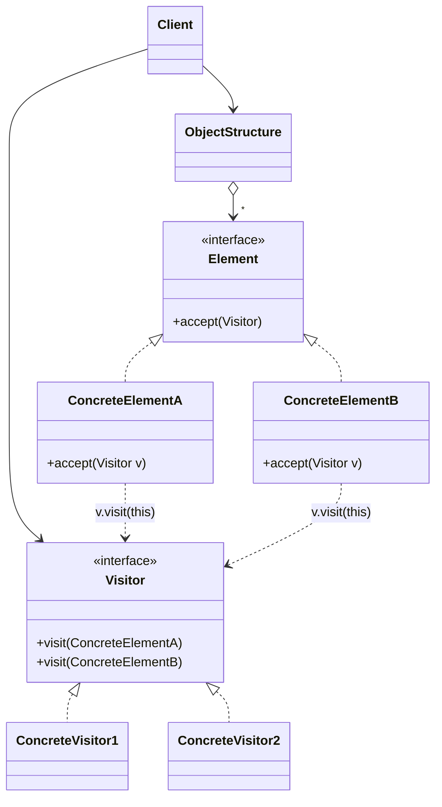

<div align="center">

# 🧳 Visitor Design Pattern

   

*Add new operations to a set of classes without modifying them.*

</div>

---

## 📑 Table of contents

- [🎯 Intent](#-intent)
- [🧩 The problem & the solution](#-the-problem--the-solution)
- [🔷 Structure](#-structure)
- [👥 Participants](#-participants)
- [🧭 When to use it](#-when-to-use-it)
- [📊 Pros & cons](#-pros--cons)
- [🌍 Real-world examples](#-real-world-examples)
- [💻 Code](#-code)
  - [1. ❌ Problem - every operation lives inside every class](#ex1)
  - [2. ✅ Solution 1 - Shopping cart visitors](#ex2)
  - [3. ✅ Solution 2 - File system visitors](#ex3)

---

## 🎯 Intent

> Represent an operation to be performed on the elements of an object structure. Visitor lets you **define a new operation without changing the classes** of the elements it works on.

## 🧩 The problem & the solution

| 😣 Problem | 💡 Solution |
|---|---|
| A shopping cart holds `Book`, `Fruit` and `Electronics`. Tax, shipping, JSON export, discounts... each new operation means opening **every** item class and adding another method, mixing business rules into model classes and breaking Open/Closed. | Move each operation into its own **visitor** class with one `visit()` method per element type. Items only get a tiny `accept(visitor)` method, once. New operation = new visitor class, and none of the item classes change. |

## 🔷 Structure



## 👥 Participants

| Role | Responsibility | In this repo |
|---|---|---|
| **Visitor** | Declares a `visit()` method for every concrete element type | `ItemVisitor`, `FileSystemVisitor` |
| **Concrete Visitor** | One operation implemented for all element types, can keep state while traversing | `TaxVisitor`, `ShippingVisitor`, `JsonExportVisitor`, `SizeCalculatorVisitor`, `CountVisitor`, `ExtensionSearchVisitor` |
| **Element** | Declares `accept(Visitor)` | `Item`, `FileSystemElement` |
| **Concrete Element** | Implements `accept()` by calling `visitor.visit(this)` | `Book`, `Fruit`, `Electronics`, `File`, `Directory` |
| **Object Structure** | Collection or tree that lets visitors walk the elements | `List<Item>` cart, `Directory` |
| **Client** | Creates visitors and applies them to the structure | `Main` |

## 🧭 When to use it

| ✅ Use it when | ⚠️ Avoid it when |
|---|---|
| The structure has many **different element classes** and you need many **unrelated operations** on them | Element classes change often: every new element type forces a change in **every** visitor |
| The element classes are **stable**, but new operations are added often | There is only one or two operations (a plain method is simpler) |
| You want related logic in one class instead of scattered across all elements | Elements cannot expose enough state for the visitor without breaking encapsulation |
| An operation must collect results across a whole structure (totals, reports, exports) |  |

## 📊 Pros & cons

| 👍 Pros | 👎 Cons |
|---|---|
| Open/Closed: add operations without touching element classes | Adding a new element class means updating all visitors |
| Single Responsibility: one operation per visitor class | Elements must expose their data to visitors |
| Visitors can accumulate state while walking the structure | Double dispatch is less intuitive for beginners |
| Works across elements that share no common base behaviour |  |

## 🌍 Real-world examples

- `java.nio.file.FileVisitor` with `Files.walkFileTree()`
- `javax.lang.model.element.ElementVisitor` (annotation processing)
- Compilers: AST visitors (ANTLR, Eclipse JDT) for type-checking, code generation, linting
- Tax / export / reporting modules over a fixed domain model

---

## 💻 Code

This folder has **3 examples** (21 Java files). Interfaces and abstract classes come first, the class with `main` comes last.

<a id="ex1"></a>

### 1. ❌ Problem - every operation lives inside every class

> `Book`, `Fruit` and `Electronics` each carry `getTax()` and `getShippingCost()`. A new operation (like JSON export) forces edits in all three, and they share no common type.

> ### 🔍 What are `accept()` and `visit()` doing? (double dispatch)
>
> Java chooses an overloaded method using the **compile-time type** of the argument. In `visitor.visit(item)` where `item` is typed `Item`, Java cannot pick `visit(Book)` or `visit(Fruit)`, so this does not compile.
>
> The trick is two calls:
> 1. `item.accept(visitor)` - resolved at runtime to the real element (`Book.accept`)
> 2. inside it, `visitor.visit(this)` - here `this` is statically a `Book`, so `visit(Book)` is chosen
>
> The method that runs depends on **both** the element type and the visitor type, hence *double dispatch*.

<details open>
<summary><b>📁 Files in this example</b></summary>

```text
Problem/
├── Book.java
├── Electronics.java
├── Fruit.java
└── Main.java
```

</details>

#### 📄 `Book.java`

<sub>class · 18 lines</sub>

```java
public class Book {
    private String name;
    private double price;

    public Book(String name, double price) {
        this.name = name;
        this.price = price;
    }

    public String getName() { return name; }
    public double getPrice() { return price; }

    // operation 1 lives inside the class
    public double getTax() { return price * 0.05; }

    // operation 2 lives inside the class
    public double getShippingCost() { return 40; }
}
```

#### 📄 `Electronics.java`

<sub>class · 19 lines</sub>

```java
public class Electronics {
    private String name;
    private double price;
    private int warrantyInYears;

    public Electronics(String name, double price, int warrantyInYears) {
        this.name = name;
        this.price = price;
        this.warrantyInYears = warrantyInYears;
    }

    public String getName() { return name; }
    public double getPrice() { return price; }
    public int getWarrantyInYears() { return warrantyInYears; }

    public double getTax() { return price * 0.18; }

    public double getShippingCost() { return 150; }
}
```

#### 📄 `Fruit.java`

<sub>class · 18 lines</sub>

```java
public class Fruit {
    private String name;
    private double pricePerKg;
    private double weightInKg;

    public Fruit(String name, double pricePerKg, double weightInKg) {
        this.name = name;
        this.pricePerKg = pricePerKg;
        this.weightInKg = weightInKg;
    }

    public String getName() { return name; }
    public double getPrice() { return pricePerKg * weightInKg; }

    public double getTax() { return 0; }

    public double getShippingCost() { return 10 * weightInKg; }
}
```

#### 📄 `Main.java`

<sub>class · 17 lines</sub>

```java
public class Main {
    public static void main(String[] args) {

        Book book = new Book("Clean Code", 500);
        Fruit fruit = new Fruit("Apple", 120, 2);
        Electronics phone = new Electronics("Phone", 20000, 2);

        // The cart holds 3 DIFFERENT classes, so we cannot even keep them in one List<Item>
        // without a common interface, and every new operation (JSON export, discount, insurance...)
        // means opening Book, Fruit and Electronics again and editing all of them.
        double tax = book.getTax() + fruit.getTax() + phone.getTax();
        double shipping = book.getShippingCost() + fruit.getShippingCost() + phone.getShippingCost();

        System.out.println("Total tax      : " + tax);
        System.out.println("Total shipping : " + shipping);
    }
}
```

<details>
<summary><b>▶️ How to compile and run this example</b></summary>

```bash
# run from the repository root
mkdir -p out
find "Behavioural Design Pattern/12. Visitor Design Pattern/Problem" -name "*.java" -print0 | xargs -0 javac -d out
java -cp out Main
```

</details>

---

<a id="ex2"></a>

### 2. ✅ Solution 1 - Shopping cart visitors

> Items only implement `accept()`. `TaxVisitor`, `ShippingVisitor` and `JsonExportVisitor` hold the operations; `JsonExportVisitor` was added later without touching any item.

<details open>
<summary><b>📁 Files in this example</b></summary>

```text
Solution1 Shopping Cart/
├── Book.java
├── Electronics.java
├── Fruit.java
├── Item.java
├── ItemVisitor.java
├── JsonExportVisitor.java
├── Main.java
├── ShippingVisitor.java
└── TaxVisitor.java
```

</details>

#### 📄 `Item.java`

<sub>interface · 4 lines</sub>

```java
// Element: every item of the cart can accept a visitor
public interface Item {
    void accept(ItemVisitor visitor);
}
```

#### 📄 `ItemVisitor.java`

<sub>interface · 6 lines</sub>

```java
// Visitor: one visit() method for every concrete element type
public interface ItemVisitor {
    void visit(Book book);
    void visit(Fruit fruit);
    void visit(Electronics electronics);
}
```

#### 📄 `Book.java`

<sub>class · 17 lines</sub>

```java
public class Book implements Item {
    private String name;
    private double price;

    public Book(String name, double price) {
        this.name = name;
        this.price = price;
    }

    public String getName() { return name; }
    public double getPrice() { return price; }

    @Override
    public void accept(ItemVisitor visitor) {
        visitor.visit(this);   // 'this' is a Book here, so visit(Book) is chosen (double dispatch)
    }
}
```

#### 📄 `Electronics.java`

<sub>class · 20 lines</sub>

```java
public class Electronics implements Item {
    private String name;
    private double price;
    private int warrantyInYears;

    public Electronics(String name, double price, int warrantyInYears) {
        this.name = name;
        this.price = price;
        this.warrantyInYears = warrantyInYears;
    }

    public String getName() { return name; }
    public double getPrice() { return price; }
    public int getWarrantyInYears() { return warrantyInYears; }

    @Override
    public void accept(ItemVisitor visitor) {
        visitor.visit(this);   // 'this' is Electronics here, so visit(Electronics) is chosen
    }
}
```

#### 📄 `Fruit.java`

<sub>class · 20 lines</sub>

```java
public class Fruit implements Item {
    private String name;
    private double pricePerKg;
    private double weightInKg;

    public Fruit(String name, double pricePerKg, double weightInKg) {
        this.name = name;
        this.pricePerKg = pricePerKg;
        this.weightInKg = weightInKg;
    }

    public String getName() { return name; }
    public double getPricePerKg() { return pricePerKg; }
    public double getWeightInKg() { return weightInKg; }

    @Override
    public void accept(ItemVisitor visitor) {
        visitor.visit(this);   // 'this' is a Fruit here, so visit(Fruit) is chosen
    }
}
```

#### 📄 `JsonExportVisitor.java`

<sub>class · 28 lines</sub>

```java
// Concrete Visitor 3: added LATER without touching Book, Fruit or Electronics (Open/Closed)
public class JsonExportVisitor implements ItemVisitor {
    private StringBuilder json = new StringBuilder();

    @Override
    public void visit(Book book) {
        append("{\"type\":\"book\",\"name\":\"" + book.getName() + "\",\"price\":" + book.getPrice() + "}");
    }

    @Override
    public void visit(Fruit fruit) {
        append("{\"type\":\"fruit\",\"name\":\"" + fruit.getName() + "\",\"weightInKg\":" + fruit.getWeightInKg() + "}");
    }

    @Override
    public void visit(Electronics electronics) {
        append("{\"type\":\"electronics\",\"name\":\"" + electronics.getName() + "\",\"warrantyInYears\":" + electronics.getWarrantyInYears() + "}");
    }

    private void append(String element) {
        if (json.length() > 0) {
            json.append(",");
        }
        json.append(element);
    }

    public String getJson() { return "[" + json + "]"; }
}
```

#### 📄 `ShippingVisitor.java`

<sub>class · 21 lines</sub>

```java
// Concrete Visitor 2: shipping rules for every item type
public class ShippingVisitor implements ItemVisitor {
    private double totalShipping = 0;

    @Override
    public void visit(Book book) {
        totalShipping += 40;
    }

    @Override
    public void visit(Fruit fruit) {
        totalShipping += 10 * fruit.getWeightInKg();
    }

    @Override
    public void visit(Electronics electronics) {
        totalShipping += 150;
    }

    public double getTotalShipping() { return totalShipping; }
}
```

#### 📄 `TaxVisitor.java`

<sub>class · 21 lines</sub>

```java
// Concrete Visitor 1: tax rules for every item type, kept in ONE place
public class TaxVisitor implements ItemVisitor {
    private double totalTax = 0;

    @Override
    public void visit(Book book) {
        totalTax += book.getPrice() * 0.05;
    }

    @Override
    public void visit(Fruit fruit) {
        totalTax += 0;   // fruits are tax free
    }

    @Override
    public void visit(Electronics electronics) {
        totalTax += electronics.getPrice() * 0.18;
    }

    public double getTotalTax() { return totalTax; }
}
```

#### 📄 `Main.java`

<sub>class · 27 lines</sub>

```java
import java.util.ArrayList;
import java.util.List;

public class Main {
    public static void main(String[] args) {

        // Object structure: one list holding different element types
        List<Item> cart = new ArrayList<>();
        cart.add(new Book("Clean Code", 500));
        cart.add(new Fruit("Apple", 120, 2));
        cart.add(new Electronics("Phone", 20000, 2));

        TaxVisitor taxVisitor = new TaxVisitor();
        ShippingVisitor shippingVisitor = new ShippingVisitor();
        JsonExportVisitor jsonVisitor = new JsonExportVisitor();

        for (Item item : cart) {
            item.accept(taxVisitor);
            item.accept(shippingVisitor);
            item.accept(jsonVisitor);
        }

        System.out.println("Total tax      : " + taxVisitor.getTotalTax());
        System.out.println("Total shipping : " + shippingVisitor.getTotalShipping());
        System.out.println("JSON           : " + jsonVisitor.getJson());
    }
}
```

<details>
<summary><b>▶️ How to compile and run this example</b></summary>

```bash
# run from the repository root
mkdir -p out
find "Behavioural Design Pattern/12. Visitor Design Pattern/Solution1 Shopping Cart" -name "*.java" -print0 | xargs -0 javac -d out
java -cp out Main
```

</details>

---

<a id="ex3"></a>

### 3. ✅ Solution 2 - File system visitors

> `File` and `Directory` accept visitors, and `Directory` walks its children. `SizeCalculatorVisitor`, `CountVisitor` and `ExtensionSearchVisitor` each run over the whole tree.

<details open>
<summary><b>📁 Files in this example</b></summary>

```text
Solution2 File System/
├── CountVisitor.java
├── Directory.java
├── ExtensionSearchVisitor.java
├── File.java
├── FileSystemElement.java
├── FileSystemVisitor.java
├── Main.java
└── SizeCalculatorVisitor.java
```

</details>

#### 📄 `FileSystemElement.java`

<sub>interface · 3 lines</sub>

```java
public interface FileSystemElement {
    void accept(FileSystemVisitor visitor);
}
```

#### 📄 `FileSystemVisitor.java`

<sub>interface · 4 lines</sub>

```java
public interface FileSystemVisitor {
    void visit(File file);
    void visit(Directory directory);
}
```

#### 📄 `CountVisitor.java`

<sub>class · 14 lines</sub>

```java
// Counts files and directories
public class CountVisitor implements FileSystemVisitor {
    private int files = 0;
    private int directories = 0;

    @Override
    public void visit(File file) { files++; }

    @Override
    public void visit(Directory directory) { directories++; }

    public int getFiles() { return files; }
    public int getDirectories() { return directories; }
}
```

#### 📄 `Directory.java`

<sub>class · 26 lines</sub>

```java
import java.util.ArrayList;
import java.util.List;

public class Directory implements FileSystemElement {
    private String name;
    private List<FileSystemElement> children = new ArrayList<>();

    public Directory(String name) {
        this.name = name;
    }

    public String getName() { return name; }

    public void add(FileSystemElement element) {
        children.add(element);
    }

    @Override
    public void accept(FileSystemVisitor visitor) {
        visitor.visit(this);
        // the structure (not the visitor) knows how to walk its children
        for (FileSystemElement child : children) {
            child.accept(visitor);
        }
    }
}
```

#### 📄 `ExtensionSearchVisitor.java`

<sub>class · 24 lines</sub>

```java
import java.util.ArrayList;
import java.util.List;

// Collects the names of all files that end with a given extension
public class ExtensionSearchVisitor implements FileSystemVisitor {
    private String extension;
    private List<String> matches = new ArrayList<>();

    public ExtensionSearchVisitor(String extension) {
        this.extension = extension;
    }

    @Override
    public void visit(File file) {
        if (file.getName().endsWith(extension)) {
            matches.add(file.getName());
        }
    }

    @Override
    public void visit(Directory directory) { }

    public List<String> getMatches() { return matches; }
}
```

#### 📄 `File.java`

<sub>class · 17 lines</sub>

```java
public class File implements FileSystemElement {
    private String name;
    private long sizeInKb;

    public File(String name, long sizeInKb) {
        this.name = name;
        this.sizeInKb = sizeInKb;
    }

    public String getName() { return name; }
    public long getSizeInKb() { return sizeInKb; }

    @Override
    public void accept(FileSystemVisitor visitor) {
        visitor.visit(this);
    }
}
```

#### 📄 `SizeCalculatorVisitor.java`

<sub>class · 16 lines</sub>

```java
// Adds up the size of every file in the tree
public class SizeCalculatorVisitor implements FileSystemVisitor {
    private long totalSizeInKb = 0;

    @Override
    public void visit(File file) {
        totalSizeInKb += file.getSizeInKb();
    }

    @Override
    public void visit(Directory directory) {
        // a directory has no size of its own, its files are visited next
    }

    public long getTotalSizeInKb() { return totalSizeInKb; }
}
```

#### 📄 `Main.java`

<sub>class · 24 lines</sub>

```java
public class Main {
    public static void main(String[] args) {

        Directory root = new Directory("project");
        Directory src = new Directory("src");
        src.add(new File("Main.java", 10));
        src.add(new File("Util.java", 6));
        root.add(src);
        root.add(new File("README.md", 4));
        root.add(new File("logo.png", 120));

        SizeCalculatorVisitor size = new SizeCalculatorVisitor();
        CountVisitor count = new CountVisitor();
        ExtensionSearchVisitor javaFiles = new ExtensionSearchVisitor(".java");

        root.accept(size);
        root.accept(count);
        root.accept(javaFiles);

        System.out.println("Total size  : " + size.getTotalSizeInKb() + " KB");
        System.out.println("Files       : " + count.getFiles() + ", directories: " + count.getDirectories());
        System.out.println("Java files  : " + javaFiles.getMatches());
    }
}
```

<details>
<summary><b>▶️ How to compile and run this example</b></summary>

```bash
# run from the repository root
mkdir -p out
find "Behavioural Design Pattern/12. Visitor Design Pattern/Solution2 File System" -name "*.java" -print0 | xargs -0 javac -d out
java -cp out Main
```

</details>

---

<div align="center">

[◀ Iterator](../11.%20Iterator%20Design%20Pattern/README.md) &nbsp;·&nbsp; [📚 All patterns](../PATTERNS.md)

</div>
