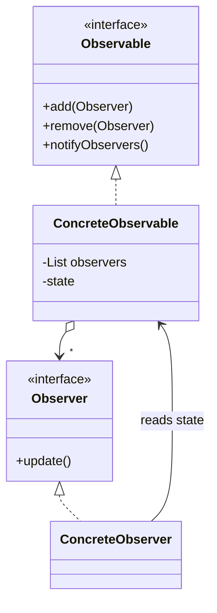

<div align="center">

# 🔔 Observer Design Pattern

   

*Notify many objects automatically when one changes.*

</div>

---

## 📑 Table of contents

- [🎯 Intent](#-intent)
- [🧩 The problem & the solution](#-the-problem--the-solution)
- [🔷 Structure](#-structure)
- [👥 Participants](#-participants)
- [🧭 When to use it](#-when-to-use-it)
- [📊 Pros & cons](#-pros--cons)
- [🌍 Real-world examples](#-real-world-examples)
- [💻 Code](#-code)
  - [1. 💡 Out-of-stock notification](#ex1)
  - [2. 💡 YouTube channel and subscribers](#ex2)

---

## 🎯 Intent

> Define a **one-to-many dependency** so that when one object changes state, all its dependents are notified and updated.

## 🧩 The problem & the solution

| 😣 Problem | 💡 Solution |
|---|---|
| Customers want to know when an out-of-stock product is back, and subscribers want to know when a channel uploads. Polling is wasteful; hard-wiring each listener is rigid. | The observable keeps a list of observers and calls `update()` on every one when its state changes. Observers subscribe and unsubscribe freely. |

## 🔷 Structure



## 👥 Participants

| Role | Responsibility | In this repo |
|---|---|---|
| **Subject / Observable** | Keeps observers and notifies them | `Product` / `Iphone`, `YoutubeChannel` / `Channel` |
| **Observer** | Interface with an update callback (`updated()` / `Notified()`) | `Customer`, `Observer` |
| **Concrete Observers** | React to the change | `EmailAlertObserverImpl`, `MobileAlertObserverImpl`, `Subscriber` |

## 🧭 When to use it

| ✅ Use it when | ⚠️ Avoid it when |
|---|---|
| A change in one object must update others and you do not know how many | Notification order matters and must be guaranteed |
| Event handling and publish/subscribe | There are very few, fixed dependents |

## 📊 Pros & cons

| 👍 Pros | 👎 Cons |
|---|---|
| Loose coupling between subject and observers | Observers are notified in unpredictable order |
| Add observers without changing the subject | Memory leaks if observers never unsubscribe |
| Supports broadcast |  |

## 🌍 Real-world examples

- Java `PropertyChangeListener`, Swing listeners
- Event buses, message brokers, RxJava
- YouTube subscriptions, stock alerts

---

## 💻 Code

This folder has **2 examples** (11 Java files). Interfaces and abstract classes come first, the class with `main` comes last.

<a id="ex1"></a>

### 1. 💡 Out-of-stock notification

> `Iphone` notifies `EmailAlertObserverImpl` and `MobileAlertObserverImpl` customers when stock returns.

<details open>
<summary><b>📁 Files in this example</b></summary>

```text
productoutofstock/
├── Observable/
│   ├── Iphone.java
│   └── Product.java
├── Observer/
│   ├── Customer.java
│   ├── EmailAlertObserverImpl.java
│   └── MobileAlertObserverImpl.java
└── Stock.java
```

</details>

#### 📄 `Observable/Product.java`

<sub>interface · 15 lines</sub>

```java
package com.productoutofstock.Observable;

import com.productoutofstock.Observer.Customer;

public interface Product {

    void add(Customer observer);
    void remove(Customer observer);
    void notifyCustomer();

    void setStockCount(int newStockAdded);

    public int getStockCount();

}
```

#### 📄 `Observer/Customer.java`

<sub>interface · 6 lines</sub>

```java
package com.productoutofstock.Observer;

public interface Customer {
    void updated();

}
```

#### 📄 `Observable/Iphone.java`

<sub>class · 38 lines</sub>

```java
package com.productoutofstock.Observable;
import com.productoutofstock.Observer.Customer;
import java.util.ArrayList;
import java.util.List;
public class Iphone implements Product {
    List<Customer> customers = new ArrayList<>();
    private int iphoneInStock=0;
    @Override
    public void add(Customer observer) {
        //System.out.println("customer is opted to be notified");
        customers.add(observer);
    }
    @Override
    public void remove(Customer observer) {
        System.out.println("customer is opted out from being notified");
        customers.remove(observer);
    }

    @Override
    public void notifyCustomer() {
        for (Customer observer : customers) {
            observer.updated();
        }
    }

    @Override
    public void setStockCount(int newStockAdded) {
        if(iphoneInStock==0){
            notifyCustomer();
        }
        iphoneInStock=iphoneInStock+newStockAdded;
    }

    @Override
    public int getStockCount() {
        return iphoneInStock;
    }
}
```

#### 📄 `Observer/EmailAlertObserverImpl.java`

<sub>class · 20 lines</sub>

```java
package com.productoutofstock.Observer;

import com.productoutofstock.Observable.Product;
public class EmailAlertObserverImpl implements Customer{
    String emailId;
    Product observable;
    public EmailAlertObserverImpl(String emailId,Product observable){
        this.emailId=emailId;
        this.observable=observable;
    }
    @Override
    public void updated() {
        sendEmail(emailId,"Product is in stock Hurry Up!");
    }

    public void sendEmail(String emailId,String message){
        System.out.println("Mail Sent to:" +emailId);
        //send the Actual mail to the User
    }
}
```

#### 📄 `Observer/MobileAlertObserverImpl.java`

<sub>class · 19 lines</sub>

```java
package com.productoutofstock.Observer;
import com.productoutofstock.Observable.Product;
public class MobileAlertObserverImpl implements Customer {
    String userName;
    Product observable;
   public MobileAlertObserverImpl(String userName,Product observable){
       this.userName=userName;
       this.observable=observable;
   }
    @Override
    public void updated() {
       sendMsgOnMobile(userName,"Product is in stock Hurry Up!");
   }
    public void sendMsgOnMobile(String userName,String message){
            System.out.println("Message Sent to:" +userName);
            //send the Actual mail to the User

    }
}
```

#### 📄 `Stock.java`

<sub>class · 22 lines</sub>

```java
package com.productoutofstock;

import com.productoutofstock.Observable.Iphone;
import com.productoutofstock.Observable.Product;
import com.productoutofstock.Observer.Customer;
import com.productoutofstock.Observer.EmailAlertObserverImpl;
public class Stock {
    public static void main(String[] args) {
        Product iphone=new Iphone();

        Customer customer1=new EmailAlertObserverImpl("pavan@gmail.com",iphone);
        Customer customer2=new EmailAlertObserverImpl("shivam@gmail.com",iphone);
        Customer customer3=new EmailAlertObserverImpl("shivam Kumar",iphone);

        iphone.add(customer1);
        iphone.add(customer2);
        iphone.add(customer3);

        iphone.setStockCount(10);
    }

}
```

<details>
<summary><b>▶️ How to compile and run this example</b></summary>

```bash
# run from the repository root
mkdir -p out
find "Behavioural Design Pattern/2. Observer Design Pattern/productoutofstock" -name "*.java" -print0 | xargs -0 javac -d out
java -cp out com.productoutofstock.Stock
```

</details>

---

<a id="ex2"></a>

### 2. 💡 YouTube channel and subscribers

> `Channel` notifies every `Subscriber` when a video is uploaded.

<details open>
<summary><b>📁 Files in this example</b></summary>

```text
youtubeandsubscriber/
├── Observable/
│   ├── Channel.java
│   └── YoutubeChannel.java
├── Observer/
│   ├── Observer.java
│   └── Subscriber.java
└── Main.java
```

</details>

#### 📄 `Observable/YoutubeChannel.java`

<sub>interface · 13 lines</sub>

```java
package com.youtubeandsubscriber.Observable;

import com.youtubeandsubscriber.Observer.Observer;

public interface YoutubeChannel {

    void subscribe(Observer sub);
    void unSubscribe(Observer sub);
    void notifySubscriber(String reason);


}
```

#### 📄 `Observer/Observer.java`

<sub>interface · 7 lines</sub>

```java
package com.youtubeandsubscriber.Observer;

public interface Observer {

    void Notified(String reason,String channelName);

}
```

#### 📄 `Observable/Channel.java`

<sub>class · 38 lines</sub>

```java
package com.youtubeandsubscriber.Observable;

import com.youtubeandsubscriber.Observer.Observer;

import java.util.ArrayList;
import java.util.List;

public class Channel implements YoutubeChannel {
    String name;
    public Channel(String name) {
        this.name=name;
    }
    List<Observer> subscribers=new ArrayList<>();

    @Override
    public void subscribe(Observer sub) {
    subscribers.add(sub);
    System.out.println("subscriber subscribed to "+name+" channel...! ");

    }

    @Override
    public void unSubscribe(Observer sub) {
        subscribers.remove(sub);
        System.out.println("subscriber UnSubscribed from "+ name+"...! ");
    }

    @Override
    public void notifySubscriber(String reason) {
        for(Observer sub: subscribers) {
            sub.Notified(reason,this.name);
        }

    }


}
```

#### 📄 `Observer/Subscriber.java`

<sub>class · 24 lines</sub>

```java
package com.youtubeandsubscriber.Observer;

import com.youtubeandsubscriber.Observer.Observer;

public class Subscriber implements Observer {

    String name;


    public String getName() {
        return name;
    }
    public Subscriber(String name) {
        this.name=name;
    }
    @Override
    public void Notified(String reason,String channelName) {
        System.out.println("from "+channelName+" : -->  Hey "+this.name+" "+reason);

    }


}
```

#### 📄 `Main.java`

<sub>class · 28 lines</sub>

```java
package com.youtubeandsubscriber;

import com.youtubeandsubscriber.Observable.Channel;
import com.youtubeandsubscriber.Observable.YoutubeChannel;
import com.youtubeandsubscriber.Observer.Observer;
import com.youtubeandsubscriber.Observer.Subscriber;

public class Main {
public static void main(String[] args) {
    YoutubeChannel channel1=new Channel("learn java programming");
    Observer sub1= new Subscriber("pavan");
    Observer sub2= new Subscriber("kavan");
    channel1.subscribe(sub1);
    channel1.subscribe(sub2);
    //yt.unSubscribe(sub1);
    channel1.notifySubscriber("reached 10k subs");

    Observer sub3= new Subscriber("kavannn");
    channel1.subscribe(sub3);
    channel1.unSubscribe(sub2);
    channel1.notifySubscriber("new video uploaded");
    YoutubeChannel channel2 = new Channel("leran design patterns");
    channel2.subscribe(sub2);
    channel2.notifySubscriber("one year anniversary");
    channel2.subscribe(sub3);
    channel2.notifySubscriber("new short released");
}
}
```

<details>
<summary><b>▶️ How to compile and run this example</b></summary>

```bash
# run from the repository root
mkdir -p out
find "Behavioural Design Pattern/2. Observer Design Pattern/youtubeandsubscriber" -name "*.java" -print0 | xargs -0 javac -d out
java -cp out com.youtubeandsubscriber.Main
```

</details>

---

<div align="center">

[◀ Strategy](../1.%20Strategy%20Design%20Pattern/README.md) &nbsp;·&nbsp; [📚 All patterns](../PATTERNS.md) &nbsp;·&nbsp; [State ▶](../3.%20State%20Design%20Pattern/README.md)

</div>
