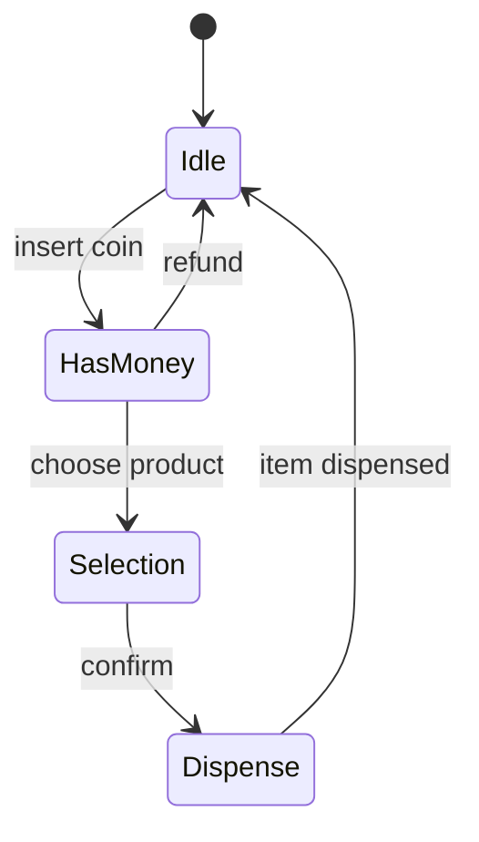

<div align="center">

# 🚦 State Design Pattern

   

*Let an object change behaviour when its state changes.*

</div>

---

## 📑 Table of contents

- [🎯 Intent](#-intent)
- [🧩 The problem & the solution](#-the-problem--the-solution)
- [🔷 Structure](#-structure)
- [👥 Participants](#-participants)
- [🧭 When to use it](#-when-to-use-it)
- [📊 Pros & cons](#-pros--cons)
- [🌍 Real-world examples](#-real-world-examples)
- [💻 Code](#-code)
  - [1. Implementation](#ex1)

---

## 🎯 Intent

> Allow an object to **alter its behaviour when its internal state changes**; it will appear to change its class.

## 🧩 The problem & the solution

| 😣 Problem | 💡 Solution |
|---|---|
| A vending machine behaves differently when idle, after inserting coins, while choosing, and while dispensing. One giant class with `if (state == ...)` in every method is hard to read and extend. | Each state is its own class (`IdleState`, `HasMoneyState`, `SelectionState`, `DispenseState`) implementing `State`. The `VendingMachine` delegates every action to its current state, which also decides the next state. |

## 🔷 Structure



## 👥 Participants

| Role | Responsibility | In this repo |
|---|---|---|
| **Context** | Holds the current state and delegates | `VendingMachine` |
| **State** | Interface for state-specific behaviour | `State` |
| **Concrete States** | One class per state | `IdleState`, `HasMoneyState`, `SelectionState`, `DispenseState` |
| **Supporting model** | Domain objects | `Inventory`, `Item`, `ItemShelf`, `ItemType`, `Coin` |

## 🧭 When to use it

| ✅ Use it when | ⚠️ Avoid it when |
|---|---|
| Behaviour depends on state and there are many states | Only two or three simple states |
| Big conditionals on state are spreading across methods | States rarely change |

## 📊 Pros & cons

| 👍 Pros | 👎 Cons |
|---|---|
| State-specific code is isolated | Many small classes |
| New states are easy to add | Overkill for simple state machines |
| No giant conditionals |  |

## 🌍 Real-world examples

- Vending machines, ATMs, elevators
- TCP connection states
- Order lifecycle (placed - shipped - delivered)

---

## 💻 Code

This folder has **1 example** (12 Java files). Interfaces and abstract classes come first, the class with `main` comes last.

<a id="ex1"></a>

### 1. Implementation

<details open>
<summary><b>📁 Files in this example</b></summary>

```text
3. State Design Pattern/
├── VendingStates/
│   ├── impl/
│   │   ├── DispenseState.java
│   │   ├── HasMoneyState.java
│   │   ├── IdleState.java
│   │   └── SelectionState.java
│   └── State.java
├── Coin.java
├── Inventory.java
├── Item.java
├── ItemShelf.java
├── ItemType.java
├── Main.java
└── VendingMachine.java
```

</details>

#### 📄 `Coin.java`

<sub>enum · 15 lines</sub>

```java
package LowLevelDesign.DesignVendingMachine;

public enum Coin {

    PENNY(1),
    NICKEL(5),
    DIME(10),
    QUARTER(25);

    public int value;

    Coin(int value) {
        this.value = value;
    }
}
```

#### 📄 `ItemType.java`

<sub>enum · 9 lines</sub>

```java
package LowLevelDesign.DesignVendingMachine;

public enum ItemType {

    COKE,
    PEPSI,
    JUICE,
    SODA;
}
```

#### 📄 `VendingStates/State.java`

<sub>interface · 28 lines</sub>

```java
package LowLevelDesign.DesignVendingMachine.VendingStates;

import LowLevelDesign.DesignVendingMachine.Coin;
import LowLevelDesign.DesignVendingMachine.Item;
import LowLevelDesign.DesignVendingMachine.VendingMachine;

import java.util.List;

public interface State {

    public void clickOnInsertCoinButton(VendingMachine machine) throws Exception;

    public void clickOnStartProductSelectionButton(VendingMachine machine) throws Exception;

    public void insertCoin(VendingMachine machine , Coin coin) throws Exception;

    public void chooseProduct(VendingMachine machine, int codeNumber) throws Exception;

    public int getChange(int returnChangeMoney) throws Exception;

    public Item dispenseProduct(VendingMachine machine, int codeNumber) throws Exception;

    public List<Coin> refundFullMoney(VendingMachine machine) throws Exception;

    public void updateInventory(VendingMachine machine, Item item, int codeNumber) throws Exception;


}
```

#### 📄 `Inventory.java`

<sub>class · 67 lines</sub>

```java
package LowLevelDesign.DesignVendingMachine;

public class Inventory {

    ItemShelf[] inventory = null;

    Inventory(int itemCount) {
        inventory = new ItemShelf[itemCount];
        initialEmptyInventory();
    }

    public ItemShelf[] getInventory() {
        return inventory;
    }

    public void setInventory(ItemShelf[] inventory) {
        this.inventory = inventory;
    }

    public void initialEmptyInventory() {
        int startCode = 101;
        for (int i = 0; i < inventory.length; i++) {
            ItemShelf space = new ItemShelf();
            space.setCode(startCode);
            space.setSoldOut(true);
            inventory[i]= space;
            startCode++;
        }
    }

    public void addItem(Item item, int codeNumber) throws Exception {

        for (ItemShelf itemShelf : inventory) {
            if (itemShelf.code == codeNumber) {
                if (itemShelf.isSoldOut()) {
                    itemShelf.item = item;
                    itemShelf.setSoldOut(false);
                } else {
                    throw new Exception("already item is present, you can not add item here");
                }
            }
        }
    }

    public Item getItem(int codeNumber) throws Exception {

        for (ItemShelf itemShelf : inventory) {
            if (itemShelf.code == codeNumber) {
                if (itemShelf.isSoldOut()) {
                    throw new Exception("item already sold out");
                } else {

                    return itemShelf.item;
                }
            }
        }
        throw new Exception("Invalid Code");
    }

    public void updateSoldOutItem(int codeNumber){
        for (ItemShelf itemShelf : inventory) {
            if (itemShelf.code == codeNumber) {
                itemShelf.setSoldOut(true);
            }
        }
    }
}
```

#### 📄 `Item.java`

<sub>class · 22 lines</sub>

```java
package LowLevelDesign.DesignVendingMachine;

public class Item {
    ItemType type;
    int price;

    public ItemType getType() {
        return type;
    }

    public void setType(ItemType type) {
        this.type = type;
    }

    public int getPrice() {
        return price;
    }

    public void setPrice(int price) {
        this.price = price;
    }
}
```

#### 📄 `ItemShelf.java`

<sub>class · 34 lines</sub>

```java
package LowLevelDesign.DesignVendingMachine;

import LowLevelDesign.DesignVendingMachine.Item;

public class ItemShelf {

    int code;
    Item item;
    boolean soldOut;

    public int getCode() {
        return code;
    }

    public void setCode(int code) {
        this.code = code;
    }

    public Item getItem() {
        return item;
    }

    public void setItem(Item item) {
        this.item = item;
    }

    public boolean isSoldOut() {
        return soldOut;
    }

    public void setSoldOut(boolean soldOut) {
        this.soldOut = soldOut;
    }
}
```

#### 📄 `VendingMachine.java`

<sub>class · 44 lines</sub>

```java
package LowLevelDesign.DesignVendingMachine;

import LowLevelDesign.DesignVendingMachine.VendingStates.State;
import LowLevelDesign.DesignVendingMachine.VendingStates.impl.IdleState;

import java.util.ArrayList;
import java.util.List;

public class VendingMachine {

    private State vendingMachineState;
    private Inventory inventory;
    private List<Coin> coinList;

    public VendingMachine(){
        vendingMachineState = new IdleState();
        inventory = new Inventory(10);
        coinList = new ArrayList<>();
    }

    public State getVendingMachineState() {
        return vendingMachineState;
    }

    public void setVendingMachineState(State vendingMachineState) {
        this.vendingMachineState = vendingMachineState;
    }

    public Inventory getInventory() {
        return inventory;
    }

    public void setInventory(Inventory inventory) {
        this.inventory = inventory;
    }

    public List<Coin> getCoinList() {
        return coinList;
    }

    public void setCoinList(List<Coin> coinList) {
        this.coinList = coinList;
    }
}
```

#### 📄 `VendingStates/impl/DispenseState.java`

<sub>class · 62 lines</sub>

```java
package LowLevelDesign.DesignVendingMachine.VendingStates.impl;

import LowLevelDesign.DesignVendingMachine.Coin;
import LowLevelDesign.DesignVendingMachine.Item;
import LowLevelDesign.DesignVendingMachine.VendingMachine;
import LowLevelDesign.DesignVendingMachine.VendingStates.State;

import java.util.List;

public class DispenseState implements State {

    DispenseState(VendingMachine machine, int codeNumber) throws Exception{

        System.out.println("Currently Vending machine is in DispenseState");
        dispenseProduct(machine, codeNumber);
    }

    @Override
    public void clickOnInsertCoinButton(VendingMachine machine) throws Exception{
        throw new Exception("insert coin button can not clicked on Dispense state");
    }

    @Override
    public void clickOnStartProductSelectionButton(VendingMachine machine) throws Exception {
        throw new Exception("product selection buttion can not be clicked in Dispense state");

    }

    @Override
    public void insertCoin(VendingMachine machine, Coin coin) throws Exception{
        throw new Exception("coin can not be inserted in Dispense state");
    }

    @Override
    public void chooseProduct(VendingMachine machine, int codeNumber) throws Exception{
        throw new Exception("product can not be choosen in Dispense state");
    }

    @Override
    public int getChange(int returnChangeMoney) throws Exception{
        throw new Exception("change can not returned in Dispense state");
    }

    @Override
    public List<Coin> refundFullMoney(VendingMachine machine) throws Exception{
        throw new Exception("refund can not be happen in Dispense state");
    }

    @Override
    public Item dispenseProduct(VendingMachine machine, int codeNumber) throws Exception{
        System.out.println("Product has been dispensed");
        Item item = machine.getInventory().getItem(codeNumber);
        machine.getInventory().updateSoldOutItem(codeNumber);
        machine.setVendingMachineState(new IdleState(machine));
        return item;
    }

    @Override
    public void updateInventory(VendingMachine machine, Item item, int codeNumber) throws Exception {
        throw new Exception("inventory can not be updated in Dispense state");
    }
}
```

#### 📄 `VendingStates/impl/HasMoneyState.java`

<sub>class · 59 lines</sub>

```java
package LowLevelDesign.DesignVendingMachine.VendingStates.impl;

import LowLevelDesign.DesignVendingMachine.Coin;
import LowLevelDesign.DesignVendingMachine.Item;
import LowLevelDesign.DesignVendingMachine.VendingMachine;
import LowLevelDesign.DesignVendingMachine.VendingStates.State;
import LowLevelDesign.DesignVendingMachine.VendingMachine;

import java.util.List;

public class HasMoneyState implements State {

    public HasMoneyState(){
        System.out.println("Currently Vending machine is in HasMoneyState");
    }

    @Override
    public void clickOnInsertCoinButton(VendingMachine machine) throws Exception {
        return;
    }

    @Override
    public void clickOnStartProductSelectionButton(VendingMachine machine) throws Exception {
        machine.setVendingMachineState(new SelectionState());
    }

    @Override
    public void insertCoin(VendingMachine machine, Coin coin) throws Exception {
        System.out.println("Accepted the coin");
        machine.getCoinList().add(coin);
    }

    @Override
    public void chooseProduct(VendingMachine machine, int codeNumber) throws Exception {
        throw new Exception("you need to click on start product selection button first");
    }

    @Override
    public int getChange(int returnChangeMoney) throws Exception {
        throw new Exception("you can not get change in hasMoney state");
    }

    @Override
    public Item dispenseProduct(VendingMachine machine, int codeNumber) throws Exception {
        throw new Exception("product can not be dispensed in hasMoney state");
    }

    @Override
    public List<Coin> refundFullMoney(VendingMachine machine) throws Exception {
        System.out.println("Returned the full amount back in the Coin Dispense Tray");
        machine.setVendingMachineState(new IdleState(machine));
        return machine.getCoinList();
    }

    @Override
    public void updateInventory(VendingMachine machine, Item item, int codeNumber) throws Exception {
        throw new Exception("you can not update inventory in hasMoney  state");
    }
}
```

#### 📄 `VendingStates/impl/IdleState.java`

<sub>class · 62 lines</sub>

```java
package LowLevelDesign.DesignVendingMachine.VendingStates.impl;

import LowLevelDesign.DesignVendingMachine.Coin;
import LowLevelDesign.DesignVendingMachine.Item;
import LowLevelDesign.DesignVendingMachine.VendingMachine;
import LowLevelDesign.DesignVendingMachine.VendingStates.State;

import java.util.ArrayList;
import java.util.List;

public class IdleState implements State {

    public IdleState(){
        System.out.println("Currently Vending machine is in IdleState");
    }

    public IdleState(VendingMachine machine){
        System.out.println("Currently Vending machine is in IdleState");
        machine.setCoinList(new ArrayList<>());
    }

    @Override
    public void clickOnInsertCoinButton(VendingMachine machine) throws Exception{
        machine.setVendingMachineState(new HasMoneyState());
    }

    @Override
    public void clickOnStartProductSelectionButton(VendingMachine machine) throws Exception {
        throw new Exception("first you need to click on insert coin button");

    }

    @Override
    public void insertCoin(VendingMachine machine, Coin coin) throws Exception{
        throw new Exception("you can not insert Coin in idle state");
    }

    @Override
    public void chooseProduct(VendingMachine machine, int codeNumber) throws Exception{
        throw new Exception("you can not choose Product in idle state");
    }

    @Override
    public int getChange(int returnChangeMoney) throws Exception{
        throw new Exception("you can not get change in idle state");
    }

    @Override
    public List<Coin> refundFullMoney(VendingMachine machine) throws Exception{
        throw new Exception("you can not get refunded in idle state");
    }

    @Override
    public Item dispenseProduct(VendingMachine machine, int codeNumber) throws Exception{
        throw new Exception("proeduct can not be dispensed idle state");
    }

    @Override
    public void updateInventory(VendingMachine machine, Item item, int codeNumber) throws Exception {
        machine.getInventory().addItem(item, codeNumber);
    }
}
```

#### 📄 `VendingStates/impl/SelectionState.java`

<sub>class · 83 lines</sub>

```java
package LowLevelDesign.DesignVendingMachine.VendingStates.impl;

import LowLevelDesign.DesignVendingMachine.Coin;
import LowLevelDesign.DesignVendingMachine.Item;
import LowLevelDesign.DesignVendingMachine.VendingMachine;
import LowLevelDesign.DesignVendingMachine.VendingStates.State;

import java.util.List;


public class SelectionState implements State {

    public SelectionState(){
        System.out.println("Currently Vending machine is in SelectionState");
    }

    @Override
    public void clickOnInsertCoinButton(VendingMachine machine) throws Exception{
        throw new Exception("you can not click on insert coin button in Selection state");
    }

    @Override
    public void clickOnStartProductSelectionButton(VendingMachine machine) throws Exception {
        return;
    }

    @Override
    public void insertCoin(VendingMachine machine, Coin coin) throws Exception{
        throw new Exception("you can not insert Coin in selection state");
    }

    @Override
    public void chooseProduct(VendingMachine machine, int codeNumber) throws Exception{

        //1. get item of this codeNumber
        Item item = machine.getInventory().getItem(codeNumber);

        //2. total amount paid by User
        int paidByUser = 0;
        for(Coin coin : machine.getCoinList()){
            paidByUser = paidByUser + coin.value;
        }

        //3. compare product price and amount paid by user
        if(paidByUser < item.getPrice()) {
            System.out.println("Insufficient Amount, Product you selected is for price: " + item.getPrice() + " and you paid: " + paidByUser);
            refundFullMoney(machine);
            throw new Exception("insufficient amount");
        }
        else if(paidByUser >= item.getPrice()) {

            if(paidByUser > item.getPrice()) {
                getChange(paidByUser-item.getPrice());
            }
            machine.setVendingMachineState(new DispenseState(machine, codeNumber));
        }
    }

    @Override
    public int getChange(int returnExtraMoney) throws Exception{
        //actual logic should be to return COINs in the dispense tray, but for simplicity i am just returning the amount to be refunded
        System.out.println("Returned the change in the Coin Dispense Tray: " + returnExtraMoney);
        return returnExtraMoney;
    }

    @Override
    public List<Coin> refundFullMoney(VendingMachine machine) throws Exception{
        System.out.println("Returned the full amount back in the Coin Dispense Tray");
        machine.setVendingMachineState(new IdleState(machine));
        return machine.getCoinList();
    }

    @Override
    public Item dispenseProduct(VendingMachine machine, int codeNumber) throws Exception{
        throw new Exception("product can not be dispensed Selection state");
    }

    @Override
    public void updateInventory(VendingMachine machine, Item item, int codeNumber) throws Exception {
        throw new Exception("Inventory can not be updated in Selection state");
    }

}
```

#### 📄 `Main.java`

<sub>class · 83 lines</sub>

```java
package LowLevelDesign.DesignVendingMachine;

import LowLevelDesign.DesignVendingMachine.VendingStates.State;


public class Main {

    public static void main(String args[]){

        VendingMachine vendingMachine = new VendingMachine();
        try {

            System.out.println("|");
            System.out.println("filling up the inventory");
            System.out.println("|");

            fillUpInventory(vendingMachine);
            displayInventory(vendingMachine);

            System.out.println("|");
            System.out.println("clicking on InsertCoinButton");
            System.out.println("|");

            State vendingState = vendingMachine.getVendingMachineState();
            vendingState.clickOnInsertCoinButton(vendingMachine);

            vendingState = vendingMachine.getVendingMachineState();
            vendingState.insertCoin(vendingMachine, Coin.NICKEL);
            vendingState.insertCoin(vendingMachine, Coin.QUARTER);
           // vendingState.insertCoin(vendingMachine, Coin.NICKEL);

            System.out.println("|");
            System.out.println("clicking on ProductSelectionButton");
            System.out.println("|");
            vendingState.clickOnStartProductSelectionButton(vendingMachine);

            vendingState = vendingMachine.getVendingMachineState();
            vendingState.chooseProduct(vendingMachine, 102);

            displayInventory(vendingMachine);

        }
        catch (Exception e){
            displayInventory(vendingMachine);
        }


    }

    private static void fillUpInventory(VendingMachine vendingMachine){
        ItemShelf[] slots = vendingMachine.getInventory().getInventory();
        for (int i = 0; i < slots.length; i++) {
            Item newItem = new Item();
            if(i >=0 && i<3) {
                newItem.setType(ItemType.COKE);
                newItem.setPrice(12);
            }else if(i >=3 && i<5){
                newItem.setType(ItemType.PEPSI);
                newItem.setPrice(9);
            }else if(i >=5 && i<7){
                newItem.setType(ItemType.JUICE);
                newItem.setPrice(13);
            }else if(i >=7 && i<10){
                newItem.setType(ItemType.SODA);
                newItem.setPrice(7);
            }
            slots[i].setItem(newItem);
            slots[i].setSoldOut(false);
        }
    }

    private static void displayInventory(VendingMachine vendingMachine){

        ItemShelf[] slots = vendingMachine.getInventory().getInventory();
        for (int i = 0; i < slots.length; i++) {

            System.out.println("CodeNumber: " + slots[i].getCode() +
                    " Item: " + slots[i].getItem().getType().name() +
                    " Price: " + slots[i].getItem().getPrice() +
                    " isAvailable: " + !slots[i].isSoldOut());
        }
    }
}
```

<details>
<summary><b>▶️ How to compile and run this example</b></summary>

```bash
# run from the repository root
mkdir -p out
find "Behavioural Design Pattern/3. State Design Pattern" -name "*.java" -print0 | xargs -0 javac -d out
java -cp out LowLevelDesign.DesignVendingMachine.Main
```

</details>

---

<div align="center">

[◀ Observer](../2.%20Observer%20Design%20Pattern/README.md) &nbsp;·&nbsp; [📚 All patterns](../PATTERNS.md) &nbsp;·&nbsp; [Chain Of Responsibility ▶](../4.%20Chain%20Of%20Responsibilty%20Design%20Pattern/README.md)

</div>
