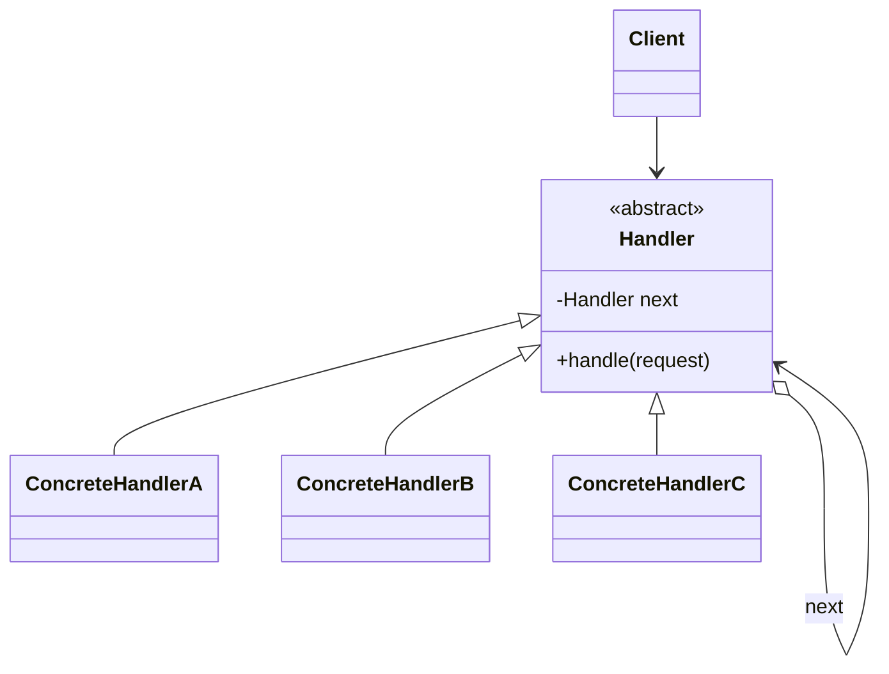

<div align="center">

# ⛓️ Chain Of Responsibility Design Pattern

   

*Pass a request along handlers until one handles it.*

</div>

---

## 📑 Table of contents

- [🎯 Intent](#-intent)
- [🧩 The problem & the solution](#-the-problem--the-solution)
- [🔷 Structure](#-structure)
- [👥 Participants](#-participants)
- [🧭 When to use it](#-when-to-use-it)
- [📊 Pros & cons](#-pros--cons)
- [🌍 Real-world examples](#-real-world-examples)
- [💻 Code](#-code)
  - [1. 💡 Logging system](#ex1)
  - [2. 💡 ATM cash dispenser](#ex2)

---

## 🎯 Intent

> Avoid coupling the sender of a request to its receiver by giving **several objects a chance to handle it**.

## 🧩 The problem & the solution

| 😣 Problem | 💡 Solution |
|---|---|
| A log message could be INFO, DEBUG or ERROR, and an ATM must pay out in the right notes. A single method with nested `if/else` for every case is rigid. | Handlers are linked in a chain. Each one either processes the request or forwards it to the next handler. |

## 🔷 Structure



## 👥 Participants

| Role | Responsibility | In this repo |
|---|---|---|
| **Handler** | Defines handle() and the link to the next handler | `LogProcessor`, `DispenseChain` |
| **Concrete Handlers** | Handle or forward | `InfoLogProcessor`, `DebugLogProcessor`, `ErrorLogProcessor`, `Rupees50/20/10Dispenser` |
| **Client** | Builds the chain and sends the request | `Main`, `ATMDispenser` |

## 🧭 When to use it

| ✅ Use it when | ⚠️ Avoid it when |
|---|---|
| More than one object may handle a request and the handler is not known in advance | Every request must be handled (a chain can silently drop it) |
| The set of handlers should change dynamically | Only one fixed handler exists |

## 📊 Pros & cons

| 👍 Pros | 👎 Cons |
|---|---|
| Decouples sender and receivers | No guarantee a request is handled |
| Flexible handler order | Hard to debug long chains |
| Single Responsibility per handler |  |

## 🌍 Real-world examples

- Servlet filters / Spring Security filter chain
- Exception handling (`catch` blocks)
- Customer-support escalation levels

---

## 💻 Code

This folder has **2 examples** (11 Java files). Interfaces and abstract classes come first, the class with `main` comes last.

<a id="ex1"></a>

### 1. 💡 Logging system

> `InfoLogProcessor` -> `DebugLogProcessor` -> `ErrorLogProcessor`; each handles its own level and passes the rest on.

<details open>
<summary><b>📁 Files in this example</b></summary>

```text
ChainOfResponsibityWithLoggingSystem/
└── ChainOfResponsibilityWithLoggingSystem/
    ├── DebugLogProcessor.java
    ├── ErrorLogProcessor.java
    ├── InfoLogProcessor.java
    ├── LogProcessor.java
    └── Main.java
```

</details>

#### 📄 `ChainOfResponsibilityWithLoggingSystem/LogProcessor.java`

<sub>abstract class · 23 lines</sub>

```java
package LowLevelDesign.DesignPatterns.LLDChainResponsibilityDesignPattern.ChainOfResponsibilityWithLoggingSystem;

public abstract class LogProcessor {

    public static int INFO = 1;
    public static int DEBUG = 2;
    public static int ERROR = 3;

    LogProcessor nextLoggerProcessor;

    LogProcessor(LogProcessor loggerProcessor) {

        this.nextLoggerProcessor = loggerProcessor;

    }

    public void log(int logLevel, String message) {

        if (nextLoggerProcessor != null) {
            nextLoggerProcessor.log(logLevel, message);
        }
    }
}
```

#### 📄 `ChainOfResponsibilityWithLoggingSystem/DebugLogProcessor.java`

<sub>class · 19 lines</sub>

```java
package LowLevelDesign.DesignPatterns.LLDChainResponsibilityDesignPattern.ChainOfResponsibilityWithLoggingSystem;

public class DebugLogProcessor extends LogProcessor{

    DebugLogProcessor(LogProcessor nexLogProcessor){
        super(nexLogProcessor);
    }

    public void log(int logLevel,String message){

        if(logLevel == DEBUG) {
            System.out.println("DEBUG: " + message);
        } else{

            super.log(logLevel, message);
        }

    }
}
```

#### 📄 `ChainOfResponsibilityWithLoggingSystem/ErrorLogProcessor.java`

<sub>class · 19 lines</sub>

```java
package LowLevelDesign.DesignPatterns.LLDChainResponsibilityDesignPattern.ChainOfResponsibilityWithLoggingSystem;

public class ErrorLogProcessor extends LogProcessor{

    ErrorLogProcessor(LogProcessor nexLogProcessor){
        super(nexLogProcessor);
    }

    public void log(int logLevel,String message){

        if(logLevel == ERROR) {
            System.out.println("ERROR: " + message);
        } else{

            super.log(logLevel, message);
        }

    }
}
```

#### 📄 `ChainOfResponsibilityWithLoggingSystem/InfoLogProcessor.java`

<sub>class · 19 lines</sub>

```java
package LowLevelDesign.DesignPatterns.LLDChainResponsibilityDesignPattern.ChainOfResponsibilityWithLoggingSystem;

public class InfoLogProcessor extends LogProcessor{

    InfoLogProcessor(LogProcessor nexLogProcessor){
        super(nexLogProcessor);
    }

    public void log(int logLevel,String message){

        if(logLevel == INFO) {
            System.out.println("INFO: " + message);
        } else{

            super.log(logLevel, message);
        }

    }
}
```

#### 📄 `ChainOfResponsibilityWithLoggingSystem/Main.java`

<sub>class · 14 lines</sub>

```java
package LowLevelDesign.DesignPatterns.LLDChainResponsibilityDesignPattern.ChainOfResponsibilityWithLoggingSystem;

public class Main {

    public static void main(String args[]) {

        LogProcessor logObject = new InfoLogProcessor(new DebugLogProcessor(new ErrorLogProcessor(null)));

        logObject.log(LogProcessor.ERROR, "exception happens");
        logObject.log(LogProcessor.DEBUG, "need to debug this ");
        logObject.log(LogProcessor.INFO, "just for info ");

    }
}
```

<details>
<summary><b>▶️ How to compile and run this example</b></summary>

```bash
# run from the repository root
mkdir -p out
find "Behavioural Design Pattern/4. Chain Of Responsibilty Design Pattern/ChainOfResponsibityWithLoggingSystem" -name "*.java" -print0 | xargs -0 javac -d out
java -cp out LowLevelDesign.DesignPatterns.LLDChainResponsibilityDesignPattern.ChainOfResponsibilityWithLoggingSystem.Main
```

</details>

---

<a id="ex2"></a>

### 2. 💡 ATM cash dispenser

> `Rupees50Dispenser` -> `Rupees20Dispenser` -> `Rupees10Dispenser` pay out as many notes as they can, then forward the remainder.

<details open>
<summary><b>📁 Files in this example</b></summary>

```text
chainofresponsibilityWithATM/
├── ATMDispenser.java
├── Currency.java
├── DispenseChain.java
├── Rupees10Dispenser.java
├── Rupees20Dispenser.java
└── Rupees50Dispenser.java
```

</details>

#### 📄 `DispenseChain.java`

<sub>abstract class · 11 lines</sub>

```java
package com.chainofresponsibilityWithATM;

public abstract class DispenseChain {


    public abstract void setNextChain(DispenseChain next);

    public abstract void dispense(Currency currency);


}
```

#### 📄 `Currency.java`

<sub>class · 15 lines</sub>

```java
package com.chainofresponsibilityWithATM;

public class Currency {

    long amount;

    public Currency(long amount) {
        this.amount=amount;
    }

    public long getAmount() {
        return this.amount;
    }

}
```

#### 📄 `Rupees10Dispenser.java`

<sub>class · 29 lines</sub>

```java
package com.chainofresponsibilityWithATM;

public class Rupees10Dispenser extends DispenseChain{

    private DispenseChain chain;
    @Override
    public void setNextChain(DispenseChain nextChain) {
        this.chain=nextChain;

    }

    @Override
    public void dispense(Currency currency) {
        //long currency.getAmount()=currency.getcurrency.getAmount()();
        if(currency.getAmount()>=10) {
            long num=currency.getAmount()/10;
            long remainder=currency.getAmount()%10;
            System.out.println("Dispensing "+num+" ₹10 rupees notes");
            if(remainder!=0) {
                this.chain.dispense(new Currency(remainder));
            }

        }
        else{
            this.chain.dispense(currency);
        }
    }

}
```

#### 📄 `Rupees20Dispenser.java`

<sub>class · 28 lines</sub>

```java
package com.chainofresponsibilityWithATM;

public class Rupees20Dispenser extends DispenseChain{

    private DispenseChain chain;
    @Override
    public void setNextChain(DispenseChain nextChain) {
        this.chain=nextChain;

    }

    @Override
    public void dispense(Currency currency) {
        //long currency.getAmount()=currency.getcurrency.getAmount()();
        if(currency.getAmount()>=20) {
            long num=currency.getAmount()/20;
            long remainder=currency.getAmount()%20;
            System.out.println("Dispensing "+num+" ₹20 rupees notes");
            if(remainder!=0) {
                this.chain.dispense(new Currency(remainder));
            }
        }
        else{
            this.chain.dispense(currency);
        }
    }

}
```

#### 📄 `Rupees50Dispenser.java`

<sub>class · 31 lines</sub>

```java
package com.chainofresponsibilityWithATM;

public class Rupees50Dispenser extends DispenseChain{

    private DispenseChain chain;
    @Override
    public void setNextChain(DispenseChain nextChain) {
        this.chain=nextChain;

    }

    @Override
    public void dispense(Currency currency) {
        //long currency.getAmount()=currency.getcurrency.getAmount()();
        if(currency.getAmount()>=50) {
            long num=currency.getAmount()/50;
            long remainder=currency.getAmount()%50;
            System.out.println("Dispensing "+num+" ₹50 rupees notes");
            if(remainder!=0) {
                this.chain.dispense(new Currency(remainder));
            }


        }

        else{
            this.chain.dispense(currency);
        }
    }

}
```

#### 📄 `ATMDispenser.java`

<sub>class · 34 lines</sub>

```java
package com.chainofresponsibilityWithATM;

import java.util.Scanner;

public class ATMDispenser {

    DispenseChain c1;

    public ATMDispenser() {
        this.c1=new Rupees50Dispenser();
        DispenseChain c2=new Rupees20Dispenser();
        DispenseChain c3=new Rupees10Dispenser();
        c1.setNextChain(c2);
        c2.setNextChain(c3);
    }

    public static void main(String[] args) {
        ATMDispenser atmDispenser=new ATMDispenser();


            long amount=0;
            System.out.println("enter amount to dispense");
            Scanner sc=new Scanner(System.in);
            amount=sc.nextLong();
            if(amount%10!=0) {
                System.out.println("amount should be mulitiple of 10s ");
                return;
            }
            atmDispenser.c1.dispense(new Currency(amount));


    }

}
```

<details>
<summary><b>▶️ How to compile and run this example</b></summary>

```bash
# run from the repository root
mkdir -p out
find "Behavioural Design Pattern/4. Chain Of Responsibilty Design Pattern/chainofresponsibilityWithATM" -name "*.java" -print0 | xargs -0 javac -d out
java -cp out com.chainofresponsibilityWithATM.ATMDispenser
```

</details>

---

<div align="center">

[◀ State](../3.%20State%20Design%20Pattern/README.md) &nbsp;·&nbsp; [📚 All patterns](../PATTERNS.md) &nbsp;·&nbsp; [Command ▶](../5.%20Command%20Design%20Pattern/README.md)

</div>
