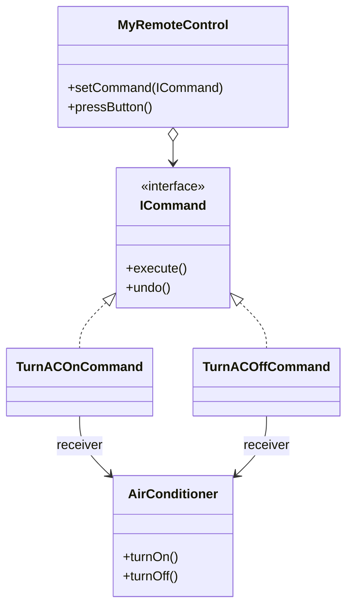

<div align="center">

# 📟 Command Design Pattern

   

*Turn a request into a stand-alone object.*

</div>

---

## 📑 Table of contents

- [🎯 Intent](#-intent)
- [🧩 The problem & the solution](#-the-problem--the-solution)
- [🔷 Structure](#-structure)
- [👥 Participants](#-participants)
- [🧭 When to use it](#-when-to-use-it)
- [📊 Pros & cons](#-pros--cons)
- [🌍 Real-world examples](#-real-world-examples)
- [💻 Code](#-code)
  - [1. ✅ With Command - undo / redo](#ex1)
  - [2. ✅ With Command - AC remote](#ex2)
  - [3. ❌ Without Command - AC remote (problem)](#ex3)
  - [4. ❌ Without Command - AC + Bulb remote (problem)](#ex4)
  - [5. ✅ With Command - file operations](#ex5)
  - [6. ✅ With Command - file operations + undo](#ex6)

---

## 🎯 Intent

> Encapsulate a request as an object so you can **parameterise, queue, log and undo** operations.

## 🧩 The problem & the solution

| 😣 Problem | 💡 Solution |
|---|---|
| A remote control wired directly to `AirConditioner` / `Bulb` methods is hard-coded, cannot be reconfigured, and cannot undo anything. | Each action becomes a `Command` object with `execute()` (and `undo()` in the undo variants). The remote (invoker) just runs the command, and a history `Stack` lets the last action be undone. |

## 🔷 Structure



## 👥 Participants

| Role | Responsibility | In this repo |
|---|---|---|
| **Command** | Interface with `execute()` / `undo()` | `ICommand`, `Command` |
| **Concrete Commands** | Bind an action to a receiver | `TurnACOnCommand`, `OpenFileCommand`, `CopyFile`, `PasteFile`, ... |
| **Receiver** | Does the real work | `AirConditioner`, `FileSystem` |
| **Invoker** | Triggers commands, keeps history | `MyRemoteControl`, `Invoker` |
| **Client** | Creates and wires everything | `Main`, `Client` |

## 🧭 When to use it

| ✅ Use it when | ⚠️ Avoid it when |
|---|---|
| Queue, schedule or log operations | A simple direct method call is enough |
| Undo / redo |  |
| Decouple the object that invokes from the one that performs |  |

## 📊 Pros & cons

| 👍 Pros | 👎 Cons |
|---|---|
| Decouples invoker and receiver | One class per command |
| Undo / redo and macro commands | More objects and indirection |
| New commands without changing the invoker |  |

## 🌍 Real-world examples

- Text-editor undo stacks
- `Runnable` / `Callable` tasks in executors
- Transaction logs, job queues

---

## 💻 Code

This folder has **6 examples** (35 Java files). Interfaces and abstract classes come first, the class with `main` comes last.

<a id="ex1"></a>

### 1. ✅ With Command - undo / redo

> `MyRemoteControl` pushes every executed command on a `Stack`, so `undo()` can reverse the last one.

<details open>
<summary><b>📁 Files in this example</b></summary>

```text
CommandDesignPatternWithUndoRedo/
├── Client/
│   └── Main.java
├── Commad/
│   ├── ICommand.java
│   ├── SetTemperature.java
│   ├── TurnACOffCommand.java
│   └── TurnACOnCommand.java
├── Invoker/
│   └── MyRemoteControl.java
└── Receiver/
    └── AirConditioner.java
```

</details>

#### 📄 `Commad/ICommand.java`

<sub>interface · 10 lines</sub>

```java
package com.CommandDesignPatternWithUndoRedo.Commad;


//Command
public interface ICommand {

    public void execute();
    public void undo();

}
```

#### 📄 `Commad/SetTemperature.java`

<sub>class · 4 lines</sub>

```java
package com.CommandDesignPatternWithUndoRedo.Commad;

public class SetTemperature {
}
```

#### 📄 `Commad/TurnACOffCommand.java`

<sub>class · 19 lines</sub>

```java
package com.CommandDesignPatternWithUndoRedo.Commad;


import com.CommandDesignPatternWithUndoRedo.Receiver.AirConditioner;

public class TurnACOffCommand implements ICommand {
    AirConditioner ac;
    TurnACOffCommand(AirConditioner ac){
        this.ac=ac;
    }
    @Override
    public void execute(){
        ac.turnOffAc();
    }
    @Override
    public  void undo(){
        ac.turnOnAc();
    }
}
```

#### 📄 `Commad/TurnACOnCommand.java`

<sub>class · 20 lines</sub>

```java
package com.CommandDesignPatternWithUndoRedo.Commad;


import com.CommandDesignPatternWithUndoRedo.Receiver.AirConditioner;

public class TurnACOnCommand implements ICommand {

    AirConditioner ac;
    public TurnACOnCommand(AirConditioner ac){
        this.ac=ac;
    }
    @Override
    public void execute(){
       ac.turnOnAc();
    }
    @Override
    public void undo(){
        ac.turnOffAc();
    }
}
```

#### 📄 `Invoker/MyRemoteControl.java`

<sub>class · 27 lines</sub>

```java
package com.CommandDesignPatternWithUndoRedo.Invoker;


import com.CommandDesignPatternWithUndoRedo.Commad.ICommand;

import java.util.Stack;

public class MyRemoteControl {
    ICommand command;
    Stack<ICommand>acCommandHistory=new Stack<>();
    public MyRemoteControl(){

    }
    public void setCommand(ICommand command){
        this.command=command;
    }
    public void pressButton(){
        command.execute();
        acCommandHistory.add(command);
    }
    public void undo(){
        if(!acCommandHistory.isEmpty()){
            ICommand lastCommand=acCommandHistory.pop();
            lastCommand.undo();
        }
    }
}
```

#### 📄 `Receiver/AirConditioner.java`

<sub>class · 20 lines</sub>

```java
package com.CommandDesignPatternWithUndoRedo.Receiver;

public class AirConditioner {
    boolean isOn;
    int temperature;
    public void turnOnAc(){
        isOn=true;
        System.out.println("AC is ON");
    }
    public void turnOffAc(){
        isOn=false;
        System.out.println("AC is OFF");
    }
    public void setTemperature(int temp){
        this.temperature=temp;
        System.out.println("Temperature Changed to:"+ temperature);
    }


}
```

#### 📄 `Client/Main.java`

<sub>class · 24 lines</sub>

```java
package com.CommandDesignPatternWithUndoRedo.Client;


import com.CommandDesignPatternWithUndoRedo.Commad.TurnACOnCommand;
import com.CommandDesignPatternWithUndoRedo.Invoker.MyRemoteControl;
import com.CommandDesignPatternWithUndoRedo.Receiver.AirConditioner;

public class Main {
    public static void main(String[] args){
        // AC Object
        AirConditioner airConditioner=new AirConditioner();

        //remote
        MyRemoteControl remoteControl=new MyRemoteControl();

        //create the Command and press the button
        remoteControl.setCommand(new TurnACOnCommand(airConditioner));
        remoteControl.pressButton();

        //undo the last operation
        remoteControl.undo();

    }
}
```

<details>
<summary><b>▶️ How to compile and run this example</b></summary>

```bash
# run from the repository root
mkdir -p out
find "Behavioural Design Pattern/5. Command Design Pattern/com/CommandDesignPatternWithUndoRedo" -name "*.java" -print0 | xargs -0 javac -d out
java -cp out com.CommandDesignPatternWithUndoRedo.Client.Main
```

</details>

---

<a id="ex2"></a>

### 2. ✅ With Command - AC remote

> `TurnACOnCommand`, `TurnACOffCommand`, `SetTemperature` run through `MyRemoteControl`.

<details open>
<summary><b>📁 Files in this example</b></summary>

```text
WithCommandDesignPattern/
├── Client/
│   └── Main.java
├── Command/
│   ├── ICommand.java
│   ├── SetTemperature.java
│   ├── TurnACOffCommand.java
│   └── TurnACOnCommand.java
├── Invoker/
│   └── MyRemoteControl.java
└── Receiver/
    └── AirConditioner.java
```

</details>

#### 📄 `Command/ICommand.java`

<sub>interface · 9 lines</sub>

```java
package com.WithCommandDesignPattern.Command;


//Command
public interface ICommand {

public 	void execute();

}
```

#### 📄 `Command/SetTemperature.java`

<sub>class · 4 lines</sub>

```java
package com.WithCommandDesignPattern.Command;

public class SetTemperature {
}
```

#### 📄 `Command/TurnACOffCommand.java`

<sub>class · 14 lines</sub>

```java
package com.WithCommandDesignPattern.Command;

import com.WithCommandDesignPattern.Receiver.AirConditioner;

public class TurnACOffCommand implements ICommand{
    AirConditioner ac;
    TurnACOffCommand(AirConditioner ac){
        this.ac=ac;
    }
    @Override
    public void execute(){
        ac.turnOffAc();
    }
}
```

#### 📄 `Command/TurnACOnCommand.java`

<sub>class · 16 lines</sub>

```java
package com.WithCommandDesignPattern.Command;


import com.WithCommandDesignPattern.Receiver.AirConditioner;

public class TurnACOnCommand implements ICommand{

    AirConditioner ac;
    public TurnACOnCommand(AirConditioner ac){
        this.ac=ac;
    }
    @Override
    public void execute(){
       ac.turnOnAc();
    }
}
```

#### 📄 `Invoker/MyRemoteControl.java`

<sub>class · 16 lines</sub>

```java
package com.WithCommandDesignPattern.Invoker;

import com.WithCommandDesignPattern.Command.ICommand;

public class MyRemoteControl {
    ICommand command;
    public MyRemoteControl(){

    }
    public void setCommand(ICommand command){
        this.command=command;
    }
    public void pressButton(){
        command.execute();
    }
}
```

#### 📄 `Receiver/AirConditioner.java`

<sub>class · 20 lines</sub>

```java
package com.WithCommandDesignPattern.Receiver;

public class AirConditioner {
    boolean isOn;
    int temperature;
    public void turnOnAc(){
        isOn=true;
        System.out.println("AC is ON");
    }
    public void turnOffAc(){
        isOn=false;
        System.out.println("AC is OFF");
    }
    public void setTemperature(int temp){
        this.temperature=temp;
        System.out.println("Temperature Changed to:"+ temperature);
    }


}
```

#### 📄 `Client/Main.java`

<sub>class · 20 lines</sub>

```java
package com.WithCommandDesignPattern.Client;

import com.WithCommandDesignPattern.Command.TurnACOnCommand;
import com.WithCommandDesignPattern.Invoker.MyRemoteControl;
import com.WithCommandDesignPattern.Receiver.AirConditioner;

public class Main {
    public static void main(String[] args){
       // AC Object
        AirConditioner airConditioner=new AirConditioner();

        //remote
        MyRemoteControl remoteControl=new MyRemoteControl();

        //create the Command and press the button
        remoteControl.setCommand(new TurnACOnCommand(airConditioner));
        remoteControl.pressButton();

    }
}
```

<details>
<summary><b>▶️ How to compile and run this example</b></summary>

```bash
# run from the repository root
mkdir -p out
find "Behavioural Design Pattern/5. Command Design Pattern/com/WithCommandDesignPattern" -name "*.java" -print0 | xargs -0 javac -d out
java -cp out com.WithCommandDesignPattern.Client.Main
```

</details>

---

<a id="ex3"></a>

### 3. ❌ Without Command - AC remote (problem)

> The remote calls `AirConditioner` methods directly.

<details open>
<summary><b>📁 Files in this example</b></summary>

```text
WithoutCommadDesignPatternRemoteControlAc/
├── AirConditioner.java
└── Main.java
```

</details>

#### 📄 `AirConditioner.java`

<sub>class · 20 lines</sub>

```java
package com.WithoutCommadDesignPatternRemoteControlAc;

public class AirConditioner {
    boolean isOn;
    int temperature;
    public void turnOnAc(){
        isOn=true;
        System.out.println("AC is ON");
    }
    public void turnOffAc(){
        isOn=false;
        System.out.println("AC is OFF");
    }
    public void setTemperature(int temp){
        this.temperature=temp;
        System.out.println("Temperature Changed to:"+ temperature);
    }


}
```

#### 📄 `Main.java`

<sub>class · 11 lines</sub>

```java
package com.WithoutCommadDesignPatternRemoteControlAc;

public class Main {
    public static void main(String args[]){
        AirConditioner ac=new AirConditioner();
        ac.turnOnAc();
        ac.setTemperature(24);
        ac.turnOffAc();

    }
}
```

<details>
<summary><b>▶️ How to compile and run this example</b></summary>

```bash
# run from the repository root
mkdir -p out
find "Behavioural Design Pattern/5. Command Design Pattern/com/WithoutCommadDesignPatternRemoteControlAc" -name "*.java" -print0 | xargs -0 javac -d out
java -cp out com.WithoutCommadDesignPatternRemoteControlAc.Main
```

</details>

---

<a id="ex4"></a>

### 4. ❌ Without Command - AC + Bulb remote (problem)

> Adding a bulb forces edits inside the remote itself.

<details open>
<summary><b>📁 Files in this example</b></summary>

```text
WithoutCommandDesignPatternRemoteControlWithBulb/
├── AirConditioner.java
├── Bulb.java
└── Main.java
```

</details>

#### 📄 `AirConditioner.java`

<sub>class · 20 lines</sub>

```java
package com.WithoutCommandDesignPatternRemoteControlWithBulb;

public class AirConditioner {
    boolean isOn;
    int temperature;
    public void turnOnAc(){
        isOn=true;
        System.out.println("AC is ON");
    }
    public void turnOffAc(){
        isOn=false;
        System.out.println("AC is OFF");
    }
    public void setTemperature(int temp){
        this.temperature=temp;
        System.out.println("Temperature Changed to:"+ temperature);
    }


}
```

#### 📄 `Bulb.java`

<sub>class · 15 lines</sub>

```java
package com.WithoutCommandDesignPatternRemoteControlWithBulb;

public class Bulb {
    boolean isOn;
    public void turnOnBulb(){
        isOn=true;
        System.out.println("Bulb is ON");
    }
    public void turnOffBulb(){
        isOn=false;
        System.out.println("AC is OFF");
    }


}
```

#### 📄 `Main.java`

<sub>class · 15 lines</sub>

```java
package com.WithoutCommandDesignPatternRemoteControlWithBulb;

public class Main {
    public static void main(String args[]){
        AirConditioner ac=new AirConditioner();
        ac.turnOnAc();
        ac.setTemperature(24);
        ac.turnOffAc();

        Bulb bulbObj=new Bulb();
        bulbObj.turnOnBulb();
        bulbObj.turnOffBulb();

    }
}
```

<details>
<summary><b>▶️ How to compile and run this example</b></summary>

```bash
# run from the repository root
mkdir -p out
find "Behavioural Design Pattern/5. Command Design Pattern/com/WithoutCommandDesignPatternRemoteControlWithBulb" -name "*.java" -print0 | xargs -0 javac -d out
java -cp out com.WithoutCommandDesignPatternRemoteControlWithBulb.Main
```

</details>

---

<a id="ex5"></a>

### 5. ✅ With Command - file operations

> Open / copy / paste / close file commands executed by an `Invoker`.

<details open>
<summary><b>📁 Files in this example</b></summary>

```text
commanddesignpatternWithFile/
├── Client/
│   └── Client.java
├── Command/
│   ├── CloseFileCommand.java
│   ├── Command.java
│   ├── CopyFile.java
│   ├── OpenFileCommand.java
│   └── PasteFile.java
├── Invoker/
│   └── Invoker.java
└── Receiver/
    └── FileSystem.java
```

</details>

#### 📄 `Command/Command.java`

<sub>interface · 9 lines</sub>

```java
package com.commanddesignpatternWithFile.Command;


//Command
public interface Command {

    void execute();

}
```

#### 📄 `Command/CloseFileCommand.java`

<sub>class · 21 lines</sub>

```java
package com.commanddesignpatternWithFile.Command;


import com.commanddesignpatternWithFile.Receiver.FileSystem;

public class CloseFileCommand implements Command {

    FileSystem fileSystem;
    public CloseFileCommand(FileSystem fs) {
        this.fileSystem=fs;
        }
    @Override
    public void execute() {
    this.fileSystem.closeFile();

    }

}


//we can have n number of commands like deleteFile,CopyFile,PasteFile etc..,
```

#### 📄 `Command/CopyFile.java`

<sub>class · 19 lines</sub>

```java
package com.commanddesignpatternWithFile.Command;

import com.commanddesignpatternWithFile.Receiver.FileSystem;

public class CopyFile implements Command {

    FileSystem fileSystem;

    public CopyFile(FileSystem fs) {
        this.fileSystem=fs;
        }

    @Override
    public void execute() {
        this.fileSystem.copyFile();

    }

}
```

#### 📄 `Command/OpenFileCommand.java`

<sub>class · 20 lines</sub>

```java
package com.commanddesignpatternWithFile.Command;

import com.commanddesignpatternWithFile.Receiver.FileSystem;

public class OpenFileCommand implements Command {

    FileSystem fileSystem;

    public OpenFileCommand(FileSystem fs) {
        this.fileSystem=fs;
    }

    @Override
    public void execute() {
        this.fileSystem.openFile();

    }

}
//we can have n number of commands like deleteFile,CopyFile,PasteFile etc..,
```

#### 📄 `Command/PasteFile.java`

<sub>class · 20 lines</sub>

```java
package com.commanddesignpatternWithFile.Command;

import com.commanddesignpatternWithFile.Receiver.FileSystem;

public class PasteFile implements Command {

    FileSystem fs;

    public PasteFile(FileSystem fileSystem) {
        this.fs=fileSystem;
    }


    @Override
    public void execute() {
        this.fs.pasteFile();

    }

}
```

#### 📄 `Invoker/Invoker.java`

<sub>class · 16 lines</sub>

```java
package com.commanddesignpatternWithFile.Invoker;

import com.commanddesignpatternWithFile.Command.Command;

public class Invoker {

    Command command;
    public void setCommand(Command command) {
        this.command=command;
    }

    public void performAction() {
        this.command.execute();
    }

}
```

#### 📄 `Receiver/FileSystem.java`

<sub>class · 29 lines</sub>

```java
package com.commanddesignpatternWithFile.Receiver;


//Receiver
public class FileSystem {

    boolean isOpen;

    public void openFile() {
        isOpen=true;
        System.out.println("file is opened");
    }

    public void closeFile() {
        isOpen=false;
        System.out.println("file is closed");
    }

    public void copyFile() {
        System.out.println("file is copied");

    }

    public void pasteFile() {
        System.out.println("file is pasted");

    }

}
```

#### 📄 `Client/Client.java`

<sub>class · 34 lines</sub>

```java
package com.commanddesignpatternWithFile.Client;

import com.commanddesignpatternWithFile.Command.CloseFileCommand;
import com.commanddesignpatternWithFile.Command.CopyFile;
import com.commanddesignpatternWithFile.Command.OpenFileCommand;
import com.commanddesignpatternWithFile.Command.PasteFile;
import com.commanddesignpatternWithFile.Invoker.Invoker;
import com.commanddesignpatternWithFile.Receiver.FileSystem;

public class Client {

    public static void main(String[] args) {

        FileSystem fs=new FileSystem();
        Invoker ivk=new Invoker();

        //command for opening file
        ivk.setCommand(new OpenFileCommand(fs));
        ivk.performAction();//just think like a button, performed by client

        //command for closing File
        ivk.setCommand(new CloseFileCommand(fs));
        ivk.performAction();//just think like a button, performed by client

        //command for coping file
        ivk.setCommand(new CopyFile(fs));
        ivk.performAction();

        //command for pasting file
        ivk.setCommand(new PasteFile(fs));
        ivk.performAction();
    }

}
```

<details>
<summary><b>▶️ How to compile and run this example</b></summary>

```bash
# run from the repository root
mkdir -p out
find "Behavioural Design Pattern/5. Command Design Pattern/com/commanddesignpatternWithFile" -name "*.java" -print0 | xargs -0 javac -d out
java -cp out com.commanddesignpatternWithFile.Client.Client
```

</details>

---

<a id="ex6"></a>

### 6. ✅ With Command - file operations + undo

> The file-operation commands, extended with undo support.

<details open>
<summary><b>📁 Files in this example</b></summary>

```text
commanddesignpatternwithundofunctionalityWithFile/
├── Client/
│   └── Client.java
├── Command/
│   ├── CloseFileCommand.java
│   ├── Command.java
│   ├── CopyFile.java
│   ├── OpenFileCommand.java
│   └── PasteFile.java
├── Invoker/
│   └── Invoker.java
└── Receiver/
    └── FileSystem.java
```

</details>

#### 📄 `Command/Command.java`

<sub>interface · 10 lines</sub>

```java
package com.commanddesignpatternwithundofunctionalityWithFile.Command;


//Command
public interface Command {

    void execute();
    void undo();

}
```

#### 📄 `Command/CloseFileCommand.java`

<sub>class · 26 lines</sub>

```java
package com.commanddesignpatternwithundofunctionalityWithFile.Command;


import com.commanddesignpatternwithundofunctionalityWithFile.Receiver.FileSystem;

public class CloseFileCommand implements Command {

    FileSystem fileSystem;
    public CloseFileCommand(FileSystem fs) {
        this.fileSystem=fs;
        }
    @Override
    public void execute() {
    this.fileSystem.closeFile();

    }
    @Override
    public void undo() {
    this.fileSystem.openFile();

    }

}


//we can have n number of commands like deleteFile,CopyFile,PasteFile etc..,
```

#### 📄 `Command/CopyFile.java`

<sub>class · 25 lines</sub>

```java
package com.commanddesignpatternwithundofunctionalityWithFile.Command;

import com.commanddesignpatternwithundofunctionalityWithFile.Receiver.FileSystem;

public class CopyFile implements Command {

    FileSystem fileSystem;

    public CopyFile(FileSystem fs) {
        this.fileSystem=fs;
        }

    @Override
    public void execute() {
        this.fileSystem.copyFile();

    }

    @Override
    public void undo() {
        this.fileSystem.pasteFile();

    }

}
```

#### 📄 `Command/OpenFileCommand.java`

<sub>class · 26 lines</sub>

```java
package com.commanddesignpatternwithundofunctionalityWithFile.Command;

import com.commanddesignpatternwithundofunctionalityWithFile.Receiver.FileSystem;

public class OpenFileCommand implements Command {

    FileSystem fileSystem;

    public OpenFileCommand(FileSystem fs) {
        this.fileSystem=fs;
    }

    @Override
    public void execute() {
        this.fileSystem.openFile();

    }

    @Override
    public void undo() {
        this.fileSystem.closeFile();

    }

}
//we can have n number of commands like deleteFile,CopyFile,PasteFile etc..,
```

#### 📄 `Command/PasteFile.java`

<sub>class · 27 lines</sub>

```java
package com.commanddesignpatternwithundofunctionalityWithFile.Command;

import com.commanddesignpatternwithundofunctionalityWithFile.Receiver.FileSystem;

public class PasteFile implements Command {

    FileSystem fs;

    public PasteFile(FileSystem fileSystem) {
        this.fs=fileSystem;
    }


    @Override
    public void execute() {
        this.fs.pasteFile();

    }


    @Override
    public void undo() {
        this.fs.copyFile();

    }

}
```

#### 📄 `Invoker/Invoker.java`

<sub>class · 31 lines</sub>

```java
package com.commanddesignpatternwithundofunctionalityWithFile.Invoker;

import com.commanddesignpatternwithundofunctionalityWithFile.Command.Command;

import java.util.Stack;

public class Invoker {

    Command command;

    Stack<Command> addCommandHistory=new Stack<>();
    public void setCommand(Command command) {
        this.command=command;
    }

    public void performAction() {
        this.command.execute();
        this.addCommandHistory.add(command);
    }

    public void undoAction() {
        if(!addCommandHistory.isEmpty()){
            Command lastCommand = addCommandHistory.pop();
            lastCommand.undo();
        }
        else {
            System.out.println("no action performed earlier");
        }
    }

}
```

#### 📄 `Receiver/FileSystem.java`

<sub>class · 29 lines</sub>

```java
package com.commanddesignpatternwithundofunctionalityWithFile.Receiver;


//Receiver
public class FileSystem {

    boolean isOpen;

    public void openFile() {
        isOpen=true;
        System.out.println("file is opened");
    }

    public void closeFile() {
        isOpen=false;
        System.out.println("file is closed");
    }

    public void copyFile() {
        System.out.println("file is copied");

    }

    public void pasteFile() {
        System.out.println("file is pasted ");

    }

}
```

#### 📄 `Client/Client.java`

<sub>class · 34 lines</sub>

```java
package com.commanddesignpatternwithundofunctionalityWithFile.Client;

import com.commanddesignpatternwithundofunctionalityWithFile.Command.CopyFile;
import com.commanddesignpatternwithundofunctionalityWithFile.Receiver.FileSystem;
import com.commanddesignpatternwithundofunctionalityWithFile.Invoker.Invoker;
import com.commanddesignpatternwithundofunctionalityWithFile.Command.OpenFileCommand;

public class Client {

    public static void main(String[] args) {

        FileSystem fs=new FileSystem();
        Invoker ivk=new Invoker();
        //command for opening file
        ivk.setCommand(new OpenFileCommand(fs));
        ivk.performAction();
        ivk.performAction();//just think like a button, performed by client

        //undoing of previously performed action
        ivk.undoAction();
        ivk.undoAction();
        ivk.undoAction();

        //command for coping the file
        ivk.setCommand(new CopyFile(fs));
        ivk.performAction();

        //undoing the performed action
        ivk.undoAction();
    }


}
```

<details>
<summary><b>▶️ How to compile and run this example</b></summary>

```bash
# run from the repository root
mkdir -p out
find "Behavioural Design Pattern/5. Command Design Pattern/com/commanddesignpatternwithundofunctionalityWithFile" -name "*.java" -print0 | xargs -0 javac -d out
java -cp out com.commanddesignpatternwithundofunctionalityWithFile.Client.Client
```

</details>

---

<div align="center">

[◀ Chain Of Responsibility](../4.%20Chain%20Of%20Responsibilty%20Design%20Pattern/README.md) &nbsp;·&nbsp; [📚 All patterns](../PATTERNS.md) &nbsp;·&nbsp; [Template Method ▶](../6.%20Template%20Design%20Pattern/README.md)

</div>
