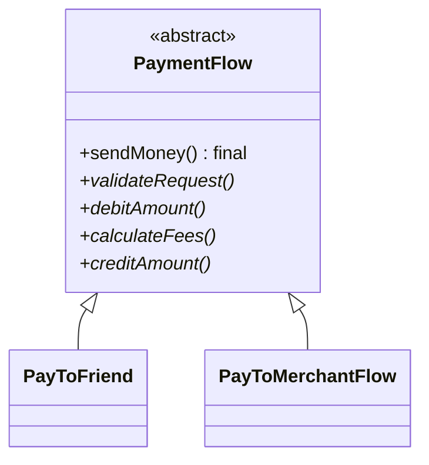

<div align="center">

# 📐 Template Method Design Pattern

   

*Fix the skeleton of an algorithm, let subclasses fill in the steps.*

</div>

---

## 📑 Table of contents

- [🎯 Intent](#-intent)
- [🧩 The problem & the solution](#-the-problem--the-solution)
- [🔷 Structure](#-structure)
- [👥 Participants](#-participants)
- [🧭 When to use it](#-when-to-use-it)
- [📊 Pros & cons](#-pros--cons)
- [🌍 Real-world examples](#-real-world-examples)
- [💻 Code](#-code)
  - [1. Implementation](#ex1)

---

## 🎯 Intent

> Define the **skeleton of an algorithm** in a base class and let subclasses redefine specific steps without changing its structure.

## 🧩 The problem & the solution

| 😣 Problem | 💡 Solution |
|---|---|
| Paying a friend and paying a merchant follow the same steps (validate - debit - calculate fees - credit) but differ in details. Copy-pasting the flow is error-prone. | `PaymentFlow.sendMoney()` is a `final` template method that calls abstract steps. `PayToFriend` and `PayToMerchantFlow` implement only the steps that differ. |

## 🔷 Structure



## 👥 Participants

| Role | Responsibility | In this repo |
|---|---|---|
| **Abstract Class** | Holds the template method and abstract steps | `PaymentFlow` |
| **Concrete Classes** | Implement the varying steps | `PayToFriend`, `PayToMerchantFlow` |
| **Client** | Calls the template method | `Client` |

## 🧭 When to use it

| ✅ Use it when | ⚠️ Avoid it when |
|---|---|
| Several classes share the same algorithm structure | Steps vary so much that there is no common skeleton |
| You want to prevent subclasses from changing the order of steps | You need to change the algorithm at runtime (use Strategy) |

## 📊 Pros & cons

| 👍 Pros | 👎 Cons |
|---|---|
| Code reuse in the base class | Inheritance-based and therefore rigid |
| Enforced algorithm order | Deep hierarchies can be hard to follow |
| Subclasses stay small |  |

## 🌍 Real-world examples

- `InputStream.read(byte[])`
- Spring `JdbcTemplate`, `HttpServlet.service()`
- Data-processing pipelines (extract - transform - load)

---

## 💻 Code

This folder has **1 example** (4 Java files). Interfaces and abstract classes come first, the class with `main` comes last.

<a id="ex1"></a>

### 1. Implementation

<details open>
<summary><b>📁 Files in this example</b></summary>

```text
6. Template Design Pattern/
├── Client.java
├── PaymentFlow.java
├── PayToFriend.java
└── PayToMerchantFlow.java
```

</details>

#### 📄 `PaymentFlow.java`

<sub>abstract class · 17 lines</sub>

```java
public abstract  class PaymentFlow {
    public abstract void validateRequest();
    public abstract void calculateFees();
    public abstract void debitAmount();
    public abstract void creditAmount();
    //this is Template method: which defines the order of steps to execute the task.
    public final void sendMoney(){
        //step 01
        validateRequest();
        //step 02
        debitAmount();
        //step 03
        calculateFees();
        //step 04
        creditAmount();
    }
}
```

#### 📄 `PayToFriend.java`

<sub>class · 22 lines</sub>

```java
public class PayToFriend extends PaymentFlow{
    @Override
    public void validateRequest() {
        //specific validation for PatToFriend Flow
        System.out.println("Validate logic of PayToFriend");
    }
    @Override
    public void debitAmount() {
        //debit the amount
        System.out.println("debit the Amount logic of PayToFriend");
    }
    @Override
    public void calculateFees() {
        //specific fees calculation logic for PayToFriend flow
        System.out.println("0 % Fee charged");
    }
    @Override
    public void creditAmount() {
        //credit the amount logic
        System.out.println("Credit the Full Amount");
    }
}
```

#### 📄 `PayToMerchantFlow.java`

<sub>class · 22 lines</sub>

```java
public class PayToMerchantFlow extends PaymentFlow{
    @Override
    public void validateRequest() {
        //specific validation for PayToMerchant Flow
        System.out.println("Validate logic of PayToMerchant");
    }
    @Override
    public void debitAmount() {
        //debit the amount
        System.out.println("debit the Amount logic of PayToMerchant");
    }
    @Override
    public void calculateFees() {
        //specific fees calculation logic for PayToMerchant flow
        System.out.println("2 % Fee charged");
    }
    @Override
    public void creditAmount() {
    //credit the amount logic
        System.out.println("Credit the remaining Amount");
    }
}
```

#### 📄 `Client.java`

<sub>class · 9 lines</sub>

```java
public class Client {
    public static void main(String[] args){
        PaymentFlow obj1=new PayToFriend();
        obj1.sendMoney();

        PaymentFlow obj2=new PayToMerchantFlow();
        obj2.sendMoney();
    }
}
```

<details>
<summary><b>▶️ How to compile and run this example</b></summary>

```bash
# run from the repository root
mkdir -p out
find "Behavioural Design Pattern/6. Template Design Pattern" -name "*.java" -print0 | xargs -0 javac -d out
java -cp out Client
```

</details>

---

<div align="center">

[◀ Command](../5.%20Command%20Design%20Pattern/README.md) &nbsp;·&nbsp; [📚 All patterns](../PATTERNS.md) &nbsp;·&nbsp; [Memento ▶](../7.%20Momento%20Design%20Pattern/README.md)

</div>
