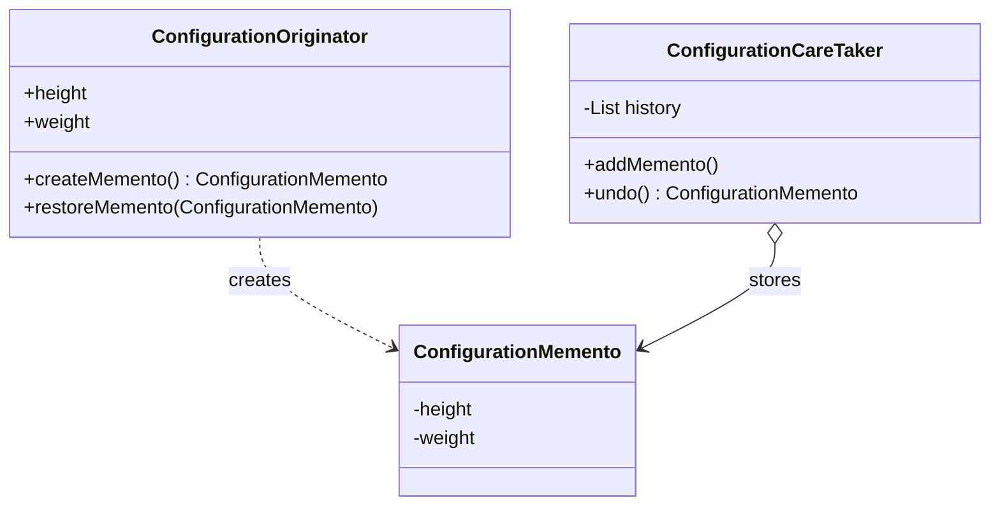

<div align="center">

# 💾 Memento Design Pattern

   

*Save and restore an object's state without exposing its internals.*

</div>

---

## 📑 Table of contents

- [🎯 Intent](#-intent)
- [🧩 The problem & the solution](#-the-problem--the-solution)
- [🔷 Structure](#-structure)
- [👥 Participants](#-participants)
- [🧭 When to use it](#-when-to-use-it)
- [📊 Pros & cons](#-pros--cons)
- [🌍 Real-world examples](#-real-world-examples)
- [💻 Code](#-code)
  - [1. Implementation](#ex1)

---

## 🎯 Intent

> Capture and externalise an object's internal state so it can be **restored later**, without violating encapsulation.

## 🧩 The problem & the solution

| 😣 Problem | 💡 Solution |
|---|---|
| You need undo or rollback for a configuration object, but exposing all its fields to an outside class would break encapsulation. | The `Originator` creates a `Memento` holding its state. The `CareTaker` stores mementos (without peeking inside) and hands them back to restore. |

## 🔷 Structure



## 👥 Participants

| Role | Responsibility | In this repo |
|---|---|---|
| **Originator** | Owns the state, creates and restores mementos | `ConfigurationOriginator` |
| **Memento** | Immutable snapshot of the state | `ConfigurationMemento` |
| **Caretaker** | Keeps the history of snapshots | `ConfigurationCareTaker` |
| **Client** | Triggers save / undo | `Client` |

## 🧭 When to use it

| ✅ Use it when | ⚠️ Avoid it when |
|---|---|
| Undo / redo, checkpoints, rollbacks | State is huge and snapshots are frequent (memory cost) |
| A direct getter-based snapshot would break encapsulation | State is trivial |

## 📊 Pros & cons

| 👍 Pros | 👎 Cons |
|---|---|
| Preserves encapsulation | Memory grows with the number of snapshots |
| Simple undo mechanism | Caretaker must manage lifecycle of mementos |
| Originator stays clean |  |

## 🌍 Real-world examples

- Editor undo, game save-points
- Database transactions / rollbacks
- `Serializable` snapshots

---

## 💻 Code

This folder has **1 example** (4 Java files). Interfaces and abstract classes come first, the class with `main` comes last.

<a id="ex1"></a>

### 1. Implementation

<details open>
<summary><b>📁 Files in this example</b></summary>

```text
7. Momento Design Pattern/
├── CareTaker/
│   └── ConfigurationCareTaker.java
├── Client/
│   └── Client.java
├── Memento/
│   └── ConfigurationMemento.java
└── Originator/
    └── ConfigurationOriginator.java
```

</details>

#### 📄 `CareTaker/ConfigurationCareTaker.java`

<sub>class · 27 lines</sub>

```java
package CareTaker;

import Memento.ConfigurationMemento;

//import java.util.ArrayList;
import java.util.ArrayList;
import java.util.List;


public class ConfigurationCareTaker {
    List<ConfigurationMemento> history=new ArrayList<>();
    public void addMemento(ConfigurationMemento memento){
        history.add(memento);
    }

    public ConfigurationMemento undo(){
        if(!history.isEmpty()){
            int lastMementoIndex=history.size();
            //get the last memento from the list
            ConfigurationMemento lastMemento=history.get(lastMementoIndex-1);
            //remove the last memento from the list now
            history.remove(lastMementoIndex-1);
            return lastMemento;
        }
        return null;
    }
}
```

#### 📄 `Memento/ConfigurationMemento.java`

<sub>class · 18 lines</sub>

```java
package Memento;

public class ConfigurationMemento {
    public  int height;
   public int weight;

    public ConfigurationMemento(int height, int weight) {
        this.height = height;
        this.weight = weight;
    }
    public  int getHeight(){
        return height;
    }
    public int getWeight(){
        return weight;
    }

}
```

#### 📄 `Originator/ConfigurationOriginator.java`

<sub>class · 27 lines</sub>

```java
package Originator;

import Memento.ConfigurationMemento;

public class ConfigurationOriginator {
    public int height;
    public int weight;

    public ConfigurationOriginator(int height, int weight) {
        this.height = height;
        this.weight = weight;
    }
    public void setHeight(int height){
        this.height=height;
    }

    public void setWeight(int weight) {
        this.weight = weight;
    }
    public ConfigurationMemento createMemento(){
        return new ConfigurationMemento(this.height,this.weight);
    }
    public void restoreMemento(ConfigurationMemento mementoToBeRestored){
        this.weight= mementoToBeRestored.weight;
        this.height=mementoToBeRestored.height;
    }
}
```

#### 📄 `Client/Client.java`

<sub>class · 36 lines</sub>

```java
package Client;

import CareTaker.ConfigurationCareTaker;
import Memento.ConfigurationMemento;
import Originator.ConfigurationOriginator;

public class Client {
    public static  void main(String[] args){
        ConfigurationCareTaker careTakerObject=new ConfigurationCareTaker();
        //initiate State of the Originator
        ConfigurationOriginator originatorObject=new ConfigurationOriginator(5,10);

        //save It
        ConfigurationMemento snapShot1=originatorObject.createMemento();
        //add it to History
        careTakerObject.addMemento(snapShot1);
        //originator changing to new state
        originatorObject.setHeight(12);
        originatorObject.setWeight(7);

        //save It
        ConfigurationMemento snapShot2=originatorObject.createMemento();
        //add it to History
        careTakerObject.addMemento(snapShot2);
        //originator changing to new state
        originatorObject.setHeight(14);
        originatorObject.setWeight(9);

        //UNDO
        ConfigurationMemento restoredStateMementoObj=careTakerObject.undo();
        originatorObject.restoreMemento(restoredStateMementoObj);

        System.out.println("height: "+originatorObject.height+" weight: "+originatorObject.weight);

    }
}
```

<details>
<summary><b>▶️ How to compile and run this example</b></summary>

```bash
# run from the repository root
mkdir -p out
find "Behavioural Design Pattern/7. Momento Design Pattern" -name "*.java" -print0 | xargs -0 javac -d out
java -cp out Client.Client
```

</details>

---

<div align="center">

[◀ Template Method](../6.%20Template%20Design%20Pattern/README.md) &nbsp;·&nbsp; [📚 All patterns](../PATTERNS.md) &nbsp;·&nbsp; [Interpreter ▶](../8.%20Interpretor%20Design%20Pattern/README.md)

</div>
