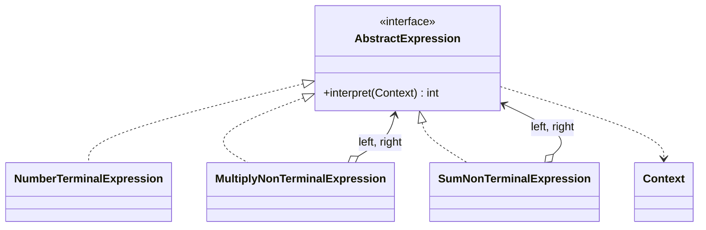

<div align="center">

# 🧮 Interpreter Design Pattern

   

*Evaluate sentences of a small language by modelling its grammar as classes.*

</div>

---

## 📑 Table of contents

- [🎯 Intent](#-intent)
- [🧩 The problem & the solution](#-the-problem--the-solution)
- [🔷 Structure](#-structure)
- [👥 Participants](#-participants)
- [🧭 When to use it](#-when-to-use-it)
- [📊 Pros & cons](#-pros--cons)
- [🌍 Real-world examples](#-real-world-examples)
- [💻 Code](#-code)
  - [1. 💡 Example 1 - `a * b`](#ex1)
  - [2. 💡 Example 2 - `(a * b) + (c * d)`](#ex2)
  - [3. 💡 Example 2 - optimised](#ex3)

---

## 🎯 Intent

> Given a language, define a representation of its **grammar** plus an interpreter that uses it to evaluate sentences.

## 🧩 The problem & the solution

| 😣 Problem | 💡 Solution |
|---|---|
| You need to evaluate expressions such as `(a * b) + (c * d)` from variables supplied at runtime. | Each grammar rule is a class: terminal expressions (numbers / variables) and non-terminal expressions (`multiply`, `sum`). Build a tree of them and call `interpret(context)` on the root. |

## 🔷 Structure



## 👥 Participants

| Role | Responsibility | In this repo |
|---|---|---|
| **Abstract Expression** | Declares `interpret()` | `AbstractExpression` |
| **Terminal Expression** | Leaf of the grammar | `NumberTerminalExpression` |
| **Non-terminal Expression** | Combines other expressions | `MultiplyNonTerminalExpression`, `SumNonTerminalExpression`, `BinaryNonTerminalExpression` |
| **Context** | Global information such as variable values | `Context` |
| **Client** | Builds the expression tree | `Client` |

## 🧭 When to use it

| ✅ Use it when | ⚠️ Avoid it when |
|---|---|
| A simple, stable grammar (rules engines, query filters, math expressions) | Large or complex grammars (use a parser generator) |
| You want grammar rules as easily extendable classes | Performance is critical |

## 📊 Pros & cons

| 👍 Pros | 👎 Cons |
|---|---|
| Easy to extend the grammar with new classes | Class explosion for complex grammars |
| Each rule is a small, testable class | Slower than dedicated parsers |

## 🌍 Real-world examples

- `java.util.regex.Pattern`
- SQL / rule-engine expressions
- Spring Expression Language (SpEL)

---

## 💻 Code

This folder has **3 examples** (16 Java files). Interfaces and abstract classes come first, the class with `main` comes last.

<a id="ex1"></a>

### 1. 💡 Example 1 - `a * b`

> The smallest tree: one multiply node over two number terminals.

<details open>
<summary><b>📁 Files in this example</b></summary>

```text
Example1(a mul b)/
├── Client/
│   └── Client.java
├── Context/
│   └── Context.java
└── Expression/
    ├── AbstractExpression.java
    ├── MultiplyNonTerminalExpression.java
    └── NumberTerminalExpression.java
```

</details>

#### 📄 `Expression/AbstractExpression.java`

<sub>interface · 6 lines</sub>

```java
package Expression;
import Context.Context;

public interface AbstractExpression {
    int interpret(Context context);
}
```

#### 📄 `Context/Context.java`

<sub>class · 16 lines</sub>

```java
package Context;

import java.util.HashMap;
import java.util.Map;

public class Context {
    Map<String,Integer> contextMap=new HashMap<>();
    public void put(String strVariable,int intVal){
        contextMap.put(strVariable,intVal);
    }

    public int get(String strVariable){
        return contextMap.get(strVariable);
    }

}
```

#### 📄 `Expression/MultiplyNonTerminalExpression.java`

<sub>class · 17 lines</sub>

```java
package Expression;

import Context.Context;
import Expression.AbstractExpression;

public class MultiplyNonTerminalExpression implements AbstractExpression {
    AbstractExpression leftExpression;
    AbstractExpression rightExpression;
    public MultiplyNonTerminalExpression(AbstractExpression leftExpression, AbstractExpression rightExpression) {
        this.leftExpression = leftExpression;
        this.rightExpression = rightExpression;
    }
    @Override
    public  int interpret(Context context){
        return leftExpression.interpret(context) * rightExpression.interpret(context);
    }
}
```

#### 📄 `Expression/NumberTerminalExpression.java`

<sub>class · 15 lines</sub>

```java
package Expression;

import Context.Context;
import Expression.AbstractExpression;

public class NumberTerminalExpression implements AbstractExpression {
    String stringValue;
   public NumberTerminalExpression(String stringVal){
        this.stringValue=stringVal;
    }
    @Override
    public int interpret(Context context){
        return context.get(stringValue);
    }
}
```

#### 📄 `Client/Client.java`

<sub>class · 19 lines</sub>

```java
package Client;

import Context.Context;
import Expression.AbstractExpression;
import Expression.MultiplyNonTerminalExpression;
import Expression.NumberTerminalExpression;

public class Client {
    public static void main(String[] args){
        //initialize the context
         Context context=new Context();
         context.put("a",2);
         context.put("b",4);

         //a*b
        AbstractExpression expression1=new MultiplyNonTerminalExpression(new NumberTerminalExpression("a"),new NumberTerminalExpression("b"));
        System.out.println(expression1.interpret(context));
    }
}
```

<details>
<summary><b>▶️ How to compile and run this example</b></summary>

```bash
# run from the repository root
mkdir -p out
find "Behavioural Design Pattern/8. Interpretor Design Pattern/Example1(a mul b)" -name "*.java" -print0 | xargs -0 javac -d out
java -cp out Client.Client
```

</details>

---

<a id="ex2"></a>

### 2. 💡 Example 2 - `(a * b) + (c * d)`

> Adds `SumNonTerminalExpression`, so multiply nodes become children of a sum node.

<details open>
<summary><b>📁 Files in this example</b></summary>

```text
Example2(a mul b) plus (c mul d)/
├── Client/
│   └── Client.java
├── Context/
│   └── Context.java
└── Expression/
    ├── AbstractExpression.java
    ├── MultiplyNonTerminalExpression.java
    ├── NumberTerminalExpression.java
    └── SumNonTerminalExpression.java
```

</details>

#### 📄 `Expression/AbstractExpression.java`

<sub>interface · 6 lines</sub>

```java
package Expression;
import Context.Context;

public interface AbstractExpression {
    int interpret(Context context);
}
```

#### 📄 `Context/Context.java`

<sub>class · 15 lines</sub>

```java
package Context;

import java.util.HashMap;
import java.util.Map;

public class Context{
    Map<String,Integer> contextMap=new HashMap<>();
    public void put(String strVariable,int intVal){
        contextMap.put(strVariable,intVal);
    }

    public int get(String strVariable){
        return contextMap.get(strVariable);
    }
}
```

#### 📄 `Expression/MultiplyNonTerminalExpression.java`

<sub>class · 16 lines</sub>

```java
package Expression;

import Context.Context;

public class MultiplyNonTerminalExpression implements AbstractExpression{
    AbstractExpression leftExpression;
    AbstractExpression rightExpression;
    public MultiplyNonTerminalExpression(AbstractExpression leftExpression, AbstractExpression rightExpression) {
        this.leftExpression = leftExpression;
        this.rightExpression = rightExpression;
    }
    @Override
    public  int interpret(Context context){
        return leftExpression.interpret(context) * rightExpression.interpret(context);
    }
}
```

#### 📄 `Expression/NumberTerminalExpression.java`

<sub>class · 14 lines</sub>

```java
package Expression;

import Context.Context;

public class NumberTerminalExpression implements AbstractExpression{
    String stringValue;
    public NumberTerminalExpression(String stringVal){
        this.stringValue=stringVal;
    }
    @Override
    public int interpret(Context context){
        return context.get(stringValue);
    }
}
```

#### 📄 `Expression/SumNonTerminalExpression.java`

<sub>class · 16 lines</sub>

```java
package Expression;

import Context.Context;

public class SumNonTerminalExpression implements AbstractExpression{
    AbstractExpression leftExpression;
    AbstractExpression rightExpression;
    public SumNonTerminalExpression(AbstractExpression leftExpression, AbstractExpression rightExpression) {
        this.leftExpression = leftExpression;
        this.rightExpression = rightExpression;
    }
    @Override
    public  int interpret(Context context){
        return leftExpression.interpret(context) + rightExpression.interpret(context);
    }
}
```

#### 📄 `Client/Client.java`

<sub>class · 20 lines</sub>

```java
package Client;

import Context.Context;
import Expression.*;

public class Client {
    public static void main(String[] args){
        //initialize the context
        Context context=new Context();
        context.put("a",2);
        context.put("b",4);
        context.put("c",8);
        context.put("d",16);

        //(a*b)+(c*d)
        Expression.AbstractExpression expression2=new SumNonTerminalExpression( new MultiplyNonTerminalExpression(new NumberTerminalExpression("a"),new NumberTerminalExpression("b")),
                new MultiplyNonTerminalExpression(new NumberTerminalExpression("c"),new NumberTerminalExpression("d")));
        System.out.println(expression2.interpret(context));
    }
}
```

<details>
<summary><b>▶️ How to compile and run this example</b></summary>

```bash
# run from the repository root
mkdir -p out
find "Behavioural Design Pattern/8. Interpretor Design Pattern/Example2(a mul b) plus (c mul d)" -name "*.java" -print0 | xargs -0 javac -d out
java -cp out Client.Client
```

</details>

---

<a id="ex3"></a>

### 3. 💡 Example 2 - optimised

> A single `BinaryNonTerminalExpression` replaces the separate multiply / sum classes.

<details open>
<summary><b>📁 Files in this example</b></summary>

```text
More Optimized Example2/
├── Client/
│   └── Client.java
├── Context/
│   └── Context.java
└── Expression/
    ├── AbstractExpression.java
    ├── BinaryNonTerminalExpression.java
    └── NumberTerminalExpression.java
```

</details>

#### 📄 `Expression/AbstractExpression.java`

<sub>interface · 6 lines</sub>

```java
package Expression;
import Context.Context;

public interface AbstractExpression {
    int interpret(Context context);
}
```

#### 📄 `Context/Context.java`

<sub>class · 15 lines</sub>

```java
package Context;

import java.util.HashMap;
import java.util.Map;

public class Context{
    Map<String,Integer> contextMap=new HashMap<>();
    public void put(String strVariable,int intVal){
        contextMap.put(strVariable,intVal);
    }

    public int get(String strVariable){
        return contextMap.get(strVariable);
    }
}
```

#### 📄 `Expression/BinaryNonTerminalExpression.java`

<sub>class · 26 lines</sub>

```java
package Expression;

import Context.Context;

public class BinaryNonTerminalExpression implements AbstractExpression{
    AbstractExpression leftExpression;
    AbstractExpression rightExpression;
    char operator;
    public BinaryNonTerminalExpression(AbstractExpression leftExpression, AbstractExpression rightExpression,char Operator) {
        this.leftExpression = leftExpression;
        this.rightExpression = rightExpression;
        this.operator=Operator;
    }
    @Override
    public  int interpret(Context context){
        switch (operator){
            case '+':
                return  leftExpression.interpret(context) + rightExpression.interpret(context);
            case '*':
                return leftExpression.interpret(context) * rightExpression.interpret(context);
            default:
                return 0;
        }

    }
}
```

#### 📄 `Expression/NumberTerminalExpression.java`

<sub>class · 14 lines</sub>

```java
package Expression;

import Context.Context;

public class NumberTerminalExpression implements AbstractExpression{
    String stringValue;
    public NumberTerminalExpression(String stringVal){
        this.stringValue=stringVal;
    }
    @Override
    public int interpret(Context context){
        return context.get(stringValue);
    }
}
```

#### 📄 `Client/Client.java`

<sub>class · 20 lines</sub>

```java
package Client;

import Context.Context;
import Expression.*;

public class Client {
    public static void main(String[] args){
        //initialize the context
        Context context=new Context();
        context.put("a",2);
        context.put("b",4);
        context.put("c",8);
        context.put("d",16);

        //(a*b)+(c*d)
        Expression.AbstractExpression expression2=new BinaryNonTerminalExpression( new BinaryNonTerminalExpression(new NumberTerminalExpression("a"),new NumberTerminalExpression("b"),'*'),
                new BinaryNonTerminalExpression(new NumberTerminalExpression("c"),new NumberTerminalExpression("d"),'*'),'+');
        System.out.println(expression2.interpret(context));
    }
}
```

<details>
<summary><b>▶️ How to compile and run this example</b></summary>

```bash
# run from the repository root
mkdir -p out
find "Behavioural Design Pattern/8. Interpretor Design Pattern/More Optimized Example2" -name "*.java" -print0 | xargs -0 javac -d out
java -cp out Client.Client
```

</details>

---

<div align="center">

[◀ Memento](../7.%20Momento%20Design%20Pattern/README.md) &nbsp;·&nbsp; [📚 All patterns](../PATTERNS.md) &nbsp;·&nbsp; [Mediator ▶](../9.%20Mediator%20Design%20Pattern/README.md)

</div>
