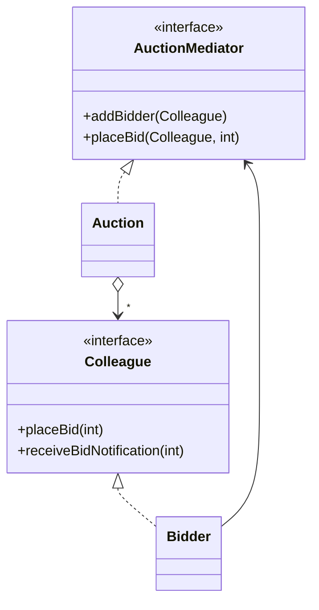

<div align="center">

# 🧑‍⚖️ Mediator Design Pattern

   

*One central object coordinates how many objects interact.*

</div>

---

## 📑 Table of contents

- [🎯 Intent](#-intent)
- [🧩 The problem & the solution](#-the-problem--the-solution)
- [🔷 Structure](#-structure)
- [👥 Participants](#-participants)
- [🧭 When to use it](#-when-to-use-it)
- [📊 Pros & cons](#-pros--cons)
- [🌍 Real-world examples](#-real-world-examples)
- [💻 Code](#-code)
  - [1. Implementation](#ex1)

---

## 🎯 Intent

> Define an object that **encapsulates how a set of objects interact**, so they no longer refer to each other directly.

## 🧩 The problem & the solution

| 😣 Problem | 💡 Solution |
|---|---|
| In an online auction every bidder would need to know every other bidder to announce a new bid, creating a tangle of many-to-many references. | Bidders talk only to the `Auction` mediator. It receives a bid and relays it to the other bidders. |

## 🔷 Structure



## 👥 Participants

| Role | Responsibility | In this repo |
|---|---|---|
| **Mediator** | Interface for coordination | `AuctionMediator` |
| **Concrete Mediator** | Knows all colleagues and routes messages | `Auction` |
| **Colleague** | Interface of participants | `Colleague` |
| **Concrete Colleague** | Talks only to the mediator | `Bidder` |

## 🧭 When to use it

| ✅ Use it when | ⚠️ Avoid it when |
|---|---|
| Many objects communicate in complex ways | Few objects with simple interactions |
| Reuse of objects is hard because of many cross-references | The mediator is turning into a god class |

## 📊 Pros & cons

| 👍 Pros | 👎 Cons |
|---|---|
| Fewer dependencies between objects | Mediator can become complex and hard to maintain |
| Interaction logic in one place |  |
| Easy to add new colleagues |  |

## 🌍 Real-world examples

- Chat rooms, air-traffic control
- `java.util.Timer`, `ExecutorService`
- MVC controllers, UI dialogs

---

## 💻 Code

This folder has **1 example** (5 Java files). Interfaces and abstract classes come first, the class with `main` comes last.

<a id="ex1"></a>

### 1. Implementation

<details open>
<summary><b>📁 Files in this example</b></summary>

```text
Online Auction/
├── Colleague/
│   ├── Bidder.java
│   └── Colleague.java
├── Mediator/
│   ├── Auction.java
│   └── AuctionMediator.java
└── Main.java
```

</details>

#### 📄 `Colleague/Colleague.java`

<sub>interface · 7 lines</sub>

```java
package Colleague;

public interface Colleague {
    void placeBid(int bidAmount);
    void receiveBidNotification(int bidAmount);
    String getName();
}
```

#### 📄 `Mediator/AuctionMediator.java`

<sub>interface · 8 lines</sub>

```java
package Mediator;
import Colleague.Colleague;

//this is Mediator Interface
public interface AuctionMediator {
    void addBidder(Colleague bidder);
    void placeBid(Colleague bidder, int bidAmount);
}
```

#### 📄 `Colleague/Bidder.java`

<sub>class · 30 lines</sub>

```java
package Colleague;

import Colleague.Colleague;
import Mediator.AuctionMediator;

public class Bidder implements Colleague {
   String name;
   AuctionMediator auctionMediator;

    public Bidder(String name, AuctionMediator auctionMediator) {
        this.name = name;
        this.auctionMediator = auctionMediator;
        auctionMediator.addBidder(this);
    }

    @Override
    public void placeBid(int bidAmount) {
        auctionMediator.placeBid(this,bidAmount);
    }

    @Override
    public void receiveBidNotification(int bidAmount) {
     System.out.println("Colleague.Bidder: "+name+" got the notification that someone has put bid of : "+bidAmount);
    }

    @Override
    public String getName() {
        return name;
    }
}
```

#### 📄 `Mediator/Auction.java`

<sub>class · 26 lines</sub>

```java
package Mediator;

import Mediator.AuctionMediator;
import Colleague.Colleague;


import java.util.ArrayList;
import java.util.List;
//Mediator Concrete Class
public class Auction implements AuctionMediator {
    List<Colleague> colleagues=new ArrayList<>();
    @Override
    public void addBidder(Colleague bidder) {
        colleagues.add(bidder);
    }

    @Override
    public void placeBid(Colleague bidder, int bidAmount) {
        for(Colleague colleague:colleagues){
            if(!colleague.getName().equals(bidder.getName())){
                colleague.receiveBidNotification(bidAmount);
            }
        }

    }
}
```

#### 📄 `Main.java`

<sub>class · 16 lines</sub>

```java
import Colleague.Colleague;
import Colleague.Bidder;
import Mediator.Auction;
import Mediator.AuctionMediator;

public class Main {
    public static void main(String[] args){
        AuctionMediator auctionMediatorObj=new Auction();
        Colleague bidder1=new Bidder("A",auctionMediatorObj);
        Colleague bidder2=new Bidder("B",auctionMediatorObj);

        bidder1.placeBid(2000);
        bidder2.placeBid(3000);
        bidder1.placeBid(3001);
    }
}
```

<details>
<summary><b>▶️ How to compile and run this example</b></summary>

```bash
# run from the repository root
mkdir -p out
find "Behavioural Design Pattern/9. Mediator Design Pattern/Online Auction" -name "*.java" -print0 | xargs -0 javac -d out
java -cp out Main
```

</details>

---

<div align="center">

[◀ Interpreter](../8.%20Interpretor%20Design%20Pattern/README.md) &nbsp;·&nbsp; [📚 All patterns](../PATTERNS.md) &nbsp;·&nbsp; [Null Object ▶](../10.%20Null%20Object%20Design%20Pattern/README.md)

</div>
