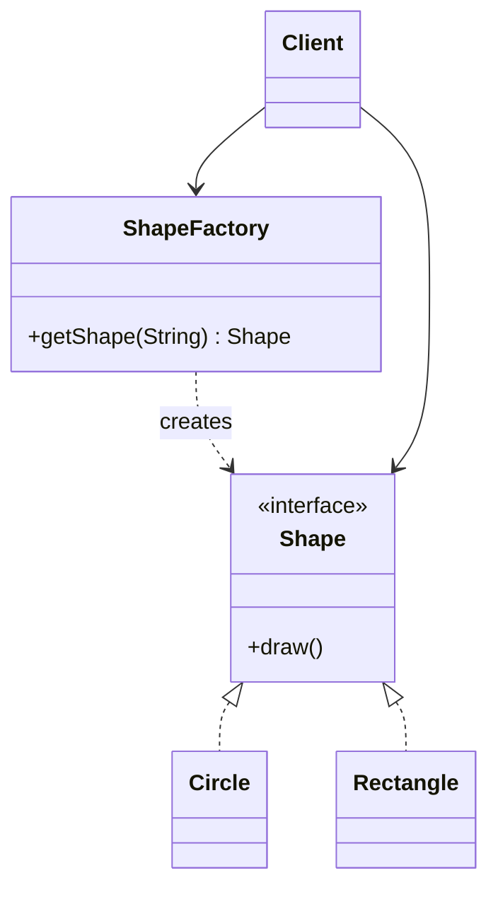

<div align="center">

# 🏭 Factory Design Pattern

   

*Create objects through a factory instead of calling `new` everywhere.*

</div>

---

## 📑 Table of contents

- [🎯 Intent](#-intent)
- [🧩 The problem & the solution](#-the-problem--the-solution)
- [🔷 Structure](#-structure)
- [👥 Participants](#-participants)
- [🧭 When to use it](#-when-to-use-it)
- [📊 Pros & cons](#-pros--cons)
- [🌍 Real-world examples](#-real-world-examples)
- [💻 Code](#-code)
  - [1. Implementation](#ex1)

---

## 🎯 Intent

> Define one place that decides **which concrete class to instantiate**, so client code only talks to an interface.

## 🧩 The problem & the solution

| 😣 Problem | 💡 Solution |
|---|---|
| Client code that does `new Circle()` / `new Rectangle()` is welded to concrete classes. Adding a new shape means hunting down and editing every `if/else` that creates shapes. | Hide object creation behind a `ShapeFactory`. The client asks the factory for a shape by type and receives it as the `Shape` interface. |

## 🔷 Structure



## 👥 Participants

| Role | Responsibility | In this repo |
|---|---|---|
| **Product** | Interface every created object implements | `Shape` |
| **Concrete Product** | The real classes that get created | `Circle`, `Rectangle` |
| **Factory** | Decides which concrete product to build | `ShapeFactory` |
| **Client** | Uses the factory, never the concrete classes | `Main` |

## 🧭 When to use it

| ✅ Use it when | ⚠️ Avoid it when |
|---|---|
| The exact class to create is only known at runtime | There is only one concrete class and it will never change |
| You want to centralise creation logic in one place | A plain constructor is clear enough |
| New product types should be added without touching client code |  |

## 📊 Pros & cons

| 👍 Pros | 👎 Cons |
|---|---|
| Loose coupling between client and concrete classes | One more class (the factory) to maintain |
| Open/Closed: add products without changing clients | Factory can grow into a big `switch` if not organised |
| Single place to change creation logic |  |

## 🌍 Real-world examples

- `Calendar.getInstance()`, `NumberFormat.getInstance()` in the JDK
- `LoggerFactory.getLogger()` (SLF4J)
- Payment-gateway / notification-channel selection

---

## 💻 Code

This folder has **1 example** (5 Java files). Interfaces and abstract classes come first, the class with `main` comes last.

<a id="ex1"></a>

### 1. Implementation

<details open>
<summary><b>📁 Files in this example</b></summary>

```text
1. Factory Design Pattern/
├── Circle.java
├── Main.java
├── Rectangle.java
├── Shape.java
└── ShapeFactory.java
```

</details>

#### 📄 `Shape.java`

<sub>interface · 3 lines</sub>

```java
public interface Shape {
   public void draw();
}
```

#### 📄 `Circle.java`

<sub>class · 6 lines</sub>

```java
public class Circle implements Shape{
    @Override
    public void draw() {
        System.out.println("Circle");
    }
}
```

#### 📄 `Rectangle.java`

<sub>class · 7 lines</sub>

```java
public class Rectangle implements Shape{

    @Override
    public void draw() {
        System.out.println("Rectangle");
    }
}
```

#### 📄 `ShapeFactory.java`

<sub>class · 12 lines</sub>

```java
public class ShapeFactory {
    Shape getShape(String input){
        switch (input){
            case "CIRCLE":
                return new Circle();
            case "RECTANGLE":
                return new Rectangle();
            default:
                return null;
        }
    }
}
```

#### 📄 `Main.java`

<sub>class · 10 lines</sub>

```java
public class Main {
    public static void main(String[] args){
        ShapeFactory shapeFactoryObj=new ShapeFactory();
        Shape shapeObj1=shapeFactoryObj.getShape("CIRCLE");
        shapeObj1.draw();

        Shape shapeObj2=shapeFactoryObj.getShape("RECTANGLE");
        shapeObj2.draw();
    }
}
```

<details>
<summary><b>▶️ How to compile and run this example</b></summary>

```bash
# run from the repository root
mkdir -p out
find "Creational Design Pattern/1. Factory Design Pattern" -name "*.java" -print0 | xargs -0 javac -d out
java -cp out Main
```

</details>

---

<div align="center">

[📚 All patterns](../PATTERNS.md) &nbsp;·&nbsp; [Abstract Factory ▶](../2.%20Abstract%20Factory%20Design%20Pattern/README.md)

</div>
