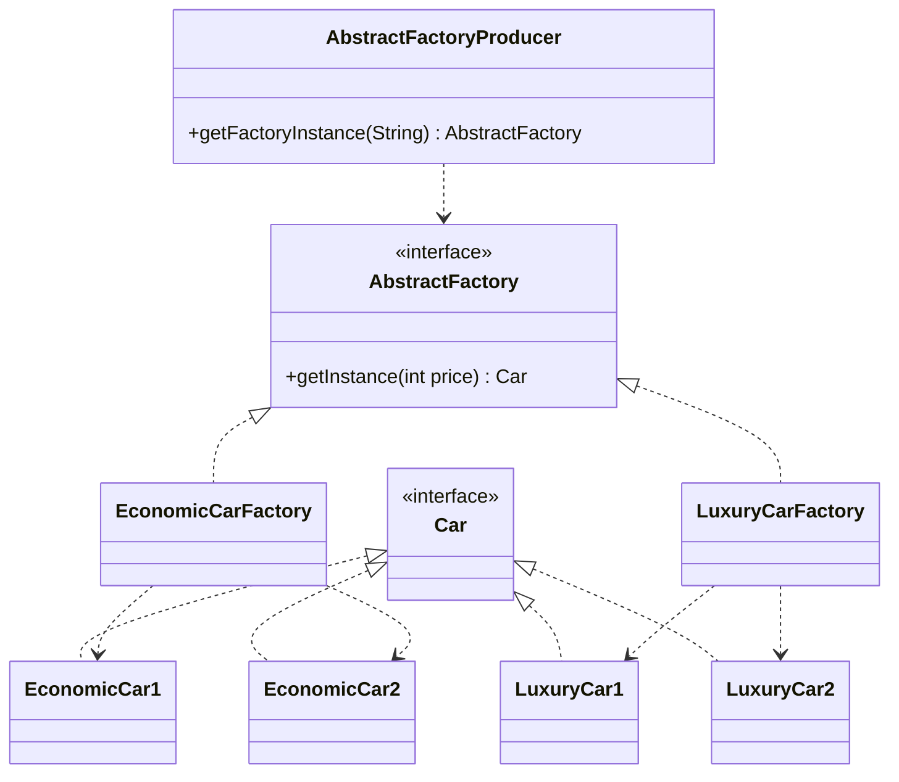

<div align="center">

# 🏗️ Abstract Factory Design Pattern

   

*A factory of factories that builds families of related objects.*

</div>

---

## 📑 Table of contents

- [🎯 Intent](#-intent)
- [🧩 The problem & the solution](#-the-problem--the-solution)
- [🔷 Structure](#-structure)
- [👥 Participants](#-participants)
- [🧭 When to use it](#-when-to-use-it)
- [📊 Pros & cons](#-pros--cons)
- [🌍 Real-world examples](#-real-world-examples)
- [💻 Code](#-code)
  - [1. Implementation](#ex1)

---

## 🎯 Intent

> Provide an interface for creating **families of related objects** without specifying their concrete classes.

## 🧩 The problem & the solution

| 😣 Problem | 💡 Solution |
|---|---|
| You have product families (economic cars, luxury cars). Mixing a luxury engine with an economic body must be impossible, and the client should not care which family it gets. | Each family gets its own factory (`EconomicCarFactory`, `LuxuryCarFactory`) implementing a common `AbstractFactory`. `AbstractFactoryProducer` returns the right factory, which then builds the cars of that family. |

## 🔷 Structure



## 👥 Participants

| Role | Responsibility | In this repo |
|---|---|---|
| **Abstract Factory** | Declares creation methods for a product family | `AbstractFactory` |
| **Concrete Factory** | Builds products of one specific family | `EconomicCarFactory`, `LuxuryCarFactory` |
| **Abstract Product** | Interface of the products | `Car` |
| **Concrete Products** | Family-specific implementations | `EconomicCar1/2`, `LuxuryCar1/2` |
| **Producer** | Picks the right factory | `AbstractFactoryProducer` |

## 🧭 When to use it

| ✅ Use it when | ⚠️ Avoid it when |
|---|---|
| Products must be used together as a consistent family | Only one product type exists (use a simple Factory) |
| The system should be independent of how its products are created | Families change rarely and adding products is the common case (it forces edits in every factory) |
| You want to switch an entire family (theme, platform, tier) in one place |  |

## 📊 Pros & cons

| 👍 Pros | 👎 Cons |
|---|---|
| Guarantees products from one family are compatible | Many classes and interfaces |
| Client is isolated from concrete classes | Adding a new product *kind* means changing every factory |
| Swapping a whole family is one line |  |

## 🌍 Real-world examples

- Cross-platform UI toolkits (Windows / macOS widgets)
- `DocumentBuilderFactory` in JAXP
- Cloud-provider SDK kits (AWS vs Azure resources)

---

## 💻 Code

This folder has **1 example** (10 Java files). Interfaces and abstract classes come first, the class with `main` comes last.

<a id="ex1"></a>

### 1. Implementation

<details open>
<summary><b>📁 Files in this example</b></summary>

```text
2. Abstract Factory Design Pattern/
├── Car/
│   ├── Car.java
│   ├── EconomicCar1.java
│   ├── EconomicCar2.java
│   ├── LuxuryCar1.java
│   └── LuxuryCar2.java
├── AbstractFactory.java
├── AbstractFactoryProducer.java
├── EconomicCarFactory.java
├── LuxuryCarFactory.java
└── Main.java
```

</details>

#### 📄 `AbstractFactory.java`

<sub>interface · 5 lines</sub>

```java
import Car.Car;

public interface AbstractFactory {
    public Car getInstance(int price);
}
```

#### 📄 `Car/Car.java`

<sub>interface · 5 lines</sub>

```java
package Car;

public interface Car {
    public int getTopSpeed();
}
```

#### 📄 `AbstractFactoryProducer.java`

<sub>class · 10 lines</sub>

```java
public class AbstractFactoryProducer {
    public AbstractFactory getFactoryInstance(String value){
        if(value.equals("Economic")){
            return new EconomicCarFactory();
        }else if(value.equals("Luxury")||value.equals("Premium")){
            return new LuxuryCarFactory();
        }
        return null;
    }
}
```

#### 📄 `Car/EconomicCar1.java`

<sub>class · 10 lines</sub>

```java
package Car;

import Car.Car;

public class EconomicCar1 implements Car {
    @Override
    public int getTopSpeed(){
        return 100;
    }
}
```

#### 📄 `Car/EconomicCar2.java`

<sub>class · 10 lines</sub>

```java
package Car;

import Car.Car;

public class EconomicCar2 implements Car {
    @Override
    public int getTopSpeed(){
        return 150;
    }
}
```

#### 📄 `Car/LuxuryCar1.java`

<sub>class · 10 lines</sub>

```java
package Car;

import Car.Car;

public class LuxuryCar1 implements Car {
    @Override
    public int getTopSpeed(){
        return 250;
    }
}
```

#### 📄 `Car/LuxuryCar2.java`

<sub>class · 10 lines</sub>

```java
package Car;

import Car.Car;

public class LuxuryCar2 implements Car {
    @Override
    public int getTopSpeed(){
        return 150;
    }
}
```

#### 📄 `EconomicCarFactory.java`

<sub>class · 13 lines</sub>

```java
import Car.*;

public class EconomicCarFactory implements AbstractFactory{
    @Override
    public Car getInstance(int price) {
        if(price<=300000){
            return new EconomicCar1();
        }else if(price>300000){
            return new EconomicCar2();
        }
        return null;
    }
}
```

#### 📄 `LuxuryCarFactory.java`

<sub>class · 13 lines</sub>

```java
import Car.*;

public class LuxuryCarFactory implements AbstractFactory{
    @Override
    public Car getInstance(int price) {
        if(price>=100000 && price<=200000){
            return new LuxuryCar1();
        }else if(price>200000){
            return new LuxuryCar2();
        }
        return null;
    }
}
```

#### 📄 `Main.java`

<sub>class · 11 lines</sub>

```java
import Car.Car;

public class Main {
    public static void main(String[] args){

        AbstractFactoryProducer abstractFactoryProducerObj=new AbstractFactoryProducer();
        AbstractFactory abstractFactoryObj=abstractFactoryProducerObj.getFactoryInstance("Premium");
        Car carObj=abstractFactoryObj.getInstance(500000);
        System.out.println(carObj.getTopSpeed());
    }
}
```

<details>
<summary><b>▶️ How to compile and run this example</b></summary>

```bash
# run from the repository root
mkdir -p out
find "Creational Design Pattern/2. Abstract Factory Design Pattern" -name "*.java" -print0 | xargs -0 javac -d out
java -cp out Main
```

</details>

---

<div align="center">

[◀ Factory](../1.%20Factory%20Design%20Pattern/README.md) &nbsp;·&nbsp; [📚 All patterns](../PATTERNS.md) &nbsp;·&nbsp; [Builder ▶](../3.%20Builder%20Design%20Pattern/README.md)

</div>
