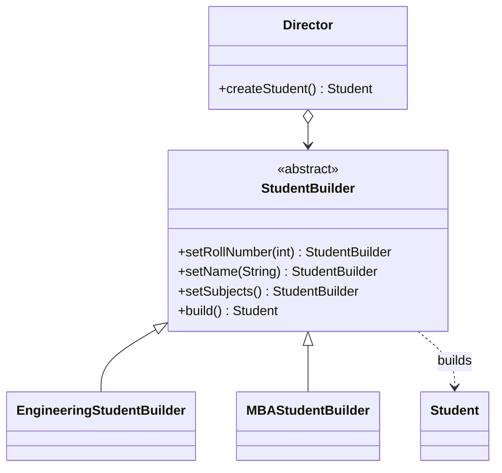

<div align="center">

# 🧰 Builder Design Pattern

   

*Construct complex objects step by step.*

</div>

---

## 📑 Table of contents

- [🎯 Intent](#-intent)
- [🧩 The problem & the solution](#-the-problem--the-solution)
- [🔷 Structure](#-structure)
- [👥 Participants](#-participants)
- [🧭 When to use it](#-when-to-use-it)
- [📊 Pros & cons](#-pros--cons)
- [🌍 Real-world examples](#-real-world-examples)
- [💻 Code](#-code)
  - [1. ❌ Problem 1 - telescoping constructor](#ex1)
  - [2. ❌ Problem 2 - same issue, other shape](#ex2)
  - [3. ✅ Solution - Builder + Director](#ex3)

---

## 🎯 Intent

> Separate the **construction** of a complex object from its representation so the same process can create different results.

## 🧩 The problem & the solution

| 😣 Problem | 💡 Solution |
|---|---|
| `Student` has one mandatory and many optional fields. A telescoping constructor (`new Student(1, 20, null, null, null, list)`) is unreadable and error-prone, and every new field breaks every call site. | A `StudentBuilder` collects the values step by step. Concrete builders (`EngineeringStudentBuilder`, `MBAStudentBuilder`) fill in different subjects, and a `Director` knows *which steps in which order* make a valid student. |

## 🔷 Structure



## 👥 Participants

| Role | Responsibility | In this repo |
|---|---|---|
| **Builder** | Declares the build steps | `StudentBuilder` |
| **Concrete Builders** | Implement the steps for one variant | `EngineeringStudentBuilder`, `MBAStudentBuilder` |
| **Director** | Orders the steps | `Director` |
| **Product** | The complex object | `Student` |
| **Client** | Chooses a builder and asks the director | `Client` |

## 🧭 When to use it

| ✅ Use it when | ⚠️ Avoid it when |
|---|---|
| Constructors would need many parameters | Objects are small with 2-3 fields |
| The same construction process should produce different representations | No variations in construction are expected |
| You want immutable objects with optional fields |  |

## 📊 Pros & cons

| 👍 Pros | 👎 Cons |
|---|---|
| Readable object construction | More code (builder per product) |
| Step-by-step and reusable construction code | Product must be mutable during construction unless a nested static builder is used |
| Product details stay hidden from the client |  |

## 🌍 Real-world examples

- `StringBuilder`
- Lombok `@Builder`
- `Stream.Builder`, `HttpRequest.newBuilder()`

---

## 💻 Code

This folder has **3 examples** (8 Java files). Interfaces and abstract classes come first, the class with `main` comes last.

<a id="ex1"></a>

### 1. ❌ Problem 1 - telescoping constructor

> A `Student` whose constructor takes every field. Callers must pass `null` for the optional ones.

<details open>
<summary><b>📁 Files in this example</b></summary>

```text
Problem1/
└── Student.java
```

</details>

#### 📄 `Student.java`

<sub>class · 18 lines</sub>

```java
import java.util.List;
    public class Student {
        int rollNumber;//Mandatory
        int age;//Optional
        String name;//optional
        String fatherName;//optional
        String motherName;//optional
        List<String> subjects;//optional

        public Student(int rollNumber, int age, String name, String fatherName, String motherName, List<String> subjects) {
            this.rollNumber = rollNumber;
            this.age = age;
            this.name = name;
            this.fatherName = fatherName;
            this.motherName = motherName;
            this.subjects = subjects;
        }
    }
```

---

<a id="ex2"></a>

### 2. ❌ Problem 2 - same issue, other shape

> A second version of the same problem to show how brittle long constructors are.

<details open>
<summary><b>📁 Files in this example</b></summary>

```text
Problem2/
└── Student.java
```

</details>

#### 📄 `Student.java`

<sub>class · 27 lines</sub>

```java
import java.util.List;
    public class Student {
        int rollNumber;//Mandatory
        int age;//Optional
        String name;//optional
        String fatherName;//optional
        String motherName;//optional
        List<String> subjects;//optional

        public Student(int rollNumber, String name) {
            this.rollNumber = rollNumber;
            this.name = name;
        }
        public Student(int rollNumber, String FathersName) {//SAme COnstructor type argument and too many Constructor
            this.rollNumber = rollNumber;
            this.fatherName = FathersName;
        }

        public Student(int rollNumber, int age, String name, String fatherName, String motherName, List<String> subjects) {
            this.rollNumber = rollNumber;
            this.age = age;
            this.name = name;
            this.fatherName = fatherName;
            this.motherName = motherName;
            this.subjects = subjects;
        }
    }
```

---

<a id="ex3"></a>

### 3. ✅ Solution - Builder + Director

> `StudentBuilder` with two concrete builders and a `Director` that drives them.

<details open>
<summary><b>📁 Files in this example</b></summary>

```text
Solution is Builder Design Pattern/
├── Client.java
├── Director.java
├── EngineeringStudentBuilder.java
├── MBAStudentBuilder.java
├── Student.java
└── StudentBuilder.java
```

</details>

#### 📄 `StudentBuilder.java`

<sub>abstract class · 45 lines</sub>

```java
package LowLevelDesign.DesignPatterns.BuilderDesignPattern;

import java.util.List;

public abstract class StudentBuilder {

    int rollNumber;
    int age;
    String name;
    String fatherName;
    String motherName;
    List<String> subjects;

    public StudentBuilder setRollNumber(int rollNumber) {
        this.rollNumber = rollNumber;
        return this;
    }

    public StudentBuilder setAge(int age) {
        this.age = age;
        return this;
    }

    public StudentBuilder setName(String name) {
        this.name = name;
        return this;
    }

    public StudentBuilder setFatherName(String fatherName) {
        this.fatherName = fatherName;
        return this;
    }

    public StudentBuilder setMotherName(String motherName) {
        this.motherName = motherName;
        return this;
    }

    abstract public StudentBuilder setSubjects();

    public Student build() {
        return new Student(this);
    }

}
```

#### 📄 `Director.java`

<sub>class · 33 lines</sub>

```java
package LowLevelDesign.DesignPatterns.BuilderDesignPattern;

public class Director {

    StudentBuilder studentBuilder;

    Director(StudentBuilder studentBuilder){
        this.studentBuilder = studentBuilder;
    }

    public Student createStudent(){

        if(studentBuilder instanceof EngineeringStudentBuilder){
            return createEngineeringStudent();
        }
        else if(studentBuilder instanceof MBAStudentBuilder){
            return createMBAStudent();
        }
        return null;
    }


    private Student createEngineeringStudent(){

        return studentBuilder.setRollNumber(1).setAge(22).setName("sj").setSubjects().build();
    }

    private Student createMBAStudent(){

        return studentBuilder.setRollNumber(2).setAge(24).setName("sj").setFatherName("MyFatherName").setMotherName("MyMotherName").setSubjects().build();

    }
}
```

#### 📄 `EngineeringStudentBuilder.java`

<sub>class · 19 lines</sub>

```java
package LowLevelDesign.DesignPatterns.BuilderDesignPattern;

import java.util.ArrayList;
import java.util.List;

public class EngineeringStudentBuilder extends StudentBuilder{

    @Override
    public StudentBuilder setSubjects() {
        List<String> subs = new ArrayList<>();
        subs.add("DSA");
        subs.add("OS");
        subs.add("Computer Architecture");
        this.subjects = subs;
        return this;
    }


}
```

#### 📄 `MBAStudentBuilder.java`

<sub>class · 17 lines</sub>

```java
package LowLevelDesign.DesignPatterns.BuilderDesignPattern;

import java.util.ArrayList;
import java.util.List;

public class MBAStudentBuilder extends StudentBuilder{

    @Override
    public StudentBuilder setSubjects() {
        List<String> subs = new ArrayList<>();
        subs.add("Micro Economics");
        subs.add("Business Studies");
        subs.add("Operations Management");
        this.subjects = subs;
        return this;
    }
}
```

#### 📄 `Student.java`

<sub>class · 30 lines</sub>

```java
package LowLevelDesign.DesignPatterns.BuilderDesignPattern;

import java.util.List;

public class Student {
    int rollNumber;
    int age;
    String name;
    String fatherName;
    String motherName;
    List<String> subjects;

    public Student(StudentBuilder builder){
        this.rollNumber = builder.rollNumber;
        this.age = builder.age;
        this.name = builder.name;
        this.fatherName = builder.fatherName;
        this.motherName = builder.motherName;
        this.subjects = builder.subjects;
    }

    public String toString(){
        return ""+ " roll number: " + this.rollNumber +
                " age: " + this.age +
                " name: " + this.name +
                " father name: " + this.fatherName +
                " mother name: " + this.motherName +
                " subjects: " + subjects.get(0) + "," + subjects.get(1) + "," + subjects.get(2);
    }
}
```

#### 📄 `Client.java`

<sub>class · 17 lines</sub>

```java
package LowLevelDesign.DesignPatterns.BuilderDesignPattern;

public class Client {

    public static void main(String args[]){

        Director directorObj1 = new Director(new EngineeringStudentBuilder());
        Director directorObj2 = new Director(new MBAStudentBuilder());

        Student engineerStudent = directorObj1.createStudent();
        Student mbaStudent =directorObj2.createStudent();

        System.out.println(engineerStudent.toString());
        System.out.println(mbaStudent.toString());

    }
}
```

<details>
<summary><b>▶️ How to compile and run this example</b></summary>

```bash
# run from the repository root
mkdir -p out
find "Creational Design Pattern/3. Builder Design Pattern/Solution is Builder Design Pattern" -name "*.java" -print0 | xargs -0 javac -d out
java -cp out LowLevelDesign.DesignPatterns.BuilderDesignPattern.Client
```

</details>

---

<div align="center">

[◀ Abstract Factory](../2.%20Abstract%20Factory%20Design%20Pattern/README.md) &nbsp;·&nbsp; [📚 All patterns](../PATTERNS.md) &nbsp;·&nbsp; [Prototype ▶](../4.%20Prototype%20Design%20Pattern/README.md)

</div>
