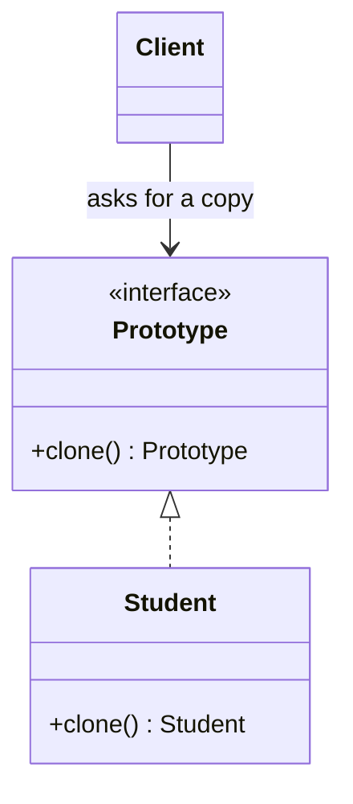

<div align="center">

# 🧬 Prototype Design Pattern

   

*Create new objects by cloning an existing one.*

</div>

---

## 📑 Table of contents

- [🎯 Intent](#-intent)
- [🧩 The problem & the solution](#-the-problem--the-solution)
- [🔷 Structure](#-structure)
- [👥 Participants](#-participants)
- [🧭 When to use it](#-when-to-use-it)
- [📊 Pros & cons](#-pros--cons)
- [🌍 Real-world examples](#-real-world-examples)
- [💻 Code](#-code)
  - [1. ❌ Problem - rebuilding every object](#ex1)
  - [2. ✅ Solution - clone()](#ex2)

---

## 🎯 Intent

> Specify the kind of objects to create using a **prototypical instance** and create new ones by copying it.

## 🧩 The problem & the solution

| 😣 Problem | 💡 Solution |
|---|---|
| Re-creating a `Student` from scratch (fetching data, running heavy setup) every time is slow, and the client has to know every field to rebuild it. | `Student` implements a `Prototype` interface with `clone()`. The client copies an existing student and changes only what differs. |

## 🔷 Structure



## 👥 Participants

| Role | Responsibility | In this repo |
|---|---|---|
| **Prototype** | Declares the clone operation | `Prototype` |
| **Concrete Prototype** | Implements cloning | `Student` |
| **Client** | Clones instead of constructing | `Main` |

## 🧭 When to use it

| ✅ Use it when | ⚠️ Avoid it when |
|---|---|
| Object creation is costly compared with copying | Objects hold resources that cannot be copied (sockets, file handles) |
| You want to avoid parallel factory hierarchies | Circular references make deep copies tricky |
| Runtime-configured objects should be reused as templates |  |

## 📊 Pros & cons

| 👍 Pros | 👎 Cons |
|---|---|
| Fast creation of complex objects | Deep vs shallow copy must be handled carefully |
| No dependency on concrete classes | Cloning objects with circular references is hard |
| Add and remove products at runtime |  |

## 🌍 Real-world examples

- `Object.clone()` / copy constructors
- Spreadsheet or drawing-tool 'duplicate' features
- Game engines spawning enemies from a template

---

## 💻 Code

This folder has **2 examples** (5 Java files). Interfaces and abstract classes come first, the class with `main` comes last.

<a id="ex1"></a>

### 1. ❌ Problem - rebuilding every object

> The client copies each `Student` field by field. This version intentionally **does not compile**: `Main` cannot read `Student`'s private fields, which is exactly why a `clone()` method is needed.

<details open>
<summary><b>📁 Files in this example</b></summary>

```text
Problem/
├── Main.java
└── Student.java
```

</details>

#### 📄 `Student.java`

<sub>class · 12 lines</sub>

```java
public class Student {
    int age;
    private int rollNumber;
    String name;
    Student(){}

    Student(int age, int rollNumber, String name) {
        this.age = age;
        this.rollNumber = rollNumber;
        this.name = name;
    }
}
```

#### 📄 `Main.java`

<sub>class · 11 lines</sub>

```java
public class Main {
    public  static void main(String[] args){
        Student obj=new Student(20,76,"Ram");

        //Creating clone of Obj
        Student cloneObj=new Student();
        cloneObj.name=obj.name;
        cloneObj.age=obj.age;
        cloneObj.rollNumber=obj.rollNumber;//gives error because trying to access private member
    }
}
```

---

<a id="ex2"></a>

### 2. ✅ Solution - clone()

> `Student` implements `Prototype`, so copies are one call.

<details open>
<summary><b>📁 Files in this example</b></summary>

```text
Solution is Prototype Design Pattern/
├── Main.java
├── Prototype.java
└── Student.java
```

</details>

#### 📄 `Prototype.java`

<sub>interface · 3 lines</sub>

```java
public interface Prototype {
    Prototype clone();
}
```

#### 📄 `Student.java`

<sub>class · 17 lines</sub>

```java
public class Student implements Prototype{
    int age;
    private int rollNumber;
    String name;
    Student(){}

    Student(int age, int rollNumber, String name) {
        this.age = age;
        this.rollNumber = rollNumber;
        this.name = name;
    }

    @Override
    public Prototype clone() {
        return new Student(age,rollNumber,name);
    }
}
```

#### 📄 `Main.java`

<sub>class · 9 lines</sub>

```java
public class Main {
    public  static void main(String[] args){
        Student obj=new Student(20,76,"Ram");

        //Creating clone of Obj
        Student cloneObj=(Student)obj.clone();

    }
}
```

<details>
<summary><b>▶️ How to compile and run this example</b></summary>

```bash
# run from the repository root
mkdir -p out
find "Creational Design Pattern/4. Prototype Design Pattern/Solution is Prototype Design Pattern" -name "*.java" -print0 | xargs -0 javac -d out
java -cp out Main
```

</details>

---

<div align="center">

[◀ Builder](../3.%20Builder%20Design%20Pattern/README.md) &nbsp;·&nbsp; [📚 All patterns](../PATTERNS.md) &nbsp;·&nbsp; [Singleton ▶](../5.%20Singleton%20Design%20Pattern/README.md)

</div>
