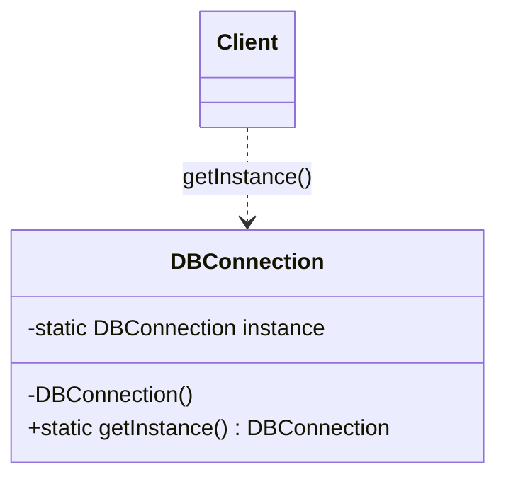

<div align="center">

# 1️⃣ Singleton Design Pattern

   

*Exactly one instance, one global access point.*

</div>

---

## 📑 Table of contents

- [🎯 Intent](#-intent)
- [🧩 The problem & the solution](#-the-problem--the-solution)
- [🔷 Structure](#-structure)
- [👥 Participants](#-participants)
- [🧭 When to use it](#-when-to-use-it)
- [📊 Pros & cons](#-pros--cons)
- [🌍 Real-world examples](#-real-world-examples)
- [💻 Code](#-code)
  - [1. 💡 Eager initialization](#ex1)
  - [2. 💡 Lazy initialization](#ex2)
  - [3. 💡 Synchronized method](#ex3)
  - [4. 💡 Double-checked locking (with `volatile`)](#ex4)
  - [5. 💡 Bill Pugh singleton (static holder class)](#ex5)
  - [6. 💡 Enum singleton](#ex6)

---

## 🎯 Intent

> Ensure a class has **only one instance** and provide a global point of access to it.

## 🧩 The problem & the solution

| 😣 Problem | 💡 Solution |
|---|---|
| Several parts of the application create their own `DBConnection`, wasting resources and causing inconsistent state. | Make the constructor private and expose a static `getInstance()`. This folder walks through six ways to do it, from the simplest to the most bullet-proof one. |

## 🔷 Structure



## 👥 Participants

| Role | Responsibility | In this repo |
|---|---|---|
| **Singleton** | Owns its single instance and the access method | `DBConnection` |
| **Client** | Always goes through `getInstance()` | `Main` |

## 🧭 When to use it

| ✅ Use it when | ⚠️ Avoid it when |
|---|---|
| Exactly one object must coordinate actions (config, connection pool, logger) | It would hide dependencies and make unit testing hard (prefer dependency injection) |
| The instance must be reachable from many places | You actually need per-request or per-user objects |

## 📊 Pros & cons

| 👍 Pros | 👎 Cons |
|---|---|
| Controlled access to the sole instance | Global state and hidden coupling |
| Lazy variants save resources | Needs care for thread safety |
| Consistent shared state | Harder to test and mock |

## 🌍 Real-world examples

- `Runtime.getRuntime()`
- Logger and configuration holders
- Database connection pools, caches

---

## 💻 Code

This folder has **6 examples** (12 Java files). Interfaces and abstract classes come first, the class with `main` comes last.

<a id="ex1"></a>

### 1. 💡 Eager initialization

> The instance is created when the class loads. Simple and thread-safe, but created even if never used.

<details open>
<summary><b>📁 Files in this example</b></summary>

```text
1. Eager Initialization/
├── DBConnection.java
└── Main.java
```

</details>

#### 📄 `DBConnection.java`

<sub>class · 15 lines</sub>

```java
public class DBConnection {
    private static DBConnection conObject=new DBConnection();
    //So called Eager Initialization because it is initialized
    // early due to static  so only one object is created when
    // java class is run then only 1 object is created

    private DBConnection(){}

    public static DBConnection getInstance(){
        return conObject;
    }
    //method to expose to create new only 1 Object
    //Does not matter you are using it or not it is linked to class
    // not object due to static
}
```

#### 📄 `Main.java`

<sub>class · 5 lines</sub>

```java
public class Main {
    public static void main(String [] args){
        DBConnection connObject=DBConnection.getInstance();
    }
}
```

<details>
<summary><b>▶️ How to compile and run this example</b></summary>

```bash
# run from the repository root
mkdir -p out
find "Creational Design Pattern/5. Singleton Design Pattern/1. Eager Initialization" -name "*.java" -print0 | xargs -0 javac -d out
java -cp out Main
```

</details>

---

<a id="ex2"></a>

### 2. 💡 Lazy initialization

> The instance is created on first use. Saves resources but is **not thread-safe**.

<details open>
<summary><b>📁 Files in this example</b></summary>

```text
2. Lazy Initialization/
├── DBConnection.java
└── Main.java
```

</details>

#### 📄 `DBConnection.java`

<sub>class · 21 lines</sub>

```java
public class DBConnection {
    private static DBConnection conObject;
    //So called Lazy Initialization because it is not initialized
    // early here it is null due to static  so only one object is created when
    // java class is run then only 1 object is created

    private DBConnection(){}

    public static DBConnection getInstance(){
        if(conObject==null){//When two threads T1 and T2 comes Simultaneously
            // here then here if condition for both is true and then they both
            // will create two different objects but singleton will allow only
            // one object to create so it will not follow singleton DP
            return conObject=new DBConnection();
        }
       return conObject;
    }
    //method to expose to create new only 1 Object
    //Does not matter you are using it or not it is linked to class
    // not object due to static
}
```

#### 📄 `Main.java`

<sub>class · 6 lines</sub>

```java
public class Main {
    public static void main(String [] args){

        DBConnection connObject=DBConnection.getInstance();
    }
}
```

<details>
<summary><b>▶️ How to compile and run this example</b></summary>

```bash
# run from the repository root
mkdir -p out
find "Creational Design Pattern/5. Singleton Design Pattern/2. Lazy Initialization" -name "*.java" -print0 | xargs -0 javac -d out
java -cp out Main
```

</details>

---

<a id="ex3"></a>

### 3. 💡 Synchronized method

> `getInstance()` is `synchronized`. Thread-safe but every call pays the locking cost.

<details open>
<summary><b>📁 Files in this example</b></summary>

```text
3. Synchronized Method/
├── DBConnection.java
└── Main.java
```

</details>

#### 📄 `DBConnection.java`

<sub>class · 25 lines</sub>

```java
public class DBConnection {
    private static DBConnection conObject;
    // Object is not initialized
    //here it is null due to static  so only one object is created when
    // java class is run then only 1 object is created

    private DBConnection(){}

    synchronized  static DBConnection getInstance(){
        if(conObject==null){//When two threads T1 and T2 comes Simultaneously
            // here then here  due to synchronized method it will allow only one
            // thread to comes in and allow others to wait till first one completes its execution
            // at a time if condition is true and then
            // will create one objects only
            // one object to create so it will follow singleton DP

            //But the Problem here is it is too much costly.
            return conObject=new DBConnection();
        }
       return conObject;
    }
    //method to expose to create new only 1 Object
    //Does not matter you are using it or not it is linked to class
    // not object due to static
}
```

#### 📄 `Main.java`

<sub>class · 6 lines</sub>

```java
public class Main {
    public static void main(String [] args){

        DBConnection connObject=DBConnection.getInstance();
    }
}
```

<details>
<summary><b>▶️ How to compile and run this example</b></summary>

```bash
# run from the repository root
mkdir -p out
find "Creational Design Pattern/5. Singleton Design Pattern/3. Synchronized Method" -name "*.java" -print0 | xargs -0 javac -d out
java -cp out Main
```

</details>

---

<a id="ex4"></a>

### 4. 💡 Double-checked locking (with `volatile`)

> Check without a lock, lock only if the instance is still `null`, then check **again** inside the lock. The field must be `volatile`.

> ### 🔍 Why is `volatile` required here?
>
> `conObject = new DBConnection();` looks like one step but is really three:
>
> 1. allocate memory for the object
> 2. run the constructor (initialise the fields)
> 3. assign the reference to `conObject`
>
> The compiler, the JIT and the CPU may **reorder steps 2 and 3**. Then this can happen:
>
> | Thread T1 (inside `synchronized`) | Thread T2 (first check, **no lock**) |
> |---|---|
> | allocates the object | |
> | assigns `conObject` (step 3, early) | |
> | | sees `conObject != null`, skips the lock |
> | | **returns an object whose constructor has not finished** 💥 |
> | runs the constructor (step 2, late) | |
>
> `volatile` fixes both problems:
>
> - **No reordering:** everything written by the constructor *happens-before* any thread that reads the non-null reference (Java Memory Model, Java 5+).
> - **Visibility:** once T1 writes the reference, every other thread sees it immediately instead of a stale `null` from its CPU cache.
>
> The **second** `if (conObject == null)` inside the lock is needed as well: a thread that waited for the lock must re-check, otherwise it would create a second object after T1 has already created the first.

<details open>
<summary><b>📁 Files in this example</b></summary>

```text
4. Double Checking/
├── DBConnection.java
└── Main.java
```

</details>

#### 📄 `DBConnection.java`

<sub>class · 40 lines</sub>

```java
public class DBConnection {
    // volatile is REQUIRED for double-checked locking to be correct:
    //  1) "conObject = new DBConnection()" is NOT one atomic step. It is three steps:
    //        a) allocate memory for the object
    //        b) run the constructor (initialise the fields)
    //        c) assign the reference to conObject
    //     The compiler / JIT / CPU are allowed to reorder b) and c).
    //  2) Without volatile, thread T1 could publish the reference (step c) before the
    //     constructor has finished (step b). Thread T2, doing the first UNsynchronized
    //     check, would then see conObject != null, skip the lock and use a half-built object.
    //  3) volatile forbids that reordering (the constructor's writes happen-before any read
    //     of conObject) and makes the new value visible to all threads immediately.
    private static volatile DBConnection conObject;
    // Object is not initialized
    //here it is null due to static  so only one object is created when
    // java class is run then only 1 object is created

    private DBConnection(){}

    static DBConnection getInstance(){

        if(conObject==null) {//1st check (no lock): fast path, almost every call returns here after the object exists
            synchronized (DBConnection.class) {//When two threads T1 and T2 comes Simultaneously
                // here then here  due to synchronized block it will allow only one
                // thread to comes in and allow others to wait till first one completes its execution
                // Synchronized block is cheaper than synchronized Method because the lock is taken
                // only while the object is still null.

                if(conObject==null) {//2nd check (with lock): T2 may have been waiting while T1 created the
                    // object, so without this check T2 would create a second object.
                    conObject = new DBConnection();
                }
            }
        }
       return conObject;
    }
    //method to expose to create new only 1 Object
    //Does not matter you are using it or not it is linked to class
    // not object due to static
}
```

#### 📄 `Main.java`

<sub>class · 6 lines</sub>

```java
public class Main {
    public static void main(String [] args){

        DBConnection connObject=DBConnection.getInstance();
    }
}
```

<details>
<summary><b>▶️ How to compile and run this example</b></summary>

```bash
# run from the repository root
mkdir -p out
find "Creational Design Pattern/5. Singleton Design Pattern/4. Double Checking" -name "*.java" -print0 | xargs -0 javac -d out
java -cp out Main
```

</details>

---

<a id="ex5"></a>

### 5. 💡 Bill Pugh singleton (static holder class)

> A private static nested *holder* class owns the instance. It is loaded, and the object created, only on the first `getInstance()` call.

> ### 🔍 Why is this the recommended approach?
>
> - **Lazy:** `DBConnectionHolder` is not loaded together with `DBConnection`; it is loaded the first time `getInstance()` reads `DBConnectionHolder.INSTANCE`.
> - **Thread-safe for free:** the JVM guarantees class initialisation runs exactly once and is safe across threads, so there is **no `synchronized`, no `volatile` and no double check**.
> - **Fast:** after initialisation every call is a plain static field read, with no locking.
>
> Limitations: it cannot take constructor arguments at call time, and (like every classic singleton) it can still be broken with reflection or serialization. An `enum` singleton is the usual answer to that.

<details open>
<summary><b>📁 Files in this example</b></summary>

```text
5. Bill Pugh Singleton/
├── DBConnection.java
└── Main.java
```

</details>

#### 📄 `DBConnection.java`

<sub>class · 17 lines</sub>

```java
public class DBConnection {

    private DBConnection(){}

    // Bill Pugh Singleton (initialization-on-demand holder idiom).
    // The nested class is NOT loaded when DBConnection is loaded, only when getInstance()
    // touches DBConnectionHolder for the first time. So the object is created lazily.
    // The JVM guarantees that class initialisation is thread-safe, so we need no
    // synchronized, no volatile and no double check, and every call is just a field read.
    private static class DBConnectionHolder {
        private static final DBConnection INSTANCE = new DBConnection();
    }

    public static DBConnection getInstance(){
        return DBConnectionHolder.INSTANCE;
    }
}
```

#### 📄 `Main.java`

<sub>class · 10 lines</sub>

```java
public class Main {
    public static void main(String [] args){

        DBConnection connObject1=DBConnection.getInstance();
        DBConnection connObject2=DBConnection.getInstance();

        // Both references point to the very same object
        System.out.println(connObject1 == connObject2);//true
    }
}
```

<details>
<summary><b>▶️ How to compile and run this example</b></summary>

```bash
# run from the repository root
mkdir -p out
find "Creational Design Pattern/5. Singleton Design Pattern/5. Bill Pugh Singleton" -name "*.java" -print0 | xargs -0 javac -d out
java -cp out Main
```

</details>

---

<a id="ex6"></a>

### 6. 💡 Enum singleton

> A single-constant `enum` (`INSTANCE`). The JVM guarantees one instance, and it is safe against threads, serialization and reflection.

> ### 🔍 Why does an enum work, and why is it considered the best?
>
> | Threat | Plain class singleton | **Enum singleton** |
> |---|---|---|
> | **Multiple threads** | needs `synchronized` / `volatile` / holder class | ✅ the JVM initialises the enum class once, thread-safely |
> | **Serialization** | deserializing creates a **new** object (needs `readResolve()`) | ✅ an enum is serialized by *name* and read back as the same constant |
> | **Reflection** | `setAccessible(true)` on the private constructor creates a 2nd object | ✅ `Constructor.newInstance()` throws *Cannot reflectively create enum objects* |
> | **Boilerplate** | private constructor, static field, `getInstance()` | ✅ one line: `INSTANCE;` |
>
> `Main` in this example proves the last three rows: it prints `true` after a serialization round trip and shows the reflection attack being blocked.
>
> **Trade-offs**
> - An enum **cannot extend another class** (it can implement interfaces).
> - You cannot pass constructor arguments at call time.
> - The instance is created when the enum class is first used (not at JVM start), but you cannot customise *when*.
>
> **Rule of thumb:** use the enum when you want the strongest guarantee with the least code; use the Bill Pugh holder when you must extend a class or want a classic `getInstance()` API.

<details open>
<summary><b>📁 Files in this example</b></summary>

```text
6. Enum Singleton/
├── DBConnection.java
└── Main.java
```

</details>

#### 📄 `DBConnection.java`

<sub>enum · 11 lines</sub>

```java
// Enum Singleton (recommended by Joshua Bloch, Effective Java, Item 3).
// The JVM creates exactly one constant, INSTANCE, and nothing else can ever create another.
public enum DBConnection {

    INSTANCE;   // the one and only object

    // normal fields and methods work exactly like in a class
    public void connect() {
        System.out.println("Connected using " + this.hashCode());
    }
}
```

#### 📄 `Main.java`

<sub>class · 29 lines</sub>

```java
import java.io.*;
import java.lang.reflect.Constructor;

public class Main {
    public static void main(String [] args) throws Exception {

        DBConnection connObject1 = DBConnection.INSTANCE;
        DBConnection connObject2 = DBConnection.INSTANCE;
        System.out.println(connObject1 == connObject2);//true
        connObject1.connect();

        // 1) Serialization cannot create a second object: the enum is read back by its NAME,
        //    so we get the same constant, not a copy.
        ByteArrayOutputStream bytes = new ByteArrayOutputStream();
        new ObjectOutputStream(bytes).writeObject(connObject1);
        DBConnection afterSerialization = (DBConnection) new ObjectInputStream(
                new ByteArrayInputStream(bytes.toByteArray())).readObject();
        System.out.println(connObject1 == afterSerialization);//true

        // 2) Reflection cannot create a second object: the JVM refuses to build enum instances.
        try {
            Constructor<DBConnection> constructor = DBConnection.class.getDeclaredConstructor(String.class, int.class);
            constructor.setAccessible(true);
            constructor.newInstance("HACK", 1);
        } catch (Exception e) {
            System.out.println("Reflection blocked: " + e.getMessage());//Cannot reflectively create enum objects
        }
    }
}
```

<details>
<summary><b>▶️ How to compile and run this example</b></summary>

```bash
# run from the repository root
mkdir -p out
find "Creational Design Pattern/5. Singleton Design Pattern/6. Enum Singleton" -name "*.java" -print0 | xargs -0 javac -d out
java -cp out Main
```

</details>

---

<div align="center">

[◀ Prototype](../4.%20Prototype%20Design%20Pattern/README.md) &nbsp;·&nbsp; [📚 All patterns](../PATTERNS.md)

</div>
