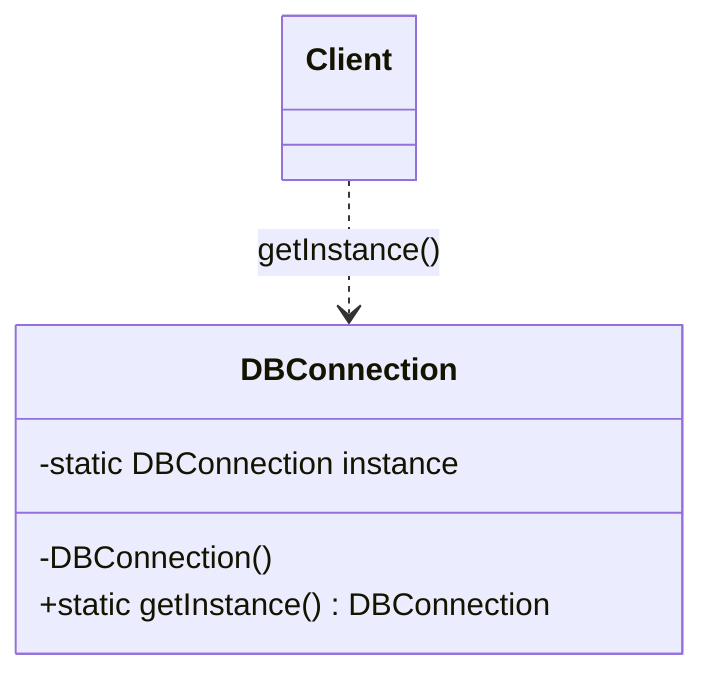

<div align="center">

# 1️⃣ Singleton Design Pattern

   

*Exactly one instance, one global access point.*

</div>

---

## 📑 Table of contents

- [🎯 Intent](#-intent)
- [🧩 The problem & the solution](#-the-problem--the-solution)
- [🔷 Structure](#-structure)
- [👥 Participants](#-participants)
- [🧭 When to use it](#-when-to-use-it)
- [📊 Pros & cons](#-pros--cons)
- [🌍 Real-world examples](#-real-world-examples)
- [💻 Code](#-code)
  - [1. 💡 Eager initialization](#ex1)
  - [2. 💡 Lazy initialization](#ex2)
  - [3. 💡 Synchronized method](#ex3)
  - [4. 💡 Double-checked locking](#ex4)

---

## 🎯 Intent

> Ensure a class has **only one instance** and provide a global point of access to it.

## 🧩 The problem & the solution

| 😣 Problem | 💡 Solution |
|---|---|
| Several parts of the application create their own `DBConnection`, wasting resources and causing inconsistent state. | Make the constructor private and expose a static `getInstance()`. This folder walks through four ways to do it, from the simplest to the production-grade one. |

## 🔷 Structure



## 👥 Participants

| Role | Responsibility | In this repo |
|---|---|---|
| **Singleton** | Owns its single instance and the access method | `DBConnection` |
| **Client** | Always goes through `getInstance()` | `Main` |

## 🧭 When to use it

| ✅ Use it when | ⚠️ Avoid it when |
|---|---|
| Exactly one object must coordinate actions (config, connection pool, logger) | It would hide dependencies and make unit testing hard (prefer dependency injection) |
| The instance must be reachable from many places | You actually need per-request or per-user objects |

## 📊 Pros & cons

| 👍 Pros | 👎 Cons |
|---|---|
| Controlled access to the sole instance | Global state and hidden coupling |
| Lazy variants save resources | Needs care for thread safety |
| Consistent shared state | Harder to test and mock |

## 🌍 Real-world examples

- `Runtime.getRuntime()`
- Logger and configuration holders
- Database connection pools, caches

---

## 💻 Code

This folder has **4 examples** (8 Java files). Interfaces and abstract classes come first, the class with `main` comes last.

<a id="ex1"></a>

### 1. 💡 Eager initialization

> The instance is created when the class loads. Simple and thread-safe, but created even if never used.

<details open>
<summary><b>📁 Files in this example</b></summary>

```text
1. Eager Initialization/
├── DBConnection.java
└── Main.java
```

</details>

#### 📄 `DBConnection.java`

<sub>class · 15 lines</sub>

```java
public class DBConnection {
    private static DBConnection conObject=new DBConnection();
    //So called Eager Initialization because it is initialized
    // early due to static  so only one object is created when
    // java class is run then only 1 object is created

    private DBConnection(){}

    public static DBConnection getInstance(){
        return conObject;
    }
    //method to expose to create new only 1 Object
    //Does not matter you are using it or not it is linked to class
    // not object due to static
}
```

#### 📄 `Main.java`

<sub>class · 5 lines</sub>

```java
public class Main {
    public static void main(String [] args){
        DBConnection connObject=DBConnection.getInstance();
    }
}
```

<details>
<summary><b>▶️ How to compile and run this example</b></summary>

```bash
# run from the repository root
mkdir -p out
find "Creational Design Pattern/5. Singleton Design Pattern/1. Eager Initialization" -name "*.java" -print0 | xargs -0 javac -d out
java -cp out Main
```

</details>

---

<a id="ex2"></a>

### 2. 💡 Lazy initialization

> The instance is created on first use. Saves resources but is **not thread-safe**.

<details open>
<summary><b>📁 Files in this example</b></summary>

```text
2. Lazy Initialization/
├── DBConnection.java
└── Main.java
```

</details>

#### 📄 `DBConnection.java`

<sub>class · 21 lines</sub>

```java
public class DBConnection {
    private static DBConnection conObject;
    //So called Lazy Initialization because it is not initialized
    // early here it is null due to static  so only one object is created when
    // java class is run then only 1 object is created

    private DBConnection(){}

    public static DBConnection getInstance(){
        if(conObject==null){//When two threads T1 and T2 comes Simultaneously
            // here then here if condition for both is true and then they both
            // will create two different objects but singleton will allow only
            // one object to create so it will not follow singleton DP
            return conObject=new DBConnection();
        }
       return conObject;
    }
    //method to expose to create new only 1 Object
    //Does not matter you are using it or not it is linked to class
    // not object due to static
}
```

#### 📄 `Main.java`

<sub>class · 6 lines</sub>

```java
public class Main {
    public static void main(String [] args){

        DBConnection connObject=DBConnection.getInstance();
    }
}
```

<details>
<summary><b>▶️ How to compile and run this example</b></summary>

```bash
# run from the repository root
mkdir -p out
find "Creational Design Pattern/5. Singleton Design Pattern/2. Lazy Initialization" -name "*.java" -print0 | xargs -0 javac -d out
java -cp out Main
```

</details>

---

<a id="ex3"></a>

### 3. 💡 Synchronized method

> `getInstance()` is `synchronized`. Thread-safe but every call pays the locking cost.

<details open>
<summary><b>📁 Files in this example</b></summary>

```text
3. Synchronized Method/
├── DBConnection.java
└── Main.java
```

</details>

#### 📄 `DBConnection.java`

<sub>class · 25 lines</sub>

```java
public class DBConnection {
    private static DBConnection conObject;
    // Object is not initialized
    //here it is null due to static  so only one object is created when
    // java class is run then only 1 object is created

    private DBConnection(){}

    synchronized  static DBConnection getInstance(){
        if(conObject==null){//When two threads T1 and T2 comes Simultaneously
            // here then here  due to synchronized method it will allow only one
            // thread to comes in and allow others to wait till first one completes its execution
            // at a time if condition is true and then
            // will create one objects only
            // one object to create so it will follow singleton DP

            //But the Problem here is it is too much costly.
            return conObject=new DBConnection();
        }
       return conObject;
    }
    //method to expose to create new only 1 Object
    //Does not matter you are using it or not it is linked to class
    // not object due to static
}
```

#### 📄 `Main.java`

<sub>class · 6 lines</sub>

```java
public class Main {
    public static void main(String [] args){

        DBConnection connObject=DBConnection.getInstance();
    }
}
```

<details>
<summary><b>▶️ How to compile and run this example</b></summary>

```bash
# run from the repository root
mkdir -p out
find "Creational Design Pattern/5. Singleton Design Pattern/3. Synchronized Method" -name "*.java" -print0 | xargs -0 javac -d out
java -cp out Main
```

</details>

---

<a id="ex4"></a>

### 4. 💡 Double-checked locking

> Check, lock only when needed, check again (with `volatile`). Thread-safe and fast after the first call.

<details open>
<summary><b>📁 Files in this example</b></summary>

```text
4. Double Checking/
├── DBConnection.java
└── Main.java
```

</details>

#### 📄 `DBConnection.java`

<sub>class · 29 lines</sub>

```java
public class DBConnection {
    private static DBConnection conObject;
    // Object is not initialized
    //here it is null due to static  so only one object is created when
    // java class is run then only 1 object is created

    private DBConnection(){}

      static DBConnection getInstance(){

        if(conObject==null) {
            synchronized (DBConnection.class) {//When two threads T1 and T2 comes Simultaneously
                // here then here  due to synchronized method it will allow only one
                // thread to comes in and allow others to wait till first one completes its execution
                // at a time if condition is true and then
                // will create one objects only
                // one object to create so it will follow singleton DP

                //Synchronized class is cheaper than synchronized Method and it also checking
                // for Double condition then creates the objects.
                return conObject = new DBConnection();
            }
        }
       return conObject;
    }
    //method to expose to create new only 1 Object
    //Does not matter you are using it or not it is linked to class
    // not object due to static
}
```

#### 📄 `Main.java`

<sub>class · 6 lines</sub>

```java
public class Main {
    public static void main(String [] args){

        DBConnection connObject=DBConnection.getInstance();
    }
}
```

<details>
<summary><b>▶️ How to compile and run this example</b></summary>

```bash
# run from the repository root
mkdir -p out
find "Creational Design Pattern/5. Singleton Design Pattern/4. Double Checking" -name "*.java" -print0 | xargs -0 javac -d out
java -cp out Main
```

</details>

---

<div align="center">

[◀ Prototype](../4.%20Prototype%20Design%20Pattern/README.md) &nbsp;·&nbsp; [📚 All patterns](../PATTERNS.md)

</div>
