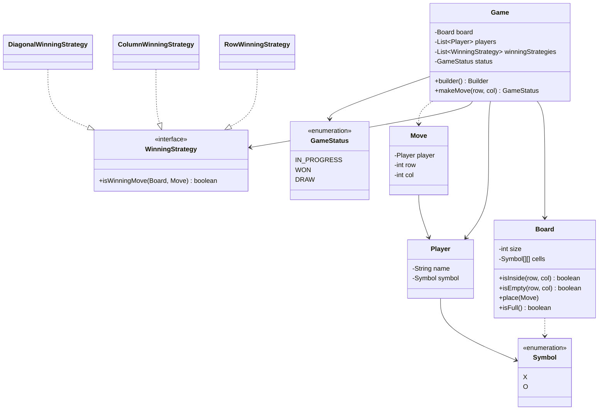

<div align="center">

# ⭕ Design Tic Tac Toe

   

*Two players take turns on an NxN grid; the first to fill a whole row, column or diagonal wins.*

</div>

---

## 📑 Table of contents

- [🎯 Problem statement](#-problem-statement)
- [🧩 Requirements & approach](#-requirements--approach)
- [🔷 Class diagram](#-class-diagram)
- [👥 Classes & responsibilities](#-classes--responsibilities)
- [🧭 Design patterns & principles used](#-design-patterns--principles-used)
- [📊 Strengths & limitations](#-strengths--limitations)
- [🌍 Follow-up interview questions](#-follow-up-interview-questions)
- [💻 Code](#-code)
  - [1. Implementation](#ex1)

---

## 🎯 Problem statement

> Design a **Tic Tac Toe** game for two players. Players alternate placing their symbol on an `N x N` board (3 x 3 by default). The first player to fill an entire row, column or diagonal wins. If the board fills up with no winner, the game is a draw.

## 🧩 Requirements & approach

| 📋 Requirements | 🛠️ Design approach |
|---|---|
| 1. Two players, symbols `X` and `O`, alternate turns<br>2. Board size is configurable (default 3 x 3)<br>3. Reject moves that are outside the board, on a taken cell, or after the game ended<br>4. Detect a win by row, column or diagonal, and detect a draw<br>5. Adding a new winning rule must not change existing code | `Game` owns the turn order and delegates to two helpers. `Board` only stores the grid. Each way of winning is a separate `WinningStrategy`, and only the **last move** is checked, so a win check costs `O(N)` rather than scanning the whole board. `Game.Builder` wires board size, players and rules. The code is split into folders (`entities`, `enums`, `exceptions`, `strategy`, `game`) and `Main`, the client, sits outside them. |

## 🔷 Class diagram



## 👥 Classes & responsibilities

| Class / interface | Responsibility | Kind · folder |
|---|---|---|
| **`Game`** | Runs turns, validates moves, asks the strategies if the move won, tracks status and winner | class (with inner `Builder`) · `game/` |
| **`Board`** | Stores the grid, tells if a cell is inside or empty, knows when it is full | class · `entities/` |
| **`Player`** | A name and a symbol | class · `entities/` |
| **`Move`** | Who played and where (immutable) | class · `entities/` |
| **`WinningStrategy`** | One way of winning, checked against the last move | interface · `strategy/` |
| **`RowWinningStrategy`** | Whole row of the last move matches | class · `strategy/` |
| **`ColumnWinningStrategy`** | Whole column of the last move matches | class · `strategy/` |
| **`DiagonalWinningStrategy`** | Main or anti diagonal matches (only if the move lies on one) | class · `strategy/` |
| **`Symbol`, `GameStatus`** | Type safe marks and game state (`IN_PROGRESS`, `WON`, `DRAW`) | enums · `enums/` |
| **`InvalidMoveException`** | Signals a rejected move; the turn does not change | runtime exception · `exceptions/` |
| **`Main`** | Plays a row win, a draw, a 4 x 4 diagonal win and shows invalid moves | demo · client, outside the packages |

## 🧭 Design patterns & principles used

| Pattern / principle | Where and why |
|---|---|
| **Strategy** | `WinningStrategy` with row, column and diagonal implementations: win rules are swappable and extendable |
| **Builder** | `Game.Builder` configures board size, players and rules, with sensible defaults |
| **Open/Closed principle** | A new rule (for example 'four corners') is a new class, `Game` is not edited |
| **Single Responsibility principle** | `Board` stores, `Game` orchestrates, strategies decide the winner |
| **Dependency Inversion principle** | `Game` depends on the `WinningStrategy` interface, not on concrete rules |

## 📊 Strengths & limitations

| 👍 Strengths | 👎 Limitations |
|---|---|
| Win rules are pluggable without touching `Game` | Still `O(N)` per move; row and column counters would make it `O(1)` (see follow-ups) |
| Win check looks only at the last move: `O(N)` per move | Win length is always `N`; 'k in a row' on a large board needs a new strategy |
| Board size and player count are configurable | No undo and no input layer: moves are passed as `(row, col)` |
| Invalid moves fail fast with a clear exception and do not skip the turn | Not thread safe: one `Game` should be driven by one thread or externally synchronised |

## 🌍 Follow-up interview questions

- **How do you support an `N x N` board with `k` in a row?** Add a `k` to the strategies and count consecutive matching cells in each of the four directions around the last move.
- **How would you add a new winning rule?** Implement `WinningStrategy` and register it with `addWinningStrategy`. No existing class changes (Open/Closed).
- **How do you make the win check `O(1)`?** Keep a counter per row, column and both diagonals for each player. Increment on every move and the player wins when a counter reaches `N`.
- **How would you add undo?** Make each move a command object, keep a stack of moves, and on undo clear the cell, step the turn back and reset the status (Command pattern).
- **How would you add a computer player?** Introduce a `PlayerStrategy` (or `Player` subclass) that chooses a move: random, rule based or minimax. `Game` only receives `(row, col)`.
- **How would you handle concurrency or an online game?** Make `makeMove` synchronised (or use a per-game lock), and check that the caller is the current player before accepting the move.
- **Why an enum for `Symbol` and `GameStatus`?** It is type safe, prevents invalid values and removes magic strings or ints.

---

## 💻 Code

This folder has **1 example** (12 Java files). Interfaces and abstract classes come first, the class with `main` comes last.

<a id="ex1"></a>

### 1. Implementation

<details open>
<summary><b>📁 Files in this example</b></summary>

```text
1. Tic Tac Toe/
├── entities/
│   ├── Board.java
│   ├── Move.java
│   └── Player.java
├── enums/
│   ├── GameStatus.java
│   └── Symbol.java
├── exceptions/
│   └── InvalidMoveException.java
├── game/
│   └── Game.java
├── strategy/
│   ├── ColumnWinningStrategy.java
│   ├── DiagonalWinningStrategy.java
│   ├── RowWinningStrategy.java
│   └── WinningStrategy.java
└── Main.java
```

</details>

### 📁 `enums/`

#### 📄 `enums/GameStatus.java`

<sub>enum · 7 lines</sub>

```java
package enums;

public enum GameStatus {
    IN_PROGRESS,
    WON,
    DRAW
}
```

#### 📄 `enums/Symbol.java`

<sub>enum · 7 lines</sub>

```java
package enums;

// The mark a player puts on the board
public enum Symbol {
    X,
    O
}
```

### 📁 `exceptions/`

#### 📄 `exceptions/InvalidMoveException.java`

<sub>class · 8 lines</sub>

```java
package exceptions;

// Thrown when a move is outside the board, on a taken cell, or made after the game ended
public class InvalidMoveException extends RuntimeException {
    public InvalidMoveException(String message) {
        super(message);
    }
}
```

### 📁 `entities/`

#### 📄 `entities/Board.java`

<sub>class · 52 lines</sub>

```java
package entities;

import enums.Symbol;

// Knows the grid and nothing about the rules of winning
public class Board {
    private final int size;
    private final Symbol[][] cells;
    private int filledCells = 0;

    public Board(int size) {
        if (size < 3) {
            throw new IllegalArgumentException("Board size must be at least 3");
        }
        this.size = size;
        this.cells = new Symbol[size][size];
    }

    public int getSize() { return size; }

    public Symbol getSymbolAt(int row, int col) { return cells[row][col]; }

    public boolean isInside(int row, int col) {
        return row >= 0 && row < size && col >= 0 && col < size;
    }

    public boolean isEmpty(int row, int col) {
        return cells[row][col] == null;
    }

    public void place(Move move) {
        cells[move.getRow()][move.getCol()] = move.getPlayer().getSymbol();
        filledCells++;
    }

    public boolean isFull() {
        return filledCells == size * size;
    }

    public void print() {
        for (int r = 0; r < size; r++) {
            StringBuilder line = new StringBuilder();
            for (int c = 0; c < size; c++) {
                line.append(cells[r][c] == null ? "." : cells[r][c].name());
                if (c < size - 1) {
                    line.append(" | ");
                }
            }
            System.out.println(line);
        }
    }
}
```

#### 📄 `entities/Move.java`

<sub>class · 20 lines</sub>

```java
package entities;

// Immutable value object: who played, and where
public class Move {
    private final Player player;
    private final int row;
    private final int col;

    public Move(Player player, int row, int col) {
        this.player = player;
        this.row = row;
        this.col = col;
    }

    public Player getPlayer() { return player; }

    public int getRow() { return row; }

    public int getCol() { return col; }
}
```

#### 📄 `entities/Player.java`

<sub>class · 22 lines</sub>

```java
package entities;

import enums.Symbol;

public class Player {
    private final String name;
    private final Symbol symbol;

    public Player(String name, Symbol symbol) {
        this.name = name;
        this.symbol = symbol;
    }

    public String getName() { return name; }

    public Symbol getSymbol() { return symbol; }

    @Override
    public String toString() {
        return name + " (" + symbol + ")";
    }
}
```

### 📁 `strategy/`

#### 📄 `strategy/WinningStrategy.java`

<sub>interface · 9 lines</sub>

```java
package strategy;

import entities.Board;
import entities.Move;

// Strategy: one way of winning. New rules are new classes (Open/Closed).
public interface WinningStrategy {
    boolean isWinningMove(Board board, Move move);
}
```

#### 📄 `strategy/ColumnWinningStrategy.java`

<sub>class · 20 lines</sub>

```java
package strategy;

import entities.Board;
import entities.Move;
import enums.Symbol;

// Wins when the whole column of the last move holds the player's symbol
public class ColumnWinningStrategy implements WinningStrategy {

    @Override
    public boolean isWinningMove(Board board, Move move) {
        Symbol symbol = move.getPlayer().getSymbol();
        for (int row = 0; row < board.getSize(); row++) {
            if (board.getSymbolAt(row, move.getCol()) != symbol) {
                return false;
            }
        }
        return true;
    }
}
```

#### 📄 `strategy/DiagonalWinningStrategy.java`

<sub>class · 31 lines</sub>

```java
package strategy;

import entities.Board;
import entities.Move;
import enums.Symbol;

// Wins when a whole diagonal holds the player's symbol (only checked if the move is on a diagonal)
public class DiagonalWinningStrategy implements WinningStrategy {

    @Override
    public boolean isWinningMove(Board board, Move move) {
        int n = board.getSize();
        Symbol symbol = move.getPlayer().getSymbol();

        if (move.getRow() == move.getCol() && allMatch(board, symbol, true)) {
            return true;                                   // main diagonal
        }
        return move.getRow() + move.getCol() == n - 1 && allMatch(board, symbol, false);   // anti diagonal
    }

    private boolean allMatch(Board board, Symbol symbol, boolean mainDiagonal) {
        int n = board.getSize();
        for (int i = 0; i < n; i++) {
            int col = mainDiagonal ? i : n - 1 - i;
            if (board.getSymbolAt(i, col) != symbol) {
                return false;
            }
        }
        return true;
    }
}
```

#### 📄 `strategy/RowWinningStrategy.java`

<sub>class · 20 lines</sub>

```java
package strategy;

import entities.Board;
import entities.Move;
import enums.Symbol;

// Wins when the whole row of the last move holds the player's symbol
public class RowWinningStrategy implements WinningStrategy {

    @Override
    public boolean isWinningMove(Board board, Move move) {
        Symbol symbol = move.getPlayer().getSymbol();
        for (int col = 0; col < board.getSize(); col++) {
            if (board.getSymbolAt(move.getRow(), col) != symbol) {
                return false;
            }
        }
        return true;
    }
}
```

### 📁 `game/`

#### 📄 `game/Game.java`

<sub>class · 106 lines</sub>

```java
package game;

import entities.Board;
import entities.Move;
import entities.Player;
import enums.GameStatus;
import exceptions.InvalidMoveException;
import strategy.ColumnWinningStrategy;
import strategy.DiagonalWinningStrategy;
import strategy.RowWinningStrategy;
import strategy.WinningStrategy;

import java.util.ArrayList;
import java.util.List;

// Orchestrates turns. It delegates "who has won" to the strategies and "what is on the grid" to the board.
public class Game {
    private final Board board;
    private final List<Player> players;
    private final List<WinningStrategy> winningStrategies;
    private int currentPlayerIndex = 0;
    private GameStatus status = GameStatus.IN_PROGRESS;
    private Player winner;

    private Game(Board board, List<Player> players, List<WinningStrategy> winningStrategies) {
        this.board = board;
        this.players = players;
        this.winningStrategies = winningStrategies;
    }

    public static Builder builder() {
        return new Builder();
    }

    public Player getCurrentPlayer() { return players.get(currentPlayerIndex); }

    public GameStatus getStatus() { return status; }

    public Player getWinner() { return winner; }

    public Board getBoard() { return board; }

    // The current player plays on (row, col); returns the status after the move
    public GameStatus makeMove(int row, int col) {
        if (status != GameStatus.IN_PROGRESS) {
            throw new InvalidMoveException("The game is already over");
        }
        if (!board.isInside(row, col)) {
            throw new InvalidMoveException("Cell (" + row + "," + col + ") is outside the board");
        }
        if (!board.isEmpty(row, col)) {
            throw new InvalidMoveException("Cell (" + row + "," + col + ") is already taken");
        }

        Move move = new Move(getCurrentPlayer(), row, col);
        board.place(move);

        for (WinningStrategy strategy : winningStrategies) {
            if (strategy.isWinningMove(board, move)) {
                status = GameStatus.WON;
                winner = move.getPlayer();
                return status;
            }
        }
        if (board.isFull()) {
            status = GameStatus.DRAW;
            return status;
        }
        currentPlayerIndex = (currentPlayerIndex + 1) % players.size();   // next turn
        return status;
    }

    // Builder: configure board size, players and winning rules, then build()
    public static class Builder {
        private int boardSize = 3;
        private final List<Player> players = new ArrayList<>();
        private final List<WinningStrategy> strategies = new ArrayList<>();

        public Builder boardSize(int boardSize) {
            this.boardSize = boardSize;
            return this;
        }

        public Builder addPlayer(Player player) {
            players.add(player);
            return this;
        }

        public Builder addWinningStrategy(WinningStrategy strategy) {
            strategies.add(strategy);
            return this;
        }

        public Game build() {
            if (players.size() < 2) {
                throw new IllegalStateException("At least two players are needed");
            }
            if (strategies.isEmpty()) {          // sensible default rules
                strategies.add(new RowWinningStrategy());
                strategies.add(new ColumnWinningStrategy());
                strategies.add(new DiagonalWinningStrategy());
            }
            return new Game(new Board(boardSize), players, strategies);
        }
    }
}
```

### 📁 Client code (outside the packages)

#### 📄 `Main.java`

<sub>class · 58 lines</sub>

```java
import entities.Player;
import enums.GameStatus;
import enums.Symbol;
import exceptions.InvalidMoveException;
import game.Game;

public class Main {
    public static void main(String[] args) {

        Player alice = new Player("Alice", Symbol.X);
        Player bob = new Player("Bob", Symbol.O);

        // ---------- Game 1: Alice wins with the top row ----------
        System.out.println("=== Game 1: win by row ===");
        Game game1 = Game.builder().addPlayer(alice).addPlayer(bob).build();
        play(game1, new int[][]{{0, 0}, {1, 0}, {0, 1}, {1, 1}, {0, 2}});

        // ---------- Game 2: draw ----------
        System.out.println("\n=== Game 2: draw ===");
        Game game2 = Game.builder().addPlayer(alice).addPlayer(bob).build();
        play(game2, new int[][]{{0, 0}, {0, 1}, {0, 2}, {1, 1}, {1, 0}, {1, 2}, {2, 1}, {2, 0}, {2, 2}});

        // ---------- Game 3: 4x4 board, Bob wins on the anti-diagonal ----------
        System.out.println("\n=== Game 3: 4x4 board, win by diagonal ===");
        Game game3 = Game.builder().boardSize(4).addPlayer(alice).addPlayer(bob).build();
        play(game3, new int[][]{{0, 0}, {0, 3}, {0, 1}, {1, 2}, {3, 3}, {2, 1}, {1, 1}, {3, 0}});

        // ---------- Invalid moves are rejected, the turn does not change ----------
        System.out.println("\n=== Invalid moves ===");
        Game game4 = Game.builder().addPlayer(alice).addPlayer(bob).build();
        game4.makeMove(1, 1);
        tryMove(game4, 1, 1);   // taken cell
        tryMove(game4, 3, 0);   // outside the board
        System.out.println("Still " + game4.getCurrentPlayer() + "'s turn");
    }

    private static void play(Game game, int[][] moves) {
        for (int[] move : moves) {
            Player player = game.getCurrentPlayer();
            GameStatus status = game.makeMove(move[0], move[1]);
            System.out.println(player + " plays (" + move[0] + "," + move[1] + ") -> " + status);
        }
        game.getBoard().print();
        if (game.getStatus() == GameStatus.WON) {
            System.out.println("Winner: " + game.getWinner());
        } else if (game.getStatus() == GameStatus.DRAW) {
            System.out.println("It is a draw");
        }
    }

    private static void tryMove(Game game, int row, int col) {
        try {
            game.makeMove(row, col);
        } catch (InvalidMoveException e) {
            System.out.println("Rejected: " + e.getMessage());
        }
    }
}
```

<details>
<summary><b>▶️ How to compile and run this example</b></summary>

```bash
# run from the repository root
mkdir -p out
find "Interview Questions/1. Tic Tac Toe" -name "*.java" -print0 | xargs -0 javac -d out
java -cp out Main
```

</details>

---

<div align="center">

[📚 All questions](../QUESTIONS.md) &nbsp;·&nbsp; [Snake and Ladder ▶](../2.%20Snake%20and%20Ladder/README.md)

</div>
