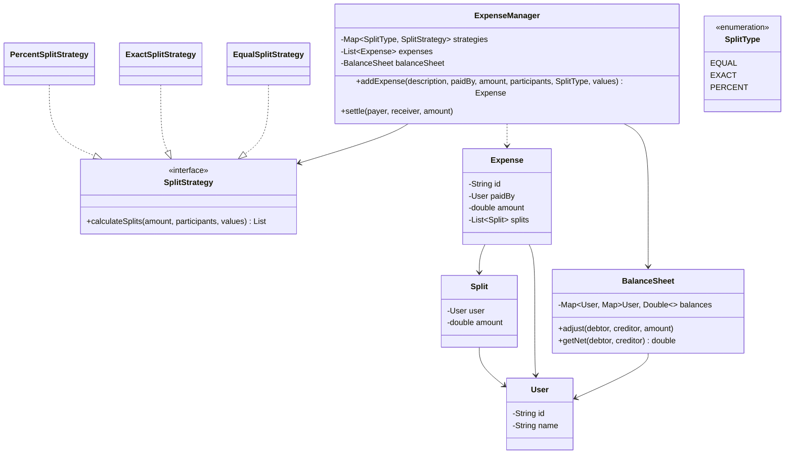

<div align="center">

# 💸 Design Splitwise (expense sharing)

   

*Record an expense split equally, exactly or by percentage, and track who owes whom.*

</div>

---

## 📑 Table of contents

- [🎯 Problem statement](#-problem-statement)
- [🧩 Requirements & approach](#-requirements--approach)
- [🔷 Class diagram](#-class-diagram)
- [👥 Classes & responsibilities](#-classes--responsibilities)
- [🧭 Design patterns & principles used](#-design-patterns--principles-used)
- [📊 Strengths & limitations](#-strengths--limitations)
- [🌍 Follow-up interview questions](#-follow-up-interview-questions)
- [💻 Code](#-code)
  - [1. Implementation](#ex1)

---

## 🎯 Problem statement

> Design a **Splitwise-style expense sharing app**. One user pays for a shared expense; it is split among participants equally, by exact amounts, or by percentage. The app tracks a running balance between every pair of users and lets debts be settled directly.

## 🧩 Requirements & approach

| 📋 Requirements | 🛠️ Design approach |
|---|---|
| 1. Record an expense: who paid, the total, who it's split among, and how<br>2. Equal split must sum exactly to the total, including rounding (fractions of a cent)<br>3. Exact split must be validated against the total; percent split must be validated against 100%<br>4. The payer's own share does not create a debt to themselves<br>5. A running net balance between every pair of users, derived from every expense so far<br>6. Settle a debt directly between two users, independent of any expense<br>7. How a split is computed must be replaceable without changing how expenses or balances work | `SplitStrategy` turns a total and a list of participants into `Split`s; `EqualSplitStrategy`, `ExactSplitStrategy` and `PercentSplitStrategy` each validate their own input and absorb rounding into the **last** participant so the splits always sum exactly. `ExpenseManager` records the expense and, for every split that is not the payer's own, tells `BalanceSheet` that user owes the payer that amount. `BalanceSheet` stores `balances[A][B]` = what A owes B, always kept symmetric (`balances[A][B] == -balances[B][A]`), so a net figure between any two users is a single lookup, never a sum over every expense. The code is split into folders (`enums`, `entities`, `exceptions`, `strategy`, `service`) and `Main`, the client, sits outside them. |

## 🔷 Class diagram



## 👥 Classes & responsibilities

| Class / interface | Responsibility | Kind · folder |
|---|---|---|
| **`ExpenseManager`** | Entry point: records an expense through the right strategy, updates balances, settles debts directly | service class · `service/` |
| **`BalanceSheet`** | Symmetric net-owed map between every pair of users; a single lookup gives the current balance | class · `service/` |
| **`SplitStrategy`** | Total + participants (+ extra input) -> each one's `Split` | interface · `strategy/` |
| **`EqualSplitStrategy`** | Even split; the last participant absorbs the rounding remainder | class · `strategy/` |
| **`ExactSplitStrategy`** | Validates the given amounts sum to the total | class · `strategy/` |
| **`PercentSplitStrategy`** | Validates the given percentages sum to 100, then converts to amounts | class · `strategy/` |
| **`User`, `Expense`, `Split`** | A participant; a recorded expense; one user's share of it | classes · `entities/` |
| **`SplitType`** | EQUAL, EXACT, PERCENT | enum · `enums/` |
| **`InvalidSplitException`** | Percentages not summing to 100, exact amounts not summing to the total, or the payer missing from the participants | runtime exception · `exceptions/` |
| **`Main`** | Equal, exact and percent expenses across three users, net balances, a direct settlement, and three rejected invalid splits | demo · client, outside the packages |

## 🧭 Design patterns & principles used

| Pattern / principle | Where and why |
|---|---|
| **Strategy** | `SplitStrategy`: a new split type (e.g. by shares/weights) is a new class; `ExpenseManager` is not touched |
| **Single Responsibility principle** | Each strategy only computes and validates its own kind of split; `BalanceSheet` only tracks net amounts; `ExpenseManager` only coordinates |
| **Open/Closed principle** | Settling debts, adding expenses and adding a new split type all extend the system without modifying existing classes |
| **Derived, symmetric ledger** | Storing both `balances[A][B]` and `balances[B][A]` as negatives of each other makes a lookup from either direction trivially consistent |

## 📊 Strengths & limitations

| 👍 Strengths | 👎 Limitations |
|---|---|
| Splits always sum exactly to the total, even with rounding, because the last participant absorbs the remainder | No simplification of debts across more than two users (e.g. A owes B who owes C could become 'A owes C' directly) — a classic follow-up |
| Net balance between two users is O(1), not a replay of every expense | No groups, no currency conversion, no expense editing or deletion |
| Settling a debt uses the exact same ledger as expenses, so there is one source of truth for 'who owes whom' | `Double` amounts can still drift over many transactions; a real system would use integer minor units (cents) throughout, not just inside one strategy |
| Validation is specific: percent, exact and payer-missing each fail with their own clear message | Not persisted; `expenses` and `balances` live only in memory |

## 🌍 Follow-up interview questions

- **How would you simplify debts across a group?** Net every user's total owed vs. owed-to-them into one number per user, then greedily match the biggest debtor to the biggest creditor until all are zero (minimises the number of transactions).
- **How would you add a 'by shares' split (e.g. 2:1:1)?** A `SharesSplitStrategy` that divides the total proportionally to each participant's share count, absorbing rounding the same way `EqualSplitStrategy` does.
- **How do you prevent floating point drift?** Store every amount as integer minor units (paise/cents) end to end, as `EqualSplitStrategy` already does internally, and only format to decimal for display.
- **How would you support editing or deleting an expense?** Reverse its original `balanceSheet.adjust` calls (apply the negated splits) before applying the new ones, or before removing it.
- **How would you add groups (e.g. 'Goa Trip')?** A `Group` holding its own member list and expenses, with `BalanceSheet` either shared across groups or scoped per group depending on whether cross-group settling is wanted.
- **What happens if a participant appears twice in the list?** Not currently guarded; a real implementation would de-duplicate participants before calling the strategy, since a duplicate would double that user's share.
- **How would you notify users of a new expense or a reminder to settle?** An `Observer` on `ExpenseManager` that `ExpenseManager.addExpense` and `settle` notify, decoupled from the core split/balance logic.

---

## 💻 Code

This folder has **1 example** (12 Java files). Interfaces and abstract classes come first, the class with `main` comes last.

<a id="ex1"></a>

### 1. Implementation

<details open>
<summary><b>📁 Files in this example</b></summary>

```text
10. Splitwise/
├── entities/
│   ├── Expense.java
│   ├── Split.java
│   └── User.java
├── enums/
│   └── SplitType.java
├── exceptions/
│   └── InvalidSplitException.java
├── service/
│   ├── BalanceSheet.java
│   └── ExpenseManager.java
├── strategy/
│   ├── EqualSplitStrategy.java
│   ├── ExactSplitStrategy.java
│   ├── PercentSplitStrategy.java
│   └── SplitStrategy.java
└── Main.java
```

</details>

#### 📄 `enums/SplitType.java`

<sub>enum · 7 lines</sub>

```java
package enums;

public enum SplitType {
    EQUAL,
    EXACT,
    PERCENT
}
```

#### 📄 `strategy/SplitStrategy.java`

<sub>interface · 13 lines</sub>

```java
package strategy;

import entities.Split;
import entities.User;

import java.util.List;
import java.util.Map;

// Strategy: turns a total amount and a list of participants into each one's Split.
// `values` carries whatever extra input the strategy needs (ignored by EQUAL).
public interface SplitStrategy {
    List<Split> calculateSplits(double totalAmount, List<User> participants, Map<User, Double> values);
}
```

#### 📄 `entities/Expense.java`

<sub>class · 34 lines</sub>

```java
package entities;

import java.util.List;

public class Expense {
    private final String id;
    private final String description;
    private final User paidBy;
    private final double amount;
    private final List<Split> splits;

    public Expense(String id, String description, User paidBy, double amount, List<Split> splits) {
        this.id = id;
        this.description = description;
        this.paidBy = paidBy;
        this.amount = amount;
        this.splits = splits;
    }

    public String getId() { return id; }

    public User getPaidBy() { return paidBy; }

    public double getAmount() { return amount; }

    public List<Split> getSplits() { return splits; }

    @Override
    public String toString() {
        return id + " " + description + ": " + paidBy + " paid " + amount + " " + splits.stream()
                .map(s -> s.getUser() + "=" + String.format("%.2f", s.getAmount()))
                .reduce((a, b) -> a + ", " + b).orElse("");
    }
}
```

#### 📄 `entities/Split.java`

<sub>class · 16 lines</sub>

```java
package entities;

// How much one user's share of an expense comes to. Immutable once computed by a SplitStrategy.
public class Split {
    private final User user;
    private final double amount;

    public Split(User user, double amount) {
        this.user = user;
        this.amount = amount;
    }

    public User getUser() { return user; }

    public double getAmount() { return amount; }
}
```

#### 📄 `entities/User.java`

<sub>class · 18 lines</sub>

```java
package entities;

public class User {
    private final String id;
    private final String name;

    public User(String id, String name) {
        this.id = id;
        this.name = name;
    }

    public String getId() { return id; }

    public String getName() { return name; }

    @Override
    public String toString() { return name; }
}
```

#### 📄 `exceptions/InvalidSplitException.java`

<sub>class · 7 lines</sub>

```java
package exceptions;

public class InvalidSplitException extends RuntimeException {
    public InvalidSplitException(String message) {
        super(message);
    }
}
```

#### 📄 `service/BalanceSheet.java`

<sub>class · 46 lines</sub>

```java
package service;

import entities.User;

import java.util.HashMap;
import java.util.Map;

// balances[A][B] = how much A owes B. Always kept symmetric: balances[A][B] == -balances[B][A].
// Keyed directly by User (the same instances are reused everywhere, so identity equality is fine).
public class BalanceSheet {
    private final Map<User, Map<User, Double>> balances = new HashMap<>();

    public synchronized void adjust(User debtor, User creditor, double amount) {
        if (debtor.getId().equals(creditor.getId()) || amount == 0) {
            return;
        }
        add(debtor, creditor, amount);
        add(creditor, debtor, -amount);
    }

    private void add(User a, User b, double amount) {
        balances.computeIfAbsent(a, k -> new HashMap<>()).merge(b, amount, Double::sum);
    }

    public double getNet(User debtor, User creditor) {
        return balances.getOrDefault(debtor, new HashMap<>()).getOrDefault(creditor, 0.0);
    }

    public void printBalancesFor(User user) {
        Map<User, Double> row = balances.getOrDefault(user, new HashMap<>());
        boolean settled = true;
        for (Map.Entry<User, Double> e : row.entrySet()) {
            double amount = Math.round(e.getValue() * 100) / 100.0;
            if (amount > 0) {
                System.out.println("  " + user.getName() + " owes " + e.getKey().getName() + ": " + amount);
                settled = false;
            } else if (amount < 0) {
                System.out.println("  " + e.getKey().getName() + " owes " + user.getName() + ": " + (-amount));
                settled = false;
            }
        }
        if (settled) {
            System.out.println("  " + user.getName() + " is settled up");
        }
    }
}
```

#### 📄 `service/ExpenseManager.java`

<sub>class · 56 lines</sub>

```java
package service;

import entities.Expense;
import entities.Split;
import entities.User;
import enums.SplitType;
import exceptions.InvalidSplitException;
import strategy.EqualSplitStrategy;
import strategy.ExactSplitStrategy;
import strategy.PercentSplitStrategy;
import strategy.SplitStrategy;

import java.util.ArrayList;
import java.util.EnumMap;
import java.util.List;
import java.util.Map;

// Single entry point: records an expense (computing its splits through the right strategy),
// updates the balance sheet, and lets debts be settled directly between two users.
public class ExpenseManager {
    private final Map<SplitType, SplitStrategy> strategies = new EnumMap<>(SplitType.class);
    private final List<Expense> expenses = new ArrayList<>();
    private final BalanceSheet balanceSheet = new BalanceSheet();
    private int counter = 0;

    public ExpenseManager() {
        strategies.put(SplitType.EQUAL, new EqualSplitStrategy());
        strategies.put(SplitType.EXACT, new ExactSplitStrategy());
        strategies.put(SplitType.PERCENT, new PercentSplitStrategy());
    }

    public BalanceSheet getBalanceSheet() { return balanceSheet; }

    public synchronized Expense addExpense(String description, User paidBy, double amount,
                                           List<User> participants, SplitType type, Map<User, Double> values) {
        if (!participants.contains(paidBy)) {
            throw new InvalidSplitException(paidBy + " must be one of the participants");
        }
        SplitStrategy strategy = strategies.get(type);
        List<Split> splits = strategy.calculateSplits(amount, participants, values);

        Expense expense = new Expense("E-" + (++counter), description, paidBy, amount, splits);
        expenses.add(expense);
        for (Split split : splits) {
            balanceSheet.adjust(split.getUser(), paidBy, split.getAmount());
        }
        return expense;
    }

    // Direct payment between two users, outside of any shared expense
    public synchronized void settle(User payer, User receiver, double amount) {
        balanceSheet.adjust(payer, receiver, -amount);
    }

    public List<Expense> getExpenses() { return expenses; }
}
```

#### 📄 `strategy/EqualSplitStrategy.java`

<sub>class · 27 lines</sub>

```java
package strategy;

import entities.Split;
import entities.User;

import java.util.ArrayList;
import java.util.List;
import java.util.Map;

// Divides evenly; the last participant absorbs the rounding remainder so the splits sum exactly
public class EqualSplitStrategy implements SplitStrategy {

    @Override
    public List<Split> calculateSplits(double totalAmount, List<User> participants, Map<User, Double> values) {
        int n = participants.size();
        long totalCents = Math.round(totalAmount * 100);
        long shareCents = totalCents / n;
        long remainder = totalCents - shareCents * n;

        List<Split> splits = new ArrayList<>();
        for (int i = 0; i < n; i++) {
            long cents = shareCents + (i == n - 1 ? remainder : 0);
            splits.add(new Split(participants.get(i), cents / 100.0));
        }
        return splits;
    }
}
```

#### 📄 `strategy/ExactSplitStrategy.java`

<sub>class · 31 lines</sub>

```java
package strategy;

import entities.Split;
import entities.User;
import exceptions.InvalidSplitException;

import java.util.ArrayList;
import java.util.List;
import java.util.Map;

// `values` gives the exact amount each participant owes; they must add up to the total
public class ExactSplitStrategy implements SplitStrategy {

    @Override
    public List<Split> calculateSplits(double totalAmount, List<User> participants, Map<User, Double> values) {
        double sum = 0;
        List<Split> splits = new ArrayList<>();
        for (User user : participants) {
            Double amount = values.get(user);
            if (amount == null) {
                throw new InvalidSplitException("No exact amount given for " + user);
            }
            sum += amount;
            splits.add(new Split(user, amount));
        }
        if (Math.abs(sum - totalAmount) > 0.01) {
            throw new InvalidSplitException("Exact splits (" + sum + ") do not add up to the total (" + totalAmount + ")");
        }
        return splits;
    }
}
```

#### 📄 `strategy/PercentSplitStrategy.java`

<sub>class · 43 lines</sub>

```java
package strategy;

import entities.Split;
import entities.User;
import exceptions.InvalidSplitException;

import java.util.ArrayList;
import java.util.List;
import java.util.Map;

// `values` gives each participant's percentage; they must add up to 100
public class PercentSplitStrategy implements SplitStrategy {

    @Override
    public List<Split> calculateSplits(double totalAmount, List<User> participants, Map<User, Double> values) {
        double totalPercent = 0;
        for (User user : participants) {
            Double percent = values.get(user);
            if (percent == null) {
                throw new InvalidSplitException("No percentage given for " + user);
            }
            totalPercent += percent;
        }
        if (Math.abs(totalPercent - 100.0) > 0.01) {
            throw new InvalidSplitException("Percentages add up to " + totalPercent + ", not 100");
        }

        List<Split> splits = new ArrayList<>();
        double runningTotal = 0;
        for (int i = 0; i < participants.size(); i++) {
            User user = participants.get(i);
            double amount;
            if (i == participants.size() - 1) {
                amount = Math.round((totalAmount - runningTotal) * 100) / 100.0;   // absorb rounding
            } else {
                amount = Math.round(totalAmount * values.get(user) / 100.0 * 100) / 100.0;
                runningTotal += amount;
            }
            splits.add(new Split(user, amount));
        }
        return splits;
    }
}
```

#### 📄 `Main.java`

<sub>class · 76 lines</sub>

```java
import entities.Expense;
import entities.User;
import enums.SplitType;
import exceptions.InvalidSplitException;
import service.ExpenseManager;

import java.util.Arrays;
import java.util.HashMap;
import java.util.List;
import java.util.Map;

public class Main {
    public static void main(String[] args) {

        User alice = new User("U1", "Alice");
        User bob = new User("U2", "Bob");
        User carol = new User("U3", "Carol");
        List<User> all = Arrays.asList(alice, bob, carol);

        ExpenseManager manager = new ExpenseManager();

        System.out.println("=== 1. Equal split: Alice pays 300 for dinner, split 3 ways ===");
        Expense dinner = manager.addExpense("Dinner", alice, 300.00, all, SplitType.EQUAL, null);
        System.out.println(dinner);

        System.out.println("\n=== 2. Exact split: Bob pays 200 for tickets (Alice 120, Bob 80) ===");
        Map<User, Double> exact = new HashMap<>();
        exact.put(alice, 120.0);
        exact.put(bob, 80.0);
        Expense tickets = manager.addExpense("Tickets", bob, 200.00, Arrays.asList(alice, bob), SplitType.EXACT, exact);
        System.out.println(tickets);

        System.out.println("\n=== 3. Percent split: Carol pays 150 for groceries (50/30/20) ===");
        Map<User, Double> percent = new HashMap<>();
        percent.put(alice, 50.0);
        percent.put(bob, 30.0);
        percent.put(carol, 20.0);
        Expense groceries = manager.addExpense("Groceries", carol, 150.00, all, SplitType.PERCENT, percent);
        System.out.println(groceries);

        System.out.println("\n=== Net balances after all three expenses ===");
        for (User user : all) {
            manager.getBalanceSheet().printBalancesFor(user);
        }

        System.out.println("\n=== Alice settles her debt to Bob directly ===");
        double owed = manager.getBalanceSheet().getNet(alice, bob);
        System.out.println("Alice currently owes Bob: " + owed);
        manager.settle(alice, bob, owed);
        manager.getBalanceSheet().printBalancesFor(alice);
        manager.getBalanceSheet().printBalancesFor(bob);

        System.out.println("\n-- Invalid splits are rejected --");
        try {
            Map<User, Double> badPercent = new HashMap<>();
            badPercent.put(alice, 60.0);
            badPercent.put(bob, 60.0);
            manager.addExpense("Bad split", alice, 100.0, Arrays.asList(alice, bob), SplitType.PERCENT, badPercent);
        } catch (InvalidSplitException e) {
            System.out.println("Rejected: " + e.getMessage());
        }
        try {
            Map<User, Double> badExact = new HashMap<>();
            badExact.put(alice, 50.0);
            badExact.put(bob, 40.0);
            manager.addExpense("Bad exact", alice, 100.0, Arrays.asList(alice, bob), SplitType.EXACT, badExact);
        } catch (InvalidSplitException e) {
            System.out.println("Rejected: " + e.getMessage());
        }
        try {
            manager.addExpense("Payer not in group", alice, 90.0, Arrays.asList(bob, carol), SplitType.EQUAL, null);
        } catch (InvalidSplitException e) {
            System.out.println("Rejected: " + e.getMessage());
        }
    }
}
```

<details>
<summary><b>▶️ How to compile and run this example</b></summary>

```bash
# run from the repository root
mkdir -p out
find "Interview Questions/10. Splitwise" -name "*.java" -print0 | xargs -0 javac -d out
java -cp out Main
```

</details>

---

<div align="center">

[◀ Chess](../9.%20Chess/README.md) &nbsp;·&nbsp; [📚 All questions](../QUESTIONS.md) &nbsp;·&nbsp; [Apply Coupon ▶](../13.%20Apply%20Coupon/README.md)

</div>
