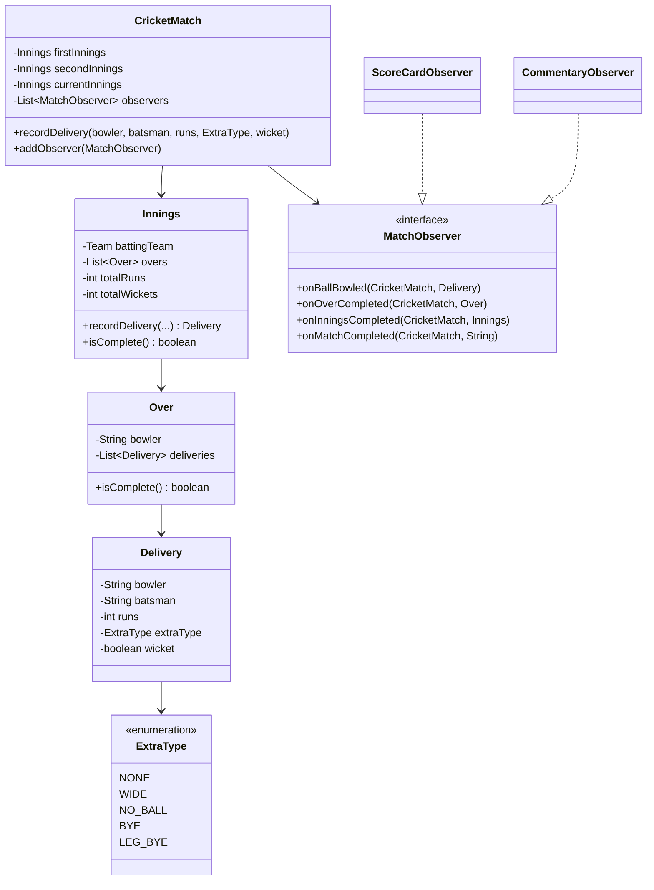

<div align="center">

# 🏏 Design a Live Cricket Score System (Cricbuzz)

   

*Each ball updates the match state; any number of subscribers (scorecard, commentary) hear about it live.*

</div>

---

## 📑 Table of contents

- [🎯 Problem statement](#-problem-statement)
- [🧩 Requirements & approach](#-requirements--approach)
- [🔷 Class diagram](#-class-diagram)
- [👥 Classes & responsibilities](#-classes--responsibilities)
- [🧭 Design patterns & principles used](#-design-patterns--principles-used)
- [📊 Strengths & limitations](#-strengths--limitations)
- [🌍 Follow-up interview questions](#-follow-up-interview-questions)
- [💻 Code](#-code)
  - [1. Implementation](#ex1)

---

## 🎯 Problem statement

> Design a **live cricket scoring system**. Every ball bowled updates the score, the over, and (eventually) the innings and the match; any number of independent consumers (a scorecard widget, ball-by-ball commentary, push notifications) need to hear about these events live, without the match itself knowing anything about them.

## 🧩 Requirements & approach

| 📋 Requirements | 🛠️ Design approach |
|---|---|
| 1. An over is 6 **legal** deliveries; a wide or no-ball does not count toward the 6, but adds a 1-run penalty<br>2. A bowler cannot bowl two overs in a row<br>3. A wicket cannot be credited directly off a wide or no-ball (only a run-out can happen on those)<br>4. First innings ends on all-out or overs-up; second innings also ends the instant the chasing team passes the target, even mid-over<br>5. Multiple independent consumers (scorecard, commentary, ...) must be notified of every ball, over and innings event, without the match knowing what they do with it<br>6. Recording a ball after the match has ended must be rejected | `Innings` is self-contained: it owns its overs, enforces the six-legal-balls rule and the no-consecutive-bowler rule, and reports its own total and completion. `CricketMatch` is the **Observer** subject: it forwards each ball to the active innings, checks for over/innings/match completion (including the early chase-completed case), and notifies every registered `MatchObserver` — `ScoreCardObserver` and `CommentaryObserver` each react to a different subset of events, and a third subscriber could be added without changing `CricketMatch` at all. The code is split into folders (`enums`, `entities`, `exceptions`, `observer`, `service`) and `Main`, the client, sits outside them. |

## 🔷 Class diagram



## 👥 Classes & responsibilities

| Class / interface | Responsibility | Kind · folder |
|---|---|---|
| **`CricketMatch`** | Observer subject and orchestrator: feeds each ball to the active innings, detects completion, notifies subscribers | service class · `service/` |
| **`Innings`** | Its own overs, score and wickets; enforces the six-legal-ball and no-consecutive-bowler rules | class · `entities/` |
| **`Over`** | A bowler and its deliveries; knows when its six legal balls are done | class · `entities/` |
| **`Delivery`** | One ball: bowler, batsman, runs, extra type, wicket; knows if it counts toward the over | class · `entities/` |
| **`Team`** | Just a name, for this scope | class · `entities/` |
| **`MatchObserver`** | Default methods so a subscriber only overrides the events it cares about | interface · `observer/` |
| **`ScoreCardObserver`** | Prints the running score after every completed over | class · `observer/` |
| **`CommentaryObserver`** | Prints ball-by-ball commentary, independent of the scorecard | class · `observer/` |
| **`ExtraType`, `MatchFormat`, `MatchStatus`** | NONE/WIDE/NO_BALL/BYE/LEG_BYE; T20/ODI; SCHEDULED/LIVE/COMPLETED | enums · `enums/` |
| **`InvalidDeliveryException`** | Signals a rule break: wicket off a wide, same bowler twice, or a ball after the match ended | runtime exception · `exceptions/` |
| **`Main`** | A 2-overs-a-side match: a bowler-repeat rejection, an over transition, an early chase win, a post-match rejection, and a wicket-off-a-wide rejection | demo · client, outside the packages |

## 🧭 Design patterns & principles used

| Pattern / principle | Where and why |
|---|---|
| **Observer** | `MatchObserver` subscribers (scorecard, commentary) react to match events without `CricketMatch` knowing they exist |
| **Single Responsibility principle** | `Innings` only owns one team's innings rules, `Over` only tracks legal balls, `CricketMatch` only orchestrates and notifies |
| **Open/Closed principle** | A new subscriber (push notifications, a win-probability model) is a new `MatchObserver` implementation; nothing in `CricketMatch` changes |
| **Default method / template** | `MatchObserver`'s default no-op methods mean a subscriber only writes the handler it actually needs, the same technique as the Vending Machine's and ATM's state interfaces |

## 📊 Strengths & limitations

| 👍 Strengths | 👎 Limitations |
|---|---|
| Adding a new live-score consumer needs zero changes to the match or innings logic | No strike rotation (who's facing changes only by the caller naming a batsman each ball) or non-striker tracking |
| The over/innings/match transition rules live in exactly one place each, so they cannot drift apart between consumers | No overs-remaining-per-bowler limit (a real match caps a bowler's total overs, not just consecutive ones) |
| An early chase finish (mid-over, before the overs limit) is detected the same way as every other ball, not as a special case bolted on afterward | No DLS/rain-affected target recalculation |
| Clear, specific exceptions for every real cricket rule the code enforces | Single `CricketMatch` instance is not designed to be queried concurrently by many live viewers at web scale (that would sit behind a read-optimised cache fed by these same events) |

## 🌍 Follow-up interview questions

- **How would you add strike rotation?** Track an on-strike/off-strike pair in `Innings`, swap them on odd runs and at the end of every over, and stop requiring the batsman's name as an external input.
- **How would you enforce a bowler's total-overs limit (e.g. max 4 overs in a T20)?** `Innings` already has every `Over`'s bowler; count overs per bowler name and reject `startOver` if the limit for that format is reached.
- **How would you add DLS for a rain-shortened match?** A `TargetCalculationStrategy` interface, with a simple 'target = first innings runs + 1' default and a DLS implementation swapped in when overs are reduced — the same Strategy shape used by the Parking Lot and Coupon questions.
- **How would you push live updates to thousands of viewers?** `MatchObserver` already decouples the match from its consumers; a `WebSocketBroadcastObserver` would publish each event to a message queue or pub/sub topic instead of printing to stdout.
- **How would you support DRS (review) or a super over?** A review would pause the match (a new `MatchStatus.UNDER_REVIEW`) before confirming or reversing the last `Delivery`'s wicket; a super over is just a short extra `Innings` pair appended after a tie.
- **Why does `Innings` (not `CricketMatch`) own the bowler-repeat rule?** It only needs that innings' own over history, so keeping it local avoids `CricketMatch` reaching into `Innings` internals to check it.
- **How would you replay a match from its event log?** Since every state change already goes through `recordDelivery`, replaying is just calling it again, in order, against a fresh `CricketMatch` with the same observers.

---

## 💻 Code

This folder has **1 example** (13 Java files). Interfaces and abstract classes come first, the class with `main` comes last.

<a id="ex1"></a>

### 1. Implementation

<details open>
<summary><b>📁 Files in this example</b></summary>

```text
11. Cricbuzz/
├── entities/
│   ├── Delivery.java
│   ├── Innings.java
│   ├── Over.java
│   └── Team.java
├── enums/
│   ├── ExtraType.java
│   ├── MatchFormat.java
│   └── MatchStatus.java
├── exceptions/
│   └── InvalidDeliveryException.java
├── observer/
│   ├── CommentaryObserver.java
│   ├── MatchObserver.java
│   └── ScoreCardObserver.java
├── service/
│   └── CricketMatch.java
└── Main.java
```

</details>

#### 📄 `enums/ExtraType.java`

<sub>enum · 9 lines</sub>

```java
package enums;

public enum ExtraType {
    NONE,
    WIDE,
    NO_BALL,
    BYE,
    LEG_BYE
}
```

#### 📄 `enums/MatchFormat.java`

<sub>enum · 12 lines</sub>

```java
package enums;

public enum MatchFormat {
    T20(20),
    ODI(50);

    private final int standardOvers;

    MatchFormat(int standardOvers) { this.standardOvers = standardOvers; }

    public int getStandardOvers() { return standardOvers; }
}
```

#### 📄 `enums/MatchStatus.java`

<sub>enum · 7 lines</sub>

```java
package enums;

public enum MatchStatus {
    SCHEDULED,
    LIVE,
    COMPLETED
}
```

#### 📄 `observer/MatchObserver.java`

<sub>interface · 17 lines</sub>

```java
package observer;

import entities.Delivery;
import entities.Innings;
import entities.Over;
import service.CricketMatch;

// Observer: each subscriber only overrides the events it actually cares about.
public interface MatchObserver {
    default void onBallBowled(CricketMatch match, Delivery delivery) { }

    default void onOverCompleted(CricketMatch match, Over over) { }

    default void onInningsCompleted(CricketMatch match, Innings innings) { }

    default void onMatchCompleted(CricketMatch match, String result) { }
}
```

#### 📄 `entities/Delivery.java`

<sub>class · 41 lines</sub>

```java
package entities;

import enums.ExtraType;

// One ball bowled. `runs` is what came off the bat/byes, excluding the automatic
// one-run penalty a wide or no-ball adds on top (that is applied by Innings).
public class Delivery {
    private final String bowler;
    private final String batsman;
    private final int runs;
    private final ExtraType extraType;
    private final boolean wicket;

    public Delivery(String bowler, String batsman, int runs, ExtraType extraType, boolean wicket) {
        this.bowler = bowler;
        this.batsman = batsman;
        this.runs = runs;
        this.extraType = extraType;
        this.wicket = wicket;
    }

    public String getBowler() { return bowler; }

    public String getBatsman() { return batsman; }

    public int getRuns() { return runs; }

    public ExtraType getExtraType() { return extraType; }

    public boolean isWicket() { return wicket; }

    // A wide or no-ball does not consume one of the over's six legal deliveries
    public boolean isLegal() { return extraType != ExtraType.WIDE && extraType != ExtraType.NO_BALL; }

    @Override
    public String toString() {
        String extra = extraType == ExtraType.NONE ? "" : " " + extraType;
        String out = wicket ? " WICKET" : "";
        return bowler + " to " + batsman + ": " + runs + " run(s)" + extra + out;
    }
}
```

#### 📄 `entities/Innings.java`

<sub>class · 72 lines</sub>

```java
package entities;

import enums.ExtraType;
import exceptions.InvalidDeliveryException;

import java.util.ArrayList;
import java.util.List;

// One team's innings: its overs, its running score, and the rules that only make sense
// within a single innings (six legal balls per over, no bowler twice in a row).
public class Innings {
    private final Team battingTeam;
    private final Team bowlingTeam;
    private final int maxOvers;
    private final List<Over> overs = new ArrayList<>();
    private int totalRuns = 0;
    private int totalWickets = 0;
    private Over currentOver;

    public Innings(Team battingTeam, Team bowlingTeam, int maxOvers) {
        this.battingTeam = battingTeam;
        this.bowlingTeam = bowlingTeam;
        this.maxOvers = maxOvers;
    }

    public Team getBattingTeam() { return battingTeam; }

    public int getTotalRuns() { return totalRuns; }

    public int getTotalWickets() { return totalWickets; }

    public Over getCurrentOver() { return currentOver; }

    public int oversBowled() { return overs.size() - (currentOver != null && !currentOver.isComplete() ? 1 : 0); }

    public boolean isAllOut() { return totalWickets >= 10; }

    public boolean oversUp() { return oversBowled() >= maxOvers; }

    public boolean isComplete() { return isAllOut() || oversUp(); }

    public Delivery recordDelivery(String bowler, String batsman, int runs, ExtraType extraType, boolean wicket) {
        if (isComplete()) {
            throw new InvalidDeliveryException("This innings is already over");
        }
        if (wicket && (extraType == ExtraType.WIDE || extraType == ExtraType.NO_BALL)) {
            throw new InvalidDeliveryException("A wicket cannot be taken directly off a " + extraType + " (only a run-out can)");
        }
        if (currentOver == null || currentOver.isComplete()) {
            startOver(bowler);
        }

        Delivery delivery = new Delivery(bowler, batsman, runs, extraType, wicket);
        currentOver.add(delivery);
        totalRuns += runs + (extraType == ExtraType.WIDE || extraType == ExtraType.NO_BALL ? 1 : 0);
        if (wicket) {
            totalWickets++;
        }
        return delivery;
    }

    private void startOver(String bowler) {
        if (!overs.isEmpty()) {
            String previousBowler = overs.get(overs.size() - 1).getBowler();
            if (previousBowler.equals(bowler)) {
                throw new InvalidDeliveryException(bowler + " cannot bowl two overs in a row");
            }
        }
        currentOver = new Over(bowler);
        overs.add(currentOver);
    }
}
```

#### 📄 `entities/Over.java`

<sub>class · 31 lines</sub>

```java
package entities;

import java.util.ArrayList;
import java.util.List;

public class Over {
    private final String bowler;
    private final List<Delivery> deliveries = new ArrayList<>();

    public Over(String bowler) {
        this.bowler = bowler;
    }

    public String getBowler() { return bowler; }

    public List<Delivery> getDeliveries() { return deliveries; }

    public void add(Delivery delivery) { deliveries.add(delivery); }

    public int legalBallCount() {
        int count = 0;
        for (Delivery d : deliveries) {
            if (d.isLegal()) {
                count++;
            }
        }
        return count;
    }

    public boolean isComplete() { return legalBallCount() == 6; }
}
```

#### 📄 `entities/Team.java`

<sub>class · 14 lines</sub>

```java
package entities;

public class Team {
    private final String name;

    public Team(String name) {
        this.name = name;
    }

    public String getName() { return name; }

    @Override
    public String toString() { return name; }
}
```

#### 📄 `exceptions/InvalidDeliveryException.java`

<sub>class · 7 lines</sub>

```java
package exceptions;

public class InvalidDeliveryException extends RuntimeException {
    public InvalidDeliveryException(String message) {
        super(message);
    }
}
```

#### 📄 `observer/CommentaryObserver.java`

<sub>class · 13 lines</sub>

```java
package observer;

import entities.Delivery;
import service.CricketMatch;

// Another subscriber: ball-by-ball commentary, independent of the scorecard
public class CommentaryObserver implements MatchObserver {

    @Override
    public void onBallBowled(CricketMatch match, Delivery delivery) {
        System.out.println("  [Commentary] " + delivery);
    }
}
```

#### 📄 `observer/ScoreCardObserver.java`

<sub>class · 17 lines</sub>

```java
package observer;

import entities.Innings;
import entities.Over;
import service.CricketMatch;

// One subscriber: prints the running score after every over
public class ScoreCardObserver implements MatchObserver {

    @Override
    public void onOverCompleted(CricketMatch match, Over over) {
        Innings innings = match.getCurrentInnings();
        System.out.println("  [Scorecard] " + innings.getBattingTeam() + ": "
                + innings.getTotalRuns() + "/" + innings.getTotalWickets()
                + " after " + innings.oversBowled() + " over(s)");
    }
}
```

#### 📄 `service/CricketMatch.java`

<sub>class · 111 lines</sub>

```java
package service;

import entities.Delivery;
import entities.Innings;
import entities.Over;
import entities.Team;
import enums.ExtraType;
import enums.MatchFormat;
import enums.MatchStatus;
import exceptions.InvalidDeliveryException;
import observer.MatchObserver;

import java.util.ArrayList;
import java.util.List;

// Subject of the Observer pattern and the orchestrator of the match: records each ball
// against the active innings, detects over/innings/match completion, and notifies
// every subscriber (scorecard, commentary, ...) without knowing what they do with it.
public class CricketMatch {
    private final Team firstBattingTeam;
    private final Team secondBattingTeam;
    private final MatchFormat format;
    private final int maxOvers;
    private final List<MatchObserver> observers = new ArrayList<>();
    private MatchStatus status = MatchStatus.SCHEDULED;
    private Innings firstInnings;
    private Innings secondInnings;
    private Innings currentInnings;
    private String result;

    public CricketMatch(Team firstBattingTeam, Team secondBattingTeam, MatchFormat format, int maxOvers) {
        this.firstBattingTeam = firstBattingTeam;
        this.secondBattingTeam = secondBattingTeam;
        this.format = format;
        this.maxOvers = maxOvers;
    }

    public void addObserver(MatchObserver observer) { observers.add(observer); }

    public MatchStatus getStatus() { return status; }

    public Innings getCurrentInnings() { return currentInnings; }

    public Integer getTarget() { return firstInnings == null ? null : firstInnings.getTotalRuns() + 1; }

    public String getResult() { return result; }

    public void start() {
        status = MatchStatus.LIVE;
        firstInnings = new Innings(firstBattingTeam, secondBattingTeam, maxOvers);
        currentInnings = firstInnings;
    }

    public synchronized void recordDelivery(String bowler, String batsman, int runs, ExtraType extraType, boolean wicket) {
        if (status != MatchStatus.LIVE) {
            throw new InvalidDeliveryException("The match is not live");
        }
        Delivery delivery = currentInnings.recordDelivery(bowler, batsman, runs, extraType, wicket);
        notifyBall(delivery);

        if (currentInnings.getCurrentOver().isComplete()) {
            notifyOverCompleted(currentInnings.getCurrentOver());
        }

        if (currentInnings == secondInnings && currentInnings.getTotalRuns() > firstInnings.getTotalRuns()) {
            finishMatch(secondBattingTeam + " won by " + (10 - secondInnings.getTotalWickets()) + " wicket(s)");
            return;
        }
        if (currentInnings.isComplete()) {
            notifyInningsCompleted(currentInnings);
            if (currentInnings == firstInnings) {
                secondInnings = new Innings(secondBattingTeam, firstBattingTeam, maxOvers);
                currentInnings = secondInnings;
            } else {
                int margin = firstInnings.getTotalRuns() - secondInnings.getTotalRuns();
                String outcome = margin == 0 ? "Match tied" : firstBattingTeam + " won by " + margin + " run(s)";
                finishMatch(outcome);
            }
        }
    }

    private void finishMatch(String outcome) {
        status = MatchStatus.COMPLETED;
        result = outcome;
        notifyMatchCompleted(outcome);
    }

    private void notifyBall(Delivery delivery) {
        for (MatchObserver observer : observers) {
            observer.onBallBowled(this, delivery);
        }
    }

    private void notifyOverCompleted(Over over) {
        for (MatchObserver observer : observers) {
            observer.onOverCompleted(this, over);
        }
    }

    private void notifyInningsCompleted(Innings innings) {
        for (MatchObserver observer : observers) {
            observer.onInningsCompleted(this, innings);
        }
    }

    private void notifyMatchCompleted(String result) {
        for (MatchObserver observer : observers) {
            observer.onMatchCompleted(this, result);
        }
    }
}
```

#### 📄 `Main.java`

<sub>class · 75 lines</sub>

```java
import entities.Team;
import enums.ExtraType;
import enums.MatchFormat;
import exceptions.InvalidDeliveryException;
import observer.CommentaryObserver;
import observer.ScoreCardObserver;
import service.CricketMatch;

public class Main {
    public static void main(String[] args) {

        Team india = new Team("India");
        Team australia = new Team("Australia");

        // A short 2-over-a-side match so the whole innings fits in one demo
        System.out.println("=== India vs Australia, 2 overs a side ===");
        CricketMatch match = new CricketMatch(india, australia, MatchFormat.T20, 2);
        match.addObserver(new ScoreCardObserver());
        match.addObserver(new CommentaryObserver());
        match.start();

        System.out.println("\n-- India bat first --");
        bowl(match, "Starc", "Rohit", 4, ExtraType.NONE, false);
        bowl(match, "Starc", "Rohit", 1, ExtraType.NONE, false);
        bowl(match, "Starc", "Kohli", 0, ExtraType.WIDE, false);
        bowl(match, "Starc", "Kohli", 6, ExtraType.NONE, false);
        bowl(match, "Starc", "Kohli", 0, ExtraType.NONE, true);
        bowl(match, "Starc", "Pant", 1, ExtraType.NONE, false);
        bowl(match, "Starc", "Rohit", 2, ExtraType.NONE, false);

        try {
            bowl(match, "Starc", "Rohit", 1, ExtraType.NONE, false);   // same bowler, next over: not allowed
        } catch (InvalidDeliveryException e) {
            System.out.println("Rejected: " + e.getMessage());
        }

        bowl(match, "Cummins", "Rohit", 4, ExtraType.NONE, false);
        bowl(match, "Cummins", "Rohit", 4, ExtraType.NONE, false);
        bowl(match, "Cummins", "Rohit", 1, ExtraType.LEG_BYE, false);
        bowl(match, "Cummins", "Pant", 6, ExtraType.NONE, false);
        bowl(match, "Cummins", "Pant", 4, ExtraType.NONE, false);
        bowl(match, "Cummins", "Pant", 1, ExtraType.NONE, false);

        System.out.println("\n-- Innings 1 done, Australia need " + match.getTarget() + " to win --");

        System.out.println("\n-- Australia chase --");
        bowl(match, "Bumrah", "Warner", 6, ExtraType.NONE, false);
        bowl(match, "Bumrah", "Warner", 6, ExtraType.NONE, false);
        bowl(match, "Bumrah", "Warner", 6, ExtraType.NONE, false);
        bowl(match, "Bumrah", "Warner", 6, ExtraType.NONE, false);
        bowl(match, "Bumrah", "Warner", 6, ExtraType.NONE, false);
        bowl(match, "Bumrah", "Warner", 6, ExtraType.NONE, false);   // 36 reaches the target: chase won at the end of over 1, a full over early

        System.out.println("\nStatus: " + match.getStatus());
        System.out.println("Result: " + match.getResult());

        System.out.println("\n-- Rejections --");
        try {
            bowl(match, "Hazlewood", "Warner", 1, ExtraType.NONE, false);   // match already over
        } catch (InvalidDeliveryException e) {
            System.out.println("Rejected: " + e.getMessage());
        }
        CricketMatch another = new CricketMatch(india, australia, MatchFormat.ODI, 2);
        another.start();
        try {
            another.recordDelivery("Starc", "Rohit", 4, ExtraType.WIDE, true);   // wicket off a wide
        } catch (InvalidDeliveryException e) {
            System.out.println("Rejected: " + e.getMessage());
        }
    }

    private static void bowl(CricketMatch match, String bowler, String batsman, int runs, ExtraType extraType, boolean wicket) {
        match.recordDelivery(bowler, batsman, runs, extraType, wicket);
    }
}
```

<details>
<summary><b>▶️ How to compile and run this example</b></summary>

```bash
# run from the repository root
mkdir -p out
find "Interview Questions/11. Cricbuzz" -name "*.java" -print0 | xargs -0 javac -d out
java -cp out Main
```

</details>

---

<div align="center">

[◀ Splitwise](../10.%20Splitwise/README.md) &nbsp;·&nbsp; [📚 All questions](../QUESTIONS.md) &nbsp;·&nbsp; [Inventory Management ▶](../12.%20Inventory/README.md)

</div>
