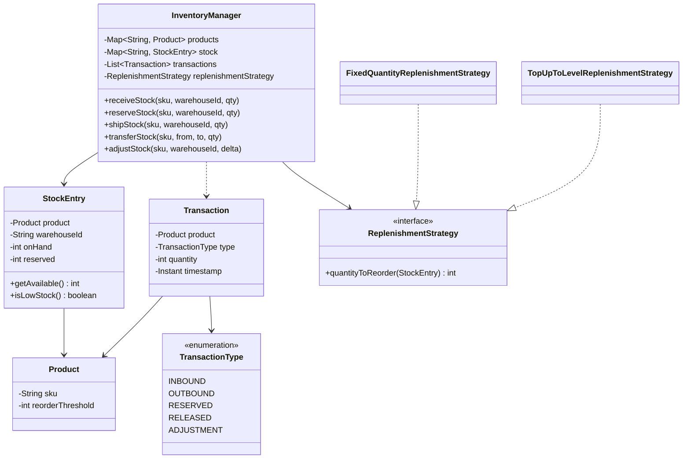

<div align="center">

# 📦 Design an Inventory Management System

   

*Receive, reserve, ship, transfer and adjust stock per warehouse, with a full audit trail and automatic reorder alerts.*

</div>

---

## 📑 Table of contents

- [🎯 Problem statement](#-problem-statement)
- [🧩 Requirements & approach](#-requirements--approach)
- [🔷 Class diagram](#-class-diagram)
- [👥 Classes & responsibilities](#-classes--responsibilities)
- [🧭 Design patterns & principles used](#-design-patterns--principles-used)
- [📊 Strengths & limitations](#-strengths--limitations)
- [🌍 Follow-up interview questions](#-follow-up-interview-questions)
- [💻 Code](#-code)
  - [1. Implementation](#ex1)

---

## 🎯 Problem statement

> Design an **inventory management system** for a multi-warehouse retailer. Stock is received, reserved for an order, shipped, transferred between warehouses, or manually adjusted (damage, stock take). Every movement must be auditable, and falling below a reorder threshold should trigger a reorder automatically.

## 🧩 Requirements & approach

| 📋 Requirements | 🛠️ Design approach |
|---|---|
| 1. Stock is tracked per (product, warehouse), not just per product<br>2. 'Available' stock excludes anything already reserved for an order<br>3. Reserving or shipping more than is available/reserved must be rejected<br>4. Every movement (receive, reserve, release, ship, adjust, transfer) must be logged with what, where, how much and when<br>5. Shipping stock that drops available quantity to or below a per-product threshold should trigger a reorder, with the reorder amount pluggable<br>6. Transferring stock between two warehouses must look like one operation, not two independent ones that could partially fail<br>7. An adjustment must never drop on-hand stock below what is already reserved | `StockEntry` is the unit of truth for one (product, warehouse) pair: on-hand, reserved, and available = on-hand minus reserved. `InventoryManager` is the single entry point for every movement; each method validates the quantity, applies the change to the right `StockEntry`, and appends one `Transaction` to the audit log, so no path can move stock without being recorded. Shipping checks `StockEntry.isLowStock()` afterward and asks an injected `ReplenishmentStrategy` how much to reorder, without `InventoryManager` knowing the reorder policy itself. The code is split into folders (`enums`, `entities`, `exceptions`, `strategy`, `service`) and `Main`, the client, sits outside them. |

## 🔷 Class diagram



## 👥 Classes & responsibilities

| Class / interface | Responsibility | Kind · folder |
|---|---|---|
| **`InventoryManager`** | Entry point for every movement; validates, applies the change, logs it, and triggers reorder checks (thread safe) | service class · `service/` |
| **`StockEntry`** | One product's stock at one warehouse: on-hand, reserved, derived available | class · `entities/` |
| **`Transaction`** | An immutable audit log line for one movement | class · `entities/` |
| **`Product`** | SKU, name and its own reorder threshold | class · `entities/` |
| **`ReplenishmentStrategy`** | Given a low-stock entry, how much should be reordered? | interface · `strategy/` |
| **`FixedQuantityReplenishmentStrategy`** | Always reorders the same fixed amount | class · `strategy/` |
| **`TopUpToLevelReplenishmentStrategy`** | Reorders just enough to bring available stock back to a target level | class · `strategy/` |
| **`TransactionType`** | INBOUND/OUTBOUND/RESERVED/RELEASED/ADJUSTMENT | enum · `enums/` |
| **`InsufficientStockException`, `InvalidQuantityException`, `ProductNotFoundException`** | Not enough available/reserved stock; a non-positive quantity or an unsafe adjustment; an unknown SKU | runtime exceptions · `exceptions/` |
| **`Main`** | Receive, reserve, ship (triggering a reorder), a cross-warehouse transfer, a damage adjustment, and four rejected operations, finishing with the full audit trail | demo · client, outside the packages |

## 🧭 Design patterns & principles used

| Pattern / principle | Where and why |
|---|---|
| **Strategy** | `ReplenishmentStrategy`: the reorder policy changes without touching `InventoryManager` or `StockEntry` |
| **Single Responsibility principle** | `StockEntry` only tracks quantities for one (product, warehouse) pair; `InventoryManager` only validates and logs; `Transaction` only records |
| **Open/Closed principle** | A new movement type (e.g. a return) or a new reorder policy is a new method/class, with every existing one untouched |
| **Append-only audit log** | `Transaction`s are immutable and only ever added, never edited, so the audit trail is tamper-evident by construction |
| **Derived state** | `available` is never stored directly, only computed from `onHand - reserved`, so it cannot drift out of sync with the two numbers that define it |

## 📊 Strengths & limitations

| 👍 Strengths | 👎 Limitations |
|---|---|
| Every movement is logged exactly once, by construction, because all seven operations funnel through one class | `transferStock` is not transactional across a crash between its two halves (a real system would wrap both in a DB transaction or a saga) |
| Reservation and shipping are kept separate, so 'sold but not yet picked' stock is always visible and correct | No batch/lot tracking or expiry dates, no multi-product orders / kitting |
| Reorder policy is swappable per deployment without touching core stock logic | Reorder only triggers on `shipStock`, not on `adjustStock`, so a damage write-off alone will not trigger a reorder until the next shipment (noted as a follow-up) |
| A cross-warehouse transfer is one call, so it can never be half-applied by the caller forgetting the second step | One lock per manager instance; a real multi-warehouse system would shard by warehouse or product |

## 🌍 Follow-up interview questions

- **How would you make the reorder check also fire on damage adjustments?** Call the same `maybeReplenish(entry)` helper from `adjustStock` too, not only from `shipStock`.
- **How would you make `transferStock` crash safe?** Wrap both halves in a database transaction, or model it explicitly as a saga: a `TRANSFER_PENDING` state that is only cleared once both the debit and the credit are confirmed.
- **How would you support batch/lot numbers and expiry?** `StockEntry` would hold a list of `Lot(quantity, expiryDate)` instead of a single `onHand` count, and shipping would pick lots by a `LotSelectionStrategy` (e.g. FEFO - first-expiry-first-out).
- **How would you support multi-item kits (one SKU made of several component SKUs)?** A `Kit` that expands into its components at reservation time, reserving each component's `StockEntry` instead of (or as well as) the kit's own.
- **How would you scale to thousands of warehouses?** Shard `InventoryManager`'s state by warehouse (or by product) and make cross-shard operations like `transferStock` go through a coordinator instead of in-process locks.
- **How would you prevent overselling across two concurrent reservations for the last unit?** `reserveStock` is already `synchronized`, so the check-then-reserve is atomic within one instance; across instances this would need a database-level row lock or optimistic concurrency check.
- **How would you report low-stock items across the whole catalog?** Iterate `StockEntry` values and filter `isLowStock()`; at scale, maintain a materialized 'low stock' index updated incrementally on every `shipStock`/`adjustStock` instead of scanning.

---

## 💻 Code

This folder has **1 example** (12 Java files). Interfaces and abstract classes come first, the class with `main` comes last.

<a id="ex1"></a>

### 1. Implementation

<details open>
<summary><b>📁 Files in this example</b></summary>

```text
12. Inventory/
├── entities/
│   ├── Product.java
│   ├── StockEntry.java
│   └── Transaction.java
├── enums/
│   └── TransactionType.java
├── exceptions/
│   ├── InsufficientStockException.java
│   ├── InvalidQuantityException.java
│   └── ProductNotFoundException.java
├── service/
│   └── InventoryManager.java
├── strategy/
│   ├── FixedQuantityReplenishmentStrategy.java
│   ├── ReplenishmentStrategy.java
│   └── TopUpToLevelReplenishmentStrategy.java
└── Main.java
```

</details>

#### 📄 `enums/TransactionType.java`

<sub>enum · 9 lines</sub>

```java
package enums;

public enum TransactionType {
    INBOUND,     // stock received
    OUTBOUND,    // stock sold/shipped
    RESERVED,    // held for an order, not yet shipped
    RELEASED,    // a reservation cancelled
    ADJUSTMENT   // manual correction (stock take, damage, ...)
}
```

#### 📄 `strategy/ReplenishmentStrategy.java`

<sub>interface · 8 lines</sub>

```java
package strategy;

import entities.StockEntry;

// Strategy: once a product is low on stock, how much should be reordered?
public interface ReplenishmentStrategy {
    int quantityToReorder(StockEntry entry);
}
```

#### 📄 `entities/Product.java`

<sub>class · 22 lines</sub>

```java
package entities;

public class Product {
    private final String sku;
    private final String name;
    private final int reorderThreshold;    // reorder when available stock falls to or below this

    public Product(String sku, String name, int reorderThreshold) {
        this.sku = sku;
        this.name = name;
        this.reorderThreshold = reorderThreshold;
    }

    public String getSku() { return sku; }

    public String getName() { return name; }

    public int getReorderThreshold() { return reorderThreshold; }

    @Override
    public String toString() { return name + " (" + sku + ")"; }
}
```

#### 📄 `entities/StockEntry.java`

<sub>class · 40 lines</sub>

```java
package entities;

// One warehouse's stock for one product. `reserved` is already-sold stock still physically
// on the shelf; available = onHand - reserved is what can be sold or reserved next.
public class StockEntry {
    private final Product product;
    private final String warehouseId;
    private int onHand;
    private int reserved;

    public StockEntry(Product product, String warehouseId) {
        this.product = product;
        this.warehouseId = warehouseId;
    }

    public Product getProduct() { return product; }

    public String getWarehouseId() { return warehouseId; }

    public int getOnHand() { return onHand; }

    public int getReserved() { return reserved; }

    public int getAvailable() { return onHand - reserved; }

    public void receive(int quantity) { onHand += quantity; }

    public void reserve(int quantity) { reserved += quantity; }

    public void release(int quantity) { reserved -= quantity; }

    public void ship(int quantity) {
        onHand -= quantity;
        reserved -= quantity;
    }

    public void adjust(int delta) { onHand += delta; }

    public boolean isLowStock() { return getAvailable() <= product.getReorderThreshold(); }
}
```

#### 📄 `entities/Transaction.java`

<sub>class · 27 lines</sub>

```java
package entities;

import enums.TransactionType;

import java.time.Instant;

// An immutable audit trail entry: what moved, where, by how much, and when
public class Transaction {
    private final Product product;
    private final String warehouseId;
    private final TransactionType type;
    private final int quantity;
    private final Instant timestamp;

    public Transaction(Product product, String warehouseId, TransactionType type, int quantity, Instant timestamp) {
        this.product = product;
        this.warehouseId = warehouseId;
        this.type = type;
        this.quantity = quantity;
        this.timestamp = timestamp;
    }

    @Override
    public String toString() {
        return timestamp + " [" + warehouseId + "] " + type + " " + quantity + "x " + product.getName();
    }
}
```

#### 📄 `exceptions/InsufficientStockException.java`

<sub>class · 7 lines</sub>

```java
package exceptions;

public class InsufficientStockException extends RuntimeException {
    public InsufficientStockException(String message) {
        super(message);
    }
}
```

#### 📄 `exceptions/InvalidQuantityException.java`

<sub>class · 7 lines</sub>

```java
package exceptions;

public class InvalidQuantityException extends RuntimeException {
    public InvalidQuantityException(String message) {
        super(message);
    }
}
```

#### 📄 `exceptions/ProductNotFoundException.java`

<sub>class · 7 lines</sub>

```java
package exceptions;

public class ProductNotFoundException extends RuntimeException {
    public ProductNotFoundException(String message) {
        super(message);
    }
}
```

#### 📄 `service/InventoryManager.java`

<sub>class · 125 lines</sub>

```java
package service;

import entities.Product;
import entities.StockEntry;
import entities.Transaction;
import enums.TransactionType;
import exceptions.InsufficientStockException;
import exceptions.InvalidQuantityException;
import exceptions.ProductNotFoundException;
import strategy.ReplenishmentStrategy;

import java.time.Clock;
import java.util.ArrayList;
import java.util.HashMap;
import java.util.List;
import java.util.Map;

// Single entry point for every stock movement. Every method validates the quantity, finds
// (or refuses to find) the (product, warehouse) entry, applies the change, and appends one
// Transaction - so the audit trail can never miss or double-count a movement.
public class InventoryManager {
    private final Map<String, Product> products = new HashMap<>();
    private final Map<String, StockEntry> stock = new HashMap<>();   // key: sku + "@" + warehouseId
    private final List<Transaction> transactions = new ArrayList<>();
    private final ReplenishmentStrategy replenishmentStrategy;
    private final Clock clock;

    public InventoryManager(ReplenishmentStrategy replenishmentStrategy, Clock clock) {
        this.replenishmentStrategy = replenishmentStrategy;
        this.clock = clock;
    }

    public void registerProduct(Product product) { products.put(product.getSku(), product); }

    public synchronized void receiveStock(String sku, String warehouseId, int quantity) {
        requirePositive(quantity);
        StockEntry entry = entryFor(sku, warehouseId);
        entry.receive(quantity);
        log(entry, TransactionType.INBOUND, quantity);
    }

    public synchronized void reserveStock(String sku, String warehouseId, int quantity) {
        requirePositive(quantity);
        StockEntry entry = entryFor(sku, warehouseId);
        if (entry.getAvailable() < quantity) {
            throw new InsufficientStockException("Only " + entry.getAvailable() + " available for " + entry.getProduct() + " at " + warehouseId);
        }
        entry.reserve(quantity);
        log(entry, TransactionType.RESERVED, quantity);
    }

    public synchronized void releaseReservation(String sku, String warehouseId, int quantity) {
        requirePositive(quantity);
        StockEntry entry = entryFor(sku, warehouseId);
        if (entry.getReserved() < quantity) {
            throw new InvalidQuantityException("Cannot release " + quantity + ", only " + entry.getReserved() + " is reserved");
        }
        entry.release(quantity);
        log(entry, TransactionType.RELEASED, quantity);
    }

    public synchronized void shipStock(String sku, String warehouseId, int quantity) {
        requirePositive(quantity);
        StockEntry entry = entryFor(sku, warehouseId);
        if (entry.getReserved() < quantity) {
            throw new InsufficientStockException("Cannot ship " + quantity + ", only " + entry.getReserved() + " is reserved for " + entry.getProduct());
        }
        entry.ship(quantity);
        log(entry, TransactionType.OUTBOUND, quantity);
        maybeReplenish(entry);
    }

    public synchronized void adjustStock(String sku, String warehouseId, int delta) {
        StockEntry entry = entryFor(sku, warehouseId);
        if (entry.getOnHand() + delta < entry.getReserved()) {
            throw new InvalidQuantityException("Adjustment would drop on-hand stock below what is already reserved");
        }
        entry.adjust(delta);
        log(entry, TransactionType.ADJUSTMENT, delta);
    }

    // Moves stock between two warehouses for the same product, as one atomic operation
    public synchronized void transferStock(String sku, String fromWarehouse, String toWarehouse, int quantity) {
        requirePositive(quantity);
        StockEntry from = entryFor(sku, fromWarehouse);
        if (from.getAvailable() < quantity) {
            throw new InsufficientStockException("Only " + from.getAvailable() + " available to transfer from " + fromWarehouse);
        }
        from.adjust(-quantity);
        log(from, TransactionType.OUTBOUND, quantity);
        StockEntry to = entryFor(sku, toWarehouse);
        to.receive(quantity);
        log(to, TransactionType.INBOUND, quantity);
    }

    public StockEntry getStock(String sku, String warehouseId) { return entryFor(sku, warehouseId); }

    public List<Transaction> getTransactions() { return transactions; }

    private void maybeReplenish(StockEntry entry) {
        if (entry.isLowStock()) {
            int reorderQuantity = replenishmentStrategy.quantityToReorder(entry);
            System.out.println("  [Reorder] " + entry.getProduct() + " at " + entry.getWarehouseId()
                    + " is low (" + entry.getAvailable() + " available) -> reordering " + reorderQuantity);
        }
    }

    private StockEntry entryFor(String sku, String warehouseId) {
        Product product = products.get(sku);
        if (product == null) {
            throw new ProductNotFoundException("Unknown SKU: " + sku);
        }
        return stock.computeIfAbsent(sku + "@" + warehouseId, k -> new StockEntry(product, warehouseId));
    }

    private void log(StockEntry entry, TransactionType type, int quantity) {
        transactions.add(new Transaction(entry.getProduct(), entry.getWarehouseId(), type, quantity, clock.instant()));
    }

    private void requirePositive(int quantity) {
        if (quantity <= 0) {
            throw new InvalidQuantityException("Quantity must be positive, got " + quantity);
        }
    }
}
```

#### 📄 `strategy/FixedQuantityReplenishmentStrategy.java`

<sub>class · 15 lines</sub>

```java
package strategy;

import entities.StockEntry;

// Always reorder the same fixed amount
public class FixedQuantityReplenishmentStrategy implements ReplenishmentStrategy {
    private final int quantity;

    public FixedQuantityReplenishmentStrategy(int quantity) {
        this.quantity = quantity;
    }

    @Override
    public int quantityToReorder(StockEntry entry) { return quantity; }
}
```

#### 📄 `strategy/TopUpToLevelReplenishmentStrategy.java`

<sub>class · 17 lines</sub>

```java
package strategy;

import entities.StockEntry;

// Reorders just enough to bring available stock back up to a target level
public class TopUpToLevelReplenishmentStrategy implements ReplenishmentStrategy {
    private final int targetLevel;

    public TopUpToLevelReplenishmentStrategy(int targetLevel) {
        this.targetLevel = targetLevel;
    }

    @Override
    public int quantityToReorder(StockEntry entry) {
        return Math.max(0, targetLevel - entry.getAvailable());
    }
}
```

#### 📄 `Main.java`

<sub>class · 72 lines</sub>

```java
import entities.Product;
import entities.StockEntry;
import exceptions.InsufficientStockException;
import exceptions.InvalidQuantityException;
import exceptions.ProductNotFoundException;
import service.InventoryManager;
import strategy.TopUpToLevelReplenishmentStrategy;

import java.time.Clock;
import java.time.Instant;
import java.time.ZoneOffset;

public class Main {
    public static void main(String[] args) {

        InventoryManager manager = new InventoryManager(
                new TopUpToLevelReplenishmentStrategy(50), Clock.fixed(Instant.parse("2026-01-01T00:00:00Z"), ZoneOffset.UTC));

        Product widget = new Product("SKU-1", "Widget", 10);
        manager.registerProduct(widget);

        System.out.println("=== Receive and reserve stock ===");
        manager.receiveStock("SKU-1", "WH-EAST", 100);
        manager.reserveStock("SKU-1", "WH-EAST", 30);
        StockEntry entry = manager.getStock("SKU-1", "WH-EAST");
        System.out.println("On hand: " + entry.getOnHand() + ", reserved: " + entry.getReserved() + ", available: " + entry.getAvailable());

        System.out.println("\n=== Ship the reserved stock ===");
        manager.shipStock("SKU-1", "WH-EAST", 30);
        System.out.println("On hand: " + entry.getOnHand() + ", reserved: " + entry.getReserved() + ", available: " + entry.getAvailable());

        System.out.println("\n=== Reserve and ship enough to trigger a reorder ===");
        manager.reserveStock("SKU-1", "WH-EAST", 62);
        manager.shipStock("SKU-1", "WH-EAST", 62);     // available drops to 8, at or below the threshold of 10
        System.out.println("On hand: " + entry.getOnHand() + ", available: " + entry.getAvailable() + ", low stock: " + entry.isLowStock());

        System.out.println("\n=== Transfer stock between warehouses ===");
        manager.receiveStock("SKU-1", "WH-WEST", 5);
        manager.transferStock("SKU-1", "WH-EAST", "WH-WEST", 3);
        System.out.println("WH-EAST available: " + manager.getStock("SKU-1", "WH-EAST").getAvailable());
        System.out.println("WH-WEST available: " + manager.getStock("SKU-1", "WH-WEST").getAvailable());

        System.out.println("\n=== A damaged-stock adjustment ===");
        manager.adjustStock("SKU-1", "WH-WEST", -2);
        System.out.println("WH-WEST on hand: " + manager.getStock("SKU-1", "WH-WEST").getOnHand());

        System.out.println("\n-- Rejections --");
        try {
            manager.reserveStock("SKU-1", "WH-EAST", 1000);
        } catch (InsufficientStockException e) {
            System.out.println("Rejected: " + e.getMessage());
        }
        try {
            manager.shipStock("SKU-1", "WH-EAST", 5);     // nothing reserved right now
        } catch (InsufficientStockException e) {
            System.out.println("Rejected: " + e.getMessage());
        }
        try {
            manager.receiveStock("SKU-1", "WH-EAST", -10);
        } catch (InvalidQuantityException e) {
            System.out.println("Rejected: " + e.getMessage());
        }
        try {
            manager.receiveStock("SKU-404", "WH-EAST", 10);
        } catch (ProductNotFoundException e) {
            System.out.println("Rejected: " + e.getMessage());
        }

        System.out.println("\n=== Audit trail (" + manager.getTransactions().size() + " entries) ===");
        manager.getTransactions().forEach(System.out::println);
    }
}
```

<details>
<summary><b>▶️ How to compile and run this example</b></summary>

```bash
# run from the repository root
mkdir -p out
find "Interview Questions/12. Inventory" -name "*.java" -print0 | xargs -0 javac -d out
java -cp out Main
```

</details>

---

<div align="center">

[◀ Cricbuzz](../11.%20Cricbuzz/README.md) &nbsp;·&nbsp; [📚 All questions](../QUESTIONS.md) &nbsp;·&nbsp; [Apply Coupon ▶](../13.%20Apply%20Coupon/README.md)

</div>
