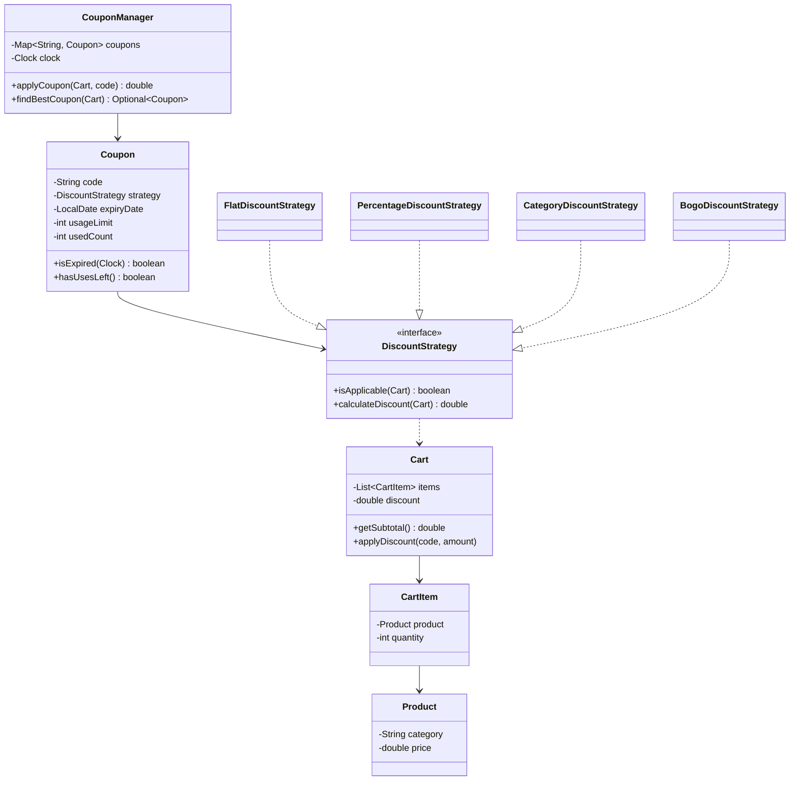

<div align="center">

# 🏷️ Design a Coupon / Discount Engine

   

*Validate a coupon against a cart (expiry, usage, applicability) and apply the right kind of discount.*

</div>

---

## 📑 Table of contents

- [🎯 Problem statement](#-problem-statement)
- [🧩 Requirements & approach](#-requirements--approach)
- [🔷 Class diagram](#-class-diagram)
- [👥 Classes & responsibilities](#-classes--responsibilities)
- [🧭 Design patterns & principles used](#-design-patterns--principles-used)
- [📊 Strengths & limitations](#-strengths--limitations)
- [🌍 Follow-up interview questions](#-follow-up-interview-questions)
- [💻 Code](#-code)
  - [1. Implementation](#ex1)

---

## 🎯 Problem statement

> Design a **coupon / discount system** for an e-commerce cart. Different coupons give a flat amount off, a capped percentage off, a percentage off one category, or a 'buy one get one free' deal on a category. Every coupon also has an expiry date and a usage limit, checked the same way regardless of how the discount itself is computed.

## 🧩 Requirements & approach

| 📋 Requirements | 🛠️ Design approach |
|---|---|
| 1. Several kinds of discount: flat, percentage (capped), category percentage (capped), BOGO on a category<br>2. Each coupon has a minimum-cart or applicability rule, an expiry date, and a usage limit<br>3. Validation must happen in a fixed order (unknown code, then expired, then usage limit, then applicability) so results are predictable<br>4. A coupon must never discount more than the cart's subtotal<br>5. Given a cart, find the single best applicable coupon automatically<br>6. A new kind of discount must be addable without touching validation or the manager<br>7. Expiry must be testable without waiting for a real date to pass | `DiscountStrategy` turns a cart into 'does this apply' and 'how much off'; `FlatDiscountStrategy`, `PercentageDiscountStrategy`, `CategoryDiscountStrategy` and `BogoDiscountStrategy` each only know their own rule. `Coupon` pairs a strategy with its expiry and usage limit, but does not validate itself; `CouponManager` is the single place that checks expiry, usage and applicability, in that order, for both `applyCoupon` (by code) and `findBestCoupon` (tries every registered coupon and keeps the one with the largest discount). Time comes from an injected `Clock`, so expiry is testable. The code is split into folders (`entities`, `exceptions`, `strategy`, `service`, `util`) and `Main`, the client, sits outside them. |

## 🔷 Class diagram



## 👥 Classes & responsibilities

| Class / interface | Responsibility | Kind · folder |
|---|---|---|
| **`CouponManager`** | Entry point: validates (unknown, expired, usage, applicability) and applies by code, or finds the best coupon automatically | service class · `service/` |
| **`Coupon`** | Code, description, strategy, expiry and usage limit; reports its own expiry/uses but does not validate itself against a cart | class · `entities/` |
| **`DiscountStrategy`** | Is this coupon applicable to this cart, and how much does it take off? | interface · `strategy/` |
| **`FlatDiscountStrategy`** | A fixed amount off once a minimum subtotal is met | class · `strategy/` |
| **`PercentageDiscountStrategy`** | A capped percentage off the whole cart | class · `strategy/` |
| **`CategoryDiscountStrategy`** | A capped percentage off only the items in one category | class · `strategy/` |
| **`BogoDiscountStrategy`** | Buy-one-get-one on a category: the cheaper unit of every pair is free | class · `strategy/` |
| **`Cart`, `CartItem`, `Product`** | What's being bought, and the subtotal/discount/final amount | classes · `entities/` |
| **`CouponExpiredException`, `CouponUsageLimitExceededException`, `CouponNotApplicableException`** | The three ways a coupon can be rejected, plus an unknown code | runtime exceptions · `exceptions/` |
| **`ManualClock`** | A clock moved by hand so expiry can be tested without waiting | test helper · `util/` |
| **`Main`** | Five coupon types applied to one cart, auto-picking the best one, four rejections, and a coupon expiring after the clock advances | demo · client, outside the packages |

## 🧭 Design patterns & principles used

| Pattern / principle | Where and why |
|---|---|
| **Strategy** | `DiscountStrategy`: a new discount type is a new class; `CouponManager` and `Coupon` are not touched |
| **Single Responsibility principle** | `Coupon` only carries its own expiry/usage state, strategies only compute discounts, `CouponManager` only validates and coordinates |
| **Open/Closed principle** | Adding 'buy 2 get 1 free' or 'free shipping' is a new `DiscountStrategy`, with zero changes to validation order or the manager |
| **Dependency Injection** | The `Clock` is passed into `CouponManager`, exactly like the Parking Lot and ATM questions, so expiry is deterministic in tests |
| **Fixed validation order** | Unknown code -> expired -> usage limit -> applicability is checked in exactly that order every time, in one method, so results never depend on call site |

## 📊 Strengths & limitations

| 👍 Strengths | 👎 Limitations |
|---|---|
| Every coupon type is validated through the same four checks, so a new strategy can never skip a rule | Only one coupon per cart at a time (`applyDiscount` overwrites); stacking is a named follow-up, not implemented |
| A discount can never exceed the cart's subtotal (`Cart.applyDiscount` clamps it) | No per-user usage limit, only a global counter on the coupon itself |
| `findBestCoupon` reuses the exact same applicability check as `applyCoupon`, so 'best' and 'valid' can never disagree | BOGO always frees the cheaper unit; a 'free the equal/cheaper item of a specific pair' variant would need more input |
| Expiry is deterministic and testable via the injected clock, demonstrated by advancing it mid-demo | Floating point amounts; a production system would use integer minor units throughout |

## 🌍 Follow-up interview questions

- **How would you support stacking multiple coupons?** Define an explicit stacking policy (e.g. at most one percentage + one flat), apply them in a fixed order, and recompute the subtotal available to each next strategy from the remaining amount.
- **How would you add a per-user usage limit instead of global?** Change `usedCount` to a `Map<UserId, Integer>` on `Coupon`, and pass the user into `hasUsesLeft(userId)`.
- **How would you add 'buy 2 get 1 free' or 'spend X get Y off'?** A new `DiscountStrategy` implementation; nothing in `CouponManager`, `Coupon` or `Cart` changes (Open/Closed).
- **How do you decide which coupon is 'best' when two give the same discount?** `findBestCoupon` currently keeps the first one seen; a tie-break (e.g. prefer simpler discount types, or the one expiring soonest) would be a small comparator change.
- **How would you let a customer remove a coupon and try another?** `Cart.removeCoupon()` already exists for this, used between each strategy in the demo; a UI would call it before re-applying.
- **Why validate in a fixed order (expired, then usage, then applicability) rather than checking strategy applicability first?** Cheap, coupon-only checks run before anything that needs to scan the cart's items, and the error message a customer sees is the most specific true reason, not an incidental one.
- **How would you prevent a race where two orders use the last allowed use of a limited coupon at once?** `applyCoupon` is already `synchronized`; at scale, move the usage counter into the database with an atomic increment instead of an in-memory field.

---

## 💻 Code

This folder has **1 example** (15 Java files). Interfaces and abstract classes come first, the class with `main` comes last.

<a id="ex1"></a>

### 1. Implementation

<details open>
<summary><b>📁 Files in this example</b></summary>

```text
13. Apply Coupon/
├── entities/
│   ├── Cart.java
│   ├── CartItem.java
│   ├── Coupon.java
│   └── Product.java
├── exceptions/
│   ├── CouponExpiredException.java
│   ├── CouponNotApplicableException.java
│   └── CouponUsageLimitExceededException.java
├── service/
│   └── CouponManager.java
├── strategy/
│   ├── BogoDiscountStrategy.java
│   ├── CategoryDiscountStrategy.java
│   ├── DiscountStrategy.java
│   ├── FlatDiscountStrategy.java
│   └── PercentageDiscountStrategy.java
├── util/
│   └── ManualClock.java
└── Main.java
```

</details>

#### 📄 `strategy/DiscountStrategy.java`

<sub>interface · 10 lines</sub>

```java
package strategy;

import entities.Cart;

// Strategy: does this coupon apply to this cart, and if so, how much does it take off?
public interface DiscountStrategy {
    boolean isApplicable(Cart cart);

    double calculateDiscount(Cart cart);
}
```

#### 📄 `entities/Cart.java`

<sub>class · 50 lines</sub>

```java
package entities;

import java.util.ArrayList;
import java.util.List;

public class Cart {
    private final List<CartItem> items = new ArrayList<>();
    private String appliedCouponCode;
    private double discount = 0;

    public void addItem(Product product, int quantity) {
        items.add(new CartItem(product, quantity));
    }

    public List<CartItem> getItems() { return items; }

    public List<CartItem> getItemsInCategory(String category) {
        List<CartItem> result = new ArrayList<>();
        for (CartItem item : items) {
            if (item.getProduct().getCategory().equals(category)) {
                result.add(item);
            }
        }
        return result;
    }

    public double getSubtotal() {
        double total = 0;
        for (CartItem item : items) {
            total += item.getSubtotal();
        }
        return total;
    }

    public double getFinalAmount() { return getSubtotal() - discount; }

    public double getDiscount() { return discount; }

    public String getAppliedCouponCode() { return appliedCouponCode; }

    public void applyDiscount(String couponCode, double discountAmount) {
        this.appliedCouponCode = couponCode;
        this.discount = Math.min(discountAmount, getSubtotal());
    }

    public void removeCoupon() {
        this.appliedCouponCode = null;
        this.discount = 0;
    }
}
```

#### 📄 `entities/CartItem.java`

<sub>class · 17 lines</sub>

```java
package entities;

public class CartItem {
    private final Product product;
    private final int quantity;

    public CartItem(Product product, int quantity) {
        this.product = product;
        this.quantity = quantity;
    }

    public Product getProduct() { return product; }

    public int getQuantity() { return quantity; }

    public double getSubtotal() { return product.getPrice() * quantity; }
}
```

#### 📄 `entities/Coupon.java`

<sub>class · 37 lines</sub>

```java
package entities;

import strategy.DiscountStrategy;

import java.time.Clock;
import java.time.LocalDate;

public class Coupon {
    private final String code;
    private final String description;
    private final DiscountStrategy strategy;
    private final LocalDate expiryDate;
    private final int usageLimit;
    private int usedCount = 0;

    public Coupon(String code, String description, DiscountStrategy strategy, LocalDate expiryDate, int usageLimit) {
        this.code = code;
        this.description = description;
        this.strategy = strategy;
        this.expiryDate = expiryDate;
        this.usageLimit = usageLimit;
    }

    public String getCode() { return code; }

    public String getDescription() { return description; }

    public DiscountStrategy getStrategy() { return strategy; }

    public boolean isExpired(Clock clock) { return LocalDate.now(clock).isAfter(expiryDate); }

    public boolean hasUsesLeft() { return usedCount < usageLimit; }

    public void recordUse() { usedCount++; }

    public int getUsedCount() { return usedCount; }
}
```

#### 📄 `entities/Product.java`

<sub>class · 26 lines</sub>

```java
package entities;

public class Product {
    private final String id;
    private final String name;
    private final String category;
    private final double price;

    public Product(String id, String name, String category, double price) {
        this.id = id;
        this.name = name;
        this.category = category;
        this.price = price;
    }

    public String getId() { return id; }

    public String getName() { return name; }

    public String getCategory() { return category; }

    public double getPrice() { return price; }

    @Override
    public String toString() { return name + " ($" + price + ")"; }
}
```

#### 📄 `exceptions/CouponExpiredException.java`

<sub>class · 7 lines</sub>

```java
package exceptions;

public class CouponExpiredException extends RuntimeException {
    public CouponExpiredException(String message) {
        super(message);
    }
}
```

#### 📄 `exceptions/CouponNotApplicableException.java`

<sub>class · 7 lines</sub>

```java
package exceptions;

public class CouponNotApplicableException extends RuntimeException {
    public CouponNotApplicableException(String message) {
        super(message);
    }
}
```

#### 📄 `exceptions/CouponUsageLimitExceededException.java`

<sub>class · 7 lines</sub>

```java
package exceptions;

public class CouponUsageLimitExceededException extends RuntimeException {
    public CouponUsageLimitExceededException(String message) {
        super(message);
    }
}
```

#### 📄 `service/CouponManager.java`

<sub>class · 73 lines</sub>

```java
package service;

import entities.Cart;
import entities.Coupon;
import exceptions.CouponExpiredException;
import exceptions.CouponNotApplicableException;
import exceptions.CouponUsageLimitExceededException;

import java.time.Clock;
import java.util.HashMap;
import java.util.Map;
import java.util.Optional;

// Single entry point: register coupons, validate and apply one by code, or find the best
// applicable one automatically. Validity (expiry, usage, applicability) is always checked
// in the same order and in one place, so the three ways in can never disagree.
public class CouponManager {
    private final Map<String, Coupon> coupons = new HashMap<>();
    private final Clock clock;

    public CouponManager(Clock clock) {
        this.clock = clock;
    }

    public void register(Coupon coupon) {
        coupons.put(coupon.getCode(), coupon);
    }

    public synchronized double applyCoupon(Cart cart, String code) {
        Coupon coupon = coupons.get(code);
        if (coupon == null) {
            throw new CouponNotApplicableException("Unknown coupon code: " + code);
        }
        validate(coupon, cart);

        double discount = coupon.getStrategy().calculateDiscount(cart);
        coupon.recordUse();
        cart.applyDiscount(coupon.getCode(), discount);
        return discount;
    }

    // Tries every registered coupon and returns the one giving the biggest discount, if any applies
    public synchronized Optional<Coupon> findBestCoupon(Cart cart) {
        Coupon best = null;
        double bestDiscount = -1;
        for (Coupon coupon : coupons.values()) {
            if (isUsable(coupon, cart)) {
                double discount = coupon.getStrategy().calculateDiscount(cart);
                if (discount > bestDiscount) {
                    best = coupon;
                    bestDiscount = discount;
                }
            }
        }
        return Optional.ofNullable(best);
    }

    private void validate(Coupon coupon, Cart cart) {
        if (coupon.isExpired(clock)) {
            throw new CouponExpiredException(coupon.getCode() + " expired");
        }
        if (!coupon.hasUsesLeft()) {
            throw new CouponUsageLimitExceededException(coupon.getCode() + " has reached its usage limit");
        }
        if (!coupon.getStrategy().isApplicable(cart)) {
            throw new CouponNotApplicableException(coupon.getCode() + " does not apply to this cart");
        }
    }

    private boolean isUsable(Coupon coupon, Cart cart) {
        return !coupon.isExpired(clock) && coupon.hasUsesLeft() && coupon.getStrategy().isApplicable(cart);
    }
}
```

#### 📄 `strategy/BogoDiscountStrategy.java`

<sub>class · 46 lines</sub>

```java
package strategy;

import entities.Cart;
import entities.CartItem;

import java.util.ArrayList;
import java.util.Collections;
import java.util.List;

// "Buy one, get one free" on a category: for every 2 units in the category, the cheaper
// unit of the pair is free. Needs at least 2 units in the category to apply at all.
public class BogoDiscountStrategy implements DiscountStrategy {
    private final String category;

    public BogoDiscountStrategy(String category) {
        this.category = category;
    }

    @Override
    public boolean isApplicable(Cart cart) { return unitCount(cart) >= 2; }

    @Override
    public double calculateDiscount(Cart cart) {
        List<Double> unitPrices = new ArrayList<>();
        for (CartItem item : cart.getItemsInCategory(category)) {
            for (int i = 0; i < item.getQuantity(); i++) {
                unitPrices.add(item.getProduct().getPrice());
            }
        }
        Collections.sort(unitPrices);                     // cheapest units are the ones made free
        int freeCount = unitPrices.size() / 2;
        double discount = 0;
        for (int i = 0; i < freeCount; i++) {
            discount += unitPrices.get(i);
        }
        return discount;
    }

    private int unitCount(Cart cart) {
        int count = 0;
        for (CartItem item : cart.getItemsInCategory(category)) {
            count += item.getQuantity();
        }
        return count;
    }
}
```

#### 📄 `strategy/CategoryDiscountStrategy.java`

<sub>class · 29 lines</sub>

```java
package strategy;

import entities.Cart;
import entities.CartItem;

// A percentage off only the items in one category, capped
public class CategoryDiscountStrategy implements DiscountStrategy {
    private final String category;
    private final double percentage;
    private final double maxDiscountCap;

    public CategoryDiscountStrategy(String category, double percentage, double maxDiscountCap) {
        this.category = category;
        this.percentage = percentage;
        this.maxDiscountCap = maxDiscountCap;
    }

    @Override
    public boolean isApplicable(Cart cart) { return !cart.getItemsInCategory(category).isEmpty(); }

    @Override
    public double calculateDiscount(Cart cart) {
        double categorySubtotal = 0;
        for (CartItem item : cart.getItemsInCategory(category)) {
            categorySubtotal += item.getSubtotal();
        }
        return Math.min(categorySubtotal * percentage / 100.0, maxDiscountCap);
    }
}
```

#### 📄 `strategy/FlatDiscountStrategy.java`

<sub>class · 20 lines</sub>

```java
package strategy;

import entities.Cart;

// A fixed amount off, once the cart reaches a minimum subtotal
public class FlatDiscountStrategy implements DiscountStrategy {
    private final double minCartValue;
    private final double flatAmount;

    public FlatDiscountStrategy(double minCartValue, double flatAmount) {
        this.minCartValue = minCartValue;
        this.flatAmount = flatAmount;
    }

    @Override
    public boolean isApplicable(Cart cart) { return cart.getSubtotal() >= minCartValue; }

    @Override
    public double calculateDiscount(Cart cart) { return flatAmount; }
}
```

#### 📄 `strategy/PercentageDiscountStrategy.java`

<sub>class · 24 lines</sub>

```java
package strategy;

import entities.Cart;

// A percentage off the whole cart, capped so a huge cart cannot blow past the intended cost
public class PercentageDiscountStrategy implements DiscountStrategy {
    private final double minCartValue;
    private final double percentage;
    private final double maxDiscountCap;

    public PercentageDiscountStrategy(double minCartValue, double percentage, double maxDiscountCap) {
        this.minCartValue = minCartValue;
        this.percentage = percentage;
        this.maxDiscountCap = maxDiscountCap;
    }

    @Override
    public boolean isApplicable(Cart cart) { return cart.getSubtotal() >= minCartValue; }

    @Override
    public double calculateDiscount(Cart cart) {
        return Math.min(cart.getSubtotal() * percentage / 100.0, maxDiscountCap);
    }
}
```

#### 📄 `util/ManualClock.java`

<sub>class · 25 lines</sub>

```java
package util;

import java.time.Clock;
import java.time.Duration;
import java.time.Instant;
import java.time.ZoneId;
import java.time.ZoneOffset;

// A clock we can move by hand, so coupon expiry can be tested without waiting for a real date
public class ManualClock extends Clock {
    private Instant now;

    public ManualClock(Instant start) { this.now = start; }

    public void advance(Duration duration) { now = now.plus(duration); }

    @Override
    public Instant instant() { return now; }

    @Override
    public ZoneId getZone() { return ZoneOffset.UTC; }

    @Override
    public Clock withZone(ZoneId zone) { return this; }
}
```

#### 📄 `Main.java`

<sub>class · 102 lines</sub>

```java
import entities.Cart;
import entities.Coupon;
import entities.Product;
import exceptions.CouponExpiredException;
import exceptions.CouponNotApplicableException;
import exceptions.CouponUsageLimitExceededException;
import service.CouponManager;
import strategy.BogoDiscountStrategy;
import strategy.CategoryDiscountStrategy;
import strategy.FlatDiscountStrategy;
import strategy.PercentageDiscountStrategy;
import util.ManualClock;

import java.time.Duration;
import java.time.Instant;
import java.time.LocalDate;
import java.util.Optional;

public class Main {
    public static void main(String[] args) {

        Product tshirt = new Product("P1", "T-Shirt", "APPAREL", 500);
        Product jeans = new Product("P2", "Jeans", "APPAREL", 1500);
        Product phone = new Product("P3", "Phone", "ELECTRONICS", 20000);

        ManualClock clock = new ManualClock(Instant.parse("2026-01-01T00:00:00Z"));
        CouponManager manager = new CouponManager(clock);
        manager.register(new Coupon("FLAT200", "Flat 200 off on 1000+", new FlatDiscountStrategy(1000, 200),
                LocalDate.of(2026, 1, 31), 100));
        manager.register(new Coupon("SAVE10", "10% off, up to 1000", new PercentageDiscountStrategy(500, 10, 1000),
                LocalDate.of(2026, 1, 31), 100));
        manager.register(new Coupon("APPAREL20", "20% off apparel, up to 300", new CategoryDiscountStrategy("APPAREL", 20, 300),
                LocalDate.of(2026, 1, 31), 1));
        manager.register(new Coupon("BOGOAPPAREL", "Buy 1 get 1 free on apparel", new BogoDiscountStrategy("APPAREL"),
                LocalDate.of(2026, 1, 31), 100));
        manager.register(new Coupon("OLD50", "Expired coupon", new FlatDiscountStrategy(0, 50),
                LocalDate.of(2025, 12, 31), 100));

        System.out.println("=== Cart: 2 T-Shirts + 1 Jeans + 1 Phone (subtotal 23000) ===");
        Cart cart = new Cart();
        cart.addItem(tshirt, 2);
        cart.addItem(jeans, 1);
        cart.addItem(phone, 1);
        System.out.println("Subtotal: " + cart.getSubtotal());

        System.out.println("\n-- Apply FLAT200 --");
        double d1 = manager.applyCoupon(cart, "FLAT200");
        System.out.println("Discount: " + d1 + ", final amount: " + cart.getFinalAmount());
        cart.removeCoupon();

        System.out.println("\n-- Apply SAVE10 (capped at 1000, 10% of 23000 would be 2300) --");
        double d2 = manager.applyCoupon(cart, "SAVE10");
        System.out.println("Discount: " + d2 + ", final amount: " + cart.getFinalAmount());
        cart.removeCoupon();

        System.out.println("\n-- Apply APPAREL20 (20% of 2500 apparel subtotal = 500, capped at 300) --");
        double d3 = manager.applyCoupon(cart, "APPAREL20");
        System.out.println("Discount: " + d3 + ", final amount: " + cart.getFinalAmount());
        cart.removeCoupon();

        System.out.println("\n-- Apply BOGOAPPAREL (3 apparel units -> cheapest 1 free) --");
        double d4 = manager.applyCoupon(cart, "BOGOAPPAREL");
        System.out.println("Discount: " + d4 + ", final amount: " + cart.getFinalAmount());
        cart.removeCoupon();

        System.out.println("\n=== Auto-pick the best coupon for this cart ===");
        Optional<Coupon> best = manager.findBestCoupon(cart);
        best.ifPresent(c -> System.out.println("Best coupon: " + c.getCode() + " (" + c.getDescription() + ")"));

        System.out.println("\n-- Rejections --");
        try {
            manager.applyCoupon(cart, "OLD50");
        } catch (CouponExpiredException e) {
            System.out.println("Rejected: " + e.getMessage());
        }
        try {
            Cart smallCart = new Cart();
            smallCart.addItem(tshirt, 1);
            manager.applyCoupon(smallCart, "FLAT200");     // subtotal 500 < min 1000
        } catch (CouponNotApplicableException e) {
            System.out.println("Rejected: " + e.getMessage());
        }
        try {
            manager.applyCoupon(cart, "APPAREL20");        // usage limit is 1, already used once above
        } catch (CouponUsageLimitExceededException e) {
            System.out.println("Rejected: " + e.getMessage());
        }
        try {
            manager.applyCoupon(cart, "UNKNOWN10");
        } catch (CouponNotApplicableException e) {
            System.out.println("Rejected: " + e.getMessage());
        }

        System.out.println("\n-- A coupon that is valid today expires later --");
        clock.advance(Duration.ofDays(45));
        try {
            manager.applyCoupon(cart, "FLAT200");
        } catch (CouponExpiredException e) {
            System.out.println("Rejected: " + e.getMessage());
        }
    }
}
```

<details>
<summary><b>▶️ How to compile and run this example</b></summary>

```bash
# run from the repository root
mkdir -p out
find "Interview Questions/13. Apply Coupon" -name "*.java" -print0 | xargs -0 javac -d out
java -cp out Main
```

</details>

---

<div align="center">

[◀ Inventory Management](../12.%20Inventory/README.md) &nbsp;·&nbsp; [📚 All questions](../QUESTIONS.md)

</div>
