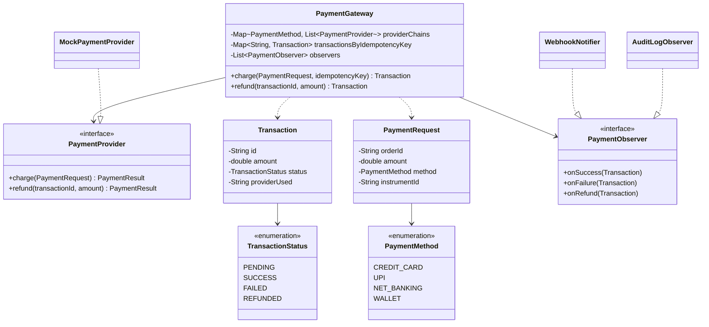

<div align="center">

# 💳 Design a Payment Gateway

   

*Route a charge through a fallback chain of providers, never double-charge the same request, and support refunds.*

</div>

---

## 📑 Table of contents

- [🎯 Problem statement](#-problem-statement)
- [🧩 Requirements & approach](#-requirements--approach)
- [🔷 Class diagram](#-class-diagram)
- [👥 Classes & responsibilities](#-classes--responsibilities)
- [🧭 Design patterns & principles used](#-design-patterns--principles-used)
- [📊 Strengths & limitations](#-strengths--limitations)
- [🌍 Follow-up interview questions](#-follow-up-interview-questions)
- [💻 Code](#-code)
  - [1. Implementation](#ex1)

---

## 🎯 Problem statement

> Design a **payment gateway**: the single entry point a merchant calls to charge a customer. It must route the request to a real payment processor for the chosen method, fall back to another processor if the first declines, never charge the same logical request twice, and support refunding a successful payment.

## 🧩 Requirements & approach

| 📋 Requirements | 🛠️ Design approach |
|---|---|
| 1. Several payment methods (card, UPI, net banking, wallet), each possibly served by more than one processor<br>2. If the first processor for a method declines, try the next one in order before giving up<br>3. The same **idempotency key** retried (a network timeout, a user double-click) must return the original result, never charge again<br>4. A refund is only allowed on a transaction that actually succeeded, and only once<br>5. Anything that happened (success, failure, refund) must notify interested systems (webhook, audit log) without the gateway hard-coding what they do<br>6. A payment method with no processor configured must fail clearly, not silently | `PaymentProvider` is a **Strategy** for one processor; `PaymentGateway` holds an ordered list of providers per `PaymentMethod` and walks it on `charge`, stopping at the first success. Idempotency is enforced by keying every `Transaction` by the caller's key **before** touching any provider, so a retried key short-circuits straight to the stored result. `PaymentGateway` is also the **Observer** subject: `WebhookNotifier` and `AuditLogObserver` each react to success/failure/refund independently of the charge logic itself. The code is split into folders (`enums`, `entities`, `exceptions`, `provider`, `observer`, `service`) and `Main`, the client, sits outside them. |

## 🔷 Class diagram



## 👥 Classes & responsibilities

| Class / interface | Responsibility | Kind · folder |
|---|---|---|
| **`PaymentGateway`** | Entry point: idempotency check, fallback chain, status transitions, refund rules, notifies observers (thread safe) | service class · `service/` |
| **`PaymentProvider`** | One processor; the gateway only ever calls `charge`/`refund` on it | interface · `provider/` |
| **`MockPaymentProvider`** | A deterministic stand-in: declines a configured set of instrument ids so the chain's fallback is testable | class · `provider/` |
| **`PaymentResult`** | A provider's own success/failure, used only internally while walking the chain | class · `provider/` |
| **`PaymentRequest`** | Order, amount, method and a generic instrument id (card/UPI/wallet id) | class · `entities/` |
| **`Transaction`** | The merchant-facing record: id, amount, status, which provider ultimately processed it | class · `entities/` |
| **`PaymentObserver`** | Default no-op methods so a subscriber only overrides the events it needs | interface · `observer/` |
| **`WebhookNotifier`** | Simulates telling the merchant's backend about success/failure/refund | class · `observer/` |
| **`AuditLogObserver`** | A second, independent subscriber: an internal audit trail | class · `observer/` |
| **`PaymentMethod`, `TransactionStatus`** | CREDIT_CARD/UPI/NET_BANKING/WALLET; PENDING/SUCCESS/FAILED/REFUNDED | enums · `enums/` |
| **`InvalidAmountException`, `TransactionNotFoundException`, `RefundNotAllowedException`, `UnsupportedPaymentMethodException`** | Non-positive amount; unknown transaction id; refunding a non-success or already-refunded transaction; no provider for a method | runtime exceptions · `exceptions/` |
| **`Main`** | A first-try success, a decline that falls back to a second provider, every provider declining, an idempotent retry, a refund, and three rejections | demo · client, outside the packages |

## 🧭 Design patterns & principles used

| Pattern / principle | Where and why |
|---|---|
| **Strategy** | `PaymentProvider`: a new processor is a new class, registered into the chain; `PaymentGateway`'s logic never changes |
| **Chain of Responsibility (via an ordered Strategy list)** | `charge` walks the provider list for a method and stops at the first success, the same shape as a classic chain, built on a simple ordered list rather than a linked chain of handler objects |
| **Observer** | `WebhookNotifier` and `AuditLogObserver` react to events without `PaymentGateway` knowing they exist |
| **Idempotency key** | The transaction is keyed by the caller's key before any provider is touched, so a retried request can never double-charge |
| **Single Responsibility principle** | `Transaction` only carries state, `PaymentProvider` only talks to 'the network', `PaymentGateway` only routes, guards and notifies |

## 📊 Strengths & limitations

| 👍 Strengths | 👎 Limitations |
|---|---|
| A retried request is provably safe: the demo shows the provider's attempt counter does not move on a repeated idempotency key | No partial refunds (a refund is all-or-nothing in this scope) |
| A declining processor never blocks the payment if a fallback can approve it | No per-provider retry/backoff on a transient error, only a move to the next provider in the chain |
| Refund rules (must have succeeded, only once) are enforced centrally, not duplicated per provider | Idempotency keys are kept in memory only; a restart loses the dedupe table (production would persist this) |
| Adding a new processor, payment method, or notification channel needs no change to existing classes | No currency conversion or multi-currency settlement |

## 🌍 Follow-up interview questions

- **How would you add partial refunds?** Track `refundedAmount` on `Transaction` instead of a boolean-like status, validate `refundedAmount + amount <= originalAmount`, and only move to `REFUNDED` once the full amount is refunded.
- **How would you persist idempotency keys safely across restarts and multiple instances?** Store them in a database with a unique constraint on the key, and use an insert-or-return-existing pattern instead of an in-memory map.
- **How would you add retry-with-backoff on a transient provider error (timeout) versus a hard decline?** Have `PaymentResult` distinguish a retriable failure from a hard decline, and only fall through to the next provider (or retry the same one with backoff) on the retriable kind.
- **How would you route by more than just payment method, e.g. by amount or region?** Replace the flat per-method list with a `ProviderSelectionStrategy` that takes the whole `PaymentRequest` and returns an ordered chain, instead of a static `Map<PaymentMethod, List<PaymentProvider>>`.
- **How do you guarantee the webhook is eventually delivered, not just attempted once?** Put the notification on a durable queue with retry, rather than calling the observer synchronously inside `charge`.
- **How would you prevent two concurrent charges with the same idempotency key from both reaching a provider?** `charge` is already `synchronized`, so the check-then-create is atomic within one instance; across instances this needs a database-level unique constraint on the key, claimed before any provider call.
- **Why does `PaymentResult` stay internal rather than being returned to the merchant directly?** The merchant only needs to know the outcome and which `Transaction` to track; which specific processor handled (or declined) it is the gateway's own routing detail.

---

## 💻 Code

This folder has **1 example** (16 Java files). Interfaces and abstract classes come first, the class with `main` comes last.

<a id="ex1"></a>

### 1. Implementation

<details open>
<summary><b>📁 Files in this example</b></summary>

```text
14. Payment Gateway/
├── entities/
│   ├── PaymentRequest.java
│   └── Transaction.java
├── enums/
│   ├── PaymentMethod.java
│   └── TransactionStatus.java
├── exceptions/
│   ├── InvalidAmountException.java
│   ├── RefundNotAllowedException.java
│   ├── TransactionNotFoundException.java
│   └── UnsupportedPaymentMethodException.java
├── observer/
│   ├── AuditLogObserver.java
│   ├── PaymentObserver.java
│   └── WebhookNotifier.java
├── provider/
│   ├── MockPaymentProvider.java
│   ├── PaymentProvider.java
│   └── PaymentResult.java
├── service/
│   └── PaymentGateway.java
└── Main.java
```

</details>

#### 📄 `enums/PaymentMethod.java`

<sub>enum · 8 lines</sub>

```java
package enums;

public enum PaymentMethod {
    CREDIT_CARD,
    UPI,
    NET_BANKING,
    WALLET
}
```

#### 📄 `enums/TransactionStatus.java`

<sub>enum · 8 lines</sub>

```java
package enums;

public enum TransactionStatus {
    PENDING,
    SUCCESS,
    FAILED,
    REFUNDED
}
```

#### 📄 `observer/PaymentObserver.java`

<sub>interface · 12 lines</sub>

```java
package observer;

import entities.Transaction;

// Observer: each subscriber only reacts to the events it cares about
public interface PaymentObserver {
    default void onSuccess(Transaction transaction) { }

    default void onFailure(Transaction transaction) { }

    default void onRefund(Transaction transaction) { }
}
```

#### 📄 `provider/PaymentProvider.java`

<sub>interface · 13 lines</sub>

```java
package provider;

import entities.PaymentRequest;

// Strategy: one payment processor (Stripe, Razorpay, ...). The gateway only ever calls
// these two methods and never needs to know which real provider it is talking to.
public interface PaymentProvider {
    String getName();

    PaymentResult charge(PaymentRequest request);

    PaymentResult refund(String transactionId, double amount);
}
```

#### 📄 `entities/PaymentRequest.java`

<sub>class · 31 lines</sub>

```java
package entities;

import enums.PaymentMethod;

// What the merchant is asking to charge. `instrumentId` is the card number / UPI id / wallet
// id - generic on purpose, since the gateway never needs to know its exact shape.
public class PaymentRequest {
    private final String orderId;
    private final double amount;
    private final String currency;
    private final PaymentMethod method;
    private final String instrumentId;

    public PaymentRequest(String orderId, double amount, String currency, PaymentMethod method, String instrumentId) {
        this.orderId = orderId;
        this.amount = amount;
        this.currency = currency;
        this.method = method;
        this.instrumentId = instrumentId;
    }

    public String getOrderId() { return orderId; }

    public double getAmount() { return amount; }

    public String getCurrency() { return currency; }

    public PaymentMethod getMethod() { return method; }

    public String getInstrumentId() { return instrumentId; }
}
```

#### 📄 `entities/Transaction.java`

<sub>class · 41 lines</sub>

```java
package entities;

import enums.PaymentMethod;
import enums.TransactionStatus;

public class Transaction {
    private final String id;
    private final String orderId;
    private final double amount;
    private final PaymentMethod method;
    private String providerUsed;
    private TransactionStatus status;

    public Transaction(String id, String orderId, double amount, PaymentMethod method) {
        this.id = id;
        this.orderId = orderId;
        this.amount = amount;
        this.method = method;
        this.status = TransactionStatus.PENDING;
    }

    public String getId() { return id; }

    public String getOrderId() { return orderId; }

    public double getAmount() { return amount; }

    public TransactionStatus getStatus() { return status; }

    public void setStatus(TransactionStatus status) { this.status = status; }

    public String getProviderUsed() { return providerUsed; }

    public void setProviderUsed(String providerUsed) { this.providerUsed = providerUsed; }

    @Override
    public String toString() {
        return id + " [order " + orderId + ", " + amount + ", " + status
                + (providerUsed != null ? " via " + providerUsed : "") + "]";
    }
}
```

#### 📄 `exceptions/InvalidAmountException.java`

<sub>class · 7 lines</sub>

```java
package exceptions;

public class InvalidAmountException extends RuntimeException {
    public InvalidAmountException(String message) {
        super(message);
    }
}
```

#### 📄 `exceptions/RefundNotAllowedException.java`

<sub>class · 7 lines</sub>

```java
package exceptions;

public class RefundNotAllowedException extends RuntimeException {
    public RefundNotAllowedException(String message) {
        super(message);
    }
}
```

#### 📄 `exceptions/TransactionNotFoundException.java`

<sub>class · 7 lines</sub>

```java
package exceptions;

public class TransactionNotFoundException extends RuntimeException {
    public TransactionNotFoundException(String message) {
        super(message);
    }
}
```

#### 📄 `exceptions/UnsupportedPaymentMethodException.java`

<sub>class · 7 lines</sub>

```java
package exceptions;

public class UnsupportedPaymentMethodException extends RuntimeException {
    public UnsupportedPaymentMethodException(String message) {
        super(message);
    }
}
```

#### 📄 `observer/AuditLogObserver.java`

<sub>class · 22 lines</sub>

```java
package observer;

import entities.Transaction;

// A second, independent subscriber: an internal audit trail
public class AuditLogObserver implements PaymentObserver {

    @Override
    public void onSuccess(Transaction transaction) {
        System.out.println("  [Audit] recorded SUCCESS for " + transaction.getId());
    }

    @Override
    public void onFailure(Transaction transaction) {
        System.out.println("  [Audit] recorded FAILED for " + transaction.getId());
    }

    @Override
    public void onRefund(Transaction transaction) {
        System.out.println("  [Audit] recorded REFUND for " + transaction.getId());
    }
}
```

#### 📄 `observer/WebhookNotifier.java`

<sub>class · 22 lines</sub>

```java
package observer;

import entities.Transaction;

// Simulates telling the merchant's backend what happened, the way a real gateway would
public class WebhookNotifier implements PaymentObserver {

    @Override
    public void onSuccess(Transaction transaction) {
        System.out.println("  [Webhook] payment.success -> " + transaction);
    }

    @Override
    public void onFailure(Transaction transaction) {
        System.out.println("  [Webhook] payment.failed -> " + transaction);
    }

    @Override
    public void onRefund(Transaction transaction) {
        System.out.println("  [Webhook] payment.refunded -> " + transaction);
    }
}
```

#### 📄 `provider/MockPaymentProvider.java`

<sub>class · 44 lines</sub>

```java
package provider;

import entities.PaymentRequest;

import java.util.HashSet;
import java.util.Set;

// A stand-in for a real processor. Declines deterministically for a configured set of
// instrument ids, so the demo (and any test) can force a specific provider to fail.
public class MockPaymentProvider implements PaymentProvider {
    private final String name;
    private final Set<String> decliningInstrumentIds;
    private int attempts = 0;

    public MockPaymentProvider(String name, String... decliningInstrumentIds) {
        this.name = name;
        this.decliningInstrumentIds = new HashSet<>();
        for (String id : decliningInstrumentIds) {
            this.decliningInstrumentIds.add(id);
        }
    }

    @Override
    public String getName() { return name; }

    public int getAttempts() { return attempts; }

    @Override
    public PaymentResult charge(PaymentRequest request) {
        attempts++;
        if (decliningInstrumentIds.contains(request.getInstrumentId())) {
            System.out.println("  [" + name + "] declined " + request.getInstrumentId());
            return PaymentResult.failure(name, "card declined by issuer");
        }
        System.out.println("  [" + name + "] approved " + request.getInstrumentId());
        return PaymentResult.success(name);
    }

    @Override
    public PaymentResult refund(String transactionId, double amount) {
        System.out.println("  [" + name + "] refunded " + amount + " for " + transactionId);
        return PaymentResult.success(name);
    }
}
```

#### 📄 `provider/PaymentResult.java`

<sub>class · 29 lines</sub>

```java
package provider;

// What one provider's attempt came back with - not exposed to the merchant, only used
// internally by the gateway while it walks the fallback chain.
public class PaymentResult {
    private final boolean success;
    private final String providerName;
    private final String message;

    private PaymentResult(boolean success, String providerName, String message) {
        this.success = success;
        this.providerName = providerName;
        this.message = message;
    }

    public static PaymentResult success(String providerName) {
        return new PaymentResult(true, providerName, "approved");
    }

    public static PaymentResult failure(String providerName, String message) {
        return new PaymentResult(false, providerName, message);
    }

    public boolean isSuccess() { return success; }

    public String getProviderName() { return providerName; }

    public String getMessage() { return message; }
}
```

#### 📄 `service/PaymentGateway.java`

<sub>class · 91 lines</sub>

```java
package service;

import entities.PaymentRequest;
import entities.Transaction;
import enums.PaymentMethod;
import enums.TransactionStatus;
import exceptions.InvalidAmountException;
import exceptions.RefundNotAllowedException;
import exceptions.TransactionNotFoundException;
import exceptions.UnsupportedPaymentMethodException;
import observer.PaymentObserver;
import provider.PaymentProvider;
import provider.PaymentResult;

import java.util.ArrayList;
import java.util.EnumMap;
import java.util.HashMap;
import java.util.List;
import java.util.Map;

// The single entry point merchants call. It never talks to a card network itself: it routes
// each request to an ordered chain of providers for that payment method, falling back to the
// next one on a decline, and guarantees the same idempotency key is never charged twice.
public class PaymentGateway {
    private final Map<PaymentMethod, List<PaymentProvider>> providerChains = new EnumMap<>(PaymentMethod.class);
    private final Map<String, Transaction> transactionsById = new HashMap<>();
    private final Map<String, Transaction> transactionsByIdempotencyKey = new HashMap<>();
    private final Map<String, PaymentProvider> providerByTransactionId = new HashMap<>();
    private final List<PaymentObserver> observers = new ArrayList<>();
    private int counter = 0;

    public void registerProvider(PaymentMethod method, PaymentProvider provider) {
        providerChains.computeIfAbsent(method, k -> new ArrayList<>()).add(provider);
    }

    public void addObserver(PaymentObserver observer) { observers.add(observer); }

    public synchronized Transaction charge(PaymentRequest request, String idempotencyKey) {
        Transaction existing = transactionsByIdempotencyKey.get(idempotencyKey);
        if (existing != null) {
            System.out.println("  [Idempotency] " + idempotencyKey + " already processed -> returning " + existing.getId());
            return existing;
        }
        if (request.getAmount() <= 0) {
            throw new InvalidAmountException("Amount must be positive, got " + request.getAmount());
        }
        List<PaymentProvider> chain = providerChains.get(request.getMethod());
        if (chain == null || chain.isEmpty()) {
            throw new UnsupportedPaymentMethodException("No provider configured for " + request.getMethod());
        }

        Transaction transaction = new Transaction("TXN-" + (++counter), request.getOrderId(), request.getAmount(), request.getMethod());
        transactionsById.put(transaction.getId(), transaction);
        transactionsByIdempotencyKey.put(idempotencyKey, transaction);

        for (PaymentProvider provider : chain) {
            PaymentResult result = provider.charge(request);
            if (result.isSuccess()) {
                transaction.setStatus(TransactionStatus.SUCCESS);
                transaction.setProviderUsed(provider.getName());
                providerByTransactionId.put(transaction.getId(), provider);
                notifySuccess(transaction);
                return transaction;
            }
        }
        transaction.setStatus(TransactionStatus.FAILED);
        notifyFailure(transaction);
        return transaction;
    }

    public synchronized Transaction refund(String transactionId, double amount) {
        Transaction transaction = transactionsById.get(transactionId);
        if (transaction == null) {
            throw new TransactionNotFoundException("Unknown transaction: " + transactionId);
        }
        if (transaction.getStatus() != TransactionStatus.SUCCESS) {
            throw new RefundNotAllowedException("Cannot refund a transaction that is " + transaction.getStatus());
        }
        PaymentProvider provider = providerByTransactionId.get(transactionId);
        provider.refund(transactionId, amount);
        transaction.setStatus(TransactionStatus.REFUNDED);
        notifyRefund(transaction);
        return transaction;
    }

    private void notifySuccess(Transaction t) { for (PaymentObserver o : observers) o.onSuccess(t); }

    private void notifyFailure(Transaction t) { for (PaymentObserver o : observers) o.onFailure(t); }

    private void notifyRefund(Transaction t) { for (PaymentObserver o : observers) o.onRefund(t); }
}
```

#### 📄 `Main.java`

<sub>class · 66 lines</sub>

```java
import entities.PaymentRequest;
import entities.Transaction;
import enums.PaymentMethod;
import exceptions.RefundNotAllowedException;
import exceptions.UnsupportedPaymentMethodException;
import observer.AuditLogObserver;
import observer.WebhookNotifier;
import provider.MockPaymentProvider;
import service.PaymentGateway;

public class Main {
    public static void main(String[] args) {

        MockPaymentProvider stripe = new MockPaymentProvider("Stripe", "4000-0000-0000-0002", "0000");
        MockPaymentProvider razorpay = new MockPaymentProvider("Razorpay", "0000");

        PaymentGateway gateway = new PaymentGateway();
        gateway.registerProvider(PaymentMethod.CREDIT_CARD, stripe);     // tried first
        gateway.registerProvider(PaymentMethod.CREDIT_CARD, razorpay);   // fallback
        gateway.addObserver(new WebhookNotifier());
        gateway.addObserver(new AuditLogObserver());

        System.out.println("=== 1. A normal payment (Stripe approves first try) ===");
        PaymentRequest goodCard = new PaymentRequest("ORDER-1", 1500.0, "INR", PaymentMethod.CREDIT_CARD, "4111-1111-1111-1111");
        Transaction t1 = gateway.charge(goodCard, "idem-key-1");
        System.out.println("Result: " + t1);

        System.out.println("\n=== 2. Stripe declines this card, Razorpay picks it up ===");
        PaymentRequest fallbackCard = new PaymentRequest("ORDER-2", 2500.0, "INR", PaymentMethod.CREDIT_CARD, "4000-0000-0000-0002");
        Transaction t2 = gateway.charge(fallbackCard, "idem-key-2");
        System.out.println("Result: " + t2);

        System.out.println("\n=== 3. Every provider in the chain declines ===");
        PaymentRequest badCard = new PaymentRequest("ORDER-3", 900.0, "INR", PaymentMethod.CREDIT_CARD, "0000");
        Transaction t3 = gateway.charge(badCard, "idem-key-3");
        System.out.println("Result: " + t3);

        System.out.println("\n=== 4. Retrying with the same idempotency key as #1 does not charge again ===");
        System.out.println("Stripe charge attempts before retry: " + stripe.getAttempts());
        Transaction t1Retry = gateway.charge(goodCard, "idem-key-1");
        System.out.println("Stripe charge attempts after retry: " + stripe.getAttempts() + " (unchanged)");
        System.out.println("Same transaction returned: " + (t1Retry == t1));

        System.out.println("\n=== 5. Refund the successful #1 transaction ===");
        gateway.refund(t1.getId(), t1.getAmount());
        System.out.println("Status now: " + t1.getStatus());

        System.out.println("\n-- Rejections --");
        try {
            gateway.refund(t1.getId(), t1.getAmount());     // already refunded
        } catch (RefundNotAllowedException e) {
            System.out.println("Rejected: " + e.getMessage());
        }
        try {
            gateway.refund(t3.getId(), t3.getAmount());      // never succeeded
        } catch (RefundNotAllowedException e) {
            System.out.println("Rejected: " + e.getMessage());
        }
        try {
            PaymentRequest wallet = new PaymentRequest("ORDER-4", 100.0, "INR", PaymentMethod.WALLET, "wallet-1");
            gateway.charge(wallet, "idem-key-4");             // no provider registered for WALLET
        } catch (UnsupportedPaymentMethodException e) {
            System.out.println("Rejected: " + e.getMessage());
        }
    }
}
```

<details>
<summary><b>▶️ How to compile and run this example</b></summary>

```bash
# run from the repository root
mkdir -p out
find "Interview Questions/14. Payment Gateway" -name "*.java" -print0 | xargs -0 javac -d out
java -cp out Main
```

</details>

---

<div align="center">

[◀ Apply Coupon](../13.%20Apply%20Coupon/README.md) &nbsp;·&nbsp; [📚 All questions](../QUESTIONS.md)

</div>
