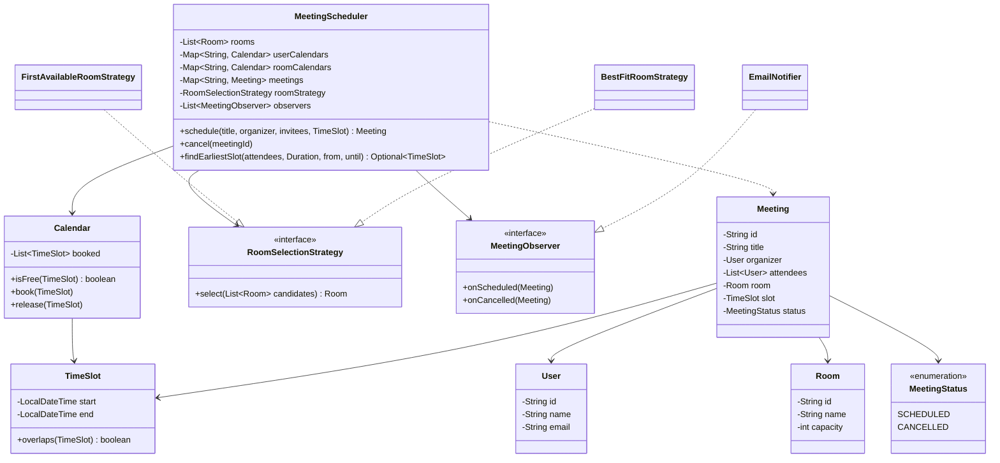

<div align="center">

# 📅 Design a Meeting Scheduler

   

*Book a meeting only if every attendee and a big-enough room are free, suggest the earliest common slot, and cancel cleanly.*

</div>

---

## 📑 Table of contents

- [🎯 Problem statement](#-problem-statement)
- [🧩 Requirements & approach](#-requirements--approach)
- [🔷 Class diagram](#-class-diagram)
- [👥 Classes & responsibilities](#-classes--responsibilities)
- [🧭 Design patterns & principles used](#-design-patterns--principles-used)
- [📊 Strengths & limitations](#-strengths--limitations)
- [🌍 Follow-up interview questions](#-follow-up-interview-questions)
- [💻 Code](#-code)
  - [1. Implementation](#ex1)

---

## 🎯 Problem statement

> Design a **meeting scheduler** (think Google Calendar plus room booking). An organizer invites some people to a meeting in a time slot. The system must book the meeting only if **every attendee is free** and **a meeting room that fits everyone is free**, pick a room by a configurable policy, let a meeting be cancelled, and be able to suggest the earliest slot when everybody is free.

## 🧩 Requirements & approach

| 📋 Requirements | 🛠️ Design approach |
|---|---|
| 1. A meeting has an organizer, attendees, a title, a time slot and exactly one room<br>2. Two slots clash if they overlap; back-to-back meetings (one ends at 11:00, the next starts at 11:00) are allowed<br>3. Scheduling is **all-or-nothing**: if any attendee is busy, or no room is free, nothing at all gets booked<br>4. The room must hold every attendee, and *which* free room is chosen must be replaceable (first free, smallest that fits, ...)<br>5. Cancelling frees every attendee and the room again<br>6. Find the earliest slot of a given length where everyone and some room are free<br>7. Attendees must be told about new and cancelled meetings without the scheduler hard-coding how (email today, Slack tomorrow)<br>8. Two concurrent requests must never double-book the same person or room | `Calendar` holds the booked `TimeSlot`s of one resource and answers `isFree(slot)`; people and rooms are both just resources, so **one class serves both**. `MeetingScheduler` first checks every attendee's calendar, then asks for a room, and only after both succeed does it book anything, so a failure part-way leaves no half-booked state. The room choice is a **Strategy** (`RoomSelectionStrategy`) that only receives rooms already known to be free and big enough, so each policy is a one-liner. `MeetingObserver` lets `EmailNotifier` react to scheduled/cancelled events independently. `TimeSlot` is a half-open interval `[start, end)`, which is what makes back-to-back meetings legal. All public methods are `synchronized`, so the check-then-book sequence is atomic. The code is split into folders (`enums`, `entities`, `exceptions`, `strategy`, `observer`, `service`) and `Main`, the client, sits outside them. |

## 🔷 Class diagram



## 👥 Classes & responsibilities

| Class / interface | Responsibility | Kind · folder |
|---|---|---|
| **`MeetingScheduler`** | Entry point: checks attendees, picks a room, books all-or-nothing, cancels, suggests the earliest common slot, notifies observers (thread safe) | service class · `service/` |
| **`Calendar`** | The booked slots of one person or one room; `isFree` is an overlap check | class · `service/` |
| **`RoomSelectionStrategy`** | Given the free rooms that are big enough, choose one | interface · `strategy/` |
| **`FirstAvailableRoomStrategy`** | First room that fits, in registration order | class · `strategy/` |
| **`BestFitRoomStrategy`** | Smallest room that still fits, keeping big rooms free for big meetings | class · `strategy/` |
| **`MeetingObserver`** | Default no-op methods so a subscriber only overrides the events it needs | interface · `observer/` |
| **`EmailNotifier`** | Simulates emailing every attendee an invite or cancellation | class · `observer/` |
| **`TimeSlot`** | Immutable half-open interval `[start, end)`; validates start < end and provides `overlaps` | class · `entities/` |
| **`User`, `Room`, `Meeting`** | A person; a room with a capacity; a booked meeting with its attendees, room, slot and status | classes · `entities/` |
| **`MeetingStatus`** | SCHEDULED, CANCELLED | enum · `enums/` |
| **`InvalidTimeSlotException`, `UserBusyException`, `NoRoomAvailableException`, `MeetingNotFoundException`** | Start not before end; an attendee already booked; no free room that fits; cancelling an unknown or already-cancelled meeting | runtime exceptions · `exceptions/` |
| **`Main`** | Best-fit room choice, a spill-over to the larger room, a back-to-back booking, three rejections, a cancel that frees resources, and two earliest-slot searches | demo · client, outside the packages |

## 🧭 Design patterns & principles used

| Pattern / principle | Where and why |
|---|---|
| **Strategy** | `RoomSelectionStrategy`: a new room policy (closest to the organizer's floor, cheapest, ...) is a new class; `MeetingScheduler` is not touched |
| **Observer** | `EmailNotifier` hears about scheduled/cancelled meetings without `MeetingScheduler` knowing it exists; a Slack notifier is just another subscriber |
| **All-or-nothing validation** | Every check (all attendees, then a room) happens before the first booking, so a failure can never leave half a meeting booked |
| **One abstraction for two resources** | `Calendar` is used for both people and rooms because they obey the same rule: free if nothing overlaps |
| **Single Responsibility principle** | `TimeSlot` knows overlap, `Calendar` knows one resource's bookings, strategies only choose, `MeetingScheduler` only coordinates |
| **Open/Closed principle** | New room policies and new notification channels extend the system without modifying existing classes |

## 📊 Strengths & limitations

| 👍 Strengths | 👎 Limitations |
|---|---|
| Booking is atomic: either the whole meeting is booked or nothing changes, even under concurrent requests | `isFree` scans every booked slot, so it is O(n) per resource; a busy calendar would want a sorted structure (see follow-ups) |
| Back-to-back meetings work because the interval is half-open | One global lock (`synchronized` on the scheduler) serialises all scheduling, even for unrelated people |
| The room policy and the notification channel can each change without touching the scheduler | No recurring meetings, no time zones, no accept/decline per attendee |
| `findEarliestSlot` reuses the exact same free checks as `schedule`, so a suggested slot is always bookable | `findEarliestSlot` steps in fixed 30 minute increments, so it can miss a gap that starts off the half hour |

## 🌍 Follow-up interview questions

- **How would you make the overlap check faster than O(n)?** Keep each `Calendar` in a `TreeMap` keyed by start time (or an interval tree); a new slot only needs to be compared with the one booking just before it and the one just after, giving O(log n).
- **How would you support recurring meetings (e.g. every Monday)?** Store a recurrence rule on `Meeting` and expand it into concrete `TimeSlot`s; schedule all occurrences all-or-nothing, and let a cancel apply to one occurrence or the whole series.
- **How would you handle time zones?** Store every `TimeSlot` in UTC (`Instant`) and convert to each attendee's zone only for display and for working-hours checks.
- **How would you add accept/decline?** Give each attendee an `RSVP` status on `Meeting`; booking an attendee's calendar can be tentative until they accept, and a decline releases only that person's slot.
- **How would you scale the locking?** Lock per resource instead of the whole scheduler: acquire the locks of all involved calendars in a fixed order (e.g. by id) to avoid deadlock, then check and book. Across servers this needs a database transaction or per-resource distributed lock.
- **How would you find a slot that works for a large group more efficiently?** Merge each person's busy intervals, sort, and sweep once to find the first gap of the required length, instead of probing every 30 minute candidate.
- **How would you add a new room rule, such as 'needs a projector'?** Add the equipment to `Room`, filter the candidates in `freeRooms` by the required equipment, or add a `RoomFilter` strategy composed in front of `RoomSelectionStrategy`.

---

## 💻 Code

This folder has **1 example** (17 Java files). Interfaces and abstract classes come first, the class with `main` comes last.

<a id="ex1"></a>

### 1. Implementation

<details open>
<summary><b>📁 Files in this example</b></summary>

```text
15. Meeting Scheduler/
├── entities/
│   ├── Meeting.java
│   ├── Room.java
│   ├── TimeSlot.java
│   └── User.java
├── enums/
│   └── MeetingStatus.java
├── exceptions/
│   ├── InvalidTimeSlotException.java
│   ├── MeetingNotFoundException.java
│   ├── NoRoomAvailableException.java
│   └── UserBusyException.java
├── observer/
│   ├── EmailNotifier.java
│   └── MeetingObserver.java
├── service/
│   ├── Calendar.java
│   └── MeetingScheduler.java
├── strategy/
│   ├── BestFitRoomStrategy.java
│   ├── FirstAvailableRoomStrategy.java
│   └── RoomSelectionStrategy.java
└── Main.java
```

</details>

#### 📄 `enums/MeetingStatus.java`

<sub>enum · 6 lines</sub>

```java
package enums;

public enum MeetingStatus {
    SCHEDULED,
    CANCELLED
}
```

#### 📄 `strategy/RoomSelectionStrategy.java`

<sub>interface · 10 lines</sub>

```java
package strategy;

import entities.Room;

import java.util.List;

// Strategy: given the rooms that are already free AND big enough, choose one.
public interface RoomSelectionStrategy {
    Room select(List<Room> candidates);
}
```

#### 📄 `observer/MeetingObserver.java`

<sub>interface · 10 lines</sub>

```java
package observer;

import entities.Meeting;

// Observer: each subscriber only overrides the events it cares about
public interface MeetingObserver {
    default void onScheduled(Meeting meeting) { }

    default void onCancelled(Meeting meeting) { }
}
```

#### 📄 `entities/TimeSlot.java`

<sub>class · 38 lines</sub>

```java
package entities;

import exceptions.InvalidTimeSlotException;

import java.time.Duration;
import java.time.LocalDateTime;
import java.time.format.DateTimeFormatter;

// A half-open interval [start, end): a meeting ending at 11:00 does not clash with one starting at 11:00.
public class TimeSlot {
    private static final DateTimeFormatter FORMAT = DateTimeFormatter.ofPattern("dd MMM HH:mm");

    private final LocalDateTime start;
    private final LocalDateTime end;

    public TimeSlot(LocalDateTime start, LocalDateTime end) {
        if (!start.isBefore(end)) {
            throw new InvalidTimeSlotException("Start (" + start + ") must be before end (" + end + ")");
        }
        this.start = start;
        this.end = end;
    }

    public LocalDateTime getStart() { return start; }

    public LocalDateTime getEnd() { return end; }

    public Duration getDuration() { return Duration.between(start, end); }

    public boolean overlaps(TimeSlot other) {
        return start.isBefore(other.end) && other.start.isBefore(end);
    }

    @Override
    public String toString() {
        return FORMAT.format(start) + " - " + DateTimeFormatter.ofPattern("HH:mm").format(end);
    }
}
```

#### 📄 `entities/User.java`

<sub>class · 22 lines</sub>

```java
package entities;

public class User {
    private final String id;
    private final String name;
    private final String email;

    public User(String id, String name, String email) {
        this.id = id;
        this.name = name;
        this.email = email;
    }

    public String getId() { return id; }

    public String getName() { return name; }

    public String getEmail() { return email; }

    @Override
    public String toString() { return name; }
}
```

#### 📄 `entities/Room.java`

<sub>class · 22 lines</sub>

```java
package entities;

public class Room {
    private final String id;
    private final String name;
    private final int capacity;

    public Room(String id, String name, int capacity) {
        this.id = id;
        this.name = name;
        this.capacity = capacity;
    }

    public String getId() { return id; }

    public String getName() { return name; }

    public int getCapacity() { return capacity; }

    @Override
    public String toString() { return name + "(cap " + capacity + ")"; }
}
```

#### 📄 `entities/Meeting.java`

<sub>class · 45 lines</sub>

```java
package entities;

import enums.MeetingStatus;

import java.util.List;

public class Meeting {
    private final String id;
    private final String title;
    private final User organizer;
    private final List<User> attendees;   // includes the organizer
    private final Room room;
    private final TimeSlot slot;
    private MeetingStatus status = MeetingStatus.SCHEDULED;

    public Meeting(String id, String title, User organizer, List<User> attendees, Room room, TimeSlot slot) {
        this.id = id;
        this.title = title;
        this.organizer = organizer;
        this.attendees = attendees;
        this.room = room;
        this.slot = slot;
    }

    public String getId() { return id; }

    public String getTitle() { return title; }

    public User getOrganizer() { return organizer; }

    public List<User> getAttendees() { return attendees; }

    public Room getRoom() { return room; }

    public TimeSlot getSlot() { return slot; }

    public MeetingStatus getStatus() { return status; }

    public void setStatus(MeetingStatus status) { this.status = status; }

    @Override
    public String toString() {
        return id + " '" + title + "' " + slot + " in " + room.getName() + " " + attendees + " [" + status + "]";
    }
}
```

#### 📄 `exceptions/InvalidTimeSlotException.java`

<sub>class · 7 lines</sub>

```java
package exceptions;

public class InvalidTimeSlotException extends RuntimeException {
    public InvalidTimeSlotException(String message) {
        super(message);
    }
}
```

#### 📄 `exceptions/UserBusyException.java`

<sub>class · 7 lines</sub>

```java
package exceptions;

public class UserBusyException extends RuntimeException {
    public UserBusyException(String message) {
        super(message);
    }
}
```

#### 📄 `exceptions/NoRoomAvailableException.java`

<sub>class · 7 lines</sub>

```java
package exceptions;

public class NoRoomAvailableException extends RuntimeException {
    public NoRoomAvailableException(String message) {
        super(message);
    }
}
```

#### 📄 `exceptions/MeetingNotFoundException.java`

<sub>class · 7 lines</sub>

```java
package exceptions;

public class MeetingNotFoundException extends RuntimeException {
    public MeetingNotFoundException(String message) {
        super(message);
    }
}
```

#### 📄 `observer/EmailNotifier.java`

<sub>class · 23 lines</sub>

```java
package observer;

import entities.Meeting;
import entities.User;

// Simulates emailing every attendee an invite or a cancellation
public class EmailNotifier implements MeetingObserver {

    @Override
    public void onScheduled(Meeting meeting) {
        for (User u : meeting.getAttendees()) {
            System.out.println("  [Email -> " + u.getEmail() + "] Invite: '" + meeting.getTitle() + "' " + meeting.getSlot()
                    + " in " + meeting.getRoom().getName());
        }
    }

    @Override
    public void onCancelled(Meeting meeting) {
        for (User u : meeting.getAttendees()) {
            System.out.println("  [Email -> " + u.getEmail() + "] Cancelled: '" + meeting.getTitle() + "'");
        }
    }
}
```

#### 📄 `strategy/FirstAvailableRoomStrategy.java`

<sub>class · 14 lines</sub>

```java
package strategy;

import entities.Room;

import java.util.List;

// Simplest policy: the first room that fits, in registration order
public class FirstAvailableRoomStrategy implements RoomSelectionStrategy {

    @Override
    public Room select(List<Room> candidates) {
        return candidates.get(0);
    }
}
```

#### 📄 `strategy/BestFitRoomStrategy.java`

<sub>class · 15 lines</sub>

```java
package strategy;

import entities.Room;

import java.util.Comparator;
import java.util.List;

// Smallest room that still fits, so big rooms stay free for big meetings
public class BestFitRoomStrategy implements RoomSelectionStrategy {

    @Override
    public Room select(List<Room> candidates) {
        return candidates.stream().min(Comparator.comparingInt(Room::getCapacity)).get();
    }
}
```

#### 📄 `service/Calendar.java`

<sub>class · 25 lines</sub>

```java
package service;

import entities.TimeSlot;

import java.util.ArrayList;
import java.util.List;

// The booked slots of ONE resource (a person or a room). Both are scheduled the same way,
// so one class serves both: a resource is free for a slot if nothing booked overlaps it.
public class Calendar {
    private final List<TimeSlot> booked = new ArrayList<>();

    public boolean isFree(TimeSlot slot) {
        for (TimeSlot existing : booked) {
            if (existing.overlaps(slot)) {
                return false;
            }
        }
        return true;
    }

    public void book(TimeSlot slot) { booked.add(slot); }

    public void release(TimeSlot slot) { booked.remove(slot); }
}
```

#### 📄 `service/MeetingScheduler.java`

<sub>class · 119 lines</sub>

```java
package service;

import entities.Meeting;
import entities.Room;
import entities.TimeSlot;
import entities.User;
import enums.MeetingStatus;
import exceptions.MeetingNotFoundException;
import exceptions.NoRoomAvailableException;
import exceptions.UserBusyException;
import observer.MeetingObserver;
import strategy.RoomSelectionStrategy;

import java.time.Duration;
import java.time.LocalDateTime;
import java.util.ArrayList;
import java.util.HashMap;
import java.util.LinkedHashSet;
import java.util.List;
import java.util.Map;
import java.util.Optional;
import java.util.Set;

// Single entry point. Scheduling is all-or-nothing: every attendee AND a room must be free
// for the slot, otherwise nothing is booked. Every method is synchronized so that two
// concurrent requests can never both grab the same person or room.
public class MeetingScheduler {
    private final List<Room> rooms = new ArrayList<>();
    private final Map<String, Calendar> userCalendars = new HashMap<>();
    private final Map<String, Calendar> roomCalendars = new HashMap<>();
    private final Map<String, Meeting> meetings = new HashMap<>();
    private final List<MeetingObserver> observers = new ArrayList<>();
    private final RoomSelectionStrategy roomStrategy;
    private int counter = 0;

    public MeetingScheduler(RoomSelectionStrategy roomStrategy) {
        this.roomStrategy = roomStrategy;
    }

    public void addRoom(Room room) {
        rooms.add(room);
        roomCalendars.put(room.getId(), new Calendar());
    }

    public void addObserver(MeetingObserver observer) { observers.add(observer); }

    public synchronized Meeting schedule(String title, User organizer, List<User> invitees, TimeSlot slot) {
        Set<User> attendees = new LinkedHashSet<>();     // de-duplicates; organizer always attends
        attendees.add(organizer);
        attendees.addAll(invitees);

        for (User user : attendees) {
            if (!calendarOf(user).isFree(slot)) {
                throw new UserBusyException(user + " is busy during " + slot);
            }
        }
        Room room = pickRoom(attendees.size(), slot);

        Meeting meeting = new Meeting("M-" + (++counter), title, organizer, new ArrayList<>(attendees), room, slot);
        for (User user : attendees) {
            calendarOf(user).book(slot);
        }
        roomCalendars.get(room.getId()).book(slot);
        meetings.put(meeting.getId(), meeting);

        for (MeetingObserver o : observers) o.onScheduled(meeting);
        return meeting;
    }

    public synchronized void cancel(String meetingId) {
        Meeting meeting = meetings.get(meetingId);
        if (meeting == null || meeting.getStatus() == MeetingStatus.CANCELLED) {
            throw new MeetingNotFoundException("No active meeting " + meetingId);
        }
        for (User user : meeting.getAttendees()) {
            calendarOf(user).release(meeting.getSlot());
        }
        roomCalendars.get(meeting.getRoom().getId()).release(meeting.getSlot());
        meeting.setStatus(MeetingStatus.CANCELLED);

        for (MeetingObserver o : observers) o.onCancelled(meeting);
    }

    // Earliest slot of the given length, starting no earlier than `from`, where everyone is free
    // and some room fits. Scans in 30 minute steps up to `until`.
    public synchronized Optional<TimeSlot> findEarliestSlot(List<User> attendees, Duration length,
                                                             LocalDateTime from, LocalDateTime until) {
        for (LocalDateTime start = from; !start.plus(length).isAfter(until); start = start.plusMinutes(30)) {
            TimeSlot candidate = new TimeSlot(start, start.plus(length));
            boolean everyoneFree = attendees.stream().allMatch(u -> calendarOf(u).isFree(candidate));
            if (everyoneFree && !freeRooms(attendees.size(), candidate).isEmpty()) {
                return Optional.of(candidate);
            }
        }
        return Optional.empty();
    }

    private Room pickRoom(int attendeeCount, TimeSlot slot) {
        List<Room> candidates = freeRooms(attendeeCount, slot);
        if (candidates.isEmpty()) {
            throw new NoRoomAvailableException("No free room for " + attendeeCount + " people during " + slot);
        }
        return roomStrategy.select(candidates);
    }

    private List<Room> freeRooms(int attendeeCount, TimeSlot slot) {
        List<Room> result = new ArrayList<>();
        for (Room room : rooms) {
            if (room.getCapacity() >= attendeeCount && roomCalendars.get(room.getId()).isFree(slot)) {
                result.add(room);
            }
        }
        return result;
    }

    private Calendar calendarOf(User user) {
        return userCalendars.computeIfAbsent(user.getId(), k -> new Calendar());
    }
}
```

#### 📄 `Main.java`

<sub>class · 86 lines</sub>

```java
import entities.Meeting;
import entities.Room;
import entities.TimeSlot;
import entities.User;
import exceptions.InvalidTimeSlotException;
import exceptions.NoRoomAvailableException;
import exceptions.UserBusyException;
import observer.EmailNotifier;
import service.MeetingScheduler;
import strategy.BestFitRoomStrategy;

import java.time.Duration;
import java.time.LocalDate;
import java.time.LocalDateTime;
import java.util.Arrays;
import java.util.Collections;
import java.util.List;
import java.util.Optional;

public class Main {
    private static final LocalDate DAY = LocalDate.of(2026, 11, 16);

    private static TimeSlot slot(int startHour, int startMin, int endHour, int endMin) {
        return new TimeSlot(DAY.atTime(startHour, startMin), DAY.atTime(endHour, endMin));
    }

    public static void main(String[] args) {

        User alice = new User("U1", "Alice", "alice@corp.com");
        User bob = new User("U2", "Bob", "bob@corp.com");
        User carol = new User("U3", "Carol", "carol@corp.com");
        User dave = new User("U4", "Dave", "dave@corp.com");
        User erin = new User("U5", "Erin", "erin@corp.com");
        User frank = new User("U6", "Frank", "frank@corp.com");

        MeetingScheduler scheduler = new MeetingScheduler(new BestFitRoomStrategy());
        scheduler.addRoom(new Room("R1", "Focus", 2));
        scheduler.addRoom(new Room("R2", "Boardroom", 8));
        scheduler.addObserver(new EmailNotifier());

        System.out.println("=== 1. Alice + Bob, 10:00-11:00 (best-fit picks the small Focus room) ===");
        Meeting m1 = scheduler.schedule("Design sync", alice, Arrays.asList(bob), slot(10, 0, 11, 0));
        System.out.println(m1);

        System.out.println("\n=== 2. Carol + Dave at the same time (Focus taken -> Boardroom) ===");
        Meeting m2 = scheduler.schedule("Planning", carol, Arrays.asList(dave), slot(10, 0, 11, 0));
        System.out.println(m2);

        System.out.println("\n=== 3. Back-to-back is fine: Alice + Carol, 11:00-12:00 ===");
        Meeting m3 = scheduler.schedule("Review", alice, Arrays.asList(carol), slot(11, 0, 12, 0));
        System.out.println(m3);

        System.out.println("\n-- Rejections --");
        try {
            scheduler.schedule("Clash", bob, Arrays.asList(erin), slot(10, 30, 11, 30));
        } catch (UserBusyException e) {
            System.out.println("Rejected: " + e.getMessage());
        }
        try {
            scheduler.schedule("No room", erin, Arrays.asList(frank), slot(10, 0, 11, 0));
        } catch (NoRoomAvailableException e) {
            System.out.println("Rejected: " + e.getMessage());
        }
        try {
            slot(12, 0, 11, 0);
        } catch (InvalidTimeSlotException e) {
            System.out.println("Rejected: " + e.getMessage());
        }

        System.out.println("\n=== 4. Cancel the Design sync, which frees Alice, Bob and Focus ===");
        scheduler.cancel(m1.getId());

        System.out.println("\n=== 5. Erin + Frank can now take 10:00-11:00 ===");
        System.out.println(scheduler.schedule("Retro", erin, Arrays.asList(frank), slot(10, 0, 11, 0)));

        System.out.println("\n=== 6. Earliest 1h slot for Carol + Dave from 10:00 (both busy until 11:00; Carol also 11-12) ===");
        Optional<TimeSlot> found = scheduler.findEarliestSlot(Arrays.asList(carol, dave), Duration.ofHours(1),
                DAY.atTime(10, 0), DAY.atTime(18, 0));
        System.out.println(found.map(Object::toString).orElse("none found"));

        System.out.println("\n=== 7. Nobody is free for a 10h meeting in a 9h window ===");
        Optional<TimeSlot> none = scheduler.findEarliestSlot(Collections.singletonList(alice), Duration.ofHours(10),
                DAY.atTime(9, 0), DAY.atTime(18, 0));
        System.out.println(none.map(Object::toString).orElse("none found"));
    }
}
```

<details>
<summary><b>▶️ How to compile and run this example</b></summary>

```bash
# run from the repository root
mkdir -p out
find "Interview Questions/15. Meeting Scheduler" -name "*.java" -print0 | xargs -0 javac -d out
java -cp out Main
```

</details>

---

<div align="center">

[◀ Payment Gateway](../14.%20Payment%20Gateway/README.md) &nbsp;·&nbsp; [📚 All questions](../QUESTIONS.md) &nbsp;·&nbsp; [BookMyShow ▶](../16.%20BookMyShow/README.md)

</div>
