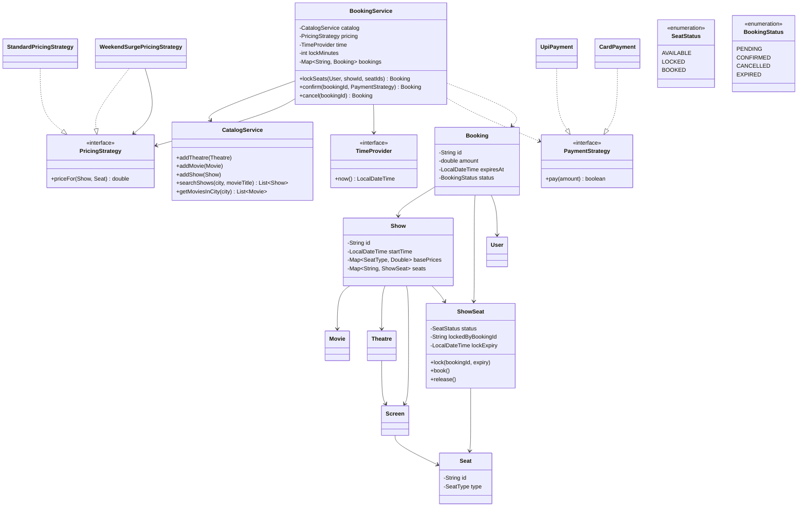

<div align="center">

# 🎟️ Design BookMyShow (movie ticket booking)

   

*Browse shows, lock seats while paying, confirm or release them, and never sell the same seat twice.*

</div>

---

## 📑 Table of contents

- [🎯 Problem statement](#-problem-statement)
- [🧩 Requirements & approach](#-requirements--approach)
- [🔷 Class diagram](#-class-diagram)
- [👥 Classes & responsibilities](#-classes--responsibilities)
- [🧭 Design patterns & principles used](#-design-patterns--principles-used)
- [📊 Strengths & limitations](#-strengths--limitations)
- [🌍 Follow-up interview questions](#-follow-up-interview-questions)
- [💻 Code](#-code)
  - [1. Implementation](#ex1)

---

## 🎯 Problem statement

> Design a **movie ticket booking system** like BookMyShow. Theatres have screens with seats of different classes; a movie plays on a screen as a **show**. A user searches shows by city and movie, picks seats, pays, and gets a confirmed booking. Two people must never end up with the same seat, a seat picked but not yet paid for must be held for a short time, and an abandoned hold must free itself.

## 🧩 Requirements & approach

| 📋 Requirements | 🛠️ Design approach |
|---|---|
| 1. Theatres in cities, each with screens; each screen has seats of types (Silver, Gold, Platinum)<br>2. A show is one movie on one screen at one time; seat availability is **per show** (the same seat can be taken at 6pm and free at 9pm)<br>3. Search shows by city and movie title<br>4. Booking is two steps: **lock** the chosen seats for a few minutes, then **confirm** with payment<br>5. Locking is all-or-nothing: if any one chosen seat is taken, none are locked<br>6. A hold that is not paid in time expires and the seats go back on sale; a failed payment releases them straight away<br>7. A booking can be cancelled (pending or confirmed), which releases its seats<br>8. Pricing must be replaceable (weekend surge, festival pricing) and so must the payment method<br>9. When many users race for the same seat, **exactly one** wins | The physical `Seat` never changes, while `ShowSeat` is that seat's state **for one show** (`AVAILABLE`, `LOCKED` with an expiry, `BOOKED`). `BookingService.lockSeats` takes the show's monitor, drops any expired holds, checks that every requested seat is available, and only then locks them all, so locking is atomic and different shows never block each other. `confirm` re-checks the expiry, charges through a `PaymentStrategy`, and either marks the seats `BOOKED` or releases them. Expired holds are released **lazily** (the next person to touch that show frees them), so no background timer is needed, and `TimeProvider` makes the timeout testable without sleeping. Price comes from a `PricingStrategy`; `WeekendSurgePricingStrategy` **wraps** another strategy and adds a surcharge. `CatalogService` is the read side: add theatres, movies and shows, and search them. The code is split into folders (`enums`, `entities`, `exceptions`, `strategy`, `service`) and `Main`, the client, sits outside them. |

## 🔷 Class diagram



## 👥 Classes & responsibilities

| Class / interface | Responsibility | Kind · folder |
|---|---|---|
| **`BookingService`** | Entry point: lock seats all-or-nothing, confirm with payment, cancel, release expired holds; locks per show (thread safe) | service class · `service/` |
| **`CatalogService`** | Holds theatres, movies and shows; searches by city and movie | service class · `service/` |
| **`TimeProvider`** | The clock, as an interface, so hold expiry is testable without sleeping | interface · `service/` |
| **`PricingStrategy`** | How much one seat costs for one show | interface · `strategy/` |
| **`StandardPricingStrategy`** | The price printed on the show for that seat type | class · `strategy/` |
| **`WeekendSurgePricingStrategy`** | Wraps another pricing strategy and adds a surcharge on Saturday and Sunday | class · `strategy/` |
| **`PaymentStrategy`** | One way to pay; returns whether it went through | interface · `strategy/` |
| **`UpiPayment`, `CardPayment`** | Two payment methods; the card one can decline over a limit to show the failure path | classes · `strategy/` |
| **`Show`** | One movie on one screen at one time, with its price list and per-show seat map; the unit of locking | class · `entities/` |
| **`ShowSeat`** | A seat's state for one show: status, who locked it, and when the hold expires | class · `entities/` |
| **`Seat`, `Screen`, `Theatre`, `Movie`, `User`** | The unchanging physical and catalogue facts | classes · `entities/` |
| **`Booking`** | The user's chosen seats, total amount, hold expiry and status | class · `entities/` |
| **`SeatType`, `SeatStatus`, `BookingStatus`** | SILVER/GOLD/PLATINUM; AVAILABLE/LOCKED/BOOKED; PENDING/CONFIRMED/CANCELLED/EXPIRED | enums · `enums/` |
| **`SeatUnavailableException`, `BookingNotFoundException`, `BookingExpiredException`, `PaymentFailedException`, `InvalidBookingStateException`** | Seat missing or already taken; unknown booking id; hold timed out; payment declined; confirming or cancelling a booking in the wrong state | runtime exceptions · `exceptions/` |
| **`Main`** | Browse, a normal booking, weekend pricing, a taken seat (with no partial lock left behind), a declined card, an expired hold, cancel, and a 20-thread race for one seat | demo · client, outside the packages |

## 🧭 Design patterns & principles used

| Pattern / principle | Where and why |
|---|---|
| **Strategy** | `PricingStrategy` and `PaymentStrategy`: a new pricing rule or payment method is a new class; `BookingService` is not touched |
| **Decorator (via a wrapping Strategy)** | `WeekendSurgePricingStrategy` takes another `PricingStrategy` and modifies its answer, so surcharges can be stacked (weekend plus festival) |
| **Facade** | `BookingService` hides locking, expiry, pricing and payment behind three calls: `lockSeats`, `confirm`, `cancel` |
| **Fine-grained locking** | Synchronising on the `Show` means two people booking different shows never wait on each other, while two racing for the same show are serialised |
| **Lazy expiry** | Expired holds are released the next time anyone touches the show, so there is no background thread to run, tune or shut down |
| **Dependency injection of time** | `TimeProvider` lets the demo move the clock forward and test the 5 minute hold instantly |
| **Single Responsibility principle** | `Seat` is physical, `ShowSeat` is per-show state, `CatalogService` reads, `BookingService` writes |

## 📊 Strengths & limitations

| 👍 Strengths | 👎 Limitations |
|---|---|
| Exactly one of any number of simultaneous requests wins a seat, proven by the 20-thread race in the demo | Expiry is lazy: a held seat stays `LOCKED` in memory until someone touches that show, so a live seat-map screen must also check `isLockExpired` when displaying |
| Locking is all-or-nothing, so a failed attempt never leaves some seats stuck | `lockSeats` scans every seat of the show to look for expired holds; a large screen would keep a separate queue of expiries |
| Different shows lock independently, so a blockbuster's rush does not slow other shows | Payment happens while the show's lock is held; a slow real gateway call would block that show, so production would charge outside the lock and re-validate afterwards |
| Pricing and payment can each change without touching the booking logic | No user accounts or booking history, no refunds amounts, no food or convenience fees; everything is in memory |

## 🌍 Follow-up interview questions

- **How do you handle a seat that is locked but the user closes the app?** The hold simply expires: the next `lockSeats` on that show releases it, and `confirm` on the stale booking throws `BookingExpiredException`. A real system also runs a periodic sweeper (or a delayed queue) so seat maps are correct without waiting for traffic.
- **How would this work across several servers?** An in-process `synchronized` no longer protects you. Keep seat state in a database or Redis and lock with an atomic conditional update (`UPDATE ... SET status='LOCKED' WHERE status='AVAILABLE'`, or Redis `SET NX EX`), which also gives the expiry for free.
- **How would you avoid holding the show lock during payment?** Keep the seats `LOCKED` (the hold itself is the reservation), release the monitor, call the payment gateway, then re-acquire it to flip the seats to `BOOKED`, making the confirm idempotent if payment returns twice.
- **How would you add a 'best available seats' feature?** A `SeatSelectionStrategy` that, given a count, finds the best contiguous block in the show's seat map (centre rows first), and returns seat ids to pass to `lockSeats`.
- **How would you add offers and coupons?** Compose them as another `PricingStrategy` wrapper (like the weekend surge), or add a discount step on `Booking` after `PricingStrategy` has produced the total.
- **How would you notify users of a confirmed booking?** Add an `Observer` (`BookingObserver`) on `BookingService` for confirmed, cancelled and expired, with an SMS or email subscriber, decoupled from the booking logic.
- **How would you handle a show being cancelled by the theatre?** Walk the show's confirmed bookings, move them to `CANCELLED`, release the seats, trigger refunds through the original `PaymentStrategy`, and notify each user.

---

## 💻 Code

This folder has **1 example** (26 Java files). Interfaces and abstract classes come first, the class with `main` comes last.

<a id="ex1"></a>

### 1. Implementation

<details open>
<summary><b>📁 Files in this example</b></summary>

```text
16. BookMyShow/
├── entities/
│   ├── Booking.java
│   ├── Movie.java
│   ├── Screen.java
│   ├── Seat.java
│   ├── Show.java
│   ├── ShowSeat.java
│   ├── Theatre.java
│   └── User.java
├── enums/
│   ├── BookingStatus.java
│   ├── SeatStatus.java
│   └── SeatType.java
├── exceptions/
│   ├── BookingExpiredException.java
│   ├── BookingNotFoundException.java
│   ├── InvalidBookingStateException.java
│   ├── PaymentFailedException.java
│   └── SeatUnavailableException.java
├── service/
│   ├── BookingService.java
│   ├── CatalogService.java
│   └── TimeProvider.java
├── strategy/
│   ├── CardPayment.java
│   ├── PaymentStrategy.java
│   ├── PricingStrategy.java
│   ├── StandardPricingStrategy.java
│   ├── UpiPayment.java
│   └── WeekendSurgePricingStrategy.java
└── Main.java
```

</details>

#### 📄 `enums/SeatType.java`

<sub>enum · 7 lines</sub>

```java
package enums;

public enum SeatType {
    SILVER,
    GOLD,
    PLATINUM
}
```

#### 📄 `enums/SeatStatus.java`

<sub>enum · 7 lines</sub>

```java
package enums;

public enum SeatStatus {
    AVAILABLE,
    LOCKED,
    BOOKED
}
```

#### 📄 `enums/BookingStatus.java`

<sub>enum · 8 lines</sub>

```java
package enums;

public enum BookingStatus {
    PENDING,
    CONFIRMED,
    CANCELLED,
    EXPIRED
}
```

#### 📄 `strategy/PricingStrategy.java`

<sub>interface · 9 lines</sub>

```java
package strategy;

import entities.Seat;
import entities.Show;

// Strategy: how much one seat costs for one show
public interface PricingStrategy {
    double priceFor(Show show, Seat seat);
}
```

#### 📄 `strategy/PaymentStrategy.java`

<sub>interface · 6 lines</sub>

```java
package strategy;

// Strategy: one way to pay. Returns true if the payment went through.
public interface PaymentStrategy {
    boolean pay(double amount);
}
```

#### 📄 `service/TimeProvider.java`

<sub>interface · 8 lines</sub>

```java
package service;

import java.time.LocalDateTime;

// Lets the lock timeout be tested without sleeping: the demo swaps in a clock it can move forward.
public interface TimeProvider {
    LocalDateTime now();
}
```

#### 📄 `entities/User.java`

<sub>class · 18 lines</sub>

```java
package entities;

public class User {
    private final String id;
    private final String name;

    public User(String id, String name) {
        this.id = id;
        this.name = name;
    }

    public String getId() { return id; }

    public String getName() { return name; }

    @Override
    public String toString() { return name; }
}
```

#### 📄 `entities/Movie.java`

<sub>class · 26 lines</sub>

```java
package entities;

public class Movie {
    private final String id;
    private final String title;
    private final String language;
    private final int durationMinutes;

    public Movie(String id, String title, String language, int durationMinutes) {
        this.id = id;
        this.title = title;
        this.language = language;
        this.durationMinutes = durationMinutes;
    }

    public String getId() { return id; }

    public String getTitle() { return title; }

    public String getLanguage() { return language; }

    public int getDurationMinutes() { return durationMinutes; }

    @Override
    public String toString() { return title + " (" + language + ")"; }
}
```

#### 📄 `entities/Seat.java`

<sub>class · 21 lines</sub>

```java
package entities;

import enums.SeatType;

// A physical seat in a screen. It never changes; per-show availability lives in ShowSeat.
public class Seat {
    private final String id;      // e.g. "A1"
    private final SeatType type;

    public Seat(String id, SeatType type) {
        this.id = id;
        this.type = type;
    }

    public String getId() { return id; }

    public SeatType getType() { return type; }

    @Override
    public String toString() { return id; }
}
```

#### 📄 `entities/Screen.java`

<sub>class · 21 lines</sub>

```java
package entities;

import java.util.List;

public class Screen {
    private final String id;
    private final String name;
    private final List<Seat> seats;

    public Screen(String id, String name, List<Seat> seats) {
        this.id = id;
        this.name = name;
        this.seats = seats;
    }

    public String getId() { return id; }

    public String getName() { return name; }

    public List<Seat> getSeats() { return seats; }
}
```

#### 📄 `entities/Theatre.java`

<sub>class · 30 lines</sub>

```java
package entities;

import java.util.ArrayList;
import java.util.List;

public class Theatre {
    private final String id;
    private final String name;
    private final String city;
    private final List<Screen> screens = new ArrayList<>();

    public Theatre(String id, String name, String city) {
        this.id = id;
        this.name = name;
        this.city = city;
    }

    public void addScreen(Screen screen) { screens.add(screen); }

    public String getId() { return id; }

    public String getName() { return name; }

    public String getCity() { return city; }

    public List<Screen> getScreens() { return screens; }

    @Override
    public String toString() { return name; }
}
```

#### 📄 `entities/ShowSeat.java`

<sub>class · 44 lines</sub>

```java
package entities;

import enums.SeatStatus;

import java.time.LocalDateTime;

// One seat for ONE show: the same physical seat can be booked in the 6pm show and free in the 9pm show.
public class ShowSeat {
    private final Seat seat;
    private SeatStatus status = SeatStatus.AVAILABLE;
    private String lockedByBookingId;
    private LocalDateTime lockExpiry;

    public ShowSeat(Seat seat) { this.seat = seat; }

    public Seat getSeat() { return seat; }

    public SeatStatus getStatus() { return status; }

    public LocalDateTime getLockExpiry() { return lockExpiry; }

    public String getLockedByBookingId() { return lockedByBookingId; }

    public void lock(String bookingId, LocalDateTime expiry) {
        this.status = SeatStatus.LOCKED;
        this.lockedByBookingId = bookingId;
        this.lockExpiry = expiry;
    }

    public void book() {
        this.status = SeatStatus.BOOKED;
        this.lockExpiry = null;
    }

    public void release() {
        this.status = SeatStatus.AVAILABLE;
        this.lockedByBookingId = null;
        this.lockExpiry = null;
    }

    public boolean isLockExpired(LocalDateTime now) {
        return status == SeatStatus.LOCKED && !now.isBefore(lockExpiry);
    }
}
```

#### 📄 `entities/Show.java`

<sub>class · 55 lines</sub>

```java
package entities;

import enums.SeatStatus;
import enums.SeatType;

import java.time.LocalDateTime;
import java.util.LinkedHashMap;
import java.util.Map;

// A movie playing on a screen at a time. Owns the seat map; every change to it happens while
// holding this object's monitor (see BookingService), so one show is the unit of locking.
public class Show {
    private final String id;
    private final Movie movie;
    private final Theatre theatre;
    private final Screen screen;
    private final LocalDateTime startTime;
    private final Map<SeatType, Double> basePrices;
    private final Map<String, ShowSeat> seats = new LinkedHashMap<>();

    public Show(String id, Movie movie, Theatre theatre, Screen screen, LocalDateTime startTime, Map<SeatType, Double> basePrices) {
        this.id = id;
        this.movie = movie;
        this.theatre = theatre;
        this.screen = screen;
        this.startTime = startTime;
        this.basePrices = basePrices;
        for (Seat seat : screen.getSeats()) {
            seats.put(seat.getId(), new ShowSeat(seat));
        }
    }

    public String getId() { return id; }

    public Movie getMovie() { return movie; }

    public Theatre getTheatre() { return theatre; }

    public Screen getScreen() { return screen; }

    public LocalDateTime getStartTime() { return startTime; }

    public double getBasePrice(SeatType type) { return basePrices.get(type); }

    public Map<String, ShowSeat> getSeats() { return seats; }

    public long countByStatus(SeatStatus status) {
        return seats.values().stream().filter(s -> s.getStatus() == status).count();
    }

    @Override
    public String toString() {
        return id + " " + movie.getTitle() + " @ " + theatre.getName() + "/" + screen.getName() + " " + startTime.toLocalDate() + " " + startTime.toLocalTime();
    }
}
```

#### 📄 `entities/Booking.java`

<sub>class · 51 lines</sub>

```java
package entities;

import enums.BookingStatus;

import java.time.LocalDateTime;
import java.util.List;

public class Booking {
    private final String id;
    private final User user;
    private final Show show;
    private final List<ShowSeat> seats;
    private final double amount;
    private final LocalDateTime expiresAt;
    private BookingStatus status = BookingStatus.PENDING;

    public Booking(String id, User user, Show show, List<ShowSeat> seats, double amount, LocalDateTime expiresAt) {
        this.id = id;
        this.user = user;
        this.show = show;
        this.seats = seats;
        this.amount = amount;
        this.expiresAt = expiresAt;
    }

    public String getId() { return id; }

    public User getUser() { return user; }

    public Show getShow() { return show; }

    public List<ShowSeat> getSeats() { return seats; }

    public double getAmount() { return amount; }

    public LocalDateTime getExpiresAt() { return expiresAt; }

    public BookingStatus getStatus() { return status; }

    public void setStatus(BookingStatus status) { this.status = status; }

    @Override
    public String toString() {
        StringBuilder ids = new StringBuilder();
        for (ShowSeat s : seats) {
            if (ids.length() > 0) ids.append(",");
            ids.append(s.getSeat().getId());
        }
        return id + " [" + user + ", seats " + ids + ", Rs." + amount + ", " + status + "]";
    }
}
```

#### 📄 `exceptions/SeatUnavailableException.java`

<sub>class · 7 lines</sub>

```java
package exceptions;

public class SeatUnavailableException extends RuntimeException {
    public SeatUnavailableException(String message) {
        super(message);
    }
}
```

#### 📄 `exceptions/BookingNotFoundException.java`

<sub>class · 7 lines</sub>

```java
package exceptions;

public class BookingNotFoundException extends RuntimeException {
    public BookingNotFoundException(String message) {
        super(message);
    }
}
```

#### 📄 `exceptions/BookingExpiredException.java`

<sub>class · 7 lines</sub>

```java
package exceptions;

public class BookingExpiredException extends RuntimeException {
    public BookingExpiredException(String message) {
        super(message);
    }
}
```

#### 📄 `exceptions/PaymentFailedException.java`

<sub>class · 7 lines</sub>

```java
package exceptions;

public class PaymentFailedException extends RuntimeException {
    public PaymentFailedException(String message) {
        super(message);
    }
}
```

#### 📄 `exceptions/InvalidBookingStateException.java`

<sub>class · 7 lines</sub>

```java
package exceptions;

public class InvalidBookingStateException extends RuntimeException {
    public InvalidBookingStateException(String message) {
        super(message);
    }
}
```

#### 📄 `strategy/StandardPricingStrategy.java`

<sub>class · 13 lines</sub>

```java
package strategy;

import entities.Seat;
import entities.Show;

// The price printed on the show for that seat type
public class StandardPricingStrategy implements PricingStrategy {

    @Override
    public double priceFor(Show show, Seat seat) {
        return show.getBasePrice(seat.getType());
    }
}
```

#### 📄 `strategy/WeekendSurgePricingStrategy.java`

<sub>class · 25 lines</sub>

```java
package strategy;

import entities.Seat;
import entities.Show;

import java.time.DayOfWeek;

// Wraps another pricing strategy and adds a surcharge on Saturday and Sunday shows
public class WeekendSurgePricingStrategy implements PricingStrategy {
    private final PricingStrategy base;
    private final double surcharge;      // 0.25 = +25%

    public WeekendSurgePricingStrategy(PricingStrategy base, double surcharge) {
        this.base = base;
        this.surcharge = surcharge;
    }

    @Override
    public double priceFor(Show show, Seat seat) {
        double price = base.priceFor(show, seat);
        DayOfWeek day = show.getStartTime().getDayOfWeek();
        boolean weekend = day == DayOfWeek.SATURDAY || day == DayOfWeek.SUNDAY;
        return weekend ? price * (1 + surcharge) : price;
    }
}
```

#### 📄 `strategy/UpiPayment.java`

<sub>class · 13 lines</sub>

```java
package strategy;

public class UpiPayment implements PaymentStrategy {
    private final String upiId;

    public UpiPayment(String upiId) { this.upiId = upiId; }

    @Override
    public boolean pay(double amount) {
        System.out.println("  [UPI] charged Rs." + amount + " to " + upiId);
        return true;
    }
}
```

#### 📄 `strategy/CardPayment.java`

<sub>class · 22 lines</sub>

```java
package strategy;

// Declines when the card has an insufficient limit, to show the failure path
public class CardPayment implements PaymentStrategy {
    private final String cardNumber;
    private final double limit;

    public CardPayment(String cardNumber, double limit) {
        this.cardNumber = cardNumber;
        this.limit = limit;
    }

    @Override
    public boolean pay(double amount) {
        if (amount > limit) {
            System.out.println("  [Card " + cardNumber + "] declined: Rs." + amount + " exceeds limit " + limit);
            return false;
        }
        System.out.println("  [Card " + cardNumber + "] charged Rs." + amount);
        return true;
    }
}
```

#### 📄 `service/CatalogService.java`

<sub>class · 46 lines</sub>

```java
package service;

import entities.Movie;
import entities.Show;
import entities.Theatre;

import java.util.ArrayList;
import java.util.LinkedHashMap;
import java.util.List;
import java.util.Map;

// What is playing where: theatres, movies and shows, searchable by city and movie
public class CatalogService {
    private final List<Theatre> theatres = new ArrayList<>();
    private final Map<String, Movie> movies = new LinkedHashMap<>();
    private final Map<String, Show> shows = new LinkedHashMap<>();

    public void addTheatre(Theatre theatre) { theatres.add(theatre); }

    public void addMovie(Movie movie) { movies.put(movie.getId(), movie); }

    public void addShow(Show show) { shows.put(show.getId(), show); }

    public Show getShow(String showId) { return shows.get(showId); }

    public List<Movie> getMoviesInCity(String city) {
        List<Movie> result = new ArrayList<>();
        for (Show show : shows.values()) {
            if (show.getTheatre().getCity().equalsIgnoreCase(city) && !result.contains(show.getMovie())) {
                result.add(show.getMovie());
            }
        }
        return result;
    }

    public List<Show> searchShows(String city, String movieTitle) {
        List<Show> result = new ArrayList<>();
        for (Show show : shows.values()) {
            if (show.getTheatre().getCity().equalsIgnoreCase(city)
                    && show.getMovie().getTitle().equalsIgnoreCase(movieTitle)) {
                result.add(show);
            }
        }
        return result;
    }
}
```

#### 📄 `service/BookingService.java`

<sub>class · 140 lines</sub>

```java
package service;

import entities.Booking;
import entities.Seat;
import entities.Show;
import entities.ShowSeat;
import entities.User;
import enums.BookingStatus;
import enums.SeatStatus;
import exceptions.BookingExpiredException;
import exceptions.BookingNotFoundException;
import exceptions.InvalidBookingStateException;
import exceptions.PaymentFailedException;
import exceptions.SeatUnavailableException;
import strategy.PaymentStrategy;
import strategy.PricingStrategy;

import java.time.LocalDateTime;
import java.util.ArrayList;
import java.util.List;
import java.util.Map;
import java.util.concurrent.ConcurrentHashMap;
import java.util.concurrent.atomic.AtomicInteger;

// Booking is two steps, like the real app: (1) lock the chosen seats for a few minutes while
// the user pays, (2) confirm after payment. Seats are locked ALL-OR-NOTHING, and every change to a
// show's seat map happens while holding that show's monitor, so two people racing for the same
// seat can never both win, while different shows never block each other.
public class BookingService {
    private final CatalogService catalog;
    private final PricingStrategy pricing;
    private final TimeProvider time;
    private final int lockMinutes;
    private final Map<String, Booking> bookings = new ConcurrentHashMap<>();
    private final AtomicInteger counter = new AtomicInteger();

    public BookingService(CatalogService catalog, PricingStrategy pricing, TimeProvider time, int lockMinutes) {
        this.catalog = catalog;
        this.pricing = pricing;
        this.time = time;
        this.lockMinutes = lockMinutes;
    }

    // Step 1: hold the seats. Throws SeatUnavailableException (and holds nothing) if any is taken.
    public Booking lockSeats(User user, String showId, List<String> seatIds) {
        Show show = catalog.getShow(showId);
        synchronized (show) {
            LocalDateTime now = time.now();
            releaseExpiredLocks(show, now);

            List<ShowSeat> chosen = new ArrayList<>();
            for (String seatId : seatIds) {
                ShowSeat showSeat = show.getSeats().get(seatId);
                if (showSeat == null) {
                    throw new SeatUnavailableException("Seat " + seatId + " does not exist in " + show.getScreen().getName());
                }
                if (showSeat.getStatus() != SeatStatus.AVAILABLE) {
                    throw new SeatUnavailableException("Seat " + seatId + " is already " + showSeat.getStatus());
                }
                chosen.add(showSeat);
            }

            String bookingId = "BK-" + counter.incrementAndGet();
            LocalDateTime expiry = now.plusMinutes(lockMinutes);
            double amount = 0;
            for (ShowSeat showSeat : chosen) {
                showSeat.lock(bookingId, expiry);
                Seat seat = showSeat.getSeat();
                amount += pricing.priceFor(show, seat);
            }
            Booking booking = new Booking(bookingId, user, show, chosen, amount, expiry);
            bookings.put(bookingId, booking);
            return booking;
        }
    }

    // Step 2: pay. If the hold ran out, or payment fails, the seats go back on sale.
    public Booking confirm(String bookingId, PaymentStrategy payment) {
        Booking booking = find(bookingId);
        Show show = booking.getShow();
        synchronized (show) {
            if (booking.getStatus() != BookingStatus.PENDING) {
                throw new InvalidBookingStateException("Booking " + bookingId + " is " + booking.getStatus() + ", not PENDING");
            }
            if (!time.now().isBefore(booking.getExpiresAt())) {
                releaseSeats(booking, BookingStatus.EXPIRED);
                throw new BookingExpiredException("Seat hold for " + bookingId + " expired; please select seats again");
            }
            if (!payment.pay(booking.getAmount())) {
                releaseSeats(booking, BookingStatus.CANCELLED);
                throw new PaymentFailedException("Payment failed for " + bookingId + "; seats released");
            }
            for (ShowSeat showSeat : booking.getSeats()) {
                showSeat.book();
            }
            booking.setStatus(BookingStatus.CONFIRMED);
            return booking;
        }
    }

    // Cancel a pending or confirmed booking; its seats go back on sale
    public Booking cancel(String bookingId) {
        Booking booking = find(bookingId);
        synchronized (booking.getShow()) {
            if (booking.getStatus() != BookingStatus.PENDING && booking.getStatus() != BookingStatus.CONFIRMED) {
                throw new InvalidBookingStateException("Booking " + bookingId + " is " + booking.getStatus() + " and cannot be cancelled");
            }
            releaseSeats(booking, BookingStatus.CANCELLED);
            return booking;
        }
    }

    // Seats whose hold ran out go back on sale lazily, the next time anybody touches that show
    private void releaseExpiredLocks(Show show, LocalDateTime now) {
        for (ShowSeat showSeat : show.getSeats().values()) {
            if (showSeat.isLockExpired(now)) {
                Booking stale = bookings.get(showSeat.getLockedByBookingId());
                if (stale != null && stale.getStatus() == BookingStatus.PENDING) {
                    stale.setStatus(BookingStatus.EXPIRED);
                }
                showSeat.release();
            }
        }
    }

    private void releaseSeats(Booking booking, BookingStatus newStatus) {
        for (ShowSeat showSeat : booking.getSeats()) {
            showSeat.release();
        }
        booking.setStatus(newStatus);
    }

    private Booking find(String bookingId) {
        Booking booking = bookings.get(bookingId);
        if (booking == null) {
            throw new BookingNotFoundException("Unknown booking: " + bookingId);
        }
        return booking;
    }
}
```

#### 📄 `Main.java`

<sub>class · 166 lines</sub>

```java
import entities.Booking;
import entities.Movie;
import entities.Screen;
import entities.Seat;
import entities.Show;
import entities.Theatre;
import entities.User;
import enums.SeatStatus;
import enums.SeatType;
import exceptions.BookingExpiredException;
import exceptions.InvalidBookingStateException;
import exceptions.PaymentFailedException;
import exceptions.SeatUnavailableException;
import service.BookingService;
import service.CatalogService;
import service.TimeProvider;
import strategy.CardPayment;
import strategy.StandardPricingStrategy;
import strategy.UpiPayment;
import strategy.WeekendSurgePricingStrategy;

import java.time.LocalDateTime;
import java.util.ArrayList;
import java.util.Arrays;
import java.util.EnumMap;
import java.util.List;
import java.util.Map;
import java.util.concurrent.CountDownLatch;
import java.util.concurrent.atomic.AtomicInteger;
import java.util.concurrent.atomic.AtomicReference;

public class Main {

    // Rows A-B are PLATINUM, C-D GOLD, E SILVER; 6 seats per row
    private static Screen buildScreen(String id, String name) {
        List<Seat> seats = new ArrayList<>();
        String rows = "ABCDE";
        for (int r = 0; r < rows.length(); r++) {
            SeatType type = r < 2 ? SeatType.PLATINUM : (r < 4 ? SeatType.GOLD : SeatType.SILVER);
            for (int n = 1; n <= 6; n++) {
                seats.add(new Seat("" + rows.charAt(r) + n, type));
            }
        }
        return new Screen(id, name, seats);
    }

    public static void main(String[] args) throws Exception {

        // ---- catalog ----
        CatalogService catalog = new CatalogService();
        Theatre pvr = new Theatre("T1", "PVR Forum", "Bengaluru");
        Screen screen1 = buildScreen("S1", "Screen 1");
        pvr.addScreen(screen1);
        catalog.addTheatre(pvr);

        Movie dune = new Movie("MV1", "Dune: Part Two", "English", 166);
        Movie rrr = new Movie("MV2", "RRR", "Telugu", 182);
        catalog.addMovie(dune);
        catalog.addMovie(rrr);

        Map<SeatType, Double> prices = new EnumMap<>(SeatType.class);
        prices.put(SeatType.SILVER, 150.0);
        prices.put(SeatType.GOLD, 250.0);
        prices.put(SeatType.PLATINUM, 400.0);

        // 2026-11-16 is a Monday, 2026-11-21 a Saturday
        catalog.addShow(new Show("SH1", dune, pvr, screen1, LocalDateTime.of(2026, 11, 16, 18, 30), prices));
        catalog.addShow(new Show("SH2", dune, pvr, screen1, LocalDateTime.of(2026, 11, 21, 18, 30), prices));
        catalog.addShow(new Show("SH3", rrr, pvr, screen1, LocalDateTime.of(2026, 11, 16, 21, 30), prices));

        // A clock the demo can move forward instead of sleeping
        AtomicReference<LocalDateTime> clock = new AtomicReference<>(LocalDateTime.of(2026, 11, 15, 12, 0));
        TimeProvider time = clock::get;

        BookingService booking = new BookingService(catalog,
                new WeekendSurgePricingStrategy(new StandardPricingStrategy(), 0.25), time, 5);

        User alice = new User("U1", "Alice");
        User bob = new User("U2", "Bob");
        User carol = new User("U3", "Carol");

        System.out.println("=== 1. Browse: what is playing in Bengaluru? ===");
        System.out.println("Movies: " + catalog.getMoviesInCity("Bengaluru"));
        System.out.println("Shows of Dune: ");
        for (Show s : catalog.searchShows("Bengaluru", "Dune: Part Two")) {
            System.out.println("  " + s + " (" + s.countByStatus(SeatStatus.AVAILABLE) + " seats free)");
        }

        System.out.println("\n=== 2. Alice locks A1, A2 on the Monday show and pays by UPI ===");
        Booking b1 = booking.lockSeats(alice, "SH1", Arrays.asList("A1", "A2"));
        System.out.println("Locked: " + b1);
        booking.confirm(b1.getId(), new UpiPayment("alice@upi"));
        System.out.println("Result: " + b1);

        System.out.println("\n=== 3. Same seats on the SATURDAY show cost 25% more ===");
        Booking weekend = booking.lockSeats(alice, "SH2", Arrays.asList("A1", "A2"));
        System.out.println("Weekend price for A1+A2: Rs." + weekend.getAmount() + " (weekday was Rs." + b1.getAmount() + ")");
        booking.cancel(weekend.getId());

        System.out.println("\n=== 4. Bob tries A2 on the Monday show: already booked ===");
        try {
            booking.lockSeats(bob, "SH1", Arrays.asList("A2", "B1"));
        } catch (SeatUnavailableException e) {
            System.out.println("Rejected: " + e.getMessage());
        }
        System.out.println("B1 was not left locked by the failed attempt: B1 is "
                + catalog.getShow("SH1").getSeats().get("B1").getStatus());

        System.out.println("\n=== 5. Bob's card is declined: seats go back on sale ===");
        Booking b2 = booking.lockSeats(bob, "SH1", Arrays.asList("C1", "C2"));
        try {
            booking.confirm(b2.getId(), new CardPayment("4111-XXXX", 100.0));
        } catch (PaymentFailedException e) {
            System.out.println("Rejected: " + e.getMessage());
        }
        System.out.println("C1 is now " + catalog.getShow("SH1").getSeats().get("C1").getStatus());

        System.out.println("\n=== 6. Carol locks D1 but takes too long to pay (lock is 5 minutes) ===");
        Booking b3 = booking.lockSeats(carol, "SH1", Arrays.asList("D1"));
        System.out.println("Locked: " + b3);
        clock.set(clock.get().plusMinutes(6));
        try {
            booking.confirm(b3.getId(), new UpiPayment("carol@upi"));
        } catch (BookingExpiredException e) {
            System.out.println("Rejected: " + e.getMessage());
        }
        System.out.println("D1 is now " + catalog.getShow("SH1").getSeats().get("D1").getStatus() + ", booking is " + b3.getStatus());

        System.out.println("\n=== 7. Alice cancels her confirmed booking; a second cancel is rejected ===");
        booking.cancel(b1.getId());
        System.out.println("Result: " + b1);
        try {
            booking.cancel(b1.getId());
        } catch (InvalidBookingStateException e) {
            System.out.println("Rejected: " + e.getMessage());
        }

        System.out.println("\n=== 8. Race: 20 users all try to lock seat E1 at the same moment ===");
        int users = 20;
        CountDownLatch ready = new CountDownLatch(users);
        CountDownLatch go = new CountDownLatch(1);
        CountDownLatch done = new CountDownLatch(users);
        AtomicInteger winners = new AtomicInteger();
        AtomicInteger losers = new AtomicInteger();
        for (int i = 0; i < users; i++) {
            final User u = new User("R" + i, "Racer" + i);
            new Thread(() -> {
                ready.countDown();
                try {
                    go.await();
                    booking.lockSeats(u, "SH3", Arrays.asList("E1"));
                    winners.incrementAndGet();
                } catch (SeatUnavailableException e) {
                    losers.incrementAndGet();
                } catch (InterruptedException ignored) {
                } finally {
                    done.countDown();
                }
            }).start();
        }
        ready.await();
        go.countDown();
        done.await();
        System.out.println("Winners: " + winners.get() + ", losers: " + losers.get() + " (exactly one winner)");
    }
}
```

<details>
<summary><b>▶️ How to compile and run this example</b></summary>

```bash
# run from the repository root
mkdir -p out
find "Interview Questions/16. BookMyShow" -name "*.java" -print0 | xargs -0 javac -d out
java -cp out Main
```

</details>

---

<div align="center">

[◀ Meeting Scheduler](../15.%20Meeting%20Scheduler/README.md) &nbsp;·&nbsp; [📚 All questions](../QUESTIONS.md)

</div>
