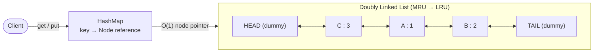
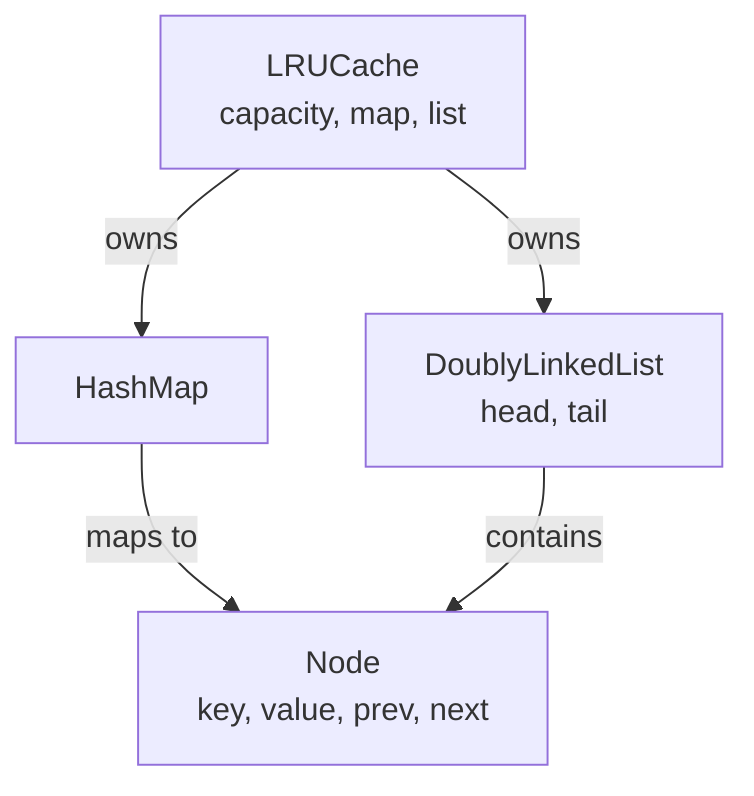
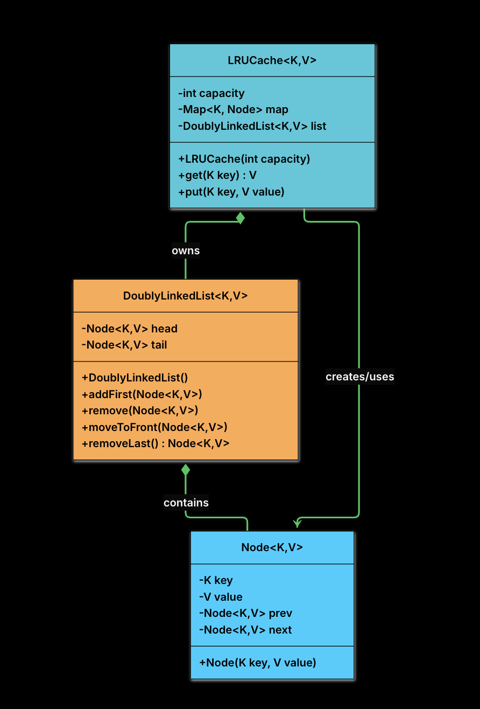
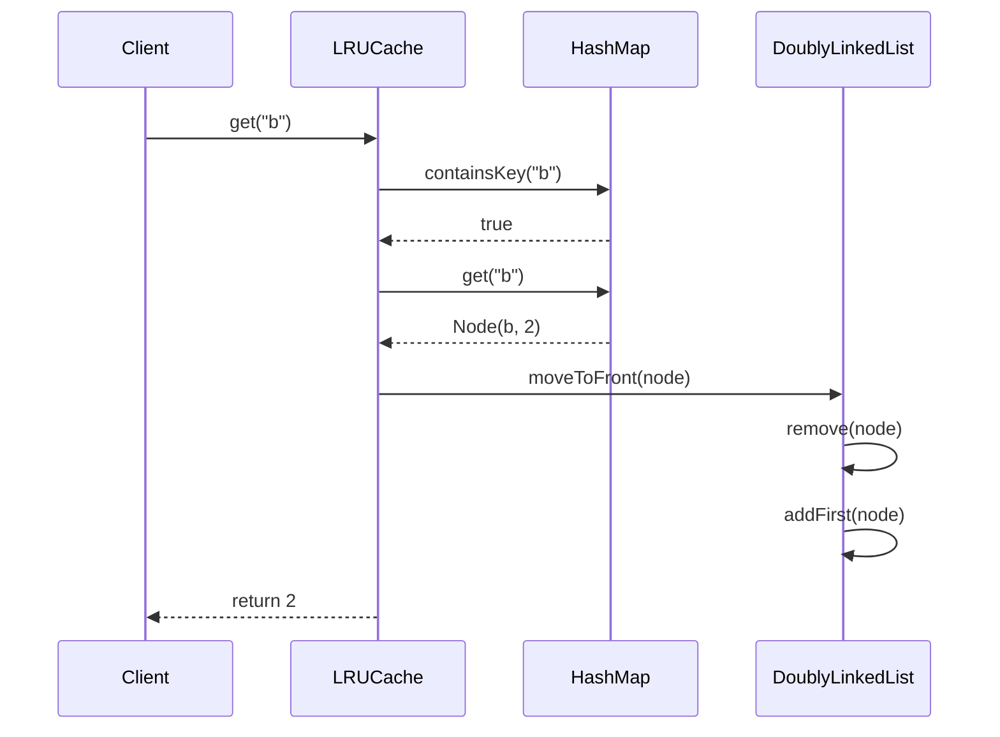
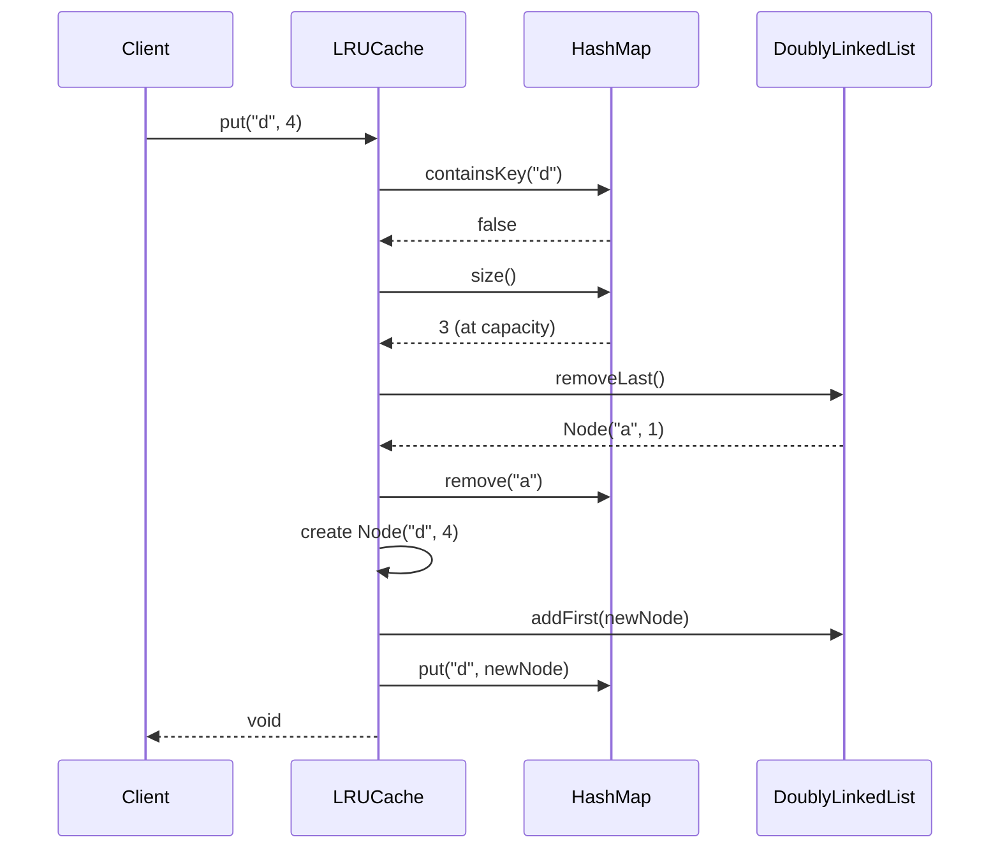
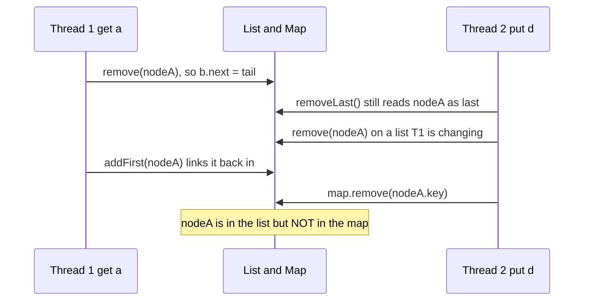
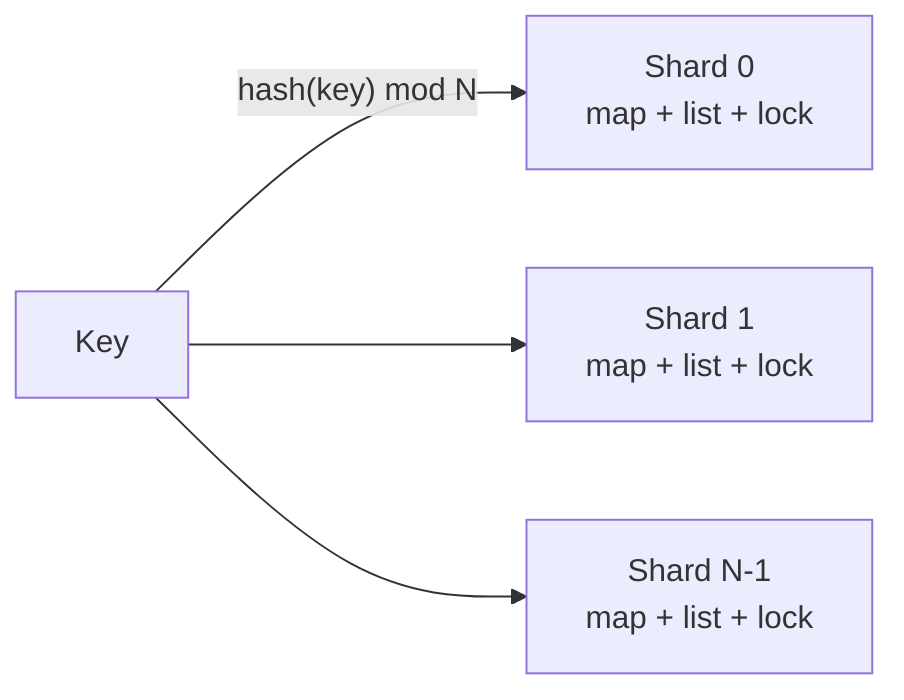
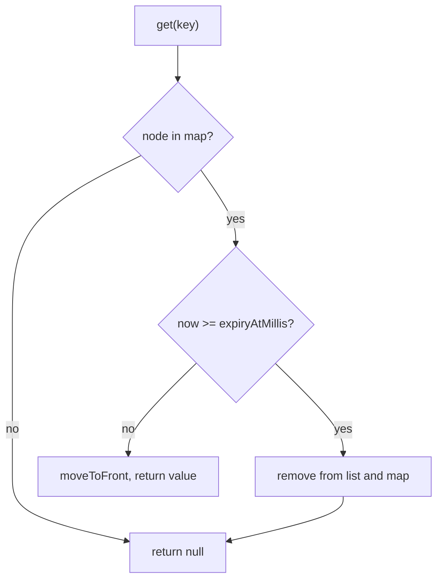

<div align="center">

# 🗃️ Design an LRU Cache

  

*A thread-safe, fixed-capacity key/value cache with O(1) `get` and `put` that evicts the Least Recently Used entry.*

</div>

---

## 📑 Contents

1. [Clarifying Requirements](#1-clarifying-requirements)
2. [Identifying Core Entities](#2-identifying-core-entities)
3. [Designing Classes and Relationships](#3-designing-classes-and-relationships)
   - [3.1 Class Definitions](#31-class-definitions) · [3.2 Full Class Diagram](#32-full-class-diagram) · [3.3 Operation Sequence Diagrams](#33-operation-sequence-diagrams)
4. [Code Implementation](#4-code-implementation)
5. [Concurrency and Thread Safety](#5-concurrency-and-thread-safety)
6. [Extensions](#6-extensions)
7. [All code files and how to run](#7-all-code-files-and-how-to-run)

---

## What is an LRU Cache?

**LRU = Least Recently Used.** When the cache is full, it evicts the entry that was used longest ago. The idea: *"if you haven't used something for a while, you probably won't need it soon."*

**Example** (capacity = 3):

```text
put(1, A)   // {1:A}
put(2, B)   // {1:A, 2:B}
put(3, C)   // {1:A, 2:B, 3:C}
get(1)      // 1 becomes most recently used
put(4, D)   // key 2 is the least recently used -> evicted

Final state (least -> most recent): {3:C, 1:A, 4:D}
```

---

## 1. Clarifying Requirements

Questions to ask the interviewer, and what they answer:

| # | Question | Answer |
|---|---|---|
| 1 | Generic key/value, or fixed types? | Generic, any `<K, V>`, as long as keys are hashable |
| 2 | Only `get` and `put`, or delete too? | Only `get` and `put` for now |
| 3 | What does `get` return on a miss? | `null` (or a sentinel like `-1`) |
| 4 | Does `put` on an existing key count as a use? | Yes, move it to the front (most recently used) |
| 5 | Multi-threaded? | Yes, it must be thread-safe |
| 6 | Performance expectation? | `get` and `put` in O(1) on average |

Summary of the requirements:

| ✅ Functional Requirements | ⚙️ Non-Functional Requirements |
|---|---|
| 1. `get(key)` returns the value if the key exists, otherwise `null` or `-1`<br><br>2. `put(key, value)` inserts a new pair or updates an existing key<br><br>3. If the cache exceeds its capacity, it automatically evicts the least recently used item<br><br>4. Both `get` and `put` update the recency of the accessed or inserted item<br><br>5. Keys and values are generic (`<K, V>`), provided keys are hashable | 1. **Time complexity:** `get` and `put` run in O(1) on average<br><br>2. **Thread safety:** safe to use in concurrent environments<br><br>3. **Modularity:** object-oriented design with clean separation of responsibilities<br><br>4. **Memory efficiency:** data structures optimised for speed and space within the constraints |

---

## 2. Identifying Core Entities

An LRU cache is not about real-world objects like users or bookings. The design is about **choosing the right data structures**. There are two challenges:

1. **Fast lookup by key** (reads and updates)
2. **Fast ordering by recency** (to know what to evict)

### 2.1 The need for fast lookup

> "Both `get` and `put` must run in O(1)."

A **HashMap** gives O(1) lookup. But it keeps no order, so finding the least recently used entry would mean scanning everything: **O(n)**.

### 2.2 The need for fast ordering

> "If the cache exceeds its capacity, evict the least recently used item."

We must, all in O(1): move an item to the front (MRU), remove the last item (LRU), and insert new items at the front.

| Structure | Why it fails / works |
|---|---|
| Array | Insert or move in the middle shifts elements: O(n) |
| Plain linked list | Finding the node to move needs a traversal: O(n) |
| **Doubly linked list** | Each node knows `prev` and `next`, so with a direct reference we can remove it, move it to the head, or evict the tail in **O(1)** |

### 2.3 Combining both

The list needs a direct node reference, and that is exactly what the HashMap can provide.



- **HashMap:** O(1) lookup. It stores a *reference to the list node*, not the value itself.
- **Doubly linked list:** keeps usage order. **Head = Most Recently Used, tail = Least Recently Used.**

So: find via the map, reorder via the node pointer, evict from the tail. All O(1).

### 2.4 Additional core entities

- **`Node`**: one cache entry and one list node; holds key, value, `prev`, `next`.
- **`LRUCache`**: the main class; exposes the public API and owns the map and the list.

> **Why store the key in the Node?** When we evict the tail node we must also remove it from the HashMap, and `HashMap.remove` needs the key.

### 2.5 Entity overview



| Entity | Type | Responsibility |
|---|---|---|
| `Node<K, V>` | Data class | Stores the key-value pair and the linked-list pointers |
| `DoublyLinkedList<K, V>` | Utility class | Manages MRU → LRU ordering with O(1) operations |
| `HashMap<K, Node>` | Standard library | O(1) key-to-node lookup |
| `LRUCache<K, V>` | Main class | Coordinates everything and enforces the eviction policy |

---

## 3. Designing Classes and Relationships

We go bottom-up: simple types first. Trivial getters and setters are skipped.

### 3.1 Class Definitions

#### `Node<K, V>`

An entry in the cache and a node in the list.

| Attribute | Type | Description | Mutable? |
|---|---|---|---|
| `key` | `K` | Cache key (needed to remove from the HashMap on eviction) | No |
| `value` | `V` | The cached value | Yes |
| `prev` | `Node<K, V>` | Previous node in the list | Yes |
| `next` | `Node<K, V>` | Next node in the list | Yes |

| Method | Description |
|---|---|
| `Node(key, value)` | Constructor that initialises key and value |

> **Design decision, why store the key?** Without it, evicting the tail would require iterating the HashMap to find which key points to that node: O(n).

#### `DoublyLinkedList<K, V>`

Manages the MRU → LRU order.

| Attribute | Type | Description |
|---|---|---|
| `head` | `Node<K, V>` | Dummy head (never holds real data) |
| `tail` | `Node<K, V>` | Dummy tail (never holds real data) |

| Method | Description |
|---|---|
| `DoublyLinkedList()` | Creates dummy head and tail and links them |
| `addFirst(node)` | Adds a node right after the head (MRU position) |
| `remove(node)` | Detaches a node from its current position |
| `moveToFront(node)` | Removes and re-adds a node at the front |
| `removeLast()` | Removes and returns the LRU node (just before the tail) |

> **Design decision, why dummy head and tail?** Without them we need special cases for: adding to an empty list, removing the only node, removing the first or last node. With dummies, real data always sits between them, so every real node has a valid `prev` and `next`.

```text
HEAD (dummy) <-> Node A <-> Node B <-> TAIL (dummy)
```

#### `LRUCache<K, V>`

The public API (`get`, `put`) and the overall cache logic.

| Attribute | Type | Description |
|---|---|---|
| `capacity` | `int` | Maximum number of entries |
| `map` | `Map<K, Node<K, V>>` | Key to list node, for O(1) lookup |
| `list` | `DoublyLinkedList<K, V>` | Keeps the recency order |

| Method | Description |
|---|---|
| `LRUCache(capacity)` | Initialises capacity, creates an empty map and list |
| `get(key)` | Returns the value if present (and marks it MRU), otherwise `null` |
| `put(key, value)` | Inserts or updates (marks MRU); evicts the LRU entry if at capacity |

**Key design principles**

1. **Single responsibility:** `LRUCache` coordinates; the list orders; the map looks up.
2. **Encapsulation:** internals are private; callers only see `get` and `put`.
3. **Thread safety:** `get` and `put` are `synchronized` (see [section 5](#5-concurrency-and-thread-safety)).

### 3.2 Full Class Diagram

<div align="center">



</div>

### 3.3 Operation Sequence Diagrams

**`get(key)`: cache hit**



**`put(key, value)`: new key at capacity (eviction)**



---

## 4. Code Implementation

Bottom-up: `Node`, then `DoublyLinkedList`, then `LRUCache`.

### 4.1 Node class

```java
package cache;

class Node<K, V> {
    K key;
    V value;
    Node<K, V> prev;
    Node<K, V> next;

    Node(K key, V value) {
        this.key = key;
        this.value = value;
    }
}
```

- **Package-private fields:** `Node` is an internal detail, and `DoublyLinkedList` needs direct access to `prev` and `next` for O(1) pointer work.
- **Key is stored** so eviction can remove the map entry.
- `prev` and `next` start as `null`; the list sets them when the node is added.

### 4.2 DoublyLinkedList class

```java
package cache;

class DoublyLinkedList<K, V> {
    private final Node<K, V> head;
    private final Node<K, V> tail;

    public DoublyLinkedList() {
        // Create dummy nodes
        head = new Node<>(null, null);
        tail = new Node<>(null, null);

        // Link them together
        head.next = tail;
        tail.prev = head;
    }

    public void addFirst(Node<K, V> node) {
        // Insert node between head and head.next
        node.next = head.next;
        node.prev = head;
        head.next.prev = node;
        head.next = node;
    }

    public void remove(Node<K, V> node) {
        // Bypass this node by linking its neighbors
        node.prev.next = node.next;
        node.next.prev = node.prev;
    }

    public void moveToFront(Node<K, V> node) {
        remove(node);
        addFirst(node);
    }

    public Node<K, V> removeLast() {
        if (tail.prev == head) {
            return null; // empty list
        }
        Node<K, V> last = tail.prev;
        remove(last);
        return last;
    }
}
```

- **Constructor:** creates dummy head and tail with `null` data. The list starts as `HEAD <-> TAIL`.
- **`addFirst`:** set the *new node's* pointers first, then update the existing nodes. If `head.next` were changed first, we would lose the reference.
- **`remove`:** no traversal needed; `node.prev` and `node.next` are already known, so the neighbours just point at each other.
- **`moveToFront`:** just `remove` plus `addFirst`, no special-case logic.
- **`removeLast`:** returns the node before the tail (the LRU item). `tail.prev == head` means the list is empty.

### 4.3 LRUCache class

```java
package cache;

import java.util.HashMap;
import java.util.Map;

public class LRUCache<K, V> {
    private final int capacity;
    private final Map<K, Node<K, V>> map;
    private final DoublyLinkedList<K, V> list;

    public LRUCache(int capacity) {
        this.capacity = capacity;
        this.map = new HashMap<>();
        this.list = new DoublyLinkedList<>();
    }

    public synchronized V get(K key) {
        if (!map.containsKey(key)) {
            return null;
        }
        Node<K, V> node = map.get(key);
        list.moveToFront(node);
        return node.value;
    }

    public synchronized void put(K key, V value) {
        if (map.containsKey(key)) {
            // Update existing entry
            Node<K, V> node = map.get(key);
            node.value = value;
            list.moveToFront(node);
        } else {
            // Add new entry
            if (map.size() == capacity) {
                // Evict LRU item
                Node<K, V> lru = list.removeLast();
                if (lru != null) {
                    map.remove(lru.key);
                }
            }

            Node<K, V> newNode = new Node<>(key, value);
            list.addFirst(newNode);
            map.put(key, newNode);
        }
    }

    // Only addition to the PDF's API: lets the demo assert the cache never exceeds capacity.
    public synchronized int size() {
        return map.size();
    }
}
```

**`get(key)`**: 1) if the key is not in the map, return `null`; 2) get the node from the map; 3) move it to the front; 4) return the value.

**`put(key, value)`**

| Case | Steps |
|---|---|
| Key exists | Get the node → update its value → move it to the front |
| Key is new | If at capacity: `removeLast()` and use its key to remove the map entry → create a new node → `addFirst` → `map.put` |

**Thread safety:** both methods are `synchronized`, so only one thread runs either at a time on one cache instance. (`size()` is the only method added beyond the PDF's API; it lets the demo check that capacity is never exceeded.)

### 4.4 Run and test

```java
LRUCache<Integer, String> cache = new LRUCache<>(3);
cache.put(1, "A");
cache.put(2, "B");
cache.put(3, "C");
cache.get(1);          // "A", key 1 is now MRU
cache.put(4, "D");     // evicts key 2
cache.get(2);          // null (evicted)
```

Expected output of the first part of `Main`:

```text
=== Basic LRU (capacity = 3) ===
get(1) = A
get(2) = null   (evicted, expected null)
get(3) = C
get(4) = D
after update + put(5): get(1) = A2, size = 3
```

---

## 5. Concurrency and Thread Safety

Many request threads share one `LRUCache` and call `get` and `put` at the same time. The cache has two pieces of state that must stay in sync: the **map** and the **list**. It is correct only when they agree. We use a single lock around both `get` and `put`. Two concerns explain why.

### 5.1 Concern 1: concurrent operations corrupting the linked list (🔴 High risk)

`addFirst`, `remove` and `moveToFront` each rewrite three or four pointers in sequence. If two threads do this at once, their half-finished updates interleave.

**Setup:** the cache holds `{a, b, c}` as `head <-> c <-> b <-> a <-> tail`. Thread 1 calls `get("a")` (`moveToFront(nodeA)`). Thread 2 calls `put("d", 4)` at capacity (`removeLast()` evicts `nodeA`). Both touch `nodeA` and its neighbours.

**Without synchronization**



1. Thread 1 (`remove(nodeA)`) sets `b.next = tail`.
2. Thread 2 (`removeLast`) still reads `nodeA` as the last node, because Thread 1 has not finished detaching it.
3. Thread 2 (`remove(nodeA)`) writes pointers based on a list that Thread 1 is in the middle of changing.
4. Thread 1 (`addFirst(nodeA)`) re-inserts `nodeA`, so the node Thread 2 thinks it evicted is back in the list.
5. Thread 2 removes `nodeA`'s key from the map.

**Result:** list and map disagree. `nodeA` is reachable through the list but its key is gone from the map. A later `removeLast()` can return a node whose key is not in the map, `map.remove(lru.key)` deletes nothing, the list **grows past capacity**, entries leak and stale values are returned.

**With synchronization:** one lock around the whole `get` and the whole `put` makes each operation atomic. Thread 1 finishes its entire `moveToFront` before Thread 2 takes the lock, so Thread 2 sees a consistent `tail.prev`, evicts the real LRU node and removes the matching key.

```java
// the synchronized keyword serializes get and put on the same instance
public synchronized void put(K key, V value) {
    if (map.containsKey(key)) {
        Node<K, V> node = map.get(key);
        node.value = value;
        list.moveToFront(node);
    } else {
        if (map.size() == capacity) {
            Node<K, V> lru = list.removeLast();
            if (lru != null) {
                map.remove(lru.key);
            }
        }
        Node<K, V> newNode = new Node<>(key, value);
        list.addFirst(newNode);
        map.put(key, newNode);
    }
}
```

> The lock must cover the **map and the list together**. Locking only one leaves the same window open, because the corruption comes from the two structures being updated out of step.

> **Why a read lock is not enough:** it is natural to treat `get` as a read and let many `get` calls share a read lock. That fails, because **`get` is not a read**: every successful `get` calls `moveToFront`, which rewrites the list pointers. Two concurrent `get`s are two writers on the same list. Both `get` and `put` must take the same exclusive lock; there is no read-only path to optimise.

### 5.2 Concern 2: a single global lock becomes the bottleneck (🟠 Medium risk)

The lock from 5.1 is correct, but it serialises **every** operation. This is a scaling problem, not a correctness one.

**Setup:** 16 worker threads run reads and writes across thousands of unrelated keys, all sharing one lock.

**Without striping:** Thread 1 works on `"user_1"` and Thread 2 on `"user_9999"`, keys that never touch the same node, yet Thread 2 still blocks until Thread 1 releases the lock. Throughput is capped at one operation at a time, no matter how many cores exist. Latency climbs and adding cores does not help.

**With striped locking:** partition the cache into **N independent shards**, each with its own map, list and lock. A key is routed by hash: `shard = hash(key) % N`. Keys in different shards run in parallel because they take different locks. Each shard runs the same single-lock logic from 5.1.



```java
package cache;

// Route each key to one of N shards; each shard is an independent LRUCache
public class StripedLRUCache<K, V> {
    private final LRUCache<K, V>[] shards;

    @SuppressWarnings("unchecked")
    public StripedLRUCache(int shardCount, int perShardCapacity) {
        shards = new LRUCache[shardCount];
        for (int i = 0; i < shardCount; i++) {
            shards[i] = new LRUCache<>(perShardCapacity);
        }
    }

    private LRUCache<K, V> shardFor(K key) {
        int index = (key.hashCode() & 0x7fffffff) % shards.length;
        return shards[index];
    }

    public V get(K key) { return shardFor(key).get(key); }
    public void put(K key, V value) { shardFor(key).put(key, value); }

    public int size() {
        int total = 0;
        for (LRUCache<K, V> shard : shards) {
            total += shard.size();
        }
        return total;
    }
}
```

> **Trade-off:** eviction is now **per shard**, not global. Each shard evicts its own LRU entry, which approximates global LRU closely enough for most workloads. Production caches such as Java's `ConcurrentHashMap` and Guava's `Cache` use this idea internally.

### 5.3 Summary

First make it **correct** with one lock covering the whole operation, including the read path (Concern 1). Then trade strict global ordering for throughput by **partitioning the lock** (Concern 2), once a single lock is the bottleneck.

The demo proves it: 16 threads hammer one `LRUCache` (capacity 100) and the final size is exactly 100 with no wrong values; the striped version also stays within `8 x 25 = 200`.

---

## 6. Extensions

The base cache keeps recent entries and evicts the rest. Real caches usually need more: expiring stale data, capping by memory, reporting performance. Each extension below adds one capability **without rewriting the core `get` and `put`** (they are separate classes in the same package).

### 6.1 Per-entry TTL expiry

**Scenario:** *"Cached values should expire after a fixed time, even if they are still being accessed."*

LRU evicts by recency, but some data goes stale by the clock (a session token or price quote valid for 60 seconds). **Fix:** stamp each node with an expiry time and treat an expired entry as a miss inside `get`.



```java
// Node gets an expiry field, set when the entry is written
class TtlNode<K, V> extends Node<K, V> {
    long expiryAtMillis; // now + ttl
    ...
}

public synchronized V get(K key) {
    TtlNode<K, V> node = (TtlNode<K, V>) map.get(key);
    if (node == null) {
        return null;
    }
    if (clock.getAsLong() >= node.expiryAtMillis) {
        list.remove(node);      // expired: drop it and report a miss
        map.remove(key);
        return null;
    }
    list.moveToFront(node);
    return node.value;
}
```

- **Lazy expiration** (on access) is cheap, but dead entries stay in memory until someone looks them up.
- For aggressive reclamation, add a **background sweeper thread** that periodically drops expired nodes, at the cost of one more thread contending for the same lock (`evictExpired()` in `TtlLRUCache`).
- The clock is injectable (`LongSupplier`), so the demo tests expiry without sleeping.

### 6.2 Weight-based (size-aware) eviction

**Scenario:** *"Cap the cache by total memory, not by a fixed number of entries."*

Counting entries assumes equal sizes. With a 2 KB thumbnail next to a 5 MB image, a count limit wastes or under-uses memory. **Fix:** give each node a **weight**, track the running total, and keep calling `removeLast()` until the total fits. That may remove several small entries or a single large one.

```java
private long maxWeight;
private long currentWeight;

public synchronized void put(K key, V value, long weight) {
    if (map.containsKey(key)) {
        WeightedNode<K, V> node = (WeightedNode<K, V>) map.get(key);
        currentWeight += weight - node.weight;
        node.value = value;
        node.weight = weight;
        list.moveToFront(node);
    } else {
        WeightedNode<K, V> newNode = new WeightedNode<>(key, value, weight);
        list.addFirst(newNode);
        map.put(key, newNode);
        currentWeight += weight;
    }
    // evict until we fit under the weight budget
    while (currentWeight > maxWeight) {
        Node<K, V> lru = list.removeLast();
        if (lru == null) break;
        map.remove(lru.key);
        currentWeight -= ((WeightedNode<K, V>) lru).weight;
    }
}
```

> **Edge case:** a single entry heavier than `maxWeight` would evict everything else and still not fit. A production cache **rejects it or caps its weight**. Our `WeightedLRUCache` rejects it up front with `IllegalArgumentException`.

### 6.3 Hit and miss metrics

**Scenario:** *"Report how often the cache actually helps."*

A cache is worth its memory only if enough requests are served from it. The **hit ratio** (`hits / total lookups`) is the most useful tuning number. **Fix:** two counters inside `get`: a hit when the key is present and live, a miss when it is absent or expired.

```java
private long hits;
private long misses;

public synchronized V get(K key) {
    Node<K, V> node = map.get(key);
    if (node == null) {
        misses++;
        return null;
    }
    hits++;
    list.moveToFront(node);
    return node.value;
}

public synchronized double hitRatio() {
    long total = hits + misses;
    return total == 0 ? 0.0 : (double) hits / total;
}
```

- Counters change inside the **same locked section** as the lookup, so they stay accurate under concurrency without a second lock.
- A **low hit ratio** is a signal to raise capacity, reconsider what is cached, or accept that the access pattern does not favour caching.

### 6.4 Extensions at a glance

| Extension | Class | Idea | Watch out for |
|---|---|---|---|
| 6.1 TTL | `TtlLRUCache`, `TtlNode` | Expiry timestamp per node; expired = miss | Lazy expiry leaves dead entries; a sweeper adds lock contention |
| 6.2 Weight-based | `WeightedLRUCache`, `WeightedNode` | Track total weight; evict until it fits | One entry heavier than the budget |
| 6.3 Metrics | `MetricsLRUCache` | `hits` / `misses` counters, `hitRatio()` | Keep counters inside the same lock |

---

## 7. All code files and how to run

<details open>
<summary><b>📁 Files</b></summary>

```text
17. LRU Cache/
├── cache/
│   ├── Node.java
│   ├── DoublyLinkedList.java
│   ├── LRUCache.java
│   ├── StripedLRUCache.java
│   ├── TtlNode.java
│   ├── TtlLRUCache.java
│   ├── WeightedNode.java
│   ├── WeightedLRUCache.java
│   └── MetricsLRUCache.java
├── images/
│   └── final-class-diagram.png
└── Main.java
```

</details>

<details>
<summary><b>💻 Full source of every file</b></summary>

#### 📄 `cache/Node.java`

```java
package cache;

class Node<K, V> {
    K key;
    V value;
    Node<K, V> prev;
    Node<K, V> next;

    Node(K key, V value) {
        this.key = key;
        this.value = value;
    }
}
```

#### 📄 `cache/DoublyLinkedList.java`

```java
package cache;

class DoublyLinkedList<K, V> {
    private final Node<K, V> head;
    private final Node<K, V> tail;

    public DoublyLinkedList() {
        // Create dummy nodes
        head = new Node<>(null, null);
        tail = new Node<>(null, null);

        // Link them together
        head.next = tail;
        tail.prev = head;
    }

    public void addFirst(Node<K, V> node) {
        // Insert node between head and head.next
        node.next = head.next;
        node.prev = head;
        head.next.prev = node;
        head.next = node;
    }

    public void remove(Node<K, V> node) {
        // Bypass this node by linking its neighbors
        node.prev.next = node.next;
        node.next.prev = node.prev;
    }

    public void moveToFront(Node<K, V> node) {
        remove(node);
        addFirst(node);
    }

    public Node<K, V> removeLast() {
        if (tail.prev == head) {
            return null; // empty list
        }
        Node<K, V> last = tail.prev;
        remove(last);
        return last;
    }
}
```

#### 📄 `cache/LRUCache.java`

```java
package cache;

import java.util.HashMap;
import java.util.Map;

public class LRUCache<K, V> {
    private final int capacity;
    private final Map<K, Node<K, V>> map;
    private final DoublyLinkedList<K, V> list;

    public LRUCache(int capacity) {
        this.capacity = capacity;
        this.map = new HashMap<>();
        this.list = new DoublyLinkedList<>();
    }

    public synchronized V get(K key) {
        if (!map.containsKey(key)) {
            return null;
        }
        Node<K, V> node = map.get(key);
        list.moveToFront(node);
        return node.value;
    }

    public synchronized void put(K key, V value) {
        if (map.containsKey(key)) {
            // Update existing entry
            Node<K, V> node = map.get(key);
            node.value = value;
            list.moveToFront(node);
        } else {
            // Add new entry
            if (map.size() == capacity) {
                // Evict LRU item
                Node<K, V> lru = list.removeLast();
                if (lru != null) {
                    map.remove(lru.key);
                }
            }

            Node<K, V> newNode = new Node<>(key, value);
            list.addFirst(newNode);
            map.put(key, newNode);
        }
    }

    // Only addition to the PDF's API: lets the demo assert the cache never exceeds capacity.
    public synchronized int size() {
        return map.size();
    }
}
```

#### 📄 `cache/StripedLRUCache.java`

```java
package cache;

// Route each key to one of N shards; each shard is an independent LRUCache
public class StripedLRUCache<K, V> {
    private final LRUCache<K, V>[] shards;

    @SuppressWarnings("unchecked")
    public StripedLRUCache(int shardCount, int perShardCapacity) {
        shards = new LRUCache[shardCount];
        for (int i = 0; i < shardCount; i++) {
            shards[i] = new LRUCache<>(perShardCapacity);
        }
    }

    private LRUCache<K, V> shardFor(K key) {
        int index = (key.hashCode() & 0x7fffffff) % shards.length;
        return shards[index];
    }

    public V get(K key) { return shardFor(key).get(key); }
    public void put(K key, V value) { shardFor(key).put(key, value); }

    public int size() {
        int total = 0;
        for (LRUCache<K, V> shard : shards) {
            total += shard.size();
        }
        return total;
    }
}
```

#### 📄 `cache/TtlNode.java`

```java
package cache;

// Extension 7.1: Node with an expiry field, set when the entry is written
class TtlNode<K, V> extends Node<K, V> {
    long expiryAtMillis; // clock.now() + ttl

    TtlNode(K key, V value, long expiryAtMillis) {
        super(key, value);
        this.expiryAtMillis = expiryAtMillis;
    }
}
```

#### 📄 `cache/TtlLRUCache.java`

```java
package cache;

import java.util.HashMap;
import java.util.Map;
import java.util.function.LongSupplier;

// Extension 7.1: per-entry TTL, enforced lazily inside get (expired entry == miss).
public class TtlLRUCache<K, V> {
    private final int capacity;
    private final long ttlMillis;
    private final LongSupplier clock; // System::currentTimeMillis in production, a fake in tests
    private final Map<K, Node<K, V>> map = new HashMap<>();
    private final DoublyLinkedList<K, V> list = new DoublyLinkedList<>();

    public TtlLRUCache(int capacity, long ttlMillis) {
        this(capacity, ttlMillis, System::currentTimeMillis);
    }

    public TtlLRUCache(int capacity, long ttlMillis, LongSupplier clock) {
        this.capacity = capacity;
        this.ttlMillis = ttlMillis;
        this.clock = clock;
    }

    @SuppressWarnings("unchecked")
    public synchronized V get(K key) {
        TtlNode<K, V> node = (TtlNode<K, V>) map.get(key);
        if (node == null) {
            return null;
        }
        if (clock.getAsLong() >= node.expiryAtMillis) {
            list.remove(node);      // expired: drop it and report a miss
            map.remove(key);
            return null;
        }
        list.moveToFront(node);
        return node.value;
    }

    @SuppressWarnings("unchecked")
    public synchronized void put(K key, V value) {
        long expiry = clock.getAsLong() + ttlMillis;
        if (map.containsKey(key)) {
            TtlNode<K, V> node = (TtlNode<K, V>) map.get(key);
            node.value = value;
            node.expiryAtMillis = expiry; // a write refreshes the TTL
            list.moveToFront(node);
        } else {
            if (map.size() == capacity) {
                Node<K, V> lru = list.removeLast();
                if (lru != null) {
                    map.remove(lru.key);
                }
            }
            TtlNode<K, V> newNode = new TtlNode<>(key, value, expiry);
            list.addFirst(newNode);
            map.put(key, newNode);
        }
    }

    // Optional "background sweeper" step: call periodically from a scheduled thread.
    public synchronized int evictExpired() {
        int removed = 0;
        long now = clock.getAsLong();
        for (java.util.Iterator<Map.Entry<K, Node<K, V>>> it = map.entrySet().iterator(); it.hasNext(); ) {
            Node<K, V> n = it.next().getValue();
            if (now >= ((TtlNode<K, V>) n).expiryAtMillis) {
                list.remove(n);
                it.remove();
                removed++;
            }
        }
        return removed;
    }

    public synchronized int size() {
        return map.size();
    }
}
```

#### 📄 `cache/WeightedNode.java`

```java
package cache;

// Extension 7.2: Node that carries a weight (e.g. size in bytes)
class WeightedNode<K, V> extends Node<K, V> {
    long weight;

    WeightedNode(K key, V value, long weight) {
        super(key, value);
        this.weight = weight;
    }
}
```

#### 📄 `cache/WeightedLRUCache.java`

```java
package cache;

import java.util.HashMap;
import java.util.Map;

// Extension 7.2: cap the cache by total weight instead of entry count.
public class WeightedLRUCache<K, V> {
    private final long maxWeight;
    private long currentWeight;
    private final Map<K, Node<K, V>> map = new HashMap<>();
    private final DoublyLinkedList<K, V> list = new DoublyLinkedList<>();

    public WeightedLRUCache(long maxWeight) {
        this.maxWeight = maxWeight;
    }

    public synchronized V get(K key) {
        Node<K, V> node = map.get(key);
        if (node == null) {
            return null;
        }
        list.moveToFront(node);
        return node.value;
    }

    @SuppressWarnings("unchecked")
    public synchronized void put(K key, V value, long weight) {
        // Edge case: an entry that can never fit is rejected, so it cannot flush the whole cache.
        if (weight > maxWeight) {
            throw new IllegalArgumentException("weight " + weight + " exceeds maxWeight " + maxWeight);
        }
        if (map.containsKey(key)) {
            WeightedNode<K, V> node = (WeightedNode<K, V>) map.get(key);
            currentWeight += weight - node.weight;
            node.value = value;
            node.weight = weight;
            list.moveToFront(node);
        } else {
            WeightedNode<K, V> newNode = new WeightedNode<>(key, value, weight);
            list.addFirst(newNode);
            map.put(key, newNode);
            currentWeight += weight;
        }
        // evict until we fit under the weight budget
        while (currentWeight > maxWeight) {
            Node<K, V> lru = list.removeLast();
            if (lru == null) break;
            map.remove(lru.key);
            currentWeight -= ((WeightedNode<K, V>) lru).weight;
        }
    }

    public synchronized long currentWeight() {
        return currentWeight;
    }

    public synchronized int size() {
        return map.size();
    }
}
```

#### 📄 `cache/MetricsLRUCache.java`

```java
package cache;

import java.util.HashMap;
import java.util.Map;

// Extension 7.3: hit / miss counters updated inside the same locked section as the lookup.
public class MetricsLRUCache<K, V> {
    private final int capacity;
    private final Map<K, Node<K, V>> map = new HashMap<>();
    private final DoublyLinkedList<K, V> list = new DoublyLinkedList<>();
    private long hits;
    private long misses;

    public MetricsLRUCache(int capacity) {
        this.capacity = capacity;
    }

    public synchronized V get(K key) {
        Node<K, V> node = map.get(key);
        if (node == null) {
            misses++;
            return null;
        }
        hits++;
        list.moveToFront(node);
        return node.value;
    }

    public synchronized void put(K key, V value) {
        if (map.containsKey(key)) {
            Node<K, V> node = map.get(key);
            node.value = value;
            list.moveToFront(node);
        } else {
            if (map.size() == capacity) {
                Node<K, V> lru = list.removeLast();
                if (lru != null) {
                    map.remove(lru.key);
                }
            }
            Node<K, V> newNode = new Node<>(key, value);
            list.addFirst(newNode);
            map.put(key, newNode);
        }
    }

    public synchronized double hitRatio() {
        long total = hits + misses;
        return total == 0 ? 0.0 : (double) hits / total;
    }

    public synchronized long hits() { return hits; }
    public synchronized long misses() { return misses; }
}
```

#### 📄 `Main.java`

```java
import cache.LRUCache;
import cache.MetricsLRUCache;
import cache.StripedLRUCache;
import cache.TtlLRUCache;
import cache.WeightedLRUCache;

import java.util.concurrent.CountDownLatch;
import java.util.concurrent.ExecutorService;
import java.util.concurrent.Executors;
import java.util.concurrent.TimeUnit;
import java.util.concurrent.atomic.AtomicLong;

public class Main {
    public static void main(String[] args) throws Exception {
        basicDemo();
        concurrencyDemo();
        stripedDemo();
        ttlDemo();
        weightedDemo();
        metricsDemo();
    }

    // The PDF's example: capacity 3, put 1,2,3, get(1), put(4) evicts key 2.
    static void basicDemo() {
        System.out.println("=== Basic LRU (capacity = 3) ===");
        LRUCache<Integer, String> cache = new LRUCache<>(3);
        cache.put(1, "A");
        cache.put(2, "B");
        cache.put(3, "C");
        System.out.println("get(1) = " + cache.get(1));
        cache.put(4, "D");
        System.out.println("get(2) = " + cache.get(2) + "   (evicted, expected null)");
        System.out.println("get(3) = " + cache.get(3));
        System.out.println("get(4) = " + cache.get(4));
        cache.put(1, "A2");           // update counts as use
        cache.put(5, "E");            // evicts the LRU one
        System.out.println("after update + put(5): get(1) = " + cache.get(1) + ", size = " + cache.size());
    }

    // Concern 1: many threads share one cache; the single lock keeps map and list in step.
    static void concurrencyDemo() throws Exception {
        System.out.println("\n=== Concurrency: 16 threads on one LRUCache (capacity = 100) ===");
        LRUCache<Integer, Integer> cache = new LRUCache<>(100);
        int threads = 16, opsPerThread = 50_000;
        ExecutorService pool = Executors.newFixedThreadPool(threads);
        CountDownLatch start = new CountDownLatch(1);
        CountDownLatch done = new CountDownLatch(threads);
        AtomicLong wrong = new AtomicLong();
        for (int t = 0; t < threads; t++) {
            final int seed = t;
            pool.execute(() -> {
                try {
                    start.await();
                    java.util.Random r = new java.util.Random(seed);
                    for (int i = 0; i < opsPerThread; i++) {
                        int k = r.nextInt(300);
                        if (r.nextBoolean()) {
                            cache.put(k, k * 10);
                        } else {
                            Integer v = cache.get(k);
                            if (v != null && v != k * 10) wrong.incrementAndGet();
                        }
                    }
                } catch (InterruptedException ignored) {
                } finally {
                    done.countDown();
                }
            });
        }
        start.countDown();
        done.await();
        pool.shutdown();
        pool.awaitTermination(5, TimeUnit.SECONDS);
        System.out.println("size = " + cache.size() + " (<= 100: " + (cache.size() <= 100) + "), stale/wrong values = " + wrong.get());
    }

    // Concern 2: striped locking, eviction is per shard.
    static void stripedDemo() throws Exception {
        System.out.println("\n=== Striped locking: 8 shards x 25 entries ===");
        StripedLRUCache<String, Integer> cache = new StripedLRUCache<>(8, 25);
        int threads = 16;
        ExecutorService pool = Executors.newFixedThreadPool(threads);
        CountDownLatch done = new CountDownLatch(threads);
        for (int t = 0; t < threads; t++) {
            final int id = t;
            pool.execute(() -> {
                for (int i = 0; i < 20_000; i++) {
                    String k = "user_" + ((i * 31 + id) % 1000);
                    cache.put(k, i);
                    cache.get(k);
                }
                done.countDown();
            });
        }
        done.await();
        pool.shutdown();
        System.out.println("total size = " + cache.size() + " (<= 200: " + (cache.size() <= 200) + ")");
    }

    // 7.1 TTL, using a fake clock so the demo is deterministic.
    static void ttlDemo() {
        System.out.println("\n=== Extension 7.1: TTL (60s) ===");
        AtomicLong now = new AtomicLong(0);
        TtlLRUCache<String, String> cache = new TtlLRUCache<>(3, 60_000, now::get);
        cache.put("token", "abc");
        now.set(30_000);
        System.out.println("t=30s get(token) = " + cache.get("token"));
        now.set(61_000);
        System.out.println("t=61s get(token) = " + cache.get("token") + "   (expired, expected null)");
        cache.put("a", "1");
        cache.put("b", "2");
        now.set(200_000);
        System.out.println("sweeper removed " + cache.evictExpired() + " dead entries, size = " + cache.size());
    }

    // 7.2 weight-based eviction.
    static void weightedDemo() {
        System.out.println("\n=== Extension 7.2: weight-based eviction (max 10 MB) ===");
        WeightedLRUCache<String, String> cache = new WeightedLRUCache<>(10);
        cache.put("t1", "thumb", 1);
        cache.put("t2", "thumb", 1);
        cache.put("img", "big", 8);
        System.out.println("weight = " + cache.currentWeight() + ", entries = " + cache.size());
        cache.put("img2", "bigger", 9);   // evicts t1, t2 and img
        System.out.println("after 9 MB put: weight = " + cache.currentWeight() + ", entries = " + cache.size()
                + ", get(img) = " + cache.get("img"));
        try {
            cache.put("huge", "x", 50);
        } catch (IllegalArgumentException e) {
            System.out.println("rejected oversize entry: " + e.getMessage());
        }
    }

    // 7.3 hit and miss metrics.
    static void metricsDemo() {
        System.out.println("\n=== Extension 7.3: hit / miss metrics ===");
        MetricsLRUCache<String, Integer> cache = new MetricsLRUCache<>(2);
        cache.put("a", 1);
        cache.put("b", 2);
        cache.get("a");   // hit
        cache.get("z");   // miss
        cache.put("c", 3); // evicts b
        cache.get("b");   // miss
        cache.get("c");   // hit
        System.out.println("hits = " + cache.hits() + ", misses = " + cache.misses()
                + ", hitRatio = " + cache.hitRatio());
    }
}
```

</details>

<details>
<summary><b>▶️ How to compile and run</b></summary>

```bash
# run from the repository root
mkdir -p out
find "Interview Questions/17. LRU Cache" -name "*.java" -print0 | xargs -0 javac -d out
java -cp out Main
```

</details>

---

<div align="center">

[◀ BookMyShow](../16.%20BookMyShow/README.md) &nbsp;·&nbsp; [📚 All questions](../QUESTIONS.md)

</div>
