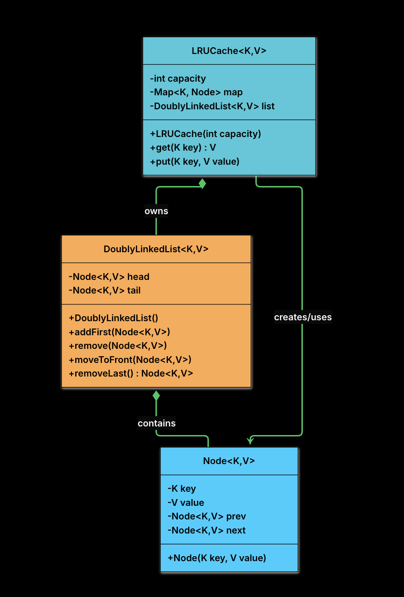
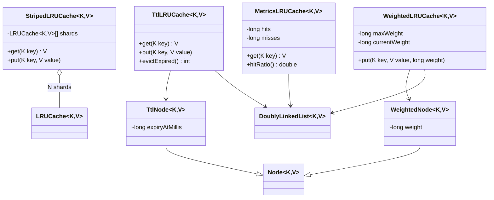

<div align="center">

# 🗃️ Design an LRU Cache

   

*A fixed-capacity, thread-safe key/value cache with O(1) get and put that evicts the Least Recently Used entry.*

</div>

---

## 📑 Table of contents

- [🎯 Problem statement](#-problem-statement)
- [🧩 Requirements & approach](#-requirements--approach)
- [🔷 Class diagram](#-class-diagram)
- [👥 Classes & responsibilities](#-classes--responsibilities)
- [🧭 Design patterns & principles used](#-design-patterns--principles-used)
- [📊 Strengths & limitations](#-strengths--limitations)
- [🌍 Follow-up interview questions](#-follow-up-interview-questions)
- [💻 Code](#-code)
  - [1. Implementation](#ex1)

---

## 🎯 Problem statement

> Design an **LRU (Least Recently Used) Cache**. It holds at most `capacity` entries; when a new key arrives and the cache is full, the entry that was used least recently is evicted. Both `get` and `put` count as a use. The cache is generic, shared by many threads in a server, and both operations must run in **O(1)** on average. Example with capacity 3: `put(1,A) put(2,B) put(3,C) get(1) put(4,D)` evicts key 2, leaving `{3:C, 1:A, 4:D}` from least to most recent.

## 🧩 Requirements & approach

| 📋 Requirements | 🛠️ Design approach |
|---|---|
| **Functional**<br>1. `get(key)` returns the value if the key exists, otherwise `null` (or `-1`)<br>2. `put(key, value)` inserts a new pair or updates the value of an existing key<br>3. If the cache exceeds its capacity, it automatically evicts the least recently used item<br>4. Both `get` and `put` update the recency of the accessed or inserted item<br>5. Keys and values are generic (`<K, V>`), provided the keys are hashable<br><br>**Non-functional**<br>1. **Time complexity:** `get` and `put` run in O(1) on average<br>2. **Thread safety:** safe to use in concurrent environments<br>3. **Modularity:** object-oriented design with clean separation of responsibilities<br>4. **Memory efficiency:** internal data structures optimised for speed and space within the constraints | Two structures, each fixing the other's weakness. A **HashMap** gives O(1) lookup but has no order; a **doubly linked list** gives O(1) reorder and eviction but no lookup. So the map stores `key -> Node`, and the list orders nodes from **head (most recently used)** to **tail (least recently used)**. A hit finds the node through the map and moves it to the front; eviction removes the node before the tail and uses the key stored **inside the node** to delete the map entry too. **Dummy head and tail nodes** remove every empty-list and only-node special case. `Node` is a package-private data holder, `DoublyLinkedList` owns the pointer surgery, and `LRUCache` coordinates both and exposes only `get` and `put`. Both public methods are `synchronized`, so the map and the list always change together. Sections 6 and 7 of the source (striped locking, TTL, weighted eviction, metrics) are implemented as extra classes in the same package without touching the core classes. |

## 🔷 Class diagram

**Final class diagram**

<div align="center">



</div>

Concurrency and extension classes built on top of the core (sections 6 and 7 of the source material):



## 👥 Classes & responsibilities

| Class / interface | Responsibility | Kind · folder |
|---|---|---|
| **`LRUCache<K,V>`** | The public API (`get`, `put`); owns the map and the list, enforces the eviction policy, synchronized | main class · `cache/` |
| **`DoublyLinkedList<K,V>`** | Maintains MRU-to-LRU order with dummy head/tail: `addFirst`, `remove`, `moveToFront`, `removeLast` | utility class · `cache/` |
| **`Node<K,V>`** | One entry: key, value, `prev`, `next`. The key is kept so eviction can remove the map entry | data class · `cache/` |
| **`StripedLRUCache<K,V>`** | Concurrency concern 2: routes each key to one of N independent `LRUCache` shards by hash, so different shards never block each other | class · `cache/` |
| **`TtlNode` / `TtlLRUCache`** | Extension 7.1: each node has an expiry time; an expired entry is dropped on `get` and reported as a miss; optional sweeper `evictExpired()` | extension · `cache/` |
| **`WeightedNode` / `WeightedLRUCache`** | Extension 7.2: capacity is a total weight (for example bytes); `put` evicts from the tail until the total fits | extension · `cache/` |
| **`MetricsLRUCache`** | Extension 7.3: counts hits and misses inside `get` and exposes `hitRatio()` | extension · `cache/` |
| **`Main`** | Demo: the PDF example, a 16-thread stress test, striping, TTL, weighted eviction and metrics | client · root |

## 🧭 Design patterns & principles used

| Pattern / principle | Where and why |
|---|---|
| **Composition / delegation** | `LRUCache` delegates ordering to `DoublyLinkedList` and lookup to `HashMap`; each part does one thing (Single Responsibility) |
| **Encapsulation** | `Node` and `DoublyLinkedList` are package-private; callers only see `get` and `put`, never nodes, links or eviction |
| **Sentinel (dummy) nodes** | The dummy head and tail guarantee every real node has a non-null `prev` and `next`, so no special cases |
| **Monitor lock** | `synchronized` on `get` and `put` makes each operation atomic over map and list together |
| **Lock striping** | `StripedLRUCache` splits one hot lock into N independent ones, the same idea as `ConcurrentHashMap` and Guava's `Cache` |
| **Open for extension** | TTL and weight are added by subclassing `Node`, not by rewriting `get`/`put` logic of the core |

## 📊 Strengths & limitations

| 👍 Strengths | 👎 Limitations |
|---|---|
| `get` and `put` are O(1): hash lookup plus a few pointer writes | One global lock: every operation on every key queues behind it (fixed by striping, at the cost of global LRU order) |
| Map and list cannot disagree, because one lock covers both | `get` cannot use a shared read lock, since it rewrites the list on every hit |
| Core classes stay tiny and the extensions do not modify them | Striped eviction is per shard, so it only approximates global LRU |
| Generic over `K` and `V` | TTL is lazy: dead entries stay in memory until looked up or swept |

## 🌍 Follow-up interview questions

- **Why a HashMap plus a doubly linked list, and not just one of them?** A HashMap alone has no order, so finding the LRU item is an O(n) scan. An array shifts on every move, and a plain linked list needs an O(n) walk to find a node. The map stores a direct reference to the node, so the list can remove and re-insert it in O(1), and the tail is always the LRU item.
- **Why store the key inside the `Node`?** On eviction we remove the tail node and must also delete its map entry. `HashMap.remove` needs the key; without it in the node we would have to scan the map to find which key points at that node, making eviction O(n).
- **Why dummy head and tail nodes?** Without them, adding to an empty list, removing the only node, and removing the first or last node are all special cases with null checks. With them, real data always sits between the two dummies, so every real node has valid `prev` and `next`.
- **What does `put` on an existing key do?** It updates the value and moves the node to the front, since an update counts as a use. No eviction happens because the size did not change.
- **What should `get` return on a miss?** `null` (or a sentinel such as `-1`). This code returns `null`.
- **Concurrency 1: what goes wrong without a lock?** `addFirst`, `remove` and `moveToFront` each rewrite three or four pointers. Say the cache is `head <-> c <-> b <-> a <-> tail`. Thread 1 runs `get("a")` (`moveToFront(nodeA)`) while Thread 2 runs `put("d")` at capacity (`removeLast()` evicts `nodeA`). Thread 2 can still read `nodeA` as the last node while Thread 1 is detaching it, then write pointers based on a half-changed list; Thread 1 re-inserts `nodeA` at the front while Thread 2 deletes its key from the map. The result: `nodeA` is reachable through the list but absent from the map, a later `removeLast()` can return a node whose key is not in the map, `map.remove` deletes nothing, the list grows past capacity and stale values leak.
- **How does synchronization fix it?** One lock around the whole `get` and the whole `put` makes each operation atomic. Thread 1 finishes its entire `moveToFront` before Thread 2 acquires the lock, so Thread 2 sees a consistent `tail.prev`, evicts the true LRU node and removes the matching key. The lock must cover the map and the list together; locking only one leaves the same window open.
- **Why can't `get` use a read lock so readers run in parallel?** Because `get` is not a read: every successful `get` calls `moveToFront`, which rewrites the list pointers. Two concurrent `get`s would be two writers on the same list and would corrupt the order exactly like above. Both methods must take the same exclusive lock; there is no read-only path to optimise.
- **Concurrency 2: the single lock is correct, but what is the cost?** It becomes a bottleneck. With 16 threads working on thousands of unrelated keys, Thread 2 on `user_9999` still blocks behind Thread 1 on `user_1`, so throughput is capped at one operation at a time however many cores exist. It is a scaling problem, not a correctness one.
- **How does striped locking solve it?** Partition the cache into N independent shards, each with its own map, list and lock, and route a key with `shard = hash(key) % N` (`StripedLRUCache`). Keys in different shards run in parallel because they take different locks, and each shard uses the same single-lock logic as before. The trade-off: eviction is per shard rather than global, which approximates global LRU closely enough for most workloads. `ConcurrentHashMap` and Guava's `Cache` use this idea internally.
- **Extension 7.1, per-entry TTL: how do you make entries expire even if they are still being read?** Stamp each node with `expiryAtMillis = now + ttl` when it is written, and treat an expired node as a miss inside `get`: remove it from the list and the map and return `null` (`TtlLRUCache`). This lazy expiry is cheap but leaves dead entries in memory until someone looks them up. For aggressive reclamation add a background sweeper thread that periodically drops expired nodes (`evictExpired()` here), at the cost of an extra thread contending for the same lock.
- **Extension 7.2, weight-based eviction: how do you cap by memory instead of entry count?** Give each node a weight (a 2 KB thumbnail vs a 5 MB image) and track `currentWeight`. After every `put`, keep calling `removeLast()` until `currentWeight <= maxWeight`; this may evict several small entries or one large one (`WeightedLRUCache`). On an update, adjust the total by the weight difference. The edge case: one entry heavier than `maxWeight` would evict everything else and still not fit, so production caches reject it or cap its weight; this code rejects it with `IllegalArgumentException`.
- **Extension 7.3, hit and miss metrics: how do you report how well the cache works?** Keep two counters, incremented inside `get` (a hit when the key is present and live, a miss when absent or expired), and expose `hitRatio() = hits / (hits + misses)` (`MetricsLRUCache`). Because they change inside the same locked section as the lookup, they stay exact under concurrency without a second lock. A low ratio means raise the capacity, reconsider what is cached, or accept that the access pattern does not favour caching.
- **How would you add `delete`?** Look up the node in the map, call `list.remove(node)` and `map.remove(key)` under the same lock; both are O(1).
- **How would you make it distributed?** Shard keys across cache servers with consistent hashing; each server runs this local LRU. Redis offers the same policy built in (`maxmemory-policy allkeys-lru`).

---

## 💻 Code

This folder has **1 example** (10 Java files). Interfaces and abstract classes come first, the class with `main` comes last.

<a id="ex1"></a>

### 1. Implementation

<details open>
<summary><b>📁 Files in this example</b></summary>

```text
17. LRU Cache/
├── cache/
│   ├── DoublyLinkedList.java
│   ├── LRUCache.java
│   ├── MetricsLRUCache.java
│   ├── Node.java
│   ├── StripedLRUCache.java
│   ├── TtlLRUCache.java
│   ├── TtlNode.java
│   ├── WeightedLRUCache.java
│   └── WeightedNode.java
└── Main.java
```

</details>

#### 📄 `cache/Node.java`

<sub>class · 13 lines</sub>

```java
package cache;

class Node<K, V> {
    K key;
    V value;
    Node<K, V> prev;
    Node<K, V> next;

    Node(K key, V value) {
        this.key = key;
        this.value = value;
    }
}
```

#### 📄 `cache/DoublyLinkedList.java`

<sub>class · 44 lines</sub>

```java
package cache;

class DoublyLinkedList<K, V> {
    private final Node<K, V> head;
    private final Node<K, V> tail;

    public DoublyLinkedList() {
        // Create dummy nodes
        head = new Node<>(null, null);
        tail = new Node<>(null, null);

        // Link them together
        head.next = tail;
        tail.prev = head;
    }

    public void addFirst(Node<K, V> node) {
        // Insert node between head and head.next
        node.next = head.next;
        node.prev = head;
        head.next.prev = node;
        head.next = node;
    }

    public void remove(Node<K, V> node) {
        // Bypass this node by linking its neighbors
        node.prev.next = node.next;
        node.next.prev = node.prev;
    }

    public void moveToFront(Node<K, V> node) {
        remove(node);
        addFirst(node);
    }

    public Node<K, V> removeLast() {
        if (tail.prev == head) {
            return null; // empty list
        }
        Node<K, V> last = tail.prev;
        remove(last);
        return last;
    }
}
```

#### 📄 `cache/LRUCache.java`

<sub>class · 52 lines</sub>

```java
package cache;

import java.util.HashMap;
import java.util.Map;

public class LRUCache<K, V> {
    private final int capacity;
    private final Map<K, Node<K, V>> map;
    private final DoublyLinkedList<K, V> list;

    public LRUCache(int capacity) {
        this.capacity = capacity;
        this.map = new HashMap<>();
        this.list = new DoublyLinkedList<>();
    }

    public synchronized V get(K key) {
        if (!map.containsKey(key)) {
            return null;
        }
        Node<K, V> node = map.get(key);
        list.moveToFront(node);
        return node.value;
    }

    public synchronized void put(K key, V value) {
        if (map.containsKey(key)) {
            // Update existing entry
            Node<K, V> node = map.get(key);
            node.value = value;
            list.moveToFront(node);
        } else {
            // Add new entry
            if (map.size() == capacity) {
                // Evict LRU item
                Node<K, V> lru = list.removeLast();
                if (lru != null) {
                    map.remove(lru.key);
                }
            }

            Node<K, V> newNode = new Node<>(key, value);
            list.addFirst(newNode);
            map.put(key, newNode);
        }
    }

    // Only addition to the PDF's API: lets the demo assert the cache never exceeds capacity.
    public synchronized int size() {
        return map.size();
    }
}
```

#### 📄 `cache/StripedLRUCache.java`

<sub>class · 30 lines</sub>

```java
package cache;

// Route each key to one of N shards; each shard is an independent LRUCache
public class StripedLRUCache<K, V> {
    private final LRUCache<K, V>[] shards;

    @SuppressWarnings("unchecked")
    public StripedLRUCache(int shardCount, int perShardCapacity) {
        shards = new LRUCache[shardCount];
        for (int i = 0; i < shardCount; i++) {
            shards[i] = new LRUCache<>(perShardCapacity);
        }
    }

    private LRUCache<K, V> shardFor(K key) {
        int index = (key.hashCode() & 0x7fffffff) % shards.length;
        return shards[index];
    }

    public V get(K key) { return shardFor(key).get(key); }
    public void put(K key, V value) { shardFor(key).put(key, value); }

    public int size() {
        int total = 0;
        for (LRUCache<K, V> shard : shards) {
            total += shard.size();
        }
        return total;
    }
}
```

#### 📄 `cache/TtlNode.java`

<sub>class · 11 lines</sub>

```java
package cache;

// Extension 7.1: Node with an expiry field, set when the entry is written
class TtlNode<K, V> extends Node<K, V> {
    long expiryAtMillis; // clock.now() + ttl

    TtlNode(K key, V value, long expiryAtMillis) {
        super(key, value);
        this.expiryAtMillis = expiryAtMillis;
    }
}
```

#### 📄 `cache/TtlLRUCache.java`

<sub>class · 79 lines</sub>

```java
package cache;

import java.util.HashMap;
import java.util.Map;
import java.util.function.LongSupplier;

// Extension 7.1: per-entry TTL, enforced lazily inside get (expired entry == miss).
public class TtlLRUCache<K, V> {
    private final int capacity;
    private final long ttlMillis;
    private final LongSupplier clock; // System::currentTimeMillis in production, a fake in tests
    private final Map<K, Node<K, V>> map = new HashMap<>();
    private final DoublyLinkedList<K, V> list = new DoublyLinkedList<>();

    public TtlLRUCache(int capacity, long ttlMillis) {
        this(capacity, ttlMillis, System::currentTimeMillis);
    }

    public TtlLRUCache(int capacity, long ttlMillis, LongSupplier clock) {
        this.capacity = capacity;
        this.ttlMillis = ttlMillis;
        this.clock = clock;
    }

    @SuppressWarnings("unchecked")
    public synchronized V get(K key) {
        TtlNode<K, V> node = (TtlNode<K, V>) map.get(key);
        if (node == null) {
            return null;
        }
        if (clock.getAsLong() >= node.expiryAtMillis) {
            list.remove(node);      // expired: drop it and report a miss
            map.remove(key);
            return null;
        }
        list.moveToFront(node);
        return node.value;
    }

    @SuppressWarnings("unchecked")
    public synchronized void put(K key, V value) {
        long expiry = clock.getAsLong() + ttlMillis;
        if (map.containsKey(key)) {
            TtlNode<K, V> node = (TtlNode<K, V>) map.get(key);
            node.value = value;
            node.expiryAtMillis = expiry; // a write refreshes the TTL
            list.moveToFront(node);
        } else {
            if (map.size() == capacity) {
                Node<K, V> lru = list.removeLast();
                if (lru != null) {
                    map.remove(lru.key);
                }
            }
            TtlNode<K, V> newNode = new TtlNode<>(key, value, expiry);
            list.addFirst(newNode);
            map.put(key, newNode);
        }
    }

    // Optional "background sweeper" step: call periodically from a scheduled thread.
    public synchronized int evictExpired() {
        int removed = 0;
        long now = clock.getAsLong();
        for (java.util.Iterator<Map.Entry<K, Node<K, V>>> it = map.entrySet().iterator(); it.hasNext(); ) {
            Node<K, V> n = it.next().getValue();
            if (now >= ((TtlNode<K, V>) n).expiryAtMillis) {
                list.remove(n);
                it.remove();
                removed++;
            }
        }
        return removed;
    }

    public synchronized int size() {
        return map.size();
    }
}
```

#### 📄 `cache/WeightedNode.java`

<sub>class · 11 lines</sub>

```java
package cache;

// Extension 7.2: Node that carries a weight (e.g. size in bytes)
class WeightedNode<K, V> extends Node<K, V> {
    long weight;

    WeightedNode(K key, V value, long weight) {
        super(key, value);
        this.weight = weight;
    }
}
```

#### 📄 `cache/WeightedLRUCache.java`

<sub>class · 60 lines</sub>

```java
package cache;

import java.util.HashMap;
import java.util.Map;

// Extension 7.2: cap the cache by total weight instead of entry count.
public class WeightedLRUCache<K, V> {
    private final long maxWeight;
    private long currentWeight;
    private final Map<K, Node<K, V>> map = new HashMap<>();
    private final DoublyLinkedList<K, V> list = new DoublyLinkedList<>();

    public WeightedLRUCache(long maxWeight) {
        this.maxWeight = maxWeight;
    }

    public synchronized V get(K key) {
        Node<K, V> node = map.get(key);
        if (node == null) {
            return null;
        }
        list.moveToFront(node);
        return node.value;
    }

    @SuppressWarnings("unchecked")
    public synchronized void put(K key, V value, long weight) {
        // Edge case: an entry that can never fit is rejected, so it cannot flush the whole cache.
        if (weight > maxWeight) {
            throw new IllegalArgumentException("weight " + weight + " exceeds maxWeight " + maxWeight);
        }
        if (map.containsKey(key)) {
            WeightedNode<K, V> node = (WeightedNode<K, V>) map.get(key);
            currentWeight += weight - node.weight;
            node.value = value;
            node.weight = weight;
            list.moveToFront(node);
        } else {
            WeightedNode<K, V> newNode = new WeightedNode<>(key, value, weight);
            list.addFirst(newNode);
            map.put(key, newNode);
            currentWeight += weight;
        }
        // evict until we fit under the weight budget
        while (currentWeight > maxWeight) {
            Node<K, V> lru = list.removeLast();
            if (lru == null) break;
            map.remove(lru.key);
            currentWeight -= ((WeightedNode<K, V>) lru).weight;
        }
    }

    public synchronized long currentWeight() {
        return currentWeight;
    }

    public synchronized int size() {
        return map.size();
    }
}
```

#### 📄 `cache/MetricsLRUCache.java`

<sub>class · 54 lines</sub>

```java
package cache;

import java.util.HashMap;
import java.util.Map;

// Extension 7.3: hit / miss counters updated inside the same locked section as the lookup.
public class MetricsLRUCache<K, V> {
    private final int capacity;
    private final Map<K, Node<K, V>> map = new HashMap<>();
    private final DoublyLinkedList<K, V> list = new DoublyLinkedList<>();
    private long hits;
    private long misses;

    public MetricsLRUCache(int capacity) {
        this.capacity = capacity;
    }

    public synchronized V get(K key) {
        Node<K, V> node = map.get(key);
        if (node == null) {
            misses++;
            return null;
        }
        hits++;
        list.moveToFront(node);
        return node.value;
    }

    public synchronized void put(K key, V value) {
        if (map.containsKey(key)) {
            Node<K, V> node = map.get(key);
            node.value = value;
            list.moveToFront(node);
        } else {
            if (map.size() == capacity) {
                Node<K, V> lru = list.removeLast();
                if (lru != null) {
                    map.remove(lru.key);
                }
            }
            Node<K, V> newNode = new Node<>(key, value);
            list.addFirst(newNode);
            map.put(key, newNode);
        }
    }

    public synchronized double hitRatio() {
        long total = hits + misses;
        return total == 0 ? 0.0 : (double) hits / total;
    }

    public synchronized long hits() { return hits; }
    public synchronized long misses() { return misses; }
}
```

#### 📄 `Main.java`

<sub>class · 148 lines</sub>

```java
import cache.LRUCache;
import cache.MetricsLRUCache;
import cache.StripedLRUCache;
import cache.TtlLRUCache;
import cache.WeightedLRUCache;

import java.util.concurrent.CountDownLatch;
import java.util.concurrent.ExecutorService;
import java.util.concurrent.Executors;
import java.util.concurrent.TimeUnit;
import java.util.concurrent.atomic.AtomicLong;

public class Main {
    public static void main(String[] args) throws Exception {
        basicDemo();
        concurrencyDemo();
        stripedDemo();
        ttlDemo();
        weightedDemo();
        metricsDemo();
    }

    // The PDF's example: capacity 3, put 1,2,3, get(1), put(4) evicts key 2.
    static void basicDemo() {
        System.out.println("=== Basic LRU (capacity = 3) ===");
        LRUCache<Integer, String> cache = new LRUCache<>(3);
        cache.put(1, "A");
        cache.put(2, "B");
        cache.put(3, "C");
        System.out.println("get(1) = " + cache.get(1));
        cache.put(4, "D");
        System.out.println("get(2) = " + cache.get(2) + "   (evicted, expected null)");
        System.out.println("get(3) = " + cache.get(3));
        System.out.println("get(4) = " + cache.get(4));
        cache.put(1, "A2");           // update counts as use
        cache.put(5, "E");            // evicts the LRU one
        System.out.println("after update + put(5): get(1) = " + cache.get(1) + ", size = " + cache.size());
    }

    // Concern 1: many threads share one cache; the single lock keeps map and list in step.
    static void concurrencyDemo() throws Exception {
        System.out.println("\n=== Concurrency: 16 threads on one LRUCache (capacity = 100) ===");
        LRUCache<Integer, Integer> cache = new LRUCache<>(100);
        int threads = 16, opsPerThread = 50_000;
        ExecutorService pool = Executors.newFixedThreadPool(threads);
        CountDownLatch start = new CountDownLatch(1);
        CountDownLatch done = new CountDownLatch(threads);
        AtomicLong wrong = new AtomicLong();
        for (int t = 0; t < threads; t++) {
            final int seed = t;
            pool.execute(() -> {
                try {
                    start.await();
                    java.util.Random r = new java.util.Random(seed);
                    for (int i = 0; i < opsPerThread; i++) {
                        int k = r.nextInt(300);
                        if (r.nextBoolean()) {
                            cache.put(k, k * 10);
                        } else {
                            Integer v = cache.get(k);
                            if (v != null && v != k * 10) wrong.incrementAndGet();
                        }
                    }
                } catch (InterruptedException ignored) {
                } finally {
                    done.countDown();
                }
            });
        }
        start.countDown();
        done.await();
        pool.shutdown();
        pool.awaitTermination(5, TimeUnit.SECONDS);
        System.out.println("size = " + cache.size() + " (<= 100: " + (cache.size() <= 100) + "), stale/wrong values = " + wrong.get());
    }

    // Concern 2: striped locking, eviction is per shard.
    static void stripedDemo() throws Exception {
        System.out.println("\n=== Striped locking: 8 shards x 25 entries ===");
        StripedLRUCache<String, Integer> cache = new StripedLRUCache<>(8, 25);
        int threads = 16;
        ExecutorService pool = Executors.newFixedThreadPool(threads);
        CountDownLatch done = new CountDownLatch(threads);
        for (int t = 0; t < threads; t++) {
            final int id = t;
            pool.execute(() -> {
                for (int i = 0; i < 20_000; i++) {
                    String k = "user_" + ((i * 31 + id) % 1000);
                    cache.put(k, i);
                    cache.get(k);
                }
                done.countDown();
            });
        }
        done.await();
        pool.shutdown();
        System.out.println("total size = " + cache.size() + " (<= 200: " + (cache.size() <= 200) + ")");
    }

    // 7.1 TTL, using a fake clock so the demo is deterministic.
    static void ttlDemo() {
        System.out.println("\n=== Extension 7.1: TTL (60s) ===");
        AtomicLong now = new AtomicLong(0);
        TtlLRUCache<String, String> cache = new TtlLRUCache<>(3, 60_000, now::get);
        cache.put("token", "abc");
        now.set(30_000);
        System.out.println("t=30s get(token) = " + cache.get("token"));
        now.set(61_000);
        System.out.println("t=61s get(token) = " + cache.get("token") + "   (expired, expected null)");
        cache.put("a", "1");
        cache.put("b", "2");
        now.set(200_000);
        System.out.println("sweeper removed " + cache.evictExpired() + " dead entries, size = " + cache.size());
    }

    // 7.2 weight-based eviction.
    static void weightedDemo() {
        System.out.println("\n=== Extension 7.2: weight-based eviction (max 10 MB) ===");
        WeightedLRUCache<String, String> cache = new WeightedLRUCache<>(10);
        cache.put("t1", "thumb", 1);
        cache.put("t2", "thumb", 1);
        cache.put("img", "big", 8);
        System.out.println("weight = " + cache.currentWeight() + ", entries = " + cache.size());
        cache.put("img2", "bigger", 9);   // evicts t1, t2 and img
        System.out.println("after 9 MB put: weight = " + cache.currentWeight() + ", entries = " + cache.size()
                + ", get(img) = " + cache.get("img"));
        try {
            cache.put("huge", "x", 50);
        } catch (IllegalArgumentException e) {
            System.out.println("rejected oversize entry: " + e.getMessage());
        }
    }

    // 7.3 hit and miss metrics.
    static void metricsDemo() {
        System.out.println("\n=== Extension 7.3: hit / miss metrics ===");
        MetricsLRUCache<String, Integer> cache = new MetricsLRUCache<>(2);
        cache.put("a", 1);
        cache.put("b", 2);
        cache.get("a");   // hit
        cache.get("z");   // miss
        cache.put("c", 3); // evicts b
        cache.get("b");   // miss
        cache.get("c");   // hit
        System.out.println("hits = " + cache.hits() + ", misses = " + cache.misses()
                + ", hitRatio = " + cache.hitRatio());
    }
}
```

<details>
<summary><b>▶️ How to compile and run this example</b></summary>

```bash
# run from the repository root
mkdir -p out
find "Interview Questions/17. LRU Cache" -name "*.java" -print0 | xargs -0 javac -d out
java -cp out Main
```

</details>

---

<div align="center">

[◀ BookMyShow](../16.%20BookMyShow/README.md) &nbsp;·&nbsp; [📚 All questions](../QUESTIONS.md)

</div>
