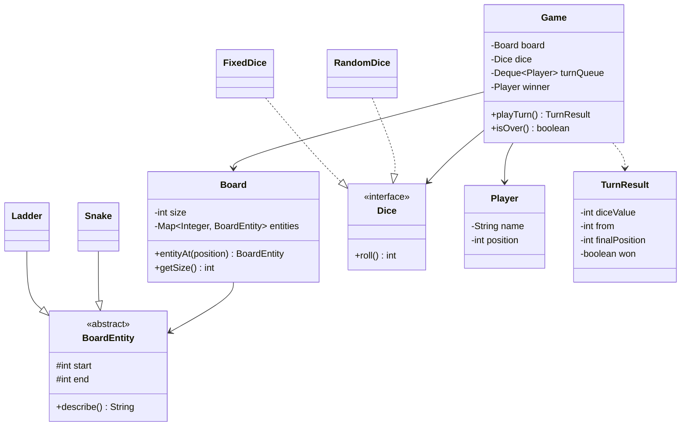

<div align="center">

# 🐍 Design Snake and Ladder

   

*Players roll dice and race to the last cell; snakes pull them down and ladders lift them up.*

</div>

---

## 📑 Table of contents

- [🎯 Problem statement](#-problem-statement)
- [🧩 Requirements & approach](#-requirements--approach)
- [🔷 Class diagram](#-class-diagram)
- [👥 Classes & responsibilities](#-classes--responsibilities)
- [🧭 Design patterns & principles used](#-design-patterns--principles-used)
- [📊 Strengths & limitations](#-strengths--limitations)
- [🌍 Follow-up interview questions](#-follow-up-interview-questions)
- [💻 Code](#-code)
  - [1. Implementation](#ex1)

---

## 🎯 Problem statement

> Design a **Snake and Ladder** game. Two or more players take turns rolling a dice and moving forward. Landing on a snake head moves the player down to its tail, landing on a ladder bottom moves the player up to its top. The first player to reach the last cell wins.

## 🧩 Requirements & approach

| 📋 Requirements | 🛠️ Design approach |
|---|---|
| 1. Configurable board size, snakes and ladders<br>2. Two or more players take turns in a fixed order<br>3. A turn: roll, move, apply a snake or ladder<br>4. Finish needs an **exact** roll; an overshoot wastes the turn<br>5. Reject invalid boards (a snake that goes up, two entities on one cell, out of range)<br>6. The dice must be replaceable so games are testable | `Board` knows the size and the snakes and ladders, but nothing about players or dice. `Dice` is an interface with a `RandomDice` for play and a `FixedDice` for tests. `Game` keeps a queue of players, runs `playTurn()` and returns a `TurnResult`. Snakes and ladders share the `BoardEntity` base class because they behave the same: start to end. |

## 🔷 Class diagram



## 👥 Classes & responsibilities

| Class / interface | Responsibility | Kind |
|---|---|---|
| **`Game`** | Turn queue, rolls the dice, moves the player, applies snake or ladder, detects the winner | class |
| **`Board`** | Size plus a map from cell to snake or ladder; validates every entity | class |
| **`BoardEntity`** | A jump from `start` to `end` | abstract class |
| **`Snake`** | Head above tail, moves a player down | class |
| **`Ladder`** | Bottom below top, moves a player up | class |
| **`Dice`** | Anything that can roll a number | interface |
| **`RandomDice`** | Sum of `count` random dice (6 sided), the `Random` is injected so a seed reproduces a game | class |
| **`FixedDice`** | Returns a scripted sequence: used for tests and the first demo | class |
| **`Player`** | A name and the current position (0 = not started) | class |
| **`TurnResult`** | What happened in a turn: roll, from, landing cell, jump, win | class |
| **`Main`** | Scenario A: 20 cells with scripted dice. Scenario B: classic 100 cells with a seeded random dice. Also shows invalid boards | demo |

## 🧭 Design patterns & principles used

| Pattern / principle | Where and why |
|---|---|
| **Polymorphism / inheritance** | `Snake` and `Ladder` extend `BoardEntity`, so the board treats them identically with one map lookup |
| **Strategy (dependency injection)** | `Dice` is injected into `Game`: random in production, fixed values in tests |
| **Single Responsibility principle** | `Board` holds the layout, `Game` runs turns, `Dice` rolls, `TurnResult` reports |
| **Open/Closed principle** | A new cell type (for example a trampoline) is a new `BoardEntity`; `Game` is unchanged |
| **Fail fast validation** | Invalid snakes, ladders and clashes are rejected when the board is built, not in the middle of a game |

## 📊 Strengths & limitations

| 👍 Strengths | 👎 Limitations |
|---|---|
| Dice is injectable, so games are deterministic and easy to test | A jump is applied once only (no chaining), a snake tail on a ladder foot does not climb again |
| Snakes and ladders are handled uniformly through `BoardEntity` | Does not detect impossible boards, such as a ladder cycle that blocks the finish |
| `Board` validates its entities up front | No extra turn on rolling a six, no multiple dice per turn by default |
| `TurnResult` keeps printing out of the game logic | Not thread safe: one thread should drive `playTurn()` |

## 🌍 Follow-up interview questions

- **How would you allow an extra turn on a six?** In `playTurn()`, if the roll is 6, put the player back at the front of the queue (`addFirst`) instead of the end. Optionally cap it at three sixes.
- **How would you support two dice?** `RandomDice(2, random)` already sums two dice. `Game` does not change because it only calls `roll()`.
- **What if jumps could chain?** Replace the single lookup by a loop: while `entityAt(position)` is not null, move to its end. Add a visited set to detect cycles.
- **How do you generate a random valid board?** Pick unique start cells, make snakes go down and ladders go up, avoid cell 1 and the last cell, and avoid two entities on one cell. Then check the last cell is still reachable.
- **How do you test it?** Inject `FixedDice` with a known sequence and assert the positions and the winner. No randomness involved.
- **What is the exact finish rule and how would you change it?** Now an overshoot wastes the turn. To allow a bounce back, compute `size - (target - size)` in `playTurn()`. Put it behind a rule object if both must be supported.
- **How would you handle many concurrent games?** One `Game` per match, each with its own queue. Guard `playTurn()` with a lock per game and store games by id in a concurrent map.

---

## 💻 Code

This folder has **1 example** (11 Java files). Interfaces and abstract classes come first, the class with `main` comes last.

<a id="ex1"></a>

### 1. Implementation

<details open>
<summary><b>📁 Files in this example</b></summary>

```text
2. Snake and Ladder/
├── Board.java
├── BoardEntity.java
├── Dice.java
├── FixedDice.java
├── Game.java
├── Ladder.java
├── Main.java
├── Player.java
├── RandomDice.java
├── Snake.java
└── TurnResult.java
```

</details>

#### 📄 `BoardEntity.java`

<sub>abstract class · 16 lines</sub>

```java
// A snake or a ladder: if you land on `start`, you are moved to `end`
public abstract class BoardEntity {
    protected final int start;
    protected final int end;

    protected BoardEntity(int start, int end) {
        this.start = start;
        this.end = end;
    }

    public int getStart() { return start; }

    public int getEnd() { return end; }

    public abstract String describe();
}
```

#### 📄 `Dice.java`

<sub>interface · 3 lines</sub>

```java
public interface Dice {
    int roll();
}
```

#### 📄 `Board.java`

<sub>class · 36 lines</sub>

```java
import java.util.HashMap;
import java.util.List;
import java.util.Map;

// Knows the size and where snakes and ladders are. It does not know about players or dice.
public class Board {
    private final int size;
    private final Map<Integer, BoardEntity> entities = new HashMap<>();

    public Board(int size, List<BoardEntity> boardEntities) {
        if (size < 2) {
            throw new IllegalArgumentException("Board needs at least 2 cells");
        }
        this.size = size;
        for (BoardEntity entity : boardEntities) {
            validate(entity);
            entities.put(entity.getStart(), entity);
        }
    }

    private void validate(BoardEntity e) {
        if (e.getStart() < 2 || e.getStart() >= size || e.getEnd() < 1 || e.getEnd() > size) {
            throw new IllegalArgumentException("Entity is outside the board: " + e.getStart() + "->" + e.getEnd());
        }
        if (entities.containsKey(e.getStart())) {
            throw new IllegalArgumentException("Two entities start on cell " + e.getStart());
        }
    }

    public int getSize() { return size; }

    // One jump only: a snake that drops you on a ladder's foot does not chain
    public BoardEntity entityAt(int position) {
        return entities.get(position);
    }
}
```

#### 📄 `FixedDice.java`

<sub>class · 17 lines</sub>

```java
// Returns a scripted sequence of values: perfect for tests and demos
public class FixedDice implements Dice {
    private final int[] values;
    private int next = 0;

    public FixedDice(int... values) {
        this.values = values;
    }

    @Override
    public int roll() {
        if (next >= values.length) {
            throw new IllegalStateException("FixedDice ran out of values");
        }
        return values[next++];
    }
}
```

#### 📄 `Game.java`

<sub>class · 52 lines</sub>

```java
import java.util.ArrayDeque;
import java.util.Deque;
import java.util.List;

// Runs the turns: roll, move, apply snake/ladder, check for the win, rotate the queue.
public class Game {
    private final Board board;
    private final Dice dice;
    private final Deque<Player> turnQueue = new ArrayDeque<>();
    private Player winner;

    public Game(Board board, Dice dice, List<Player> players) {
        if (players.size() < 2) {
            throw new IllegalArgumentException("At least two players are needed");
        }
        this.board = board;
        this.dice = dice;
        turnQueue.addAll(players);
    }

    public boolean isOver() { return winner != null; }

    public Player getWinner() { return winner; }

    public TurnResult playTurn() {
        if (isOver()) {
            throw new IllegalStateException("The game is already over");
        }
        Player player = turnQueue.pollFirst();
        int roll = dice.roll();
        int from = player.getPosition();
        int target = from + roll;

        // exact finish: an overshooting roll is wasted
        if (target > board.getSize()) {
            turnQueue.addLast(player);
            return new TurnResult(player, roll, from, from, from, null, false, false);
        }

        BoardEntity entity = board.entityAt(target);
        int finalPosition = entity == null ? target : entity.getEnd();
        player.setPosition(finalPosition);

        boolean won = finalPosition == board.getSize();
        if (won) {
            winner = player;
        } else {
            turnQueue.addLast(player);
        }
        return new TurnResult(player, roll, from, target, finalPosition, entity, true, won);
    }
}
```

#### 📄 `Ladder.java`

<sub>class · 15 lines</sub>

```java
// Bottom (start) is lower than the top (end): it takes you up
public class Ladder extends BoardEntity {

    public Ladder(int bottom, int top) {
        super(bottom, top);
        if (bottom >= top) {
            throw new IllegalArgumentException("Ladder top must be above its bottom: " + bottom + "->" + top);
        }
    }

    @Override
    public String describe() {
        return "climbed a ladder";
    }
}
```

#### 📄 `Player.java`

<sub>class · 14 lines</sub>

```java
public class Player {
    private final String name;
    private int position = 0;     // 0 = not on the board yet

    public Player(String name) {
        this.name = name;
    }

    public String getName() { return name; }

    public int getPosition() { return position; }

    public void setPosition(int position) { this.position = position; }
}
```

#### 📄 `RandomDice.java`

<sub>class · 21 lines</sub>

```java
import java.util.Random;

// Sum of `count` dice, each 1..6. The Random is injected so games can be reproduced.
public class RandomDice implements Dice {
    private final int count;
    private final Random random;

    public RandomDice(int count, Random random) {
        this.count = count;
        this.random = random;
    }

    @Override
    public int roll() {
        int total = 0;
        for (int i = 0; i < count; i++) {
            total += random.nextInt(6) + 1;
        }
        return total;
    }
}
```

#### 📄 `Snake.java`

<sub>class · 15 lines</sub>

```java
// Head (start) is higher than the tail (end): it takes you down
public class Snake extends BoardEntity {

    public Snake(int head, int tail) {
        super(head, tail);
        if (head <= tail) {
            throw new IllegalArgumentException("Snake head must be above its tail: " + head + "->" + tail);
        }
    }

    @Override
    public String describe() {
        return "bitten by a snake";
    }
}
```

#### 📄 `TurnResult.java`

<sub>class · 43 lines</sub>

```java
// What happened in one turn, so the caller can print or assert on it
public class TurnResult {
    private final Player player;
    private final int diceValue;
    private final int from;
    private final int landedOn;
    private final int finalPosition;
    private final BoardEntity entity;
    private final boolean moved;
    private final boolean won;

    public TurnResult(Player player, int diceValue, int from, int landedOn,
                      int finalPosition, BoardEntity entity, boolean moved, boolean won) {
        this.player = player;
        this.diceValue = diceValue;
        this.from = from;
        this.landedOn = landedOn;
        this.finalPosition = finalPosition;
        this.entity = entity;
        this.moved = moved;
        this.won = won;
    }

    public boolean isWon() { return won; }

    public Player getPlayer() { return player; }

    @Override
    public String toString() {
        StringBuilder sb = new StringBuilder(player.getName() + " rolled " + diceValue);
        if (!moved) {
            return sb.append(" and stays on ").append(from).append(" (needs an exact roll)").toString();
        }
        sb.append(": ").append(from).append(" -> ").append(landedOn);
        if (entity != null) {
            sb.append(", ").append(entity.describe()).append(" -> ").append(finalPosition);
        }
        if (won) {
            sb.append("  WINS!");
        }
        return sb.toString();
    }
}
```

#### 📄 `Main.java`

<sub>class · 66 lines</sub>

```java
import java.util.ArrayList;
import java.util.Arrays;
import java.util.List;
import java.util.Random;

public class Main {
    public static void main(String[] args) {

        // ---------- Scenario A: small board, scripted dice ----------
        System.out.println("=== Scenario A: 20 cells, scripted dice ===");
        List<BoardEntity> small = new ArrayList<>();
        small.add(new Ladder(3, 12));
        small.add(new Snake(17, 4));

        Game gameA = new Game(
                new Board(20, small),
                new FixedDice(3, 6, 5, 6, 6, 6, 6, 3, 4),
                Arrays.asList(new Player("Alice"), new Player("Bob")));
        play(gameA);

        // ---------- Scenario B: classic 100 cells, seeded random dice ----------
        System.out.println("\n=== Scenario B: 100 cells, random dice (seed 42) ===");
        List<BoardEntity> classic = new ArrayList<>();
        classic.add(new Snake(17, 7));
        classic.add(new Snake(54, 34));
        classic.add(new Snake(62, 19));
        classic.add(new Snake(98, 79));
        classic.add(new Ladder(3, 22));
        classic.add(new Ladder(5, 8));
        classic.add(new Ladder(11, 26));
        classic.add(new Ladder(20, 29));

        Game gameB = new Game(
                new Board(100, classic),
                new RandomDice(1, new Random(42)),
                Arrays.asList(new Player("Alice"), new Player("Bob"), new Player("Carol")));
        int turns = play(gameB);
        System.out.println("Game finished in " + turns + " turns");

        // ---------- Bad boards are rejected ----------
        System.out.println("\n=== Invalid boards ===");
        try {
            new Snake(5, 9);
        } catch (IllegalArgumentException e) {
            System.out.println("Rejected: " + e.getMessage());
        }
        try {
            List<BoardEntity> clash = new ArrayList<>();
            clash.add(new Ladder(3, 12));
            clash.add(new Snake(3, 1));
            new Board(20, clash);
        } catch (IllegalArgumentException e) {
            System.out.println("Rejected: " + e.getMessage());
        }
    }

    private static int play(Game game) {
        int turns = 0;
        while (!game.isOver()) {
            System.out.println(game.playTurn());
            turns++;
        }
        System.out.println("Winner: " + game.getWinner().getName());
        return turns;
    }
}
```

<details>
<summary><b>▶️ How to compile and run this example</b></summary>

```bash
# run from the repository root
mkdir -p out
find "Interview Questions/2. Snake and Ladder" -name "*.java" -print0 | xargs -0 javac -d out
java -cp out Main
```

</details>

---

<div align="center">

[◀ Tic Tac Toe](../1.%20Tic%20Tac%20Toe/README.md) &nbsp;·&nbsp; [📚 All questions](../QUESTIONS.md)

</div>
