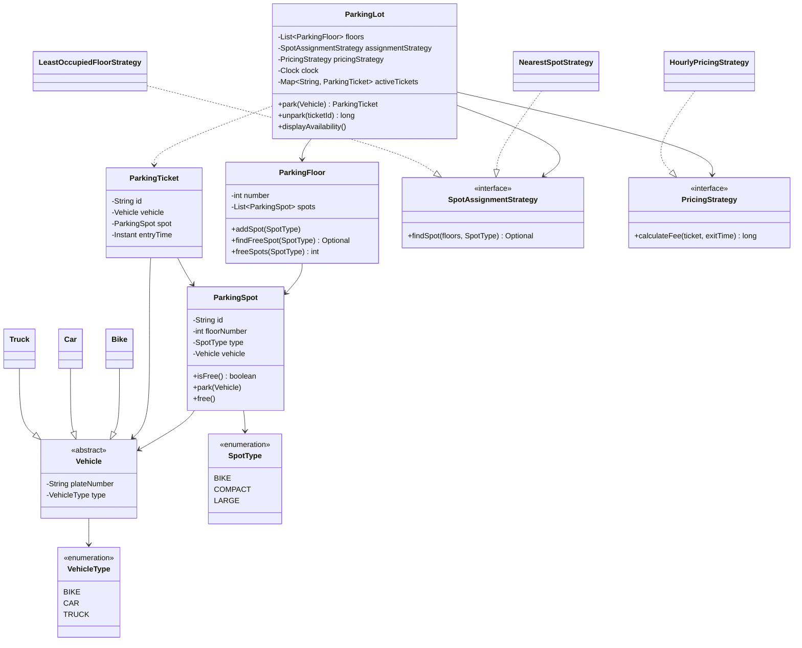

<div align="center">

# 🅿️ Design a Parking Lot

   

*Vehicles get a ticket and a spot of the right size on entry, and pay by parked time on exit.*

</div>

---

## 📑 Table of contents

- [🎯 Problem statement](#-problem-statement)
- [🧩 Requirements & approach](#-requirements--approach)
- [🔷 Class diagram](#-class-diagram)
- [👥 Classes & responsibilities](#-classes--responsibilities)
- [🧭 Design patterns & principles used](#-design-patterns--principles-used)
- [📊 Strengths & limitations](#-strengths--limitations)
- [🌍 Follow-up interview questions](#-follow-up-interview-questions)
- [💻 Code](#-code)
  - [1. Implementation](#ex1)

---

## 🎯 Problem statement

> Design a **multi-floor Parking Lot**. A vehicle (bike, car or truck) enters, gets a free spot of the matching size and a ticket. On exit it hands back the ticket, the fee is calculated from the time parked, and the spot becomes free again.

## 🧩 Requirements & approach

| 📋 Requirements | 🛠️ Design approach |
|---|---|
| 1. Several floors, each with bike, compact and large spots<br>2. Bike needs a bike spot, car a compact spot, truck a large spot<br>3. Entry issues a ticket; exit takes the ticket back and returns the fee<br>4. Fee depends on the vehicle type and the hours parked<br>5. Say clearly when no spot is free; reject an invalid or reused ticket<br>6. How the spot is chosen and how the fee is calculated must be replaceable<br>7. Two gates can work at the same time without double booking a spot | `ParkingLot` is the only entry point (`park` and `unpark`). It does not decide the spot or the price itself: it asks an injected `SpotAssignmentStrategy` and `PricingStrategy`. Floors own spots, spots know if they are free, and a `ParkingTicket` links vehicle, spot and entry time. Time comes from an injected `Clock`, so fees are testable. `park` and `unpark` are `synchronized` so two gates never get the same spot. The code is split into folders (`entities`, `enums`, `exceptions`, `strategy`, `service`, `util`) and `Main`, the client, sits outside them. |

## 🔷 Class diagram



## 👥 Classes & responsibilities

| Class / interface | Responsibility | Kind · folder |
|---|---|---|
| **`ParkingLot`** | Entry and exit gate logic: finds a spot, issues the ticket, charges the fee, frees the spot (thread safe) | service class · `service/` |
| **`ParkingFloor`** | Owns its spots, finds a free spot of a type, counts free spots | class · `entities/` |
| **`ParkingSpot`** | One slot: type, floor and the parked vehicle (if any) | class · `entities/` |
| **`ParkingTicket`** | Links vehicle, spot and entry time | class · `entities/` |
| **`Vehicle`, `Bike`, `Car`, `Truck`** | A vehicle with a plate number and a type | abstract class + subclasses · `entities/` |
| **`SpotAssignmentStrategy`** | Which free spot should this vehicle get? | interface · `strategy/` |
| **`NearestSpotStrategy`** | First free spot from the lowest floor | class · `strategy/` |
| **`LeastOccupiedFloorStrategy`** | Floor with the most free spots of that type, to spread the load | class · `strategy/` |
| **`PricingStrategy`** | How much does this ticket cost at exit time? | interface · `strategy/` |
| **`HourlyPricingStrategy`** | Rate per hour per vehicle type, every started hour charged, minimum one hour | class · `strategy/` |
| **`VehicleType`, `SpotType`** | Type safe kinds; `SpotType.forVehicle` maps a vehicle to its spot size | enums · `enums/` |
| **`ParkingFullException`, `InvalidTicketException`** | No spot available; unknown or already used ticket | runtime exceptions · `exceptions/` |
| **`ManualClock`** | A clock moved by hand so fees can be tested without waiting | test helper · `util/` |
| **`Main`** | Two lots with different strategies: parks, fills the lot, exits with fees, reuses a spot, rejects a used ticket | demo · client, outside the packages |

## 🧭 Design patterns & principles used

| Pattern / principle | Where and why |
|---|---|
| **Strategy** | `SpotAssignmentStrategy` and `PricingStrategy`: spot choice and pricing change without touching `ParkingLot` |
| **Inheritance / polymorphism** | `Bike`, `Car` and `Truck` extend `Vehicle`; the lot only works with `Vehicle` |
| **Dependency Injection** | Strategies and the `Clock` are passed in, so tests and variants are easy |
| **Open/Closed principle** | New spot rule or new pricing (peak hours, daily cap) is a new class, `ParkingLot` is not edited |
| **Single Responsibility principle** | Floor finds spots, ticket records, strategies decide, the lot coordinates |
| **Singleton (optional)** | A real system has one `ParkingLot` per building; here it is created in `Main` and passed around, which keeps tests simple |

## 📊 Strengths & limitations

| 👍 Strengths | 👎 Limitations |
|---|---|
| Spot choice and pricing are pluggable (shown by running the same lot with two spot strategies) | A vehicle can only use its own spot size (a bike cannot take a compact spot) |
| Fees are testable thanks to the injected `Clock` | One lock for the whole lot: fine for one building, a bottleneck at scale |
| Clear errors for a full lot and for an invalid or reused ticket | Finding a spot scans the floors (`O(spots)`); per type free lists would make it `O(1)` |
| Prevents the same vehicle from being parked twice | No payment step, lost ticket handling or persistence |
| Thread safe at the lot level |  |

## 🌍 Follow-up interview questions

- **What if a bike could use a bigger spot when bike spots are full?** Let `SpotType` return an ordered list of acceptable types (BIKE, COMPACT, LARGE) and have the strategy try them in order.
- **How would you add peak hour or daily cap pricing?** Implement `PricingStrategy` again. The lot is not edited (Open/Closed).
- **How do you handle many entry and exit gates at once?** `park` and `unpark` are synchronized. For more throughput, lock per spot type or keep a concurrent queue of free spots per type and take from it atomically.
- **How do you find a free spot in `O(1)`?** Keep a queue (or set) of free spots per floor and per type. Take from it on park, add back on unpark.
- **How would you add a display board or alerts when the lot is full?** Observer pattern: the lot publishes events and boards or mobile apps subscribe.
- **How would you add payment (cash, card, UPI)?** A `PaymentStrategy` called in `unpark` before the spot is freed; on failure the ticket stays active.
- **How would you support EV charging spots or reserved spots?** Add new `SpotType` values and a `Vehicle` flag; reservation is a spot state plus an expiry time.
- **What if the ticket is lost?** Look up the active ticket by plate number and charge a penalty or the maximum daily fee.
- **Why inject the `Clock`?** `Instant.now()` inside the code makes fees impossible to test. A `ManualClock` lets a test jump forward by hours.

---

## 💻 Code

This folder has **1 example** (19 Java files). Interfaces and abstract classes come first, the class with `main` comes last.

<a id="ex1"></a>

### 1. Implementation

<details open>
<summary><b>📁 Files in this example</b></summary>

```text
3. Parking Lot/
├── entities/
│   ├── Bike.java
│   ├── Car.java
│   ├── ParkingFloor.java
│   ├── ParkingSpot.java
│   ├── ParkingTicket.java
│   ├── Truck.java
│   └── Vehicle.java
├── enums/
│   ├── SpotType.java
│   └── VehicleType.java
├── exceptions/
│   ├── InvalidTicketException.java
│   └── ParkingFullException.java
├── service/
│   └── ParkingLot.java
├── strategy/
│   ├── HourlyPricingStrategy.java
│   ├── LeastOccupiedFloorStrategy.java
│   ├── NearestSpotStrategy.java
│   ├── PricingStrategy.java
│   └── SpotAssignmentStrategy.java
├── util/
│   └── ManualClock.java
└── Main.java
```

</details>

#### 📄 `entities/Vehicle.java`

<sub>abstract class · 22 lines</sub>

```java
package entities;

import enums.VehicleType;

public abstract class Vehicle {
    private final String plateNumber;
    private final VehicleType type;

    protected Vehicle(String plateNumber, VehicleType type) {
        this.plateNumber = plateNumber;
        this.type = type;
    }

    public String getPlateNumber() { return plateNumber; }

    public VehicleType getType() { return type; }

    @Override
    public String toString() {
        return type + " " + plateNumber;
    }
}
```

#### 📄 `enums/SpotType.java`

<sub>enum · 19 lines</sub>

```java
package enums;

// The size of a spot. Each vehicle type needs one spot type.
public enum SpotType {
    BIKE,
    COMPACT,
    LARGE;

    public static SpotType forVehicle(VehicleType vehicleType) {
        switch (vehicleType) {
            case BIKE:
                return BIKE;
            case CAR:
                return COMPACT;
            default:
                return LARGE;
        }
    }
}
```

#### 📄 `enums/VehicleType.java`

<sub>enum · 7 lines</sub>

```java
package enums;

public enum VehicleType {
    BIKE,
    CAR,
    TRUCK
}
```

#### 📄 `strategy/PricingStrategy.java`

<sub>interface · 10 lines</sub>

```java
package strategy;

import entities.ParkingTicket;

import java.time.Instant;

// Strategy: how much does this ticket cost at exit time?
public interface PricingStrategy {
    long calculateFee(ParkingTicket ticket, Instant exitTime);
}
```

#### 📄 `strategy/SpotAssignmentStrategy.java`

<sub>interface · 13 lines</sub>

```java
package strategy;

import entities.ParkingFloor;
import entities.ParkingSpot;
import enums.SpotType;

import java.util.List;
import java.util.Optional;

// Strategy: which free spot should this vehicle get?
public interface SpotAssignmentStrategy {
    Optional<ParkingSpot> findSpot(List<ParkingFloor> floors, SpotType type);
}
```

#### 📄 `entities/Bike.java`

<sub>class · 10 lines</sub>

```java
package entities;

import enums.VehicleType;

public class Bike extends Vehicle {

    public Bike(String plateNumber) {
        super(plateNumber, VehicleType.BIKE);
    }
}
```

#### 📄 `entities/Car.java`

<sub>class · 10 lines</sub>

```java
package entities;

import enums.VehicleType;

public class Car extends Vehicle {

    public Car(String plateNumber) {
        super(plateNumber, VehicleType.CAR);
    }
}
```

#### 📄 `entities/ParkingFloor.java`

<sub>class · 52 lines</sub>

```java
package entities;

import enums.SpotType;

import java.util.ArrayList;
import java.util.List;
import java.util.Optional;

public class ParkingFloor {
    private final int number;
    private final List<ParkingSpot> spots = new ArrayList<>();

    public ParkingFloor(int number) {
        this.number = number;
    }

    public int getNumber() { return number; }

    public void addSpot(SpotType type) {
        String id = "F" + number + "-" + type.name().charAt(0) + (countOfType(type) + 1);
        spots.add(new ParkingSpot(id, number, type));
    }

    public Optional<ParkingSpot> findFreeSpot(SpotType type) {
        for (ParkingSpot spot : spots) {
            if (spot.getType() == type && spot.isFree()) {
                return Optional.of(spot);
            }
        }
        return Optional.empty();
    }

    public int freeSpots(SpotType type) {
        int count = 0;
        for (ParkingSpot spot : spots) {
            if (spot.getType() == type && spot.isFree()) {
                count++;
            }
        }
        return count;
    }

    private int countOfType(SpotType type) {
        int count = 0;
        for (ParkingSpot spot : spots) {
            if (spot.getType() == type) {
                count++;
            }
        }
        return count;
    }
}
```

#### 📄 `entities/ParkingSpot.java`

<sub>class · 35 lines</sub>

```java
package entities;

import enums.SpotType;

public class ParkingSpot {
    private final String id;
    private final int floorNumber;
    private final SpotType type;
    private Vehicle vehicle;          // null when the spot is free

    public ParkingSpot(String id, int floorNumber, SpotType type) {
        this.id = id;
        this.floorNumber = floorNumber;
        this.type = type;
    }

    public String getId() { return id; }

    public int getFloorNumber() { return floorNumber; }

    public SpotType getType() { return type; }

    public boolean isFree() { return vehicle == null; }

    public void park(Vehicle vehicle) {
        if (!isFree()) {
            throw new IllegalStateException("Spot " + id + " is already taken");
        }
        this.vehicle = vehicle;
    }

    public void free() {
        this.vehicle = null;
    }
}
```

#### 📄 `entities/ParkingTicket.java`

<sub>class · 31 lines</sub>

```java
package entities;

import java.time.Instant;

// Issued at the entry gate, handed back at the exit gate
public class ParkingTicket {
    private final String id;
    private final Vehicle vehicle;
    private final ParkingSpot spot;
    private final Instant entryTime;

    public ParkingTicket(String id, Vehicle vehicle, ParkingSpot spot, Instant entryTime) {
        this.id = id;
        this.vehicle = vehicle;
        this.spot = spot;
        this.entryTime = entryTime;
    }

    public String getId() { return id; }

    public Vehicle getVehicle() { return vehicle; }

    public ParkingSpot getSpot() { return spot; }

    public Instant getEntryTime() { return entryTime; }

    @Override
    public String toString() {
        return "Ticket " + id + " [" + vehicle + " -> spot " + spot.getId() + "]";
    }
}
```

#### 📄 `entities/Truck.java`

<sub>class · 10 lines</sub>

```java
package entities;

import enums.VehicleType;

public class Truck extends Vehicle {

    public Truck(String plateNumber) {
        super(plateNumber, VehicleType.TRUCK);
    }
}
```

#### 📄 `exceptions/InvalidTicketException.java`

<sub>class · 7 lines</sub>

```java
package exceptions;

public class InvalidTicketException extends RuntimeException {
    public InvalidTicketException(String message) {
        super(message);
    }
}
```

#### 📄 `exceptions/ParkingFullException.java`

<sub>class · 7 lines</sub>

```java
package exceptions;

public class ParkingFullException extends RuntimeException {
    public ParkingFullException(String message) {
        super(message);
    }
}
```

#### 📄 `service/ParkingLot.java`

<sub>class · 75 lines</sub>

```java
package service;

import entities.ParkingFloor;
import entities.ParkingSpot;
import entities.ParkingTicket;
import entities.Vehicle;
import enums.SpotType;
import exceptions.InvalidTicketException;
import exceptions.ParkingFullException;
import strategy.PricingStrategy;
import strategy.SpotAssignmentStrategy;

import java.time.Clock;
import java.util.HashMap;
import java.util.HashSet;
import java.util.List;
import java.util.Map;
import java.util.Set;

// Entry point of the system: park() at the entry gate, unpark() at the exit gate.
// The two decisions that vary (which spot, how much) are injected as strategies.
public class ParkingLot {
    private final List<ParkingFloor> floors;
    private final SpotAssignmentStrategy assignmentStrategy;
    private final PricingStrategy pricingStrategy;
    private final Clock clock;
    private final Map<String, ParkingTicket> activeTickets = new HashMap<>();
    private final Set<String> parkedPlates = new HashSet<>();
    private int ticketCounter = 0;

    public ParkingLot(List<ParkingFloor> floors, SpotAssignmentStrategy assignmentStrategy,
                      PricingStrategy pricingStrategy, Clock clock) {
        this.floors = floors;
        this.assignmentStrategy = assignmentStrategy;
        this.pricingStrategy = pricingStrategy;
        this.clock = clock;
    }

    // synchronized: two gates must never hand the same spot to two vehicles
    public synchronized ParkingTicket park(Vehicle vehicle) {
        if (parkedPlates.contains(vehicle.getPlateNumber())) {
            throw new IllegalStateException(vehicle + " is already parked");
        }
        SpotType needed = SpotType.forVehicle(vehicle.getType());
        ParkingSpot spot = assignmentStrategy.findSpot(floors, needed)
                .orElseThrow(() -> new ParkingFullException("No free " + needed + " spot for " + vehicle));

        spot.park(vehicle);
        ParkingTicket ticket = new ParkingTicket("T-" + (++ticketCounter), vehicle, spot, clock.instant());
        activeTickets.put(ticket.getId(), ticket);
        parkedPlates.add(vehicle.getPlateNumber());
        return ticket;
    }

    // returns the fee to pay and frees the spot
    public synchronized long unpark(String ticketId) {
        ParkingTicket ticket = activeTickets.remove(ticketId);
        if (ticket == null) {
            throw new InvalidTicketException("Unknown or already used ticket: " + ticketId);
        }
        long fee = pricingStrategy.calculateFee(ticket, clock.instant());
        ticket.getSpot().free();
        parkedPlates.remove(ticket.getVehicle().getPlateNumber());
        return fee;
    }

    public synchronized void displayAvailability() {
        for (ParkingFloor floor : floors) {
            System.out.println("  Floor " + floor.getNumber()
                    + ": BIKE " + floor.freeSpots(SpotType.BIKE)
                    + ", COMPACT " + floor.freeSpots(SpotType.COMPACT)
                    + ", LARGE " + floor.freeSpots(SpotType.LARGE) + " free");
        }
    }
}
```

#### 📄 `strategy/HourlyPricingStrategy.java`

<sub>class · 24 lines</sub>

```java
package strategy;

import entities.ParkingTicket;
import enums.VehicleType;

import java.time.Duration;
import java.time.Instant;
import java.util.Map;

// Rate per hour for each vehicle type; every started hour is charged, minimum one hour
public class HourlyPricingStrategy implements PricingStrategy {
    private final Map<VehicleType, Long> ratePerHour;

    public HourlyPricingStrategy(Map<VehicleType, Long> ratePerHour) {
        this.ratePerHour = ratePerHour;
    }

    @Override
    public long calculateFee(ParkingTicket ticket, Instant exitTime) {
        long minutes = Duration.between(ticket.getEntryTime(), exitTime).toMinutes();
        long hours = Math.max(1, (minutes + 59) / 60);
        return hours * ratePerHour.get(ticket.getVehicle().getType());
    }
}
```

#### 📄 `strategy/LeastOccupiedFloorStrategy.java`

<sub>class · 23 lines</sub>

```java
package strategy;

import entities.ParkingFloor;
import entities.ParkingSpot;
import enums.SpotType;

import java.util.List;
import java.util.Optional;

// Spreads vehicles out: picks the floor with the most free spots of the needed type
public class LeastOccupiedFloorStrategy implements SpotAssignmentStrategy {

    @Override
    public Optional<ParkingSpot> findSpot(List<ParkingFloor> floors, SpotType type) {
        ParkingFloor best = null;
        for (ParkingFloor floor : floors) {
            if (floor.freeSpots(type) > 0 && (best == null || floor.freeSpots(type) > best.freeSpots(type))) {
                best = floor;
            }
        }
        return best == null ? Optional.<ParkingSpot>empty() : best.findFreeSpot(type);
    }
}
```

#### 📄 `strategy/NearestSpotStrategy.java`

<sub>class · 23 lines</sub>

```java
package strategy;

import entities.ParkingFloor;
import entities.ParkingSpot;
import enums.SpotType;

import java.util.List;
import java.util.Optional;

// First free spot from the lowest floor: closest to the entry gate
public class NearestSpotStrategy implements SpotAssignmentStrategy {

    @Override
    public Optional<ParkingSpot> findSpot(List<ParkingFloor> floors, SpotType type) {
        for (ParkingFloor floor : floors) {
            Optional<ParkingSpot> spot = floor.findFreeSpot(type);
            if (spot.isPresent()) {
                return spot;
            }
        }
        return Optional.empty();
    }
}
```

#### 📄 `util/ManualClock.java`

<sub>class · 29 lines</sub>

```java
package util;

import java.time.Clock;
import java.time.Duration;
import java.time.Instant;
import java.time.ZoneId;
import java.time.ZoneOffset;

// A clock we can move by hand, so fees can be tested without waiting
public class ManualClock extends Clock {
    private Instant now;

    public ManualClock(Instant start) {
        this.now = start;
    }

    public void advance(Duration duration) {
        now = now.plus(duration);
    }

    @Override
    public Instant instant() { return now; }

    @Override
    public ZoneId getZone() { return ZoneOffset.UTC; }

    @Override
    public Clock withZone(ZoneId zone) { return this; }
}
```

#### 📄 `Main.java`

<sub>class · 100 lines</sub>

```java
import entities.Bike;
import entities.Car;
import entities.ParkingFloor;
import entities.ParkingTicket;
import entities.Truck;
import enums.SpotType;
import enums.VehicleType;
import exceptions.InvalidTicketException;
import exceptions.ParkingFullException;
import service.ParkingLot;
import strategy.HourlyPricingStrategy;
import strategy.LeastOccupiedFloorStrategy;
import strategy.NearestSpotStrategy;
import strategy.PricingStrategy;
import util.ManualClock;

import java.time.Duration;
import java.time.Instant;
import java.util.ArrayList;
import java.util.EnumMap;
import java.util.List;
import java.util.Map;

public class Main {
    public static void main(String[] args) {

        Map<VehicleType, Long> rates = new EnumMap<>(VehicleType.class);
        rates.put(VehicleType.BIKE, 20L);
        rates.put(VehicleType.CAR, 40L);
        rates.put(VehicleType.TRUCK, 100L);
        PricingStrategy pricing = new HourlyPricingStrategy(rates);

        // ---------- Lot 1: nearest spot first ----------
        System.out.println("=== Lot 1: nearest spot strategy ===");
        ManualClock clock = new ManualClock(Instant.parse("2026-01-01T09:00:00Z"));
        ParkingLot lot = new ParkingLot(buildFloors(), new NearestSpotStrategy(), pricing, clock);

        ParkingTicket bike = lot.park(new Bike("KA01-B-1"));
        ParkingTicket car1 = lot.park(new Car("KA01-C-1"));
        ParkingTicket car2 = lot.park(new Car("KA01-C-2"));
        ParkingTicket car3 = lot.park(new Car("KA01-C-3"));
        ParkingTicket truck = lot.park(new Truck("KA01-T-1"));
        for (ParkingTicket t : new ParkingTicket[]{bike, car1, car2, car3, truck}) {
            System.out.println("Issued " + t);
        }
        lot.displayAvailability();

        System.out.println("\n-- All compact spots are taken --");
        try {
            lot.park(new Car("KA01-C-4"));
        } catch (ParkingFullException e) {
            System.out.println("Rejected: " + e.getMessage());
        }

        System.out.println("\n-- Time passes, vehicles leave --");
        clock.advance(Duration.ofMinutes(150));
        System.out.println(car1.getVehicle() + " leaves after 2h30 -> fee " + lot.unpark(car1.getId()));
        clock.advance(Duration.ofMinutes(90));
        System.out.println(truck.getVehicle() + " leaves after 4h -> fee " + lot.unpark(truck.getId()));
        System.out.println(bike.getVehicle() + " leaves after 4h -> fee " + lot.unpark(bike.getId()));
        lot.displayAvailability();

        System.out.println("\n-- The freed compact spot is reused --");
        System.out.println("Issued " + lot.park(new Car("KA01-C-4")));

        System.out.println("\n-- Ticket cannot be used twice --");
        try {
            lot.unpark(car1.getId());
        } catch (InvalidTicketException e) {
            System.out.println("Rejected: " + e.getMessage());
        }

        // ---------- Lot 2: same code, different strategy ----------
        System.out.println("\n=== Lot 2: least occupied floor strategy ===");
        ParkingLot spread = new ParkingLot(buildFloors(), new LeastOccupiedFloorStrategy(), pricing, clock);
        for (int i = 1; i <= 3; i++) {
            System.out.println("Issued " + spread.park(new Car("KA02-C-" + i)));
        }
        spread.displayAvailability();
    }

    // Floor 1: 1 bike, 1 compact, 1 large.  Floor 2: 1 bike, 2 compact, 1 large.
    private static List<ParkingFloor> buildFloors() {
        ParkingFloor f1 = new ParkingFloor(1);
        f1.addSpot(SpotType.BIKE);
        f1.addSpot(SpotType.COMPACT);
        f1.addSpot(SpotType.LARGE);

        ParkingFloor f2 = new ParkingFloor(2);
        f2.addSpot(SpotType.BIKE);
        f2.addSpot(SpotType.COMPACT);
        f2.addSpot(SpotType.COMPACT);
        f2.addSpot(SpotType.LARGE);

        List<ParkingFloor> floors = new ArrayList<>();
        floors.add(f1);
        floors.add(f2);
        return floors;
    }
}
```

<details>
<summary><b>▶️ How to compile and run this example</b></summary>

```bash
# run from the repository root
mkdir -p out
find "Interview Questions/3. Parking Lot" -name "*.java" -print0 | xargs -0 javac -d out
java -cp out Main
```

</details>

---

<div align="center">

[◀ Snake and Ladder](../2.%20Snake%20and%20Ladder/README.md) &nbsp;·&nbsp; [📚 All questions](../QUESTIONS.md) &nbsp;·&nbsp; [Elevator ▶](../4.%20Elevator/README.md)

</div>
