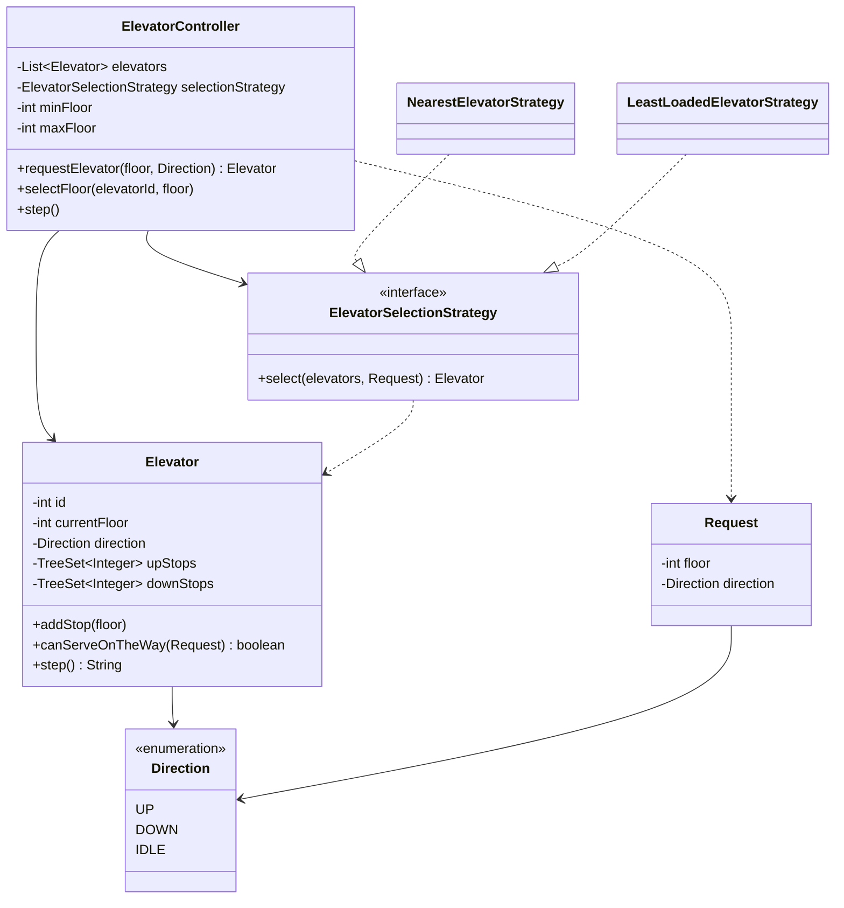

<div align="center">

# 🛗 Design an Elevator System

   

*A controller dispatches hall calls to the best of several elevators using the LOOK algorithm.*

</div>

---

## 📑 Table of contents

- [🎯 Problem statement](#-problem-statement)
- [🧩 Requirements & approach](#-requirements--approach)
- [🔷 Class diagram](#-class-diagram)
- [👥 Classes & responsibilities](#-classes--responsibilities)
- [🧭 Design patterns & principles used](#-design-patterns--principles-used)
- [📊 Strengths & limitations](#-strengths--limitations)
- [🌍 Follow-up interview questions](#-follow-up-interview-questions)
- [💻 Code](#-code)
  - [1. Implementation](#ex1)

---

## 🎯 Problem statement

> Design an **elevator system** for a building with several floors and several elevators. People press a hall button (UP/DOWN) outside, and a destination button inside the car. The system must pick a good elevator for each hall call and move every car efficiently without starving any request.

## 🧩 Requirements & approach

| 📋 Requirements | 🛠️ Design approach |
|---|---|
| 1. Several floors (0..N) and several elevator cars<br>2. A hall call has a floor and a direction (UP/DOWN); a car call has only a floor<br>3. Each elevator should serve its stops without reversing needlessly (the classic **LOOK** / elevator algorithm)<br>4. A moving elevator should pick up a call on its way if the direction matches<br>5. Reject calls for floors that do not exist, and a hall call with no direction<br>6. Which elevator answers a call must be replaceable (nearest car, least busy car, ...)<br>7. Multiple hall and car calls can arrive at the same time without corrupting a car's state | Each `Elevator` only tracks its own stops, split into an **up** set and a **down** set (sorted), and serves them with LOOK: keep going one way while stops remain that way, then flip. `ElevatorController` is the single entry point (`requestElevator`, `selectFloor`, `step`); it does not decide which car to send itself, it asks an injected `ElevatorSelectionStrategy`. The code is split into folders (`entities`, `enums`, `exceptions`, `strategy`, `service`) and `Main`, the client, sits outside them. |

## 🔷 Class diagram



## 👥 Classes & responsibilities

| Class / interface | Responsibility | Kind · folder |
|---|---|---|
| **`ElevatorController`** | Entry point: hall calls, car calls, and advancing every elevator by one tick (thread safe) | service class · `service/` |
| **`Elevator`** | One car: current floor, direction, and its own sorted up/down stop sets served by LOOK | class · `entities/` |
| **`Request`** | A hall call: floor plus UP or DOWN | class · `entities/` |
| **`ElevatorSelectionStrategy`** | Which elevator should answer this hall call? | interface · `strategy/` |
| **`NearestElevatorStrategy`** | Closest car that can pick the caller up on the way; otherwise the least busy car | class · `strategy/` |
| **`LeastLoadedElevatorStrategy`** | Fewest pending stops wins, distance only breaks ties | class · `strategy/` |
| **`Direction`** | UP, DOWN or IDLE | enum · `enums/` |
| **`InvalidFloorException`** | Signals a floor outside the building or a hall call with no direction | runtime exception · `exceptions/` |
| **`Main`** | Two elevators answer hall and car calls with the nearest strategy, then the same scenario with least-loaded | demo · client, outside the packages |

## 🧭 Design patterns & principles used

| Pattern / principle | Where and why |
|---|---|
| **Strategy** | `ElevatorSelectionStrategy`: which car answers a call changes without touching `ElevatorController` |
| **LOOK / elevator algorithm** | `Elevator.step()` keeps going one direction while stops remain, then reverses, instead of a naive nearest-stop scan |
| **Single Responsibility principle** | `Elevator` only moves and tracks its own stops; the controller only dispatches and ticks |
| **Dependency Injection** | The selection strategy is passed into the controller, so a new dispatch rule is a new class |
| **Encapsulation** | The up/down stop sets are private; everything outside only calls `addStop`, `canServeOnTheWay` and `step` |

## 📊 Strengths & limitations

| 👍 Strengths | 👎 Limitations |
|---|---|
| Elevators do not reverse needlessly: LOOK serves every stop in one pass per direction | No starvation guarantee: a far request can wait if closer ones keep arriving on a busy car |
| A moving car picks up a same-direction call on its way, instead of always sending an idle or new car | Capacity (max passengers/weight) is not modelled |
| Dispatch strategy is swappable and shown with two different ones on the same controller | `step()` simulates one floor per tick; door-open time and acceleration are not modelled |
| Invalid floors and malformed hall calls fail fast with a clear exception | One lock across the whole controller: fine for a single building, not for very high call rates |

## 🌍 Follow-up interview questions

- **How do you prevent starvation?** Track each request's wait time and give the selection strategy an ageing bonus, or force a car to detour after a wait threshold (SCAN with aging).
- **How would you add elevator capacity?** Give `Elevator` a passenger count and reject `addStop` for a hall call if the car is full; the hall call then waits for the next dispatch cycle.
- **How do you add an express or VIP elevator?** A new `Elevator` subtype that only serves a subset of floors, and a strategy that checks eligibility before calling `canServeOnTheWay`.
- **How would you simulate realistic timing (door open, acceleration)?** Make `step()` return a duration instead of a fixed tick, and drive the controller from a scheduler using that duration.
- **How do you scale to many elevators and floors?** Group elevators into banks per floor range, and keep per-bank controllers instead of one controller for the whole building.
- **How would you handle an elevator going out of service?** Remove it from the strategy's candidate list and have the controller push its pending stops to the other active elevators.
- **Why split stops into `upStops` and `downStops` instead of one list?** It mirrors LOOK directly: whichever set matches the current direction is consumed in order, no sorting or scanning the opposite direction needed.
- **How is this different from a naive 'always send the nearest idle elevator' design?** That design ignores moving elevators that are already heading the right way, causing extra idle cars to be dispatched; `canServeOnTheWay` fixes that.

---

## 💻 Code

This folder has **1 example** (9 Java files). Interfaces and abstract classes come first, the class with `main` comes last.

<a id="ex1"></a>

### 1. Implementation

<details open>
<summary><b>📁 Files in this example</b></summary>

```text
4. Elevator/
├── entities/
│   ├── Elevator.java
│   └── Request.java
├── enums/
│   └── Direction.java
├── exceptions/
│   └── InvalidFloorException.java
├── service/
│   └── ElevatorController.java
├── strategy/
│   ├── ElevatorSelectionStrategy.java
│   ├── LeastLoadedElevatorStrategy.java
│   └── NearestElevatorStrategy.java
└── Main.java
```

</details>

#### 📄 `enums/Direction.java`

<sub>enum · 7 lines</sub>

```java
package enums;

public enum Direction {
    UP,
    DOWN,
    IDLE
}
```

#### 📄 `strategy/ElevatorSelectionStrategy.java`

<sub>interface · 11 lines</sub>

```java
package strategy;

import entities.Elevator;
import entities.Request;

import java.util.List;

// Strategy: which elevator should answer this hall call?
public interface ElevatorSelectionStrategy {
    Elevator select(List<Elevator> elevators, Request request);
}
```

#### 📄 `entities/Elevator.java`

<sub>class · 88 lines</sub>

```java
package entities;

import enums.Direction;

import java.util.TreeSet;

// One car. It serves stops with the LOOK algorithm: keep going in one direction while there are
// stops ahead, then reverse. Stops are kept in two sorted sets so the next stop is found in O(log n).
public class Elevator {
    private final int id;
    private int currentFloor;
    private Direction direction = Direction.IDLE;
    private final TreeSet<Integer> upStops = new TreeSet<>();      // floors to visit while going up
    private final TreeSet<Integer> downStops = new TreeSet<>();    // floors to visit while going down

    public Elevator(int id, int startFloor) {
        this.id = id;
        this.currentFloor = startFloor;
    }

    public int getId() { return id; }

    public int getCurrentFloor() { return currentFloor; }

    public Direction getDirection() { return direction; }

    public int pendingStops() { return upStops.size() + downStops.size(); }

    // A floor above goes to the up set, below to the down set, the current floor to the set of the travel direction
    public void addStop(int floor) {
        if (floor > currentFloor || (floor == currentFloor && direction != Direction.DOWN)) {
            upStops.add(floor);
        } else {
            downStops.add(floor);
        }
    }

    // Would a hall call for (floor, direction) be picked up on the way, without reversing?
    public boolean canServeOnTheWay(Request request) {
        switch (direction) {
            case IDLE:
                return true;
            case UP:
                return request.getDirection() == Direction.UP && request.getFloor() >= currentFloor;
            default:
                return request.getDirection() == Direction.DOWN && request.getFloor() <= currentFloor;
        }
    }

    public int distanceTo(int floor) {
        return Math.abs(floor - currentFloor);
    }

    // One tick: either open the doors at a stop or move one floor. Returns what happened, or null if idle.
    public String step() {
        chooseDirection();
        if (direction == Direction.IDLE) {
            return null;
        }
        TreeSet<Integer> stops = direction == Direction.UP ? upStops : downStops;

        if (stops.remove(currentFloor)) {                      // a stop on the floor we are standing on
            return "Elevator " + id + ": doors open at floor " + currentFloor;
        }
        int from = currentFloor;
        currentFloor += direction == Direction.UP ? 1 : -1;
        String event = "Elevator " + id + ": " + from + " -> " + currentFloor + " (" + direction + ")";
        if (stops.remove(currentFloor)) {
            event += ", doors open";
        }
        return event;
    }

    private void chooseDirection() {
        if (direction == Direction.UP && upStops.isEmpty()) {
            direction = Direction.IDLE;
        } else if (direction == Direction.DOWN && downStops.isEmpty()) {
            direction = Direction.IDLE;
        }
        if (direction == Direction.IDLE) {                      // nothing ahead: take whatever is waiting
            if (!upStops.isEmpty()) {
                direction = Direction.UP;
            } else if (!downStops.isEmpty()) {
                direction = Direction.DOWN;
            }
        }
    }
}
```

#### 📄 `entities/Request.java`

<sub>class · 23 lines</sub>

```java
package entities;

import enums.Direction;

// A hall call: someone on `floor` pressed the UP or DOWN button
public class Request {
    private final int floor;
    private final Direction direction;

    public Request(int floor, Direction direction) {
        this.floor = floor;
        this.direction = direction;
    }

    public int getFloor() { return floor; }

    public Direction getDirection() { return direction; }

    @Override
    public String toString() {
        return "floor " + floor + " " + direction;
    }
}
```

#### 📄 `exceptions/InvalidFloorException.java`

<sub>class · 7 lines</sub>

```java
package exceptions;

public class InvalidFloorException extends RuntimeException {
    public InvalidFloorException(String message) {
        super(message);
    }
}
```

#### 📄 `service/ElevatorController.java`

<sub>class · 82 lines</sub>

```java
package service;

import entities.Elevator;
import entities.Request;
import enums.Direction;
import exceptions.InvalidFloorException;
import strategy.ElevatorSelectionStrategy;

import java.util.List;

// The panel of the building: hall calls come in through requestElevator(), the buttons inside a car through
// selectFloor(), and step() moves every elevator one tick. Which car answers a call is an injected strategy.
public class ElevatorController {
    private final List<Elevator> elevators;
    private final ElevatorSelectionStrategy selectionStrategy;
    private final int minFloor;
    private final int maxFloor;
    private int tick = 0;

    public ElevatorController(List<Elevator> elevators, ElevatorSelectionStrategy selectionStrategy, int minFloor, int maxFloor) {
        this.elevators = elevators;
        this.selectionStrategy = selectionStrategy;
        this.minFloor = minFloor;
        this.maxFloor = maxFloor;
    }

    // Hall call: someone outside pressed UP or DOWN
    public synchronized Elevator requestElevator(int floor, Direction direction) {
        checkFloor(floor);
        if (direction == Direction.IDLE) {
            throw new IllegalArgumentException("A hall call needs UP or DOWN");
        }
        if ((floor == maxFloor && direction == Direction.UP) || (floor == minFloor && direction == Direction.DOWN)) {
            throw new InvalidFloorException("No " + direction + " button on floor " + floor);
        }
        Request request = new Request(floor, direction);
        Elevator chosen = selectionStrategy.select(elevators, request);
        chosen.addStop(floor);
        System.out.println("Call at " + request + " -> elevator " + chosen.getId());
        return chosen;
    }

    // Destination button pressed inside an elevator
    public synchronized void selectFloor(int elevatorId, int floor) {
        checkFloor(floor);
        Elevator elevator = find(elevatorId);
        elevator.addStop(floor);
        System.out.println("Elevator " + elevatorId + ": passenger selects floor " + floor);
    }

    // Advance time by one tick and report what every moving elevator did
    public synchronized void step() {
        tick++;
        for (Elevator elevator : elevators) {
            String event = elevator.step();
            if (event != null) {
                System.out.println("  [t=" + tick + "] " + event);
            }
        }
    }

    public synchronized void run(int ticks) {
        for (int i = 0; i < ticks; i++) {
            step();
        }
    }

    private Elevator find(int id) {
        for (Elevator e : elevators) {
            if (e.getId() == id) {
                return e;
            }
        }
        throw new IllegalArgumentException("No elevator with id " + id);
    }

    private void checkFloor(int floor) {
        if (floor < minFloor || floor > maxFloor) {
            throw new InvalidFloorException("Floor " + floor + " does not exist (" + minFloor + ".." + maxFloor + ")");
        }
    }
}
```

#### 📄 `strategy/LeastLoadedElevatorStrategy.java`

<sub>class · 24 lines</sub>

```java
package strategy;

import entities.Elevator;
import entities.Request;

import java.util.List;

// Balances the work: fewest pending stops wins, the distance only breaks ties
public class LeastLoadedElevatorStrategy implements ElevatorSelectionStrategy {

    @Override
    public Elevator select(List<Elevator> elevators, Request request) {
        Elevator best = null;
        for (Elevator e : elevators) {
            if (best == null
                    || e.pendingStops() < best.pendingStops()
                    || (e.pendingStops() == best.pendingStops()
                        && e.distanceTo(request.getFloor()) < best.distanceTo(request.getFloor()))) {
                best = e;
            }
        }
        return best;
    }
}
```

#### 📄 `strategy/NearestElevatorStrategy.java`

<sub>class · 31 lines</sub>

```java
package strategy;

import entities.Elevator;
import entities.Request;

import java.util.List;

// Prefer the closest elevator that can pick the caller up on the way (idle, or already heading there in the
// same direction). If none can, fall back to the one with the fewest pending stops.
public class NearestElevatorStrategy implements ElevatorSelectionStrategy {

    @Override
    public Elevator select(List<Elevator> elevators, Request request) {
        Elevator best = null;
        for (Elevator e : elevators) {
            if (e.canServeOnTheWay(request)
                    && (best == null || e.distanceTo(request.getFloor()) < best.distanceTo(request.getFloor()))) {
                best = e;
            }
        }
        if (best != null) {
            return best;
        }
        for (Elevator e : elevators) {
            if (best == null || e.pendingStops() < best.pendingStops()) {
                best = e;
            }
        }
        return best;
    }
}
```

#### 📄 `Main.java`

<sub>class · 56 lines</sub>

```java
import entities.Elevator;
import enums.Direction;
import exceptions.InvalidFloorException;
import service.ElevatorController;
import strategy.LeastLoadedElevatorStrategy;
import strategy.NearestElevatorStrategy;

import java.util.ArrayList;
import java.util.List;

public class Main {
    public static void main(String[] args) {

        // ---------- Building with floors 0..10 and two elevators ----------
        System.out.println("=== Nearest elevator strategy (floors 0..10, elevator 1 at 0, elevator 2 at 8) ===");
        ElevatorController controller = new ElevatorController(cars(0, 8), new NearestElevatorStrategy(), 0, 10);

        controller.requestElevator(3, Direction.UP);       // elevator 1 is closer
        controller.requestElevator(6, Direction.DOWN);     // elevator 2 is closer
        controller.run(3);                                  // elevator 1 reaches floor 3, elevator 2 is on its way
        controller.selectFloor(1, 9);                       // the passenger at floor 3 wants floor 9

        System.out.println("\n-- A call arrives while elevator 1 is already going up: it picks the caller up on the way --");
        controller.requestElevator(5, Direction.UP);
        controller.run(2);
        controller.selectFloor(2, 1);                       // the passenger at floor 6 wants floor 1
        controller.run(8);

        System.out.println("\n-- Invalid requests --");
        try {
            controller.requestElevator(11, Direction.DOWN);
        } catch (InvalidFloorException e) {
            System.out.println("Rejected: " + e.getMessage());
        }
        try {
            controller.requestElevator(0, Direction.DOWN);
        } catch (InvalidFloorException e) {
            System.out.println("Rejected: " + e.getMessage());
        }

        // ---------- Same code, different strategy ----------
        System.out.println("\n=== Least loaded strategy (both elevators at floor 0) ===");
        ElevatorController balanced = new ElevatorController(cars(0, 0), new LeastLoadedElevatorStrategy(), 0, 10);
        balanced.requestElevator(4, Direction.UP);
        balanced.requestElevator(5, Direction.UP);
        balanced.requestElevator(6, Direction.UP);
        balanced.run(6);
    }

    private static List<Elevator> cars(int startOfFirst, int startOfSecond) {
        List<Elevator> list = new ArrayList<>();
        list.add(new Elevator(1, startOfFirst));
        list.add(new Elevator(2, startOfSecond));
        return list;
    }
}
```

<details>
<summary><b>▶️ How to compile and run this example</b></summary>

```bash
# run from the repository root
mkdir -p out
find "Interview Questions/4. Elevator" -name "*.java" -print0 | xargs -0 javac -d out
java -cp out Main
```

</details>

---

<div align="center">

[◀ Parking Lot](../3.%20Parking%20Lot/README.md) &nbsp;·&nbsp; [📚 All questions](../QUESTIONS.md) &nbsp;·&nbsp; [Car Rental ▶](../5.%20Car%20Rental/README.md)

</div>
