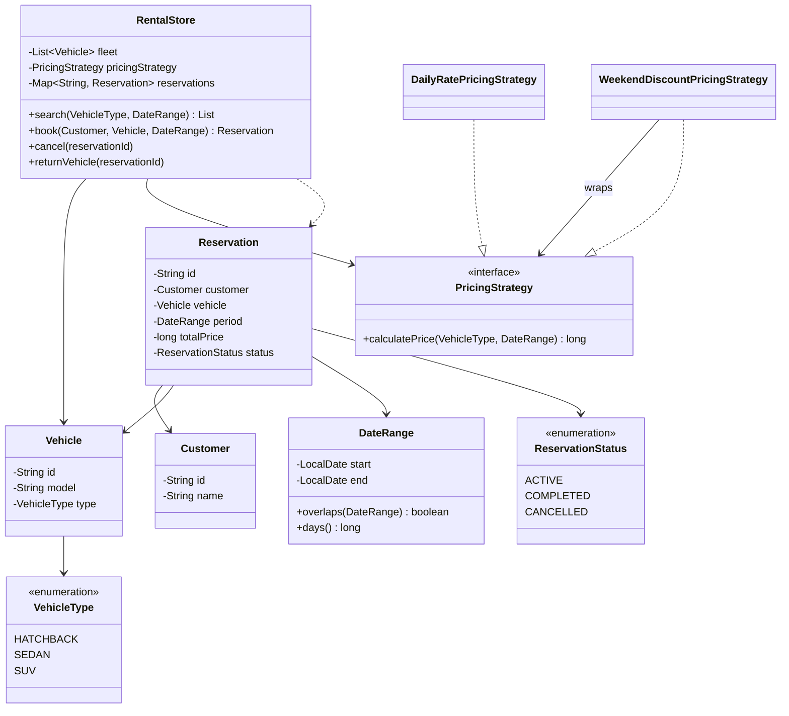

<div align="center">

# 🚗 Design a Car Rental System

   

*Customers search a fleet by type and dates, book, and later cancel or return.*

</div>

---

## 📑 Table of contents

- [🎯 Problem statement](#-problem-statement)
- [🧩 Requirements & approach](#-requirements--approach)
- [🔷 Class diagram](#-class-diagram)
- [👥 Classes & responsibilities](#-classes--responsibilities)
- [🧭 Design patterns & principles used](#-design-patterns--principles-used)
- [📊 Strengths & limitations](#-strengths--limitations)
- [🌍 Follow-up interview questions](#-follow-up-interview-questions)
- [💻 Code](#-code)
  - [1. Implementation](#ex1)

---

## 🎯 Problem statement

> Design a **car rental system**. A customer searches for a vehicle type over a date range, books an available vehicle, and later returns it or cancels. The price depends on the vehicle type, the number of days and, optionally, weekend discounts.

## 🧩 Requirements & approach

| 📋 Requirements | 🛠️ Design approach |
|---|---|
| 1. A fleet of vehicles, each with a type (hatchback, sedan, SUV)<br>2. Search available vehicles of a type for a date range<br>3. Book a vehicle only if no other **active** reservation overlaps its dates<br>4. Price depends on the vehicle type, the number of days, and the pricing rules in force<br>5. Cancel or return a reservation; reject operating twice on the same reservation<br>6. Pricing rules (flat rate, weekend discount, seasonal, ...) must be replaceable without touching the store<br>7. Two bookings for the same vehicle must never both succeed | `RentalStore` is the only entry point (`search`, `book`, `cancel`, `returnVehicle`). Availability is computed on the fly from existing **active** reservations that overlap the requested `DateRange`, so there is no separate 'is booked' flag that could drift out of sync. Pricing is an injected `PricingStrategy`; `WeekendDiscountPricingStrategy` **decorates** another strategy to add a discount without changing it. The code is split into folders (`entities`, `enums`, `exceptions`, `strategy`, `service`) and `Main`, the client, sits outside them. |

## 🔷 Class diagram



## 👥 Classes & responsibilities

| Class / interface | Responsibility | Kind · folder |
|---|---|---|
| **`RentalStore`** | Entry point: search, book, cancel, return; availability is derived from active reservations (thread safe) | service class · `service/` |
| **`Vehicle`** | A fleet item with an id, model and type | class · `entities/` |
| **`Customer`** | The person booking | class · `entities/` |
| **`DateRange`** | Inclusive start/end, knows its length and whether it overlaps another range | class · `entities/` |
| **`Reservation`** | Links customer, vehicle, period, price and status | class · `entities/` |
| **`PricingStrategy`** | How much does this vehicle type cost for this period? | interface · `strategy/` |
| **`DailyRatePricingStrategy`** | Flat rate per day per vehicle type | class · `strategy/` |
| **`WeekendDiscountPricingStrategy`** | Wraps another strategy and discounts every weekend day | class (Decorator) · `strategy/` |
| **`VehicleType`, `ReservationStatus`** | Type safe kinds and lifecycle state | enums · `enums/` |
| **`VehicleNotAvailableException`, `InvalidReservationException`** | A vehicle is already booked; a reservation is reused or unknown | runtime exceptions · `exceptions/` |
| **`Main`** | Searches SUVs, books one with a weekend discount, rejects an overlapping booking, then returns and cancels | demo · client, outside the packages |

## 🧭 Design patterns & principles used

| Pattern / principle | Where and why |
|---|---|
| **Strategy** | `PricingStrategy`: how price is computed changes without touching `RentalStore` |
| **Decorator** | `WeekendDiscountPricingStrategy` wraps a `PricingStrategy` and adds behaviour without subclassing it |
| **Single Responsibility principle** | `DateRange` only knows about dates, `Reservation` only links records, `RentalStore` only orchestrates |
| **Open/Closed principle** | A new pricing rule (seasonal, loyalty) is a new class; availability logic is never touched |
| **Derived state over a stored flag** | No `isBooked` boolean on `Vehicle`: availability is always computed from active reservations, so it cannot go stale |

## 📊 Strengths & limitations

| 👍 Strengths | 👎 Limitations |
|---|---|
| Availability can never drift out of sync with reservations, because it is computed, not stored | Availability check is `O(reservations)`; an interval tree per vehicle would make it faster at scale |
| Pricing rules compose (daily rate + weekend discount) without new store code | No payment, security deposit or late-return fee modelled |
| Double booking of the same vehicle for overlapping dates is structurally impossible | One lock over the whole store: fine for a single branch, not for a national chain |
| Clear separation between search, booking and the reservation lifecycle | No vehicle swap for the same reservation if it breaks down |

## 🌍 Follow-up interview questions

- **How would you support multiple rental branches?** Add a `Branch` that owns its own fleet and reservations, and let `search` optionally take a branch or search across branches.
- **How do you make availability checks faster for a huge fleet?** Keep a per-vehicle interval tree (or sorted list) of booked ranges instead of scanning all reservations.
- **How would you add a security deposit or late fee?** A `PaymentStrategy` called on `book` and `returnVehicle`; a late fee strategy compares actual return date to `period.getEnd()`.
- **How would you let a customer extend a reservation?** Re-run the same availability check for the new end date before extending; otherwise reject with `VehicleNotAvailableException`.
- **How do you add loyalty or seasonal pricing?** Implement `PricingStrategy` (or wrap one, like `WeekendDiscountPricingStrategy` does) — `RentalStore` is never edited.
- **What happens if two bookings race for the last vehicle?** `book` is `synchronized`, so the check-and-insert is atomic; the second caller sees the vehicle as unavailable.
- **How would you support one-way rentals (pick up at branch A, drop at branch B)?** Add a `dropBranch` to `Reservation` and update fleet location on `returnVehicle`.

---

## 💻 Code

This folder has **1 example** (13 Java files). Interfaces and abstract classes come first, the class with `main` comes last.

<a id="ex1"></a>

### 1. Implementation

<details open>
<summary><b>📁 Files in this example</b></summary>

```text
5. Car Rental/
├── entities/
│   ├── Customer.java
│   ├── DateRange.java
│   ├── Reservation.java
│   └── Vehicle.java
├── enums/
│   ├── ReservationStatus.java
│   └── VehicleType.java
├── exceptions/
│   ├── InvalidReservationException.java
│   └── VehicleNotAvailableException.java
├── service/
│   └── RentalStore.java
├── strategy/
│   ├── DailyRatePricingStrategy.java
│   ├── PricingStrategy.java
│   └── WeekendDiscountPricingStrategy.java
└── Main.java
```

</details>

#### 📄 `enums/ReservationStatus.java`

<sub>enum · 7 lines</sub>

```java
package enums;

public enum ReservationStatus {
    ACTIVE,
    COMPLETED,
    CANCELLED
}
```

#### 📄 `enums/VehicleType.java`

<sub>enum · 7 lines</sub>

```java
package enums;

public enum VehicleType {
    HATCHBACK,
    SEDAN,
    SUV
}
```

#### 📄 `strategy/PricingStrategy.java`

<sub>interface · 9 lines</sub>

```java
package strategy;

import entities.DateRange;
import enums.VehicleType;

// Strategy: how much does a rental of this vehicle type for this period cost?
public interface PricingStrategy {
    long calculatePrice(VehicleType type, DateRange period);
}
```

#### 📄 `entities/Customer.java`

<sub>class · 18 lines</sub>

```java
package entities;

public class Customer {
    private final String id;
    private final String name;

    public Customer(String id, String name) {
        this.id = id;
        this.name = name;
    }

    public String getId() { return id; }

    public String getName() { return name; }

    @Override
    public String toString() { return name; }
}
```

#### 📄 `entities/DateRange.java`

<sub>class · 31 lines</sub>

```java
package entities;

import java.time.LocalDate;
import java.time.temporal.ChronoUnit;

// A rental window, start inclusive, end inclusive
public class DateRange {
    private final LocalDate start;
    private final LocalDate end;

    public DateRange(LocalDate start, LocalDate end) {
        if (end.isBefore(start)) {
            throw new IllegalArgumentException("End date cannot be before start date");
        }
        this.start = start;
        this.end = end;
    }

    public LocalDate getStart() { return start; }

    public LocalDate getEnd() { return end; }

    public long days() { return ChronoUnit.DAYS.between(start, end) + 1; }

    public boolean overlaps(DateRange other) {
        return !start.isAfter(other.end) && !end.isBefore(other.start);
    }

    @Override
    public String toString() { return start + " to " + end; }
}
```

#### 📄 `entities/Reservation.java`

<sub>class · 39 lines</sub>

```java
package entities;

import enums.ReservationStatus;

public class Reservation {
    private final String id;
    private final Customer customer;
    private final Vehicle vehicle;
    private final DateRange period;
    private final long totalPrice;
    private ReservationStatus status = ReservationStatus.ACTIVE;

    public Reservation(String id, Customer customer, Vehicle vehicle, DateRange period, long totalPrice) {
        this.id = id;
        this.customer = customer;
        this.vehicle = vehicle;
        this.period = period;
        this.totalPrice = totalPrice;
    }

    public String getId() { return id; }

    public Customer getCustomer() { return customer; }

    public Vehicle getVehicle() { return vehicle; }

    public DateRange getPeriod() { return period; }

    public long getTotalPrice() { return totalPrice; }

    public ReservationStatus getStatus() { return status; }

    public void setStatus(ReservationStatus status) { this.status = status; }

    @Override
    public String toString() {
        return "Reservation " + id + " [" + customer + " -> " + vehicle + ", " + period + ", $" + totalPrice + ", " + status + "]";
    }
}
```

#### 📄 `entities/Vehicle.java`

<sub>class · 26 lines</sub>

```java
package entities;

import enums.VehicleType;

public class Vehicle {
    private final String id;
    private final String model;
    private final VehicleType type;

    public Vehicle(String id, String model, VehicleType type) {
        this.id = id;
        this.model = model;
        this.type = type;
    }

    public String getId() { return id; }

    public String getModel() { return model; }

    public VehicleType getType() { return type; }

    @Override
    public String toString() {
        return model + " (" + type + ", " + id + ")";
    }
}
```

#### 📄 `exceptions/InvalidReservationException.java`

<sub>class · 7 lines</sub>

```java
package exceptions;

public class InvalidReservationException extends RuntimeException {
    public InvalidReservationException(String message) {
        super(message);
    }
}
```

#### 📄 `exceptions/VehicleNotAvailableException.java`

<sub>class · 7 lines</sub>

```java
package exceptions;

public class VehicleNotAvailableException extends RuntimeException {
    public VehicleNotAvailableException(String message) {
        super(message);
    }
}
```

#### 📄 `service/RentalStore.java`

<sub>class · 84 lines</sub>

```java
package service;

import entities.Customer;
import entities.DateRange;
import entities.Reservation;
import entities.Vehicle;
import enums.ReservationStatus;
import exceptions.InvalidReservationException;
import exceptions.VehicleNotAvailableException;
import strategy.PricingStrategy;

import java.util.ArrayList;
import java.util.HashMap;
import java.util.List;
import java.util.Map;

// Single entry point: search, book, cancel and return. Availability is computed from existing
// active reservations, not from a separate "is booked" flag, so no two steps can go out of sync.
public class RentalStore {
    private final List<Vehicle> fleet;
    private final PricingStrategy pricingStrategy;
    private final Map<String, Reservation> reservations = new HashMap<>();
    private int counter = 0;

    public RentalStore(List<Vehicle> fleet, PricingStrategy pricingStrategy) {
        this.fleet = fleet;
        this.pricingStrategy = pricingStrategy;
    }

    public synchronized List<Vehicle> search(enums.VehicleType type, DateRange period) {
        List<Vehicle> available = new ArrayList<>();
        for (Vehicle vehicle : fleet) {
            if (vehicle.getType() == type && isAvailable(vehicle, period)) {
                available.add(vehicle);
            }
        }
        return available;
    }

    public synchronized Reservation book(Customer customer, Vehicle vehicle, DateRange period) {
        if (!isAvailable(vehicle, period)) {
            throw new VehicleNotAvailableException(vehicle + " is not available for " + period);
        }
        long price = pricingStrategy.calculatePrice(vehicle.getType(), period);
        Reservation reservation = new Reservation("R-" + (++counter), customer, vehicle, period, price);
        reservations.put(reservation.getId(), reservation);
        return reservation;
    }

    public synchronized void cancel(String reservationId) {
        Reservation reservation = get(reservationId);
        if (reservation.getStatus() != ReservationStatus.ACTIVE) {
            throw new InvalidReservationException("Reservation " + reservationId + " is already " + reservation.getStatus());
        }
        reservation.setStatus(ReservationStatus.CANCELLED);
    }

    public synchronized void returnVehicle(String reservationId) {
        Reservation reservation = get(reservationId);
        if (reservation.getStatus() != ReservationStatus.ACTIVE) {
            throw new InvalidReservationException("Reservation " + reservationId + " is already " + reservation.getStatus());
        }
        reservation.setStatus(ReservationStatus.COMPLETED);
    }

    private boolean isAvailable(Vehicle vehicle, DateRange period) {
        for (Reservation reservation : reservations.values()) {
            if (reservation.getVehicle() == vehicle
                    && reservation.getStatus() == ReservationStatus.ACTIVE
                    && reservation.getPeriod().overlaps(period)) {
                return false;
            }
        }
        return true;
    }

    private Reservation get(String id) {
        Reservation reservation = reservations.get(id);
        if (reservation == null) {
            throw new InvalidReservationException("Unknown reservation: " + id);
        }
        return reservation;
    }
}
```

#### 📄 `strategy/DailyRatePricingStrategy.java`

<sub>class · 20 lines</sub>

```java
package strategy;

import entities.DateRange;
import enums.VehicleType;

import java.util.Map;

// Flat rate per day per vehicle type
public class DailyRatePricingStrategy implements PricingStrategy {
    private final Map<VehicleType, Long> ratePerDay;

    public DailyRatePricingStrategy(Map<VehicleType, Long> ratePerDay) {
        this.ratePerDay = ratePerDay;
    }

    @Override
    public long calculatePrice(VehicleType type, DateRange period) {
        return ratePerDay.get(type) * period.days();
    }
}
```

#### 📄 `strategy/WeekendDiscountPricingStrategy.java`

<sub>class · 38 lines</sub>

```java
package strategy;

import entities.DateRange;
import enums.VehicleType;

import java.time.DayOfWeek;
import java.time.LocalDate;
import java.util.Map;

// Decorator: wraps another strategy and gives a discount for every weekend day in the period
public class WeekendDiscountPricingStrategy implements PricingStrategy {
    private final PricingStrategy delegate;
    private final double weekendDiscount;

    public WeekendDiscountPricingStrategy(PricingStrategy delegate, double weekendDiscount) {
        this.delegate = delegate;
        this.weekendDiscount = weekendDiscount;
    }

    @Override
    public long calculatePrice(VehicleType type, DateRange period) {
        long base = delegate.calculatePrice(type, period);
        long dailyAverage = base / period.days();
        long weekendDays = countWeekendDays(period);
        long discount = (long) (weekendDays * dailyAverage * weekendDiscount);
        return base - discount;
    }

    private long countWeekendDays(DateRange period) {
        long count = 0;
        for (LocalDate d = period.getStart(); !d.isAfter(period.getEnd()); d = d.plusDays(1)) {
            if (d.getDayOfWeek() == DayOfWeek.SATURDAY || d.getDayOfWeek() == DayOfWeek.SUNDAY) {
                count++;
            }
        }
        return count;
    }
}
```

#### 📄 `Main.java`

<sub>class · 81 lines</sub>

```java
import entities.Customer;
import entities.DateRange;
import entities.Reservation;
import entities.Vehicle;
import enums.VehicleType;
import exceptions.InvalidReservationException;
import exceptions.VehicleNotAvailableException;
import service.RentalStore;
import strategy.DailyRatePricingStrategy;
import strategy.PricingStrategy;
import strategy.WeekendDiscountPricingStrategy;

import java.time.LocalDate;
import java.util.ArrayList;
import java.util.EnumMap;
import java.util.List;
import java.util.Map;

public class Main {
    public static void main(String[] args) {

        Map<VehicleType, Long> rates = new EnumMap<>(VehicleType.class);
        rates.put(VehicleType.HATCHBACK, 30L);
        rates.put(VehicleType.SEDAN, 50L);
        rates.put(VehicleType.SUV, 80L);
        PricingStrategy pricing = new WeekendDiscountPricingStrategy(new DailyRatePricingStrategy(rates), 0.20);

        RentalStore store = new RentalStore(fleet(), pricing);
        Customer alice = new Customer("C1", "Alice");
        Customer bob = new Customer("C2", "Bob");

        System.out.println("=== Search SUVs for 2026-01-02 (Fri) to 2026-01-05 (Mon) ===");
        DateRange window = new DateRange(LocalDate.of(2026, 1, 2), LocalDate.of(2026, 1, 5));
        List<Vehicle> suvs = store.search(VehicleType.SUV, window);
        suvs.forEach(System.out::println);

        System.out.println("\n=== Alice books the first SUV (weekend discount applies) ===");
        Reservation r1 = store.book(alice, suvs.get(0), window);
        System.out.println(r1);

        System.out.println("\n-- Bob tries to book the same SUV for an overlapping window --");
        try {
            store.book(bob, suvs.get(0), new DateRange(LocalDate.of(2026, 1, 4), LocalDate.of(2026, 1, 6)));
        } catch (VehicleNotAvailableException e) {
            System.out.println("Rejected: " + e.getMessage());
        }

        System.out.println("\n-- The same SUV is free again for a non-overlapping window --");
        Reservation r2 = store.book(bob, suvs.get(0), new DateRange(LocalDate.of(2026, 1, 6), LocalDate.of(2026, 1, 7)));
        System.out.println(r2);

        System.out.println("\n=== Alice returns her car, Bob cancels his ===");
        store.returnVehicle(r1.getId());
        store.cancel(r2.getId());
        System.out.println(r1);
        System.out.println(r2);

        System.out.println("\n-- A completed reservation cannot be cancelled --");
        try {
            store.cancel(r1.getId());
        } catch (InvalidReservationException e) {
            System.out.println("Rejected: " + e.getMessage());
        }

        System.out.println("\n-- An unknown reservation id --");
        try {
            store.returnVehicle("R-999");
        } catch (InvalidReservationException e) {
            System.out.println("Rejected: " + e.getMessage());
        }
    }

    private static List<Vehicle> fleet() {
        List<Vehicle> fleet = new ArrayList<>();
        fleet.add(new Vehicle("V1", "Honda Jazz", VehicleType.HATCHBACK));
        fleet.add(new Vehicle("V2", "Honda City", VehicleType.SEDAN));
        fleet.add(new Vehicle("V3", "Toyota Fortuner", VehicleType.SUV));
        fleet.add(new Vehicle("V4", "Hyundai Creta", VehicleType.SUV));
        return fleet;
    }
}
```

<details>
<summary><b>▶️ How to compile and run this example</b></summary>

```bash
# run from the repository root
mkdir -p out
find "Interview Questions/5. Car Rental" -name "*.java" -print0 | xargs -0 javac -d out
java -cp out Main
```

</details>

---

<div align="center">

[◀ Elevator](../4.%20Elevator/README.md) &nbsp;·&nbsp; [📚 All questions](../QUESTIONS.md) &nbsp;·&nbsp; [HashMap ▶](../6.%20HashMap/README.md)

</div>
