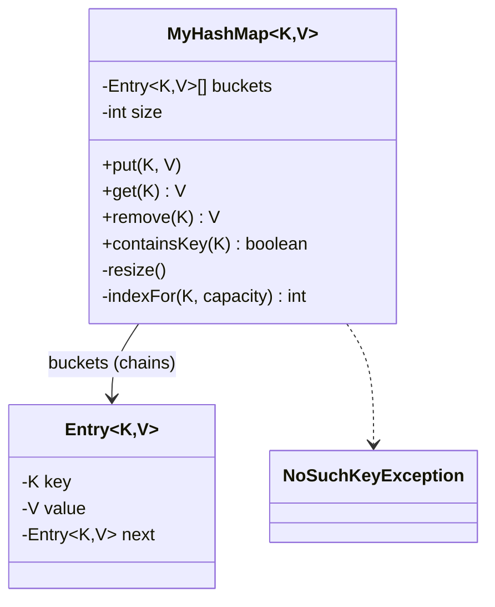

<div align="center">

# 🧮 Design a HashMap (implement it from scratch)

   

*A key/value store built from an array of buckets, each a chain of entries, with automatic resizing.*

</div>

---

## 📑 Table of contents

- [🎯 Problem statement](#-problem-statement)
- [🧩 Requirements & approach](#-requirements--approach)
- [🔷 Class diagram](#-class-diagram)
- [👥 Classes & responsibilities](#-classes--responsibilities)
- [🧭 Design patterns & principles used](#-design-patterns--principles-used)
- [📊 Strengths & limitations](#-strengths--limitations)
- [🌍 Follow-up interview questions](#-follow-up-interview-questions)
- [💻 Code](#-code)
  - [1. Implementation](#ex1)

---

## 🎯 Problem statement

> Implement a **HashMap** from scratch: `put`, `get`, `remove`, `containsKey`, resizing, and the collision strategy, without using `java.util.HashMap`. Operations should run in **amortised O(1)**.

## 🧩 Requirements & approach

| 📋 Requirements | 🛠️ Design approach |
|---|---|
| 1. Store key/value pairs and retrieve by key in O(1) on average<br>2. Two different keys can hash to the same bucket (a collision) and must both be retrievable<br>3. `put` on an existing key overwrites the value instead of duplicating the entry<br>4. The bucket array must grow as the map fills up, or performance degrades to O(n)<br>5. Growing the array must not lose or duplicate any entry<br>6. Looking up a missing key should be distinguishable from a key mapped to a real value | `MyHashMap` keeps an array of buckets; each bucket is a singly linked chain of `Entry` objects (**separate chaining**). The key's `hashCode()` is spread (XOR with a right shift) before taking it modulo the capacity, so keys that are close together or share low bits still spread across buckets. Once `size / capacity` passes a load factor of 0.75, the array doubles and every entry is **re-bucketed**, because its index depends on the capacity. The code is split into folders (`entities`, `map`, `exceptions`) and `Main`, the client, sits outside them. |

## 🔷 Class diagram



## 👥 Classes & responsibilities

| Class / interface | Responsibility | Kind · folder |
|---|---|---|
| **`MyHashMap`** | The map itself: bucket array, hashing, chaining, growth, all the public operations | generic class · `map/` |
| **`Entry`** | One key/value slot plus a pointer to the next entry in its bucket's chain | generic class · `entities/` |
| **`NoSuchKeyException`** | Thrown by `getOrThrow` when a key has no value (unlike `get`, which returns `null`) | runtime exception · `exceptions/` |
| **`Main`** | put/get/overwrite, a missing key, remove, three keys forced into one bucket, and an automatic resize across 20 inserts | demo · client, outside the packages |

## 🧭 Design patterns & principles used

| Pattern / principle | Where and why |
|---|---|
| **Separate chaining** | Each bucket is a linked list of entries, so unlimited keys can share one bucket without overwriting each other |
| **Amortised doubling** | The array doubles (not +1) when the load factor is exceeded, so the average cost of growth per insert stays O(1) |
| **Encapsulation** | The bucket array and `Entry.next` are private; everything else only sees `put`, `get`, `remove`, `containsKey` |
| **Hash spreading** | `h ^ (h >>> 16)` mixes the high bits into the low bits before the modulo, reducing collisions from poor `hashCode()` implementations |

## 📊 Strengths & limitations

| 👍 Strengths | 👎 Limitations |
|---|---|
| O(1) average put/get/remove, verified in the demo even after forcing collisions and a resize | Worst case is O(n) per operation if every key collides into one bucket (a bad or adversarial hash code) |
| Resize preserves every entry: the demo checks all 20 keys after growth | No shrink-on-remove: the array never gets smaller |
| No fixed limit on key count: chains grow as needed before a resize | Not thread safe: concurrent `put`/`resize` calls can corrupt the chains |
| Clear distinction between 'key maps to null' (not modelled here) and 'key absent' via `getOrThrow` | Iteration order is unspecified, as in the real `java.util.HashMap` |

## 🌍 Follow-up interview questions

- **Why double the capacity instead of growing by a fixed amount?** Doubling makes the *amortised* cost of growth O(1) per insert; a fixed increment degrades to O(n) over many inserts.
- **What if many keys collide into the same bucket (a hash-flooding attack)?** Real `HashMap` treeifies a long chain (>8 entries) into a red-black tree, giving O(log n) worst case instead of O(n).
- **How would you make it thread safe?** Lock per bucket (or a small set of segments, like `ConcurrentHashMap`) instead of one lock for the whole map, so unrelated buckets do not block each other.
- **Why spread the hash code instead of using it directly?** A poor `hashCode()` (e.g. all multiples of 16) would always land in the same low bits; the shift pulls high bits into the mix.
- **How would open addressing (linear/quadratic probing) differ from chaining?** No `next` pointers: a collision probes the next slot in the array itself. It's more cache friendly but harder to implement `remove` for (needs tombstones).
- **How do you support `null` keys or values?** Reserve a sentinel bucket (e.g. bucket 0 with a dedicated flag) for a `null` key, and let `get` distinguish 'absent' from 'present with value null' by checking `containsKey` first.
- **How would you implement `keySet()`/`entrySet()`/iteration efficiently?** Walk the bucket array and each chain once — the `keys()` method here already does this in O(capacity + size).

---

## 💻 Code

This folder has **1 example** (4 Java files). Interfaces and abstract classes come first, the class with `main` comes last.

<a id="ex1"></a>

### 1. Implementation

<details open>
<summary><b>📁 Files in this example</b></summary>

```text
6. HashMap/
├── entities/
│   └── Entry.java
├── exceptions/
│   └── NoSuchKeyException.java
├── map/
│   └── MyHashMap.java
└── Main.java
```

</details>

#### 📄 `entities/Entry.java`

<sub>class · 23 lines</sub>

```java
package entities;

// One key/value slot, chained to the next entry that hashed into the same bucket
public class Entry<K, V> {
    private final K key;
    private V value;
    private Entry<K, V> next;

    public Entry(K key, V value) {
        this.key = key;
        this.value = value;
    }

    public K getKey() { return key; }

    public V getValue() { return value; }

    public void setValue(V value) { this.value = value; }

    public Entry<K, V> getNext() { return next; }

    public void setNext(Entry<K, V> next) { this.next = next; }
}
```

#### 📄 `exceptions/NoSuchKeyException.java`

<sub>class · 7 lines</sub>

```java
package exceptions;

public class NoSuchKeyException extends RuntimeException {
    public NoSuchKeyException(String message) {
        super(message);
    }
}
```

#### 📄 `map/MyHashMap.java`

<sub>class · 132 lines</sub>

```java
package map;

import entities.Entry;
import exceptions.NoSuchKeyException;

import java.util.ArrayList;
import java.util.List;

// A HashMap built from scratch: an array of buckets, each a singly linked list of entries
// (separate chaining). Resizes when the load factor is exceeded, like java.util.HashMap.
public class MyHashMap<K, V> {
    private static final int DEFAULT_CAPACITY = 16;
    private static final double LOAD_FACTOR = 0.75;

    @SuppressWarnings("unchecked")
    private Entry<K, V>[] buckets = new Entry[DEFAULT_CAPACITY];
    private int size = 0;

    public int size() { return size; }

    public boolean isEmpty() { return size == 0; }

    // Spreads the bits of hashCode() so close hash codes do not collide in the same bucket
    private int indexFor(K key, int capacity) {
        int h = key == null ? 0 : key.hashCode();
        h ^= (h >>> 16);
        return (h & 0x7fffffff) % capacity;
    }

    public void put(K key, V value) {
        int index = indexFor(key, buckets.length);
        Entry<K, V> head = buckets[index];
        for (Entry<K, V> e = head; e != null; e = e.getNext()) {
            if (keyEquals(e.getKey(), key)) {
                e.setValue(value);        // key already present: overwrite
                return;
            }
        }
        Entry<K, V> entry = new Entry<>(key, value);
        entry.setNext(head);              // insert at the head of the chain: O(1)
        buckets[index] = entry;
        size++;
        if ((double) size / buckets.length > LOAD_FACTOR) {
            resize();
        }
    }

    public V get(K key) {
        Entry<K, V> entry = findEntry(key);
        return entry == null ? null : entry.getValue();
    }

    public boolean containsKey(K key) {
        return findEntry(key) != null;
    }

    public V getOrThrow(K key) {
        Entry<K, V> entry = findEntry(key);
        if (entry == null) {
            throw new NoSuchKeyException("No value for key: " + key);
        }
        return entry.getValue();
    }

    public V remove(K key) {
        int index = indexFor(key, buckets.length);
        Entry<K, V> prev = null;
        for (Entry<K, V> e = buckets[index]; e != null; prev = e, e = e.getNext()) {
            if (keyEquals(e.getKey(), key)) {
                if (prev == null) {
                    buckets[index] = e.getNext();
                } else {
                    prev.setNext(e.getNext());
                }
                size--;
                return e.getValue();
            }
        }
        return null;
    }

    public List<K> keys() {
        List<K> keys = new ArrayList<>();
        for (Entry<K, V> head : buckets) {
            for (Entry<K, V> e = head; e != null; e = e.getNext()) {
                keys.add(e.getKey());
            }
        }
        return keys;
    }

    // Doubles the bucket array and re-places every entry, since the bucket index depends on the capacity
    @SuppressWarnings("unchecked")
    private void resize() {
        Entry<K, V>[] old = buckets;
        buckets = new Entry[old.length * 2];
        for (Entry<K, V> head : old) {
            for (Entry<K, V> e = head; e != null; ) {
                Entry<K, V> next = e.getNext();
                int index = indexFor(e.getKey(), buckets.length);
                e.setNext(buckets[index]);
                buckets[index] = e;
                e = next;
            }
        }
    }

    private Entry<K, V> findEntry(K key) {
        int index = indexFor(key, buckets.length);
        for (Entry<K, V> e = buckets[index]; e != null; e = e.getNext()) {
            if (keyEquals(e.getKey(), key)) {
                return e;
            }
        }
        return null;
    }

    private boolean keyEquals(K a, K b) {
        return a == null ? b == null : a.equals(b);
    }

    // For the demo only: shows how entries land across buckets
    public int bucketCount() { return buckets.length; }

    public int chainLength(int bucketIndex) {
        int count = 0;
        for (Entry<K, V> e = buckets[bucketIndex]; e != null; e = e.getNext()) {
            count++;
        }
        return count;
    }
}
```

#### 📄 `Main.java`

<sub>class · 52 lines</sub>

```java
import exceptions.NoSuchKeyException;
import map.MyHashMap;

public class Main {
    public static void main(String[] args) {

        System.out.println("=== Basic put / get / overwrite ===");
        MyHashMap<String, Integer> map = new MyHashMap<>();
        map.put("one", 1);
        map.put("two", 2);
        map.put("three", 3);
        System.out.println("get(two) = " + map.get("two"));
        map.put("two", 22);                       // overwrite, size must not change
        System.out.println("after overwrite, get(two) = " + map.get("two") + ", size = " + map.size());

        System.out.println("\n=== Missing key ===");
        System.out.println("get(missing) = " + map.get("missing"));
        try {
            map.getOrThrow("missing");
        } catch (NoSuchKeyException e) {
            System.out.println("Rejected: " + e.getMessage());
        }

        System.out.println("\n=== Remove ===");
        System.out.println("remove(one) = " + map.remove("one"));
        System.out.println("containsKey(one) = " + map.containsKey("one") + ", size = " + map.size());

        System.out.println("\n=== Collisions in the same bucket chain correctly ===");
        MyHashMap<Integer, String> collidingMap = new MyHashMap<>();
        int capacity = collidingMap.bucketCount();
        collidingMap.put(1, "a");
        collidingMap.put(1 + capacity, "b");       // same bucket as key 1 before any resize
        collidingMap.put(1 + 2 * capacity, "c");    // same bucket again
        System.out.println("bucket 1 chain length = " + collidingMap.chainLength(1 % capacity));
        System.out.println("get(1) = " + collidingMap.get(1)
                + ", get(" + (1 + capacity) + ") = " + collidingMap.get(1 + capacity)
                + ", get(" + (1 + 2 * capacity) + ") = " + collidingMap.get(1 + 2 * capacity));

        System.out.println("\n=== Resize happens automatically past the load factor ===");
        MyHashMap<Integer, Integer> growing = new MyHashMap<>();
        int before = growing.bucketCount();
        for (int i = 0; i < 20; i++) {
            growing.put(i, i * i);
        }
        System.out.println("capacity before = " + before + ", after 20 inserts = " + growing.bucketCount());
        boolean allPresent = true;
        for (int i = 0; i < 20; i++) {
            allPresent &= growing.get(i) == i * i;
        }
        System.out.println("all 20 keys still correct after resize: " + allPresent);
    }
}
```

<details>
<summary><b>▶️ How to compile and run this example</b></summary>

```bash
# run from the repository root
mkdir -p out
find "Interview Questions/6. HashMap" -name "*.java" -print0 | xargs -0 javac -d out
java -cp out Main
```

</details>

---

<div align="center">

[◀ Car Rental](../5.%20Car%20Rental/README.md) &nbsp;·&nbsp; [📚 All questions](../QUESTIONS.md) &nbsp;·&nbsp; [Vending Machine ▶](../7.%20Vending%20Machine/README.md)

</div>
