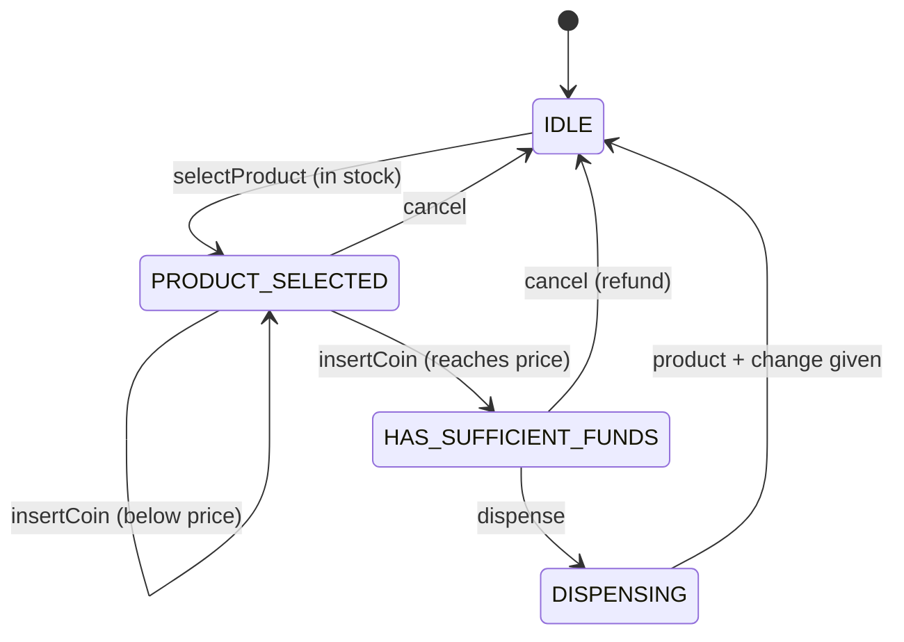

<div align="center">

# 🥤 Design a Vending Machine

   

*Select a product, insert coins, and the machine dispenses it (and any change) by a State machine.*

</div>

---

## 📑 Table of contents

- [🎯 Problem statement](#-problem-statement)
- [🧩 Requirements & approach](#-requirements--approach)
- [🔷 Class diagram](#-class-diagram)
- [👥 Classes & responsibilities](#-classes--responsibilities)
- [🧭 Design patterns & principles used](#-design-patterns--principles-used)
- [📊 Strengths & limitations](#-strengths--limitations)
- [🌍 Follow-up interview questions](#-follow-up-interview-questions)
- [💻 Code](#-code)
  - [1. Implementation](#ex1)

---

## 🎯 Problem statement

> Design a **vending machine**. A customer selects a product, inserts coins until the price is covered, and the machine dispenses the product plus any change. The machine must reject operations that make no sense for where it currently is in the flow (for example inserting a coin before selecting anything).

## 🧩 Requirements & approach

| 📋 Requirements | 🛠️ Design approach |
|---|---|
| 1. Several slots, each with a product and a stock count<br>2. Select a product only if it exists and is in stock<br>3. Accept coins one at a time and track the running balance<br>4. Dispense only once enough money is in, and return change<br>5. Allow cancelling before dispensing, with a full refund of whatever was inserted<br>6. An operation that is invalid for the current step (coin with nothing selected, dispense with no money) must be rejected, not silently ignored | The whole flow is modelled as a **State machine**: `IdleState`, `ProductSelectedState`, `HasSufficientFundsState` and the transient `DispensingState`. Each state implements only the operations that are legal in it; every other operation falls back to a default that throws. `VendingMachine` is the context: it only stores the inventory and the running balance and forwards every call to the current state. The code is split into folders (`entities`, `enums`, `exceptions`, `state`, `service`) and `Main`, the client, sits outside them. |

## 🔷 Class diagram



## 👥 Classes & responsibilities

| Class / interface | Responsibility | Kind · folder |
|---|---|---|
| **`VendingMachine`** | Context: inventory, selected product, running balance; forwards every call to the current state | service class · `service/` |
| **`VendingMachineState`** | Only the operations that make sense in a given state are overridden; the rest default to rejecting | interface · `state/` |
| **`IdleState`** | Nothing selected: only `selectProduct` is valid | class · `state/` |
| **`ProductSelectedState`** | Accepts coins, moves on once the price is covered, or cancels with nothing to refund yet | class · `state/` |
| **`HasSufficientFundsState`** | Enough money is in: accepts more (kept as change), dispenses, or cancels with a full refund | class · `state/` |
| **`DispensingState`** | Transient: drops the product, returns change, resets to `IdleState` | class · `state/` |
| **`Product`, `Slot`** | What a slot sells and how many are left | classes · `entities/` |
| **`Coin`** | PENNY..DOLLAR with its value in cents | enum · `enums/` |
| **`InvalidProductException`, `OutOfStockException`, `IllegalVendingOperationException`** | Unknown product; empty slot; operation invalid for the current state | runtime exceptions · `exceptions/` |
| **`Main`** | Exact-change purchase, purchase with change due, an emptied slot, cancel with refund, and invalid operations | demo · client, outside the packages |

## 🧭 Design patterns & principles used

| Pattern / principle | Where and why |
|---|---|
| **State** | Each step of the flow is its own class; `VendingMachine` never has a chain of `if (state == ...)` checks |
| **Single Responsibility principle** | `Slot` only tracks stock, `VendingMachine` only coordinates, states only decide what is legal next |
| **Open/Closed principle** | A new step (card payment, a `HasCardState`) is a new state class; existing states are not edited |
| **Default method / template** | `VendingMachineState`'s default methods throw, so a state only needs to override what it actually supports |

## 📊 Strengths & limitations

| 👍 Strengths | 👎 Limitations |
|---|---|
| No invalid operation can silently succeed: unsupported calls always throw, named by the current state | Coins inserted after the price is already covered are only ever refunded, never applied to a second item |
| Adding a new step in the flow needs no change to existing states | No support for notes or card payment, only coins |
| Change calculation is isolated to one place (`DispensingState`) | Change-making assumes unlimited coins of every denomination (no 'cannot make change' case) |
| The current state is inspectable (`currentState()`), which makes the demo and tests easy to assert on | Not designed for concurrent purchases from the same physical machine (one `synchronized` session at a time) |

## 🌍 Follow-up interview questions

- **How would you add card payment?** A `CardPaymentState` (or a flag on `ProductSelectedState`) that calls a `PaymentGateway` instead of accumulating coins, then transitions straight to dispensing on success.
- **How do you make change-giving realistic (limited coins)?** Give `VendingMachine` a coin inventory like the Parking Lot's cash dispenser, and have `DispensingState` fail the refund (and the whole purchase) if exact change cannot be made.
- **How would you restock or audit the machine?** Add `refillSlot(code, count)` and a `totalRevenue()` accumulator on `VendingMachine`, callable only when the machine is `IdleState`.
- **How would you support buying two items in one session?** After `DispensingState`, instead of resetting to `IdleState`, go to a new `ReadyForNextState` that still has the leftover balance available.
- **Why does `insertCoin` on `HasSufficientFundsState` not immediately refund the excess?** It keeps the model simple: excess is just more change, settled once in `DispensingState`, rather than two separate refund paths.
- **How would you test this without real coins?** Drive the `Coin` enum directly, as `Main` does, and assert on `currentState()` and the slot quantities before and after each call.
- **What happens if `dispense()` is called with insufficient funds?** `HasSufficientFundsState` is the only state where `dispense` is implemented; `ProductSelectedState` and `IdleState` inherit the default that throws.

---

## 💻 Code

This folder has **1 example** (13 Java files). Interfaces and abstract classes come first, the class with `main` comes last.

<a id="ex1"></a>

### 1. Implementation

<details open>
<summary><b>📁 Files in this example</b></summary>

```text
7. Vending Machine/
├── entities/
│   ├── Product.java
│   └── Slot.java
├── enums/
│   └── Coin.java
├── exceptions/
│   ├── IllegalVendingOperationException.java
│   ├── InvalidProductException.java
│   └── OutOfStockException.java
├── service/
│   └── VendingMachine.java
├── state/
│   ├── DispensingState.java
│   ├── HasSufficientFundsState.java
│   ├── IdleState.java
│   ├── ProductSelectedState.java
│   └── VendingMachineState.java
└── Main.java
```

</details>

#### 📄 `enums/Coin.java`

<sub>enum · 16 lines</sub>

```java
package enums;

// Value in cents
public enum Coin {
    PENNY(1),
    NICKEL(5),
    DIME(10),
    QUARTER(25),
    DOLLAR(100);

    private final int cents;

    Coin(int cents) { this.cents = cents; }

    public int getCents() { return cents; }
}
```

#### 📄 `state/VendingMachineState.java`

<sub>interface · 25 lines</sub>

```java
package state;

import enums.Coin;

// State: what selectProduct / insertCoin / dispense / cancel do depends on where we are
// in the flow. Each state only implements the operations that make sense in it.
public interface VendingMachineState {
    default void selectProduct(service.VendingMachine machine, String code) {
        throw new exceptions.IllegalVendingOperationException("Cannot select a product right now");
    }

    default void insertCoin(service.VendingMachine machine, Coin coin) {
        throw new exceptions.IllegalVendingOperationException("Cannot insert a coin right now");
    }

    default void dispense(service.VendingMachine machine) {
        throw new exceptions.IllegalVendingOperationException("Cannot dispense right now");
    }

    default void cancel(service.VendingMachine machine) {
        throw new exceptions.IllegalVendingOperationException("Nothing to cancel right now");
    }

    String name();
}
```

#### 📄 `entities/Product.java`

<sub>class · 22 lines</sub>

```java
package entities;

public class Product {
    private final String code;
    private final String name;
    private final int priceCents;

    public Product(String code, String name, int priceCents) {
        this.code = code;
        this.name = name;
        this.priceCents = priceCents;
    }

    public String getCode() { return code; }

    public String getName() { return name; }

    public int getPriceCents() { return priceCents; }

    @Override
    public String toString() { return name + " ($" + priceCents / 100.0 + ")"; }
}
```

#### 📄 `entities/Slot.java`

<sub>class · 25 lines</sub>

```java
package entities;

// One shelf position: a product and how many are left
public class Slot {
    private final Product product;
    private int quantity;

    public Slot(Product product, int quantity) {
        this.product = product;
        this.quantity = quantity;
    }

    public Product getProduct() { return product; }

    public int getQuantity() { return quantity; }

    public boolean isEmpty() { return quantity == 0; }

    public void dispenseOne() {
        if (isEmpty()) {
            throw new IllegalStateException("Slot for " + product.getName() + " is empty");
        }
        quantity--;
    }
}
```

#### 📄 `exceptions/IllegalVendingOperationException.java`

<sub>class · 8 lines</sub>

```java
package exceptions;

// A state rejects an operation that makes no sense right now (e.g. inserting a coin before selecting)
public class IllegalVendingOperationException extends RuntimeException {
    public IllegalVendingOperationException(String message) {
        super(message);
    }
}
```

#### 📄 `exceptions/InvalidProductException.java`

<sub>class · 7 lines</sub>

```java
package exceptions;

public class InvalidProductException extends RuntimeException {
    public InvalidProductException(String message) {
        super(message);
    }
}
```

#### 📄 `exceptions/OutOfStockException.java`

<sub>class · 7 lines</sub>

```java
package exceptions;

public class OutOfStockException extends RuntimeException {
    public OutOfStockException(String message) {
        super(message);
    }
}
```

#### 📄 `service/VendingMachine.java`

<sub>class · 60 lines</sub>

```java
package service;

import entities.Product;
import entities.Slot;
import enums.Coin;
import state.IdleState;
import state.VendingMachineState;

import java.util.HashMap;
import java.util.Map;

// Context of the State pattern: holds the current state and the data the states act on
// (inventory, selection, running balance), and forwards every public call to that state.
public class VendingMachine {
    private final Map<String, Slot> inventory = new HashMap<>();
    private VendingMachineState state = new IdleState();
    private String selectedCode;
    private int balanceCents = 0;

    public void addSlot(String code, Product product, int quantity) {
        inventory.put(code, new Slot(product, quantity));
    }

    public synchronized void selectProduct(String code) { state.selectProduct(this, code); }

    public synchronized void insertCoin(Coin coin) { state.insertCoin(this, coin); }

    public synchronized void dispense() { state.dispense(this); }

    public synchronized void cancel() { state.cancel(this); }

    public String currentState() { return state.name(); }

    // ----- package-visible helpers the states call on the context -----
    public Slot getSlot(String code) { return inventory.get(code); }

    public Product getSelectedProduct() { return inventory.get(selectedCode).getProduct(); }

    public String getSelectedCode() { return selectedCode; }

    public void setSelectedCode(String code) { this.selectedCode = code; }

    public int getBalanceCents() { return balanceCents; }

    public void addBalance(int cents) { balanceCents += cents; }

    public void setState(VendingMachineState state) { this.state = state; }

    public VendingMachineState getState() { return state; }

    public void refund(int cents) {
        System.out.println("Returning change: $" + cents / 100.0);
    }

    public void reset() {
        selectedCode = null;
        balanceCents = 0;
        state = new IdleState();
    }
}
```

#### 📄 `state/DispensingState.java`

<sub>class · 23 lines</sub>

```java
package state;

import entities.Slot;
import service.VendingMachine;

// Transient state: drop the product, refund the change, and go back to idle
public class DispensingState implements VendingMachineState {

    @Override
    public void dispense(VendingMachine machine) {
        Slot slot = machine.getSlot(machine.getSelectedCode());
        int change = machine.getBalanceCents() - slot.getProduct().getPriceCents();
        slot.dispenseOne();
        System.out.println("Dispensing " + slot.getProduct().getName());
        if (change > 0) {
            machine.refund(change);
        }
        machine.reset();
    }

    @Override
    public String name() { return "DISPENSING"; }
}
```

#### 📄 `state/HasSufficientFundsState.java`

<sub>class · 29 lines</sub>

```java
package state;

import enums.Coin;
import service.VendingMachine;

// Enough money is in: more coins still count (for a different purchase next time only, so we just
// accept and ignore extra for simplicity of refund), dispense gives the product and any change, or cancel refunds everything
public class HasSufficientFundsState implements VendingMachineState {

    @Override
    public void insertCoin(VendingMachine machine, Coin coin) {
        machine.addBalance(coin.getCents());   // extra coins just add to the change refunded at dispense time
    }

    @Override
    public void dispense(VendingMachine machine) {
        machine.setState(new DispensingState());
        machine.getState().dispense(machine);
    }

    @Override
    public void cancel(VendingMachine machine) {
        machine.refund(machine.getBalanceCents());
        machine.reset();
    }

    @Override
    public String name() { return "HAS_SUFFICIENT_FUNDS"; }
}
```

#### 📄 `state/IdleState.java`

<sub>class · 26 lines</sub>

```java
package state;

import entities.Slot;
import exceptions.InvalidProductException;
import exceptions.OutOfStockException;
import service.VendingMachine;

// Nothing selected yet: the only valid move is picking a product
public class IdleState implements VendingMachineState {

    @Override
    public void selectProduct(VendingMachine machine, String code) {
        Slot slot = machine.getSlot(code);
        if (slot == null) {
            throw new InvalidProductException("No such product: " + code);
        }
        if (slot.isEmpty()) {
            throw new OutOfStockException(slot.getProduct().getName() + " is out of stock");
        }
        machine.setSelectedCode(code);
        machine.setState(new ProductSelectedState());
    }

    @Override
    public String name() { return "IDLE"; }
}
```

#### 📄 `state/ProductSelectedState.java`

<sub>class · 25 lines</sub>

```java
package state;

import enums.Coin;
import service.VendingMachine;

// A product is chosen: coins can be inserted, or the selection can be cancelled (no refund needed yet)
public class ProductSelectedState implements VendingMachineState {

    @Override
    public void insertCoin(VendingMachine machine, Coin coin) {
        machine.addBalance(coin.getCents());
        int price = machine.getSelectedProduct().getPriceCents();
        if (machine.getBalanceCents() >= price) {
            machine.setState(new HasSufficientFundsState());
        }
    }

    @Override
    public void cancel(VendingMachine machine) {
        machine.reset();
    }

    @Override
    public String name() { return "PRODUCT_SELECTED"; }
}
```

#### 📄 `Main.java`

<sub>class · 64 lines</sub>

```java
import entities.Product;
import enums.Coin;
import exceptions.IllegalVendingOperationException;
import exceptions.InvalidProductException;
import exceptions.OutOfStockException;
import service.VendingMachine;

public class Main {
    public static void main(String[] args) {

        VendingMachine machine = new VendingMachine();
        machine.addSlot("A1", new Product("A1", "Coke", 125), 2);
        machine.addSlot("A2", new Product("A2", "Chips", 150), 1);
        machine.addSlot("A3", new Product("A3", "Water", 100), 0);

        System.out.println("=== Buy a Coke with exact change ===");
        machine.selectProduct("A1");
        System.out.println("State: " + machine.currentState());
        machine.insertCoin(Coin.DOLLAR);
        machine.insertCoin(Coin.QUARTER);
        System.out.println("State: " + machine.currentState());
        machine.dispense();
        System.out.println("State: " + machine.currentState());

        System.out.println("\n=== Buy a Coke with change due ===");
        machine.selectProduct("A1");
        machine.insertCoin(Coin.DOLLAR);
        machine.insertCoin(Coin.DOLLAR);
        machine.dispense();

        System.out.println("\n-- The slot is now empty --");
        try {
            machine.selectProduct("A1");
        } catch (OutOfStockException e) {
            System.out.println("Rejected: " + e.getMessage());
        }

        System.out.println("\n-- An out-of-stock slot that was never started --");
        try {
            machine.selectProduct("A3");
        } catch (OutOfStockException e) {
            System.out.println("Rejected: " + e.getMessage());
        }

        System.out.println("\n=== Select, insert some coins, then cancel: full refund ===");
        machine.selectProduct("A2");
        machine.insertCoin(Coin.QUARTER);
        machine.insertCoin(Coin.DIME);
        machine.cancel();
        System.out.println("State after cancel: " + machine.currentState());

        System.out.println("\n-- Invalid operations for the current state --");
        try {
            machine.insertCoin(Coin.DOLLAR);     // no product selected yet
        } catch (IllegalVendingOperationException e) {
            System.out.println("Rejected: " + e.getMessage());
        }
        try {
            machine.selectProduct("Z9");
        } catch (InvalidProductException e) {
            System.out.println("Rejected: " + e.getMessage());
        }
    }
}
```

<details>
<summary><b>▶️ How to compile and run this example</b></summary>

```bash
# run from the repository root
mkdir -p out
find "Interview Questions/7. Vending Machine" -name "*.java" -print0 | xargs -0 javac -d out
java -cp out Main
```

</details>

---

<div align="center">

[◀ HashMap](../6.%20HashMap/README.md) &nbsp;·&nbsp; [📚 All questions](../QUESTIONS.md) &nbsp;·&nbsp; [ATM ▶](../8.%20ATM/README.md)

</div>
