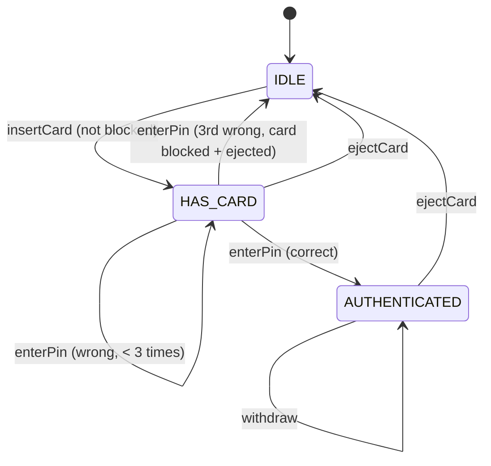

<div align="center">

# 🏧 Design an ATM

   

*Insert a card, enter the PIN, withdraw cash; a State machine drives the session and a greedy dispenser picks the notes.*

</div>

---

## 📑 Table of contents

- [🎯 Problem statement](#-problem-statement)
- [🧩 Requirements & approach](#-requirements--approach)
- [🔷 Class diagram](#-class-diagram)
- [👥 Classes & responsibilities](#-classes--responsibilities)
- [🧭 Design patterns & principles used](#-design-patterns--principles-used)
- [📊 Strengths & limitations](#-strengths--limitations)
- [🌍 Follow-up interview questions](#-follow-up-interview-questions)
- [💻 Code](#-code)
  - [1. Implementation](#ex1)

---

## 🎯 Problem statement

> Design an **ATM**. A customer inserts a card, enters a PIN, and withdraws cash. The machine must dispense the exact amount using the notes it has, verify the PIN against the bank, block a card after repeated wrong PINs, and reject anything out of order.

## 🧩 Requirements & approach

| 📋 Requirements | 🛠️ Design approach |
|---|---|
| 1. A session: insert card -> enter PIN -> withdraw -> eject card<br>2. Wrong PIN is rejected; three wrong PINs in a row block the card and eject it<br>3. Withdrawal is rejected if the balance is insufficient<br>4. Withdrawal is rejected if the amount cannot be made exactly from the notes in the machine<br>5. The note mix should favour the largest notes first<br>6. An operation out of order (withdraw before login, PIN before a card) must be rejected, not silently ignored<br>7. The ATM should not know how the bank stores accounts, only how to ask it | The session flow is a **State machine**: `IdleState`, `HasCardState`, `AuthenticatedState`. Each state only implements the operations legal there; everything else defaults to throwing. `AccountService` abstracts the bank backend behind one method, so `Atm` never touches storage directly. `CashDispenser` picks notes **greedily** from the highest denomination down, and only commits the withdrawal if the exact amount can be made; the same `plan()` is used to check feasibility and to subtract the notes, so a rejected withdrawal never partially empties the trays. The code is split into folders (`entities`, `enums`, `exceptions`, `state`, `service`) and `Main`, the client, sits outside them. |

## 🔷 Class diagram



## 👥 Classes & responsibilities

| Class / interface | Responsibility | Kind · folder |
|---|---|---|
| **`Atm`** | Context: current card, current account, the bank and dispenser; forwards every call to the current state | service class · `service/` |
| **`AtmState`** | Only the operations legal in a given state are overridden; the rest default to rejecting | interface · `state/` |
| **`IdleState`** | No card in: only `insertCard` is valid (rejects an already-blocked card) | class · `state/` |
| **`HasCardState`** | Waiting for the PIN; 3 wrong attempts block the card and eject it | class · `state/` |
| **`AuthenticatedState`** | PIN verified: withdrawals are allowed; ejecting ends the session | class · `state/` |
| **`Card`** | Card number, linked account, failed-attempt counter and blocked flag | class · `entities/` |
| **`Account`** | Account number, PIN and balance | class · `entities/` |
| **`AccountService` / `InMemoryAccountService`** | Looks accounts up by number; the ATM never touches storage directly | interface + class · `service/` |
| **`CashDispenser`** | Note counts per denomination; greedy, highest-first withdrawal that commits only if the amount matches exactly | class · `service/` |
| **`Denomination`** | ₹2000, ₹500, ₹200, ₹100, highest first | enum · `enums/` |
| **`InvalidPinException`, `CardBlockedException`, `InsufficientBalanceException`, `InsufficientCashException`, `IllegalAtmOperationException`** | Wrong PIN; blocked card; balance too low; notes cannot make the amount; operation out of order | runtime exceptions · `exceptions/` |
| **`Main`** | A full withdrawal, two wrong PINs then a correct one, three wrong PINs blocking a card, overdraw and bad amounts, and an operation out of order | demo · client, outside the packages |

## 🧭 Design patterns & principles used

| Pattern / principle | Where and why |
|---|---|
| **State** | `IdleState` / `HasCardState` / `AuthenticatedState` replace an `if (loggedIn && hasCard && ...)` tangle |
| **Strategy-like dispensing** | `CashDispenser.plan()` is the one place that decides the note mix; a different strategy (fewest notes vs. favour mid-size notes) would only change that method |
| **Facade / abstraction** | `AccountService` hides the real bank's storage so `Atm` only depends on an interface |
| **Single Responsibility principle** | `Card` only tracks its own lock-out state, `CashDispenser` only tracks notes, `Atm` only coordinates the session |
| **Fail fast, no partial effects** | A withdrawal is validated (balance, then note feasibility) *before* any state changes, so a rejected withdrawal leaves the account and the trays untouched |

## 📊 Strengths & limitations

| 👍 Strengths | 👎 Limitations |
|---|---|
| Session rules (PIN attempts, order of operations) cannot be bypassed by calling methods out of order | Greedy note picking can fail even when a different mix would work (e.g. only ₹500s left for a ₹300 ask — not representable anyway, but greedy is not always optimal with constrained counts) |
| Note dispensing always matches the amount exactly or is rejected outright, never partially | No receipt, mini-statement or deposit flow |
| Bank storage is swappable behind `AccountService` without touching `Atm` or the states | One `Atm` instance serves one session at a time; a real machine would need this per physical unit, not shared |
| Clear, specific exceptions make every rejection easy to handle or test for | PIN is compared in plain `int`; a real system would hash and salt it |

## 🌍 Follow-up interview questions

- **Why greedy and not dynamic programming for note selection?** Greedy is simpler and correct for denominations where each is a multiple of a smaller one (₹100/200/500/2000); DP's minimum-notes guarantee matters more for irregular denominations.
- **How would you support a deposit flow?** A `DepositState` reachable from `AuthenticatedState`, crediting `Account` and adding notes back to `CashDispenser` instead of removing them.
- **How do you prevent two withdrawals racing on the same account?** `Atm.withdraw` is `synchronized`; a shared `AccountService` across many ATMs would additionally need a per-account lock or a DB transaction.
- **How would you add a daily withdrawal limit?** Track a per-card running total (resettable at midnight) and check it in `AuthenticatedState.withdraw` before calling the dispenser.
- **What happens if the machine is almost out of cash?** `CashDispenser.plan()` already returns `null` when the exact amount cannot be made, so `InsufficientCashException` is thrown and nothing is deducted.
- **How would you log every transaction for audit?** An `Observer` on `Atm` (or a direct call from each state) appending to a transaction log before or after the state change.
- **Why track `failedAttempts` on `Card` rather than on `Atm`?** The card must stay blocked across *different* ATMs and sessions; keeping it on `Atm` would reset the count the moment the card is used elsewhere.

---

## 💻 Code

This folder has **1 example** (17 Java files). Interfaces and abstract classes come first, the class with `main` comes last.

<a id="ex1"></a>

### 1. Implementation

<details open>
<summary><b>📁 Files in this example</b></summary>

```text
8. ATM/
├── entities/
│   ├── Account.java
│   └── Card.java
├── enums/
│   └── Denomination.java
├── exceptions/
│   ├── CardBlockedException.java
│   ├── IllegalAtmOperationException.java
│   ├── InsufficientBalanceException.java
│   ├── InsufficientCashException.java
│   └── InvalidPinException.java
├── service/
│   ├── AccountService.java
│   ├── Atm.java
│   ├── CashDispenser.java
│   └── InMemoryAccountService.java
├── state/
│   ├── AtmState.java
│   ├── AuthenticatedState.java
│   ├── HasCardState.java
│   └── IdleState.java
└── Main.java
```

</details>

#### 📄 `enums/Denomination.java`

<sub>enum · 15 lines</sub>

```java
package enums;

// Note values, highest first, used by the cash dispenser's greedy algorithm
public enum Denomination {
    TWO_THOUSAND(2000),
    FIVE_HUNDRED(500),
    TWO_HUNDRED(200),
    HUNDRED(100);

    private final int value;

    Denomination(int value) { this.value = value; }

    public int getValue() { return value; }
}
```

#### 📄 `service/AccountService.java`

<sub>interface · 8 lines</sub>

```java
package service;

import entities.Account;

// Abstracts the bank's backend: the ATM never touches account storage directly
public interface AccountService {
    Account findByAccountNumber(String accountNumber);
}
```

#### 📄 `state/AtmState.java`

<sub>interface · 25 lines</sub>

```java
package state;

import entities.Card;

// State: insertCard / enterPin / withdraw / ejectCard do different things depending on where
// we are in the session. Each state implements only what makes sense in it.
public interface AtmState {
    default void insertCard(service.Atm atm, Card card) {
        throw new exceptions.IllegalAtmOperationException("A card is already in use, or none is expected now");
    }

    default void enterPin(service.Atm atm, int pin) {
        throw new exceptions.IllegalAtmOperationException("No card inserted");
    }

    default void withdraw(service.Atm atm, long amount) {
        throw new exceptions.IllegalAtmOperationException("Enter the correct PIN first");
    }

    default void ejectCard(service.Atm atm) {
        throw new exceptions.IllegalAtmOperationException("No card to eject");
    }

    String name();
}
```

#### 📄 `entities/Account.java`

<sub>class · 23 lines</sub>

```java
package entities;

public class Account {
    private final String accountNumber;
    private final int pin;
    private long balance;

    public Account(String accountNumber, int pin, long balance) {
        this.accountNumber = accountNumber;
        this.pin = pin;
        this.balance = balance;
    }

    public String getAccountNumber() { return accountNumber; }

    public boolean pinMatches(int enteredPin) { return pin == enteredPin; }

    public long getBalance() { return balance; }

    public void debit(long amount) { balance -= amount; }

    public void credit(long amount) { balance += amount; }
}
```

#### 📄 `entities/Card.java`

<sub>class · 31 lines</sub>

```java
package entities;

public class Card {
    private final String number;
    private final String accountNumber;
    private int failedAttempts = 0;
    private boolean blocked = false;

    public Card(String number, String accountNumber) {
        this.number = number;
        this.accountNumber = accountNumber;
    }

    public String getNumber() { return number; }

    public String getAccountNumber() { return accountNumber; }

    public boolean isBlocked() { return blocked; }

    public void registerFailedAttempt() {
        failedAttempts++;
        if (failedAttempts >= 3) {
            blocked = true;
        }
    }

    public void resetFailedAttempts() { failedAttempts = 0; }

    @Override
    public String toString() { return "Card " + number; }
}
```

#### 📄 `exceptions/CardBlockedException.java`

<sub>class · 7 lines</sub>

```java
package exceptions;

public class CardBlockedException extends RuntimeException {
    public CardBlockedException(String message) {
        super(message);
    }
}
```

#### 📄 `exceptions/IllegalAtmOperationException.java`

<sub>class · 8 lines</sub>

```java
package exceptions;

// A state rejects an operation that makes no sense right now (e.g. withdrawing before login)
public class IllegalAtmOperationException extends RuntimeException {
    public IllegalAtmOperationException(String message) {
        super(message);
    }
}
```

#### 📄 `exceptions/InsufficientBalanceException.java`

<sub>class · 7 lines</sub>

```java
package exceptions;

public class InsufficientBalanceException extends RuntimeException {
    public InsufficientBalanceException(String message) {
        super(message);
    }
}
```

#### 📄 `exceptions/InsufficientCashException.java`

<sub>class · 7 lines</sub>

```java
package exceptions;

public class InsufficientCashException extends RuntimeException {
    public InsufficientCashException(String message) {
        super(message);
    }
}
```

#### 📄 `exceptions/InvalidPinException.java`

<sub>class · 7 lines</sub>

```java
package exceptions;

public class InvalidPinException extends RuntimeException {
    public InvalidPinException(String message) {
        super(message);
    }
}
```

#### 📄 `service/Atm.java`

<sub>class · 46 lines</sub>

```java
package service;

import entities.Account;
import entities.Card;
import state.AtmState;
import state.IdleState;

// Context of the State pattern: the session data (current card, current account, dispenser,
// account backend) plus the current state, which every public call is forwarded to.
public class Atm {
    private final AccountService accountService;
    private final CashDispenser cashDispenser;
    private AtmState state = new IdleState();
    private Card currentCard;
    private Account currentAccount;

    public Atm(AccountService accountService, CashDispenser cashDispenser) {
        this.accountService = accountService;
        this.cashDispenser = cashDispenser;
    }

    public synchronized void insertCard(Card card) { state.insertCard(this, card); }

    public synchronized void enterPin(int pin) { state.enterPin(this, pin); }

    public synchronized void withdraw(long amount) { state.withdraw(this, amount); }

    public synchronized void ejectCard() { state.ejectCard(this); }

    public String currentState() { return state.name(); }

    // ----- helpers the states call on the context -----
    public AccountService getAccountService() { return accountService; }

    public CashDispenser getCashDispenser() { return cashDispenser; }

    public Card getCurrentCard() { return currentCard; }

    public void setCurrentCard(Card card) { this.currentCard = card; }

    public Account getCurrentAccount() { return currentAccount; }

    public void setCurrentAccount(Account account) { this.currentAccount = account; }

    public void setState(AtmState state) { this.state = state; }
}
```

#### 📄 `service/CashDispenser.java`

<sub>class · 46 lines</sub>

```java
package service;

import enums.Denomination;
import exceptions.InsufficientCashException;

import java.util.EnumMap;
import java.util.Map;
import java.util.TreeMap;

// Holds note counts per denomination and dispenses with a greedy, highest-first algorithm.
// Both the feasibility check and the actual withdrawal use the same simulation, so a rejected
// withdrawal never partially empties the trays.
public class CashDispenser {
    private final Map<Denomination, Integer> notes = new EnumMap<>(Denomination.class);

    public void loadNotes(Denomination denomination, int count) {
        notes.merge(denomination, count, Integer::sum);
    }

    public synchronized Map<Denomination, Integer> withdraw(long amount) {
        if (amount % 100 != 0) {
            throw new InsufficientCashException("Amount must be a multiple of the smallest note (100)");
        }
        Map<Denomination, Integer> plan = plan(amount);
        if (plan == null) {
            throw new InsufficientCashException("Cannot dispense " + amount + " with the notes available");
        }
        plan.forEach((denomination, count) -> notes.merge(denomination, -count, Integer::sum));
        return plan;
    }

    // Greedy from the highest denomination down; returns null if the amount cannot be made exactly
    private Map<Denomination, Integer> plan(long amount) {
        Map<Denomination, Integer> result = new TreeMap<>((a, b) -> b.getValue() - a.getValue());
        long remaining = amount;
        for (Denomination d : Denomination.values()) {
            int available = notes.getOrDefault(d, 0);
            int used = (int) Math.min(available, remaining / d.getValue());
            if (used > 0) {
                result.put(d, used);
                remaining -= (long) used * d.getValue();
            }
        }
        return remaining == 0 ? result : null;
    }
}
```

#### 📄 `service/InMemoryAccountService.java`

<sub>class · 19 lines</sub>

```java
package service;

import entities.Account;

import java.util.HashMap;
import java.util.Map;

public class InMemoryAccountService implements AccountService {
    private final Map<String, Account> accounts = new HashMap<>();

    public void addAccount(Account account) {
        accounts.put(account.getAccountNumber(), account);
    }

    @Override
    public Account findByAccountNumber(String accountNumber) {
        return accounts.get(accountNumber);
    }
}
```

#### 📄 `state/AuthenticatedState.java`

<sub>class · 32 lines</sub>

```java
package state;

import entities.Account;
import exceptions.InsufficientBalanceException;
import service.Atm;

import java.util.Map;

// PIN verified: withdrawals are allowed; ejecting the card ends the session
public class AuthenticatedState implements AtmState {

    @Override
    public void withdraw(Atm atm, long amount) {
        Account account = atm.getCurrentAccount();
        if (amount > account.getBalance()) {
            throw new InsufficientBalanceException("Balance is only " + account.getBalance() + ", cannot withdraw " + amount);
        }
        Map<enums.Denomination, Integer> notes = atm.getCashDispenser().withdraw(amount);
        account.debit(amount);
        System.out.println("Dispensing " + amount + ": " + notes);
    }

    @Override
    public void ejectCard(Atm atm) {
        atm.setCurrentCard(null);
        atm.setCurrentAccount(null);
        atm.setState(new IdleState());
    }

    @Override
    public String name() { return "AUTHENTICATED"; }
}
```

#### 📄 `state/HasCardState.java`

<sub>class · 39 lines</sub>

```java
package state;

import entities.Account;
import entities.Card;
import exceptions.CardBlockedException;
import exceptions.InvalidPinException;
import service.Atm;

// A card is in: waiting for the PIN. Three wrong PINs block the card and eject it.
public class HasCardState implements AtmState {

    @Override
    public void enterPin(Atm atm, int pin) {
        Card card = atm.getCurrentCard();
        Account account = atm.getAccountService().findByAccountNumber(card.getAccountNumber());
        if (account.pinMatches(pin)) {
            card.resetFailedAttempts();
            atm.setCurrentAccount(account);
            atm.setState(new AuthenticatedState());
            return;
        }
        card.registerFailedAttempt();
        if (card.isBlocked()) {
            atm.setState(new IdleState());
            atm.setCurrentCard(null);
            throw new CardBlockedException(card + " blocked after 3 wrong PIN attempts, card ejected");
        }
        throw new InvalidPinException("Wrong PIN");
    }

    @Override
    public void ejectCard(Atm atm) {
        atm.setCurrentCard(null);
        atm.setState(new IdleState());
    }

    @Override
    public String name() { return "HAS_CARD"; }
}
```

#### 📄 `state/IdleState.java`

<sub>class · 21 lines</sub>

```java
package state;

import entities.Card;
import exceptions.CardBlockedException;
import service.Atm;

// No card in the machine: the only valid move is inserting one
public class IdleState implements AtmState {

    @Override
    public void insertCard(Atm atm, Card card) {
        if (card.isBlocked()) {
            throw new CardBlockedException(card + " is blocked");
        }
        atm.setCurrentCard(card);
        atm.setState(new HasCardState());
    }

    @Override
    public String name() { return "IDLE"; }
}
```

#### 📄 `Main.java`

<sub>class · 98 lines</sub>

```java
import entities.Account;
import entities.Card;
import enums.Denomination;
import exceptions.CardBlockedException;
import exceptions.IllegalAtmOperationException;
import exceptions.InsufficientBalanceException;
import exceptions.InsufficientCashException;
import exceptions.InvalidPinException;
import service.Atm;
import service.CashDispenser;
import service.InMemoryAccountService;

public class Main {
    public static void main(String[] args) {

        InMemoryAccountService bank = new InMemoryAccountService();
        bank.addAccount(new Account("ACC1", 1234, 5000));    // balance 5000
        bank.addAccount(new Account("ACC2", 4321, 200));     // balance 200

        CashDispenser dispenser = new CashDispenser();
        dispenser.loadNotes(Denomination.TWO_THOUSAND, 5);
        dispenser.loadNotes(Denomination.FIVE_HUNDRED, 10);
        dispenser.loadNotes(Denomination.TWO_HUNDRED, 10);
        dispenser.loadNotes(Denomination.HUNDRED, 10);

        Atm atm = new Atm(bank, dispenser);
        Card card = new Card("CARD1", "ACC1");

        System.out.println("=== Successful withdrawal ===");
        atm.insertCard(card);
        System.out.println("State: " + atm.currentState());
        atm.enterPin(1234);
        System.out.println("State: " + atm.currentState());
        atm.withdraw(2700);         // should use the biggest notes first
        atm.ejectCard();
        System.out.println("State: " + atm.currentState());

        System.out.println("\n=== Wrong PIN twice, then correct ===");
        atm.insertCard(card);
        try {
            atm.enterPin(1111);
        } catch (InvalidPinException e) {
            System.out.println("Rejected: " + e.getMessage());
        }
        try {
            atm.enterPin(2222);
        } catch (InvalidPinException e) {
            System.out.println("Rejected: " + e.getMessage());
        }
        atm.enterPin(1234);
        System.out.println("State after correct PIN: " + atm.currentState());
        atm.ejectCard();

        System.out.println("\n=== Three wrong PINs block the card ===");
        Card second = new Card("CARD2", "ACC2");
        atm.insertCard(second);
        for (int i = 0; i < 2; i++) {
            try {
                atm.enterPin(9999);
            } catch (InvalidPinException e) {
                System.out.println("Rejected: " + e.getMessage());
            }
        }
        try {
            atm.enterPin(9999);
        } catch (CardBlockedException e) {
            System.out.println("Rejected: " + e.getMessage());
        }
        System.out.println("second.isBlocked() = " + second.isBlocked());
        try {
            atm.insertCard(second);
        } catch (CardBlockedException e) {
            System.out.println("Rejected re-insert: " + e.getMessage());
        }

        System.out.println("\n=== Overdraw and insufficient cash ===");
        atm.insertCard(card);
        atm.enterPin(1234);
        try {
            atm.withdraw(1000000);
        } catch (InsufficientBalanceException e) {
            System.out.println("Rejected: " + e.getMessage());
        }
        try {
            atm.withdraw(150);          // not a multiple of 100
        } catch (InsufficientCashException e) {
            System.out.println("Rejected: " + e.getMessage());
        }
        atm.ejectCard();

        System.out.println("\n-- Operations out of order --");
        try {
            atm.withdraw(100);          // no card inserted
        } catch (IllegalAtmOperationException e) {
            System.out.println("Rejected: " + e.getMessage());
        }
    }
}
```

<details>
<summary><b>▶️ How to compile and run this example</b></summary>

```bash
# run from the repository root
mkdir -p out
find "Interview Questions/8. ATM" -name "*.java" -print0 | xargs -0 javac -d out
java -cp out Main
```

</details>

---

<div align="center">

[◀ Vending Machine](../7.%20Vending%20Machine/README.md) &nbsp;·&nbsp; [📚 All questions](../QUESTIONS.md) &nbsp;·&nbsp; [Chess ▶](../9.%20Chess/README.md)

</div>
