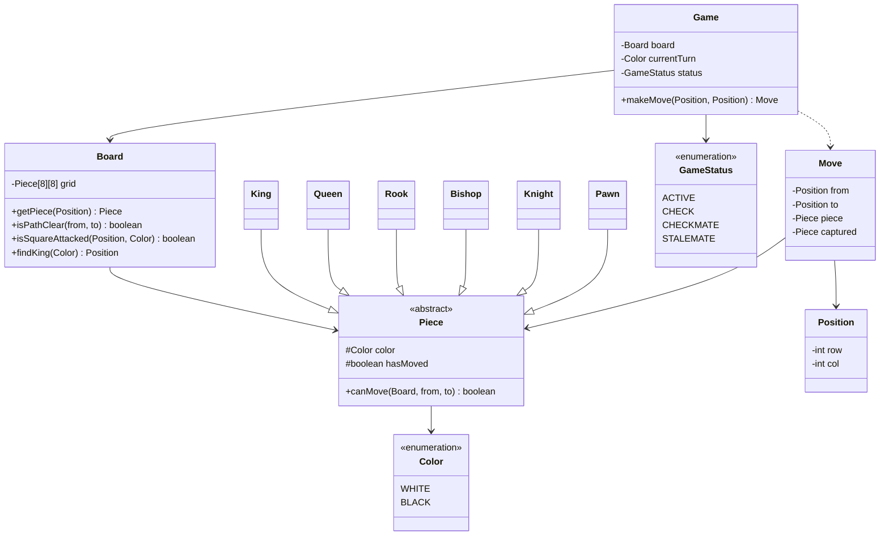

<div align="center">

# ♟️ Design Chess

   

*Two players move pieces by their own rules; a move that leaves your own king in check is illegal.*

</div>

---

## 📑 Table of contents

- [🎯 Problem statement](#-problem-statement)
- [🧩 Requirements & approach](#-requirements--approach)
- [🔷 Class diagram](#-class-diagram)
- [👥 Classes & responsibilities](#-classes--responsibilities)
- [🧭 Design patterns & principles used](#-design-patterns--principles-used)
- [📊 Strengths & limitations](#-strengths--limitations)
- [🌍 Follow-up interview questions](#-follow-up-interview-questions)
- [💻 Code](#-code)
  - [1. Implementation](#ex1)

---

## 🎯 Problem statement

> Design a **Chess** engine: an 8x8 board, the six piece types with their movement rules, whose turn it is, and the game-ending states (check, checkmate, stalemate). Full chess (castling, en passant, promotion) is out of scope; the follow-up questions cover how each would be added.

## 🧩 Requirements & approach

| 📋 Requirements | 🛠️ Design approach |
|---|---|
| 1. An 8x8 board with the standard starting position<br>2. Each piece type moves by its own rule; sliding pieces (rook, bishop, queen) cannot jump over others<br>3. Only the player whose turn it is may move, and only their own piece<br>4. A move that would leave **your own** king in check is illegal, even if the piece's shape is otherwise legal<br>5. Detect **check** (king attacked), **checkmate** (in check with no legal move) and **stalemate** (not in check, but no legal move)<br>6. Capturing, and rejecting moves onto a square held by your own piece | Each `Piece` subclass only implements its own movement shape; sliding pieces ask `Board.isPathClear`. `Board` is a passive 8x8 grid that can also answer 'is this square attacked by color X', by asking every piece of that color whether it could move there. `Game` is the only place that knows about rules spanning the whole board: it validates the shape, **simulates** the move, and only commits it if the mover's own king is not left in check (reverting otherwise), then recomputes status by trying every legal move to tell check from checkmate from stalemate. The code is split into folders (`enums`, `entities`, `exceptions`, `pieces`, `service`) and `Main`, the client, sits outside them. |

## 🔷 Class diagram



## 👥 Classes & responsibilities

| Class / interface | Responsibility | Kind · folder |
|---|---|---|
| **`Game`** | Validates a move, simulates it to guard the mover's own king, commits it, switches turns, computes status | service class · `service/` |
| **`Board`** | The 8x8 grid: what is on a square, whether a path is clear, whether a square is attacked, where a king is | class · `entities/` |
| **`Piece`** | Only knows its own movement shape; never decides whether a move is legal for the whole game | abstract class · `pieces/` |
| **`King`, `Queen`, `Rook`, `Bishop`, `Knight`, `Pawn`** | One movement rule each; the sliding pieces also check `Board.isPathClear` | classes · `pieces/` |
| **`Position`** | A (row, col) square; parses algebraic notation like `"e2"` | class · `entities/` |
| **`Move`** | What happened: piece, from, to, and anything captured | class · `entities/` |
| **`Color`, `GameStatus`** | WHITE/BLACK; ACTIVE/CHECK/CHECKMATE/STALEMATE | enums · `enums/` |
| **`InvalidMoveException`** | Wrong turn, illegal shape, or a move that would leave your own king in check | runtime exception · `exceptions/` |
| **`Main`** | A short opening, invalid moves, Fool's mate (fastest possible checkmate), and a check that must be addressed before anything else | demo · client, outside the packages |

## 🧭 Design patterns & principles used

| Pattern / principle | Where and why |
|---|---|
| **Polymorphism** | `canMove` is the only method each piece overrides; `Game` never asks 'what type is this piece' |
| **Single Responsibility principle** | `Piece` only knows shapes, `Board` only knows the grid, `Game` only knows the rules that need the whole board |
| **Open/Closed principle** | A new piece (e.g. a chess-variant 'archbishop') is a new `Piece` subclass; `Board` and `Game` are not touched |
| **Simulate, validate, commit (or revert)** | A move is applied to the real board, checked, and undone if illegal, rather than maintaining a parallel 'legal move' calculator |

## 📊 Strengths & limitations

| 👍 Strengths | 👎 Limitations |
|---|---|
| Checkmate and stalemate are derived from the same legality check used for every move, not a separate hand-written rule | No castling, en passant or pawn promotion (flagged, not implemented) |
| Each piece's movement rule is isolated and easy to unit test on its own | `hasAnyLegalMove` brute-forces every (piece, square) pair; fine for an 8x8 board, not for a generalised engine |
| `Board.isSquareAttacked` is reused for check detection, for king safety and for (eventually) castling-through-check rules | No move notation (SAN/PGN) or draw rules (threefold repetition, 50-move rule, insufficient material) |
| Fool's mate and a mid-game check are both demonstrated and pass | Not thread safe beyond a single `synchronized` method per call; no spectators/replay |

## 🌍 Follow-up interview questions

- **How would you add castling?** A special case in `King.canMove` (or a dedicated check in `Game`) that also requires: neither king nor that rook has moved, the squares between are empty, and the king does not pass through or land on an attacked square.
- **How would you add en passant?** `Pawn` needs to know the *last* move played (not just the board), so `canMove` would take the move history, or `Game` would special-case it using `history`.
- **How would you add pawn promotion?** When a pawn's move reaches the last rank, `Game.makeMove` replaces it with a chosen piece (default Queen) before updating status.
- **Why is `canMove` not aware of check?** Keeping movement shape and check-safety separate means a piece class never needs the whole board's check state; `Game` composes the two.
- **How would you detect threefold repetition or the 50-move rule?** Hash the board position after each move and count occurrences; track moves since the last pawn move or capture.
- **How do you make `hasAnyLegalMove` faster for a generalised engine?** Generate pseudo-legal moves per piece (ignoring self-check) and filter, rather than trying all 64 destinations per piece; also stop at the first legal move found, which this code already does.
- **How would you support undo?** Every applied move already knows `captured`; keep a stack of moves and restore `(from, to, captured)` plus `hasMoved` to reverse one.
- **Why does `Piece` track `hasMoved` if it's unused here?** It is exactly what castling and the pawn's double-step-from-start rule need next; the pawn rule already reads the start row, castling would read `hasMoved`.

---

## 💻 Code

This folder has **1 example** (15 Java files). Interfaces and abstract classes come first, the class with `main` comes last.

<a id="ex1"></a>

### 1. Implementation

<details open>
<summary><b>📁 Files in this example</b></summary>

```text
9. Chess/
├── entities/
│   ├── Board.java
│   ├── Move.java
│   └── Position.java
├── enums/
│   ├── Color.java
│   └── GameStatus.java
├── exceptions/
│   └── InvalidMoveException.java
├── pieces/
│   ├── Bishop.java
│   ├── King.java
│   ├── Knight.java
│   ├── Pawn.java
│   ├── Piece.java
│   ├── Queen.java
│   └── Rook.java
├── service/
│   └── Game.java
└── Main.java
```

</details>

#### 📄 `enums/Color.java`

<sub>enum · 8 lines</sub>

```java
package enums;

public enum Color {
    WHITE,
    BLACK;

    public Color opposite() { return this == WHITE ? BLACK : WHITE; }
}
```

#### 📄 `enums/GameStatus.java`

<sub>enum · 8 lines</sub>

```java
package enums;

public enum GameStatus {
    ACTIVE,
    CHECK,
    CHECKMATE,
    STALEMATE
}
```

#### 📄 `pieces/Piece.java`

<sub>abstract class · 31 lines</sub>

```java
package pieces;

import entities.Board;
import entities.Position;
import enums.Color;

// A piece only knows its own movement pattern. It does not know whether a move would leave
// its own king in check - that rule lives one level up, in Game, where both kings are visible.
public abstract class Piece {
    protected final Color color;
    protected boolean hasMoved = false;

    protected Piece(Color color) {
        this.color = color;
    }

    public Color getColor() { return color; }

    public boolean hasMoved() { return hasMoved; }

    public void markMoved() { hasMoved = true; }

    // Is (from -> to) a shape this piece can make, on an otherwise empty board, given what
    // (if anything) sits on `to`? Sliding pieces also check that the path between is clear.
    public abstract boolean canMove(Board board, Position from, Position to);

    public abstract char symbol();   // uppercase = White, lowercase = Black

    @Override
    public String toString() { return color + " " + getClass().getSimpleName(); }
}
```

#### 📄 `entities/Board.java`

<sub>class · 99 lines</sub>

```java
package entities;

import enums.Color;
import pieces.Bishop;
import pieces.King;
import pieces.Knight;
import pieces.Pawn;
import pieces.Piece;
import pieces.Queen;
import pieces.Rook;

// The 8x8 grid and the operations every piece needs from it: what is on a square, and whether
// the squares strictly between two aligned squares are all empty (for sliding pieces).
public class Board {
    private final Piece[][] grid = new Piece[8][8];

    public Board() {
        setupBackRank(0, Color.WHITE);
        setupBackRank(7, Color.BLACK);
        for (int col = 0; col < 8; col++) {
            grid[1][col] = new Pawn(Color.WHITE);
            grid[6][col] = new Pawn(Color.BLACK);
        }
    }

    private void setupBackRank(int row, Color color) {
        grid[row][0] = new Rook(color);
        grid[row][1] = new Knight(color);
        grid[row][2] = new Bishop(color);
        grid[row][3] = new Queen(color);
        grid[row][4] = new King(color);
        grid[row][5] = new Bishop(color);
        grid[row][6] = new Knight(color);
        grid[row][7] = new Rook(color);
    }

    public Piece getPiece(Position p) { return grid[p.getRow()][p.getCol()]; }

    public void setPiece(Position p, Piece piece) { grid[p.getRow()][p.getCol()] = piece; }

    // True if every square strictly between from and to (on a straight or diagonal line) is empty
    public boolean isPathClear(Position from, Position to) {
        int dr = Integer.signum(to.getRow() - from.getRow());
        int dc = Integer.signum(to.getCol() - from.getCol());
        int row = from.getRow() + dr;
        int col = from.getCol() + dc;
        while (row != to.getRow() || col != to.getCol()) {
            if (grid[row][col] != null) {
                return false;
            }
            row += dr;
            col += dc;
        }
        return true;
    }

    public static boolean notOwnPiece(Board board, Piece mover, Position to) {
        Piece target = board.getPiece(to);
        return target == null || target.getColor() != mover.getColor();
    }

    public Position findKing(Color color) {
        for (int row = 0; row < 8; row++) {
            for (int col = 0; col < 8; col++) {
                Piece piece = grid[row][col];
                if (piece instanceof King && piece.getColor() == color) {
                    return new Position(row, col);
                }
            }
        }
        throw new IllegalStateException("No " + color + " king on the board");
    }

    // Is `target` attacked by any piece of `byColor`? Used both for check detection and to
    // forbid a king from moving next to an enemy king.
    public boolean isSquareAttacked(Position target, Color byColor) {
        for (int row = 0; row < 8; row++) {
            for (int col = 0; col < 8; col++) {
                Piece piece = grid[row][col];
                if (piece != null && piece.getColor() == byColor && piece.canMove(this, new Position(row, col), target)) {
                    return true;
                }
            }
        }
        return false;
    }

    public void print() {
        for (int row = 7; row >= 0; row--) {
            StringBuilder line = new StringBuilder((row + 1) + " ");
            for (int col = 0; col < 8; col++) {
                Piece piece = grid[row][col];
                line.append(piece == null ? '.' : piece.symbol()).append(' ');
            }
            System.out.println(line);
        }
        System.out.println("  a b c d e f g h");
    }
}
```

#### 📄 `entities/Move.java`

<sub>class · 26 lines</sub>

```java
package entities;

import pieces.Piece;

public class Move {
    private final Position from;
    private final Position to;
    private final Piece piece;
    private final Piece captured;

    public Move(Position from, Position to, Piece piece, Piece captured) {
        this.from = from;
        this.to = to;
        this.piece = piece;
        this.captured = captured;
    }

    public Position getFrom() { return from; }

    public Position getTo() { return to; }

    @Override
    public String toString() {
        return piece.symbol() + " " + from + "-" + to + (captured != null ? " (captures " + captured.symbol() + ")" : "");
    }
}
```

#### 📄 `entities/Position.java`

<sub>class · 38 lines</sub>

```java
package entities;

// (row, col), both 0..7. row 0 is White's back rank, row 7 is Black's back rank.
public class Position {
    private final int row;
    private final int col;

    public Position(int row, int col) {
        this.row = row;
        this.col = col;
    }

    // Parses algebraic squares like "e2" -> col 4, row 1
    public static Position at(String square) {
        int col = square.charAt(0) - 'a';
        int row = square.charAt(1) - '1';
        return new Position(row, col);
    }

    public int getRow() { return row; }

    public int getCol() { return col; }

    public boolean isOnBoard() { return row >= 0 && row < 8 && col >= 0 && col < 8; }

    @Override
    public boolean equals(Object o) {
        if (!(o instanceof Position)) return false;
        Position p = (Position) o;
        return row == p.row && col == p.col;
    }

    @Override
    public int hashCode() { return row * 8 + col; }

    @Override
    public String toString() { return "" + (char) ('a' + col) + (row + 1); }
}
```

#### 📄 `exceptions/InvalidMoveException.java`

<sub>class · 7 lines</sub>

```java
package exceptions;

public class InvalidMoveException extends RuntimeException {
    public InvalidMoveException(String message) {
        super(message);
    }
}
```

#### 📄 `pieces/Bishop.java`

<sub>class · 18 lines</sub>

```java
package pieces;

import entities.Board;
import entities.Position;

public class Bishop extends Piece {

    public Bishop(enums.Color color) { super(color); }

    @Override
    public boolean canMove(Board board, Position from, Position to) {
        boolean diagonal = Math.abs(to.getRow() - from.getRow()) == Math.abs(to.getCol() - from.getCol());
        return diagonal && !from.equals(to) && board.isPathClear(from, to) && Board.notOwnPiece(board, this, to);
    }

    @Override
    public char symbol() { return color == enums.Color.WHITE ? 'B' : 'b'; }
}
```

#### 📄 `pieces/King.java`

<sub>class · 20 lines</sub>

```java
package pieces;

import entities.Board;
import entities.Position;
import enums.Color;

public class King extends Piece {

    public King(Color color) { super(color); }

    @Override
    public boolean canMove(Board board, Position from, Position to) {
        int dr = Math.abs(to.getRow() - from.getRow());
        int dc = Math.abs(to.getCol() - from.getCol());
        return dr <= 1 && dc <= 1 && (dr != 0 || dc != 0) && Board.notOwnPiece(board, this, to);
    }

    @Override
    public char symbol() { return color == Color.WHITE ? 'K' : 'k'; }
}
```

#### 📄 `pieces/Knight.java`

<sub>class · 19 lines</sub>

```java
package pieces;

import entities.Board;
import entities.Position;

public class Knight extends Piece {

    public Knight(enums.Color color) { super(color); }

    @Override
    public boolean canMove(Board board, Position from, Position to) {
        int dr = Math.abs(to.getRow() - from.getRow());
        int dc = Math.abs(to.getCol() - from.getCol());
        return (dr == 2 && dc == 1 || dr == 1 && dc == 2) && Board.notOwnPiece(board, this, to);
    }

    @Override
    public char symbol() { return color == enums.Color.WHITE ? 'N' : 'n'; }
}
```

#### 📄 `pieces/Pawn.java`

<sub>class · 32 lines</sub>

```java
package pieces;

import entities.Board;
import entities.Position;
import enums.Color;

public class Pawn extends Piece {

    public Pawn(Color color) { super(color); }

    @Override
    public boolean canMove(Board board, Position from, Position to) {
        int direction = color == Color.WHITE ? 1 : -1;
        int startRow = color == Color.WHITE ? 1 : 6;
        int dr = to.getRow() - from.getRow();
        int dc = to.getCol() - from.getCol();
        boolean destinationEmpty = board.getPiece(to) == null;

        if (dc == 0 && dr == direction && destinationEmpty) {
            return true;                                                   // one step forward
        }
        if (dc == 0 && dr == 2 * direction && from.getRow() == startRow && destinationEmpty
                && board.getPiece(new Position(from.getRow() + direction, from.getCol())) == null) {
            return true;                                                   // two steps from the start row
        }
        // diagonal capture only
        return Math.abs(dc) == 1 && dr == direction && !destinationEmpty && board.getPiece(to).getColor() != color;
    }

    @Override
    public char symbol() { return color == Color.WHITE ? 'P' : 'p'; }
}
```

#### 📄 `pieces/Queen.java`

<sub>class · 20 lines</sub>

```java
package pieces;

import entities.Board;
import entities.Position;

public class Queen extends Piece {

    public Queen(enums.Color color) { super(color); }

    @Override
    public boolean canMove(Board board, Position from, Position to) {
        boolean straight = from.getRow() == to.getRow() || from.getCol() == to.getCol();
        boolean diagonal = Math.abs(to.getRow() - from.getRow()) == Math.abs(to.getCol() - from.getCol());
        return (straight || diagonal) && !from.equals(to)
                && board.isPathClear(from, to) && Board.notOwnPiece(board, this, to);
    }

    @Override
    public char symbol() { return color == enums.Color.WHITE ? 'Q' : 'q'; }
}
```

#### 📄 `pieces/Rook.java`

<sub>class · 18 lines</sub>

```java
package pieces;

import entities.Board;
import entities.Position;

public class Rook extends Piece {

    public Rook(enums.Color color) { super(color); }

    @Override
    public boolean canMove(Board board, Position from, Position to) {
        boolean straight = from.getRow() == to.getRow() || from.getCol() == to.getCol();
        return straight && !from.equals(to) && board.isPathClear(from, to) && Board.notOwnPiece(board, this, to);
    }

    @Override
    public char symbol() { return color == enums.Color.WHITE ? 'R' : 'r'; }
}
```

#### 📄 `service/Game.java`

<sub>class · 110 lines</sub>

```java
package service;

import entities.Board;
import entities.Move;
import entities.Position;
import enums.Color;
import enums.GameStatus;
import exceptions.InvalidMoveException;
import pieces.King;
import pieces.Piece;

import java.util.ArrayList;
import java.util.List;

// Orchestrates turns on top of the board: validates a move's shape and legality (does not
// leave the mover's own king in check), applies it, switches turns and computes status.
public class Game {
    private final Board board = new Board();
    private final List<Move> history = new ArrayList<>();
    private Color currentTurn = Color.WHITE;
    private GameStatus status = GameStatus.ACTIVE;

    public Board getBoard() { return board; }

    public Color getCurrentTurn() { return currentTurn; }

    public GameStatus getStatus() { return status; }

    public synchronized Move makeMove(Position from, Position to) {
        if (status == GameStatus.CHECKMATE || status == GameStatus.STALEMATE) {
            throw new InvalidMoveException("The game is already over");
        }
        Piece piece = board.getPiece(from);
        if (piece == null) {
            throw new InvalidMoveException("No piece on " + from);
        }
        if (piece.getColor() != currentTurn) {
            throw new InvalidMoveException("It is " + currentTurn + "'s turn, that piece is " + piece.getColor());
        }
        if (!piece.canMove(board, from, to)) {
            throw new InvalidMoveException(piece + " cannot move " + from + " -> " + to);
        }

        Piece captured = simulateAndCheckSelf(from, to, piece, currentTurn);
        Move move = new Move(from, to, piece, captured);
        history.add(move);
        piece.markMoved();
        currentTurn = currentTurn.opposite();
        updateStatus();
        return move;
    }

    // Applies the move, then reverts it if it would leave the mover's own king in check
    private Piece simulateAndCheckSelf(Position from, Position to, Piece piece, Color mover) {
        Piece captured = board.getPiece(to);
        board.setPiece(to, piece);
        board.setPiece(from, null);

        boolean selfInCheck = board.isSquareAttacked(board.findKing(mover), mover.opposite());
        if (selfInCheck) {
            board.setPiece(from, piece);
            board.setPiece(to, captured);
            throw new InvalidMoveException("That move would leave " + mover + "'s king in check");
        }
        return captured;
    }

    private void updateStatus() {
        boolean inCheck = board.isSquareAttacked(board.findKing(currentTurn), currentTurn.opposite());
        boolean hasMove = hasAnyLegalMove(currentTurn);
        if (inCheck) {
            status = hasMove ? GameStatus.CHECK : GameStatus.CHECKMATE;
        } else {
            status = hasMove ? GameStatus.ACTIVE : GameStatus.STALEMATE;
        }
    }

    // Tries every (piece, destination) pair for `color` and returns true as soon as one does
    // not leave that color's own king in check. The board is small, so a full scan is cheap.
    private boolean hasAnyLegalMove(Color color) {
        for (int fr = 0; fr < 8; fr++) {
            for (int fc = 0; fc < 8; fc++) {
                Position from = new Position(fr, fc);
                Piece piece = board.getPiece(from);
                if (piece == null || piece.getColor() != color) {
                    continue;
                }
                for (int tr = 0; tr < 8; tr++) {
                    for (int tc = 0; tc < 8; tc++) {
                        Position to = new Position(tr, tc);
                        if (piece.canMove(board, from, to) && wouldBeSafe(from, to, piece, color)) {
                            return true;
                        }
                    }
                }
            }
        }
        return false;
    }

    private boolean wouldBeSafe(Position from, Position to, Piece piece, Color mover) {
        Piece captured = board.getPiece(to);
        board.setPiece(to, piece);
        board.setPiece(from, null);
        boolean safe = !board.isSquareAttacked(board.findKing(mover), mover.opposite());
        board.setPiece(from, piece);
        board.setPiece(to, captured);
        return safe;
    }
}
```

#### 📄 `Main.java`

<sub>class · 70 lines</sub>

```java
import entities.Board;
import entities.Move;
import entities.Position;
import enums.GameStatus;
import exceptions.InvalidMoveException;
import service.Game;

public class Main {
    public static void main(String[] args) {

        System.out.println("=== A short opening (Ruy Lopez-ish) ===");
        Game game = new Game();
        move(game, "e2", "e4");
        move(game, "e7", "e5");
        move(game, "g1", "f3");
        move(game, "b8", "c6");
        move(game, "f1", "b5");
        game.getBoard().print();
        System.out.println("Status: " + game.getStatus() + ", turn: " + game.getCurrentTurn());

        System.out.println("\n-- Invalid moves --");
        try {
            move(game, "a7", "a4");                 // wrong piece shape (pawn jumping 3)
        } catch (InvalidMoveException e) {
            System.out.println("Rejected: " + e.getMessage());
        }
        try {
            move(game, "e4", "e5");                  // not Black's turn's piece, but it's Black to move: White piece selected
        } catch (InvalidMoveException e) {
            System.out.println("Rejected: " + e.getMessage());
        }

        System.out.println("\n=== Fool's mate: fastest possible checkmate ===");
        Game fools = new Game();
        move(fools, "f2", "f3");
        move(fools, "e7", "e5");
        move(fools, "g2", "g4");
        Move mate = move(fools, "d8", "h4");
        System.out.println("Last move: " + mate);
        fools.getBoard().print();
        System.out.println("Status: " + fools.getStatus() + " (White has no legal move left)");

        System.out.println("\n-- No move is possible once the game is over --");
        try {
            move(fools, "e1", "e2");
        } catch (InvalidMoveException e) {
            System.out.println("Rejected: " + e.getMessage());
        }

        System.out.println("\n=== A move that ignores check, or exposes your own king, is rejected ===");
        Game check = new Game();
        move(check, "e2", "e4");
        move(check, "d7", "d5");
        move(check, "f1", "b5");    // Bb5+ : nothing blocks the b5-e8 diagonal yet, Black's king is in check
        System.out.println("Black is in " + check.getStatus() + " and must respond to it");
        try {
            move(check, "g8", "f6");    // a legal knight move, but it ignores the check
        } catch (InvalidMoveException e) {
            System.out.println("Rejected: " + e.getMessage());
        }
        move(check, "b8", "c6");        // this blocks the check: now legal
        System.out.println("Nc6 blocks it -> status is back to " + check.getStatus());
    }

    private static Move move(Game game, String from, String to) {
        Move move = game.makeMove(Position.at(from), Position.at(to));
        System.out.println(move + "  [" + game.getStatus() + "]");
        return move;
    }
}
```

<details>
<summary><b>▶️ How to compile and run this example</b></summary>

```bash
# run from the repository root
mkdir -p out
find "Interview Questions/9. Chess" -name "*.java" -print0 | xargs -0 javac -d out
java -cp out Main
```

</details>

---

<div align="center">

[◀ ATM](../8.%20ATM/README.md) &nbsp;·&nbsp; [📚 All questions](../QUESTIONS.md) &nbsp;·&nbsp; [Splitwise ▶](../10.%20Splitwise/README.md)

</div>
