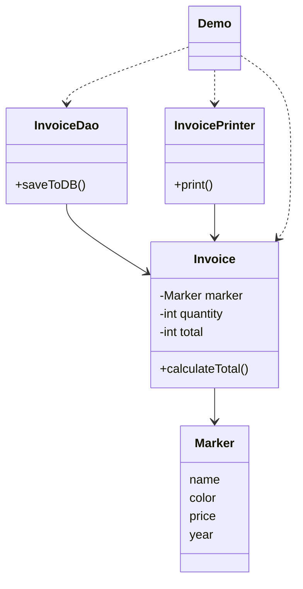

<div align="center">

# 🪪 S - Single Responsibility Principle (SRP)

   

*A class should have only one reason to change.*

</div>

---

## 📑 Table of contents

- [🎯 Intent](#-intent)
- [🧩 The problem & the solution](#-the-problem--the-solution)
- [🔷 Structure](#-structure)
- [👥 Participants](#-participants)
- [🧭 When to use it](#-when-to-use-it)
- [📊 Pros & cons](#-pros--cons)
- [🌍 Real-world examples](#-real-world-examples)
- [💻 Code](#-code)
  - [1. ❌ Problem - one class, three responsibilities](#ex1)
  - [2. ✅ Solution - one class per responsibility](#ex2)

---

## 🎯 Intent

> A class should have only **ONE reason to change**, meaning it should have ONE and ONLY ONE job or responsibility.

## 🧩 The problem & the solution

| 😣 Problem | 💡 Solution |
|---|---|
| `Invoice` has three jobs: `calculateTotal()` (business logic), `saveToDB()` (database operations) and `printInvoice()` (printing). If the tax rules, the database structure **or** the printing requirement change, the same class must be edited, and a change to one responsibility might affect or break the others. The class becomes bloated, fragile and harder to maintain. | Give every responsibility its own class: `Invoice` only calculates the total, `InvoiceDao` only talks to the database and `InvoicePrinter` only prints. Each class now has exactly one reason to change. |

## 🔷 Structure



## 👥 Participants

| Role | Responsibility | In this repo |
|---|---|---|
| **Data / business logic** | Holds the invoice data and calculates the total | `Invoice` |
| **Persistence** | Database operations only | `InvoiceDao` |
| **Presentation** | Printing the invoice only | `InvoicePrinter` |
| **Supporting data** | The product being invoiced | `Marker` |
| **Client** | Creates the objects and uses each service | `Demo` |

## 🧭 When to use it

| ✅ Use it when | ⚠️ Avoid it when |
|---|---|
| A class mixes business logic, database access and printing | You read SRP as 'one method per class'. SRP is about one **responsibility**; a class may have several methods as long as they serve that purpose |
| A change to one functionality might affect or break another | The pieces would always change together for the same reason (splitting them only adds classes) |
| You want to test each class in isolation |  |
| A class should be reused in other contexts (for example domestic and international invoices can share the same `InvoicePrinter`) |  |

## 📊 Pros & cons

| 👍 Pros | 👎 Cons |
|---|---|
| **Single responsibility:** each class has only one reason to change | More classes and files to navigate |
| **Better maintainability:** changes to one functionality do not affect others | The caller has to create and connect the objects (`InvoiceDao` and `InvoicePrinter` both receive the `Invoice`) |
| **Improved testability:** each class can be tested in isolation |  |
| **Enhanced reusability:** classes can be reused in different contexts |  |

## 🌍 Real-world examples

- **Invoice system (this folder):** calculation, database persistence and printing live in three classes (`Invoice`, `InvoiceDao`, `InvoicePrinter`)
- **Tax rules change:** only `Invoice` is edited
- **Database structure changes:** only `InvoiceDao` is edited
- **Printing requirement changes:** only `InvoicePrinter` is edited
- **Domestic and international invoices:** both kinds can reuse the same `InvoicePrinter`

---

## 💻 Code

This folder has **2 examples** (8 Java files). Interfaces and abstract classes come first, the class with `main` comes last.

<a id="ex1"></a>

### 1. ❌ Problem - one class, three responsibilities

> `Invoice` calculates the total, saves to the database and prints, all in one class.

> ### ⚠️ The three responsibilities inside `Invoice`
>
> | Method | Responsibility | Changes when... |
> |---|---|---|
> | `calculateTotal()` | Calculate the total (business logic) | the tax calculation rules change |
> | `saveToDB()` | Database operations | the database structure changes |
> | `printInvoice()` | Print the invoice | the printing requirement changes |
>
> Three different reasons to change one class: this is the SRP violation.

<details open>
<summary><b>📁 Files in this example</b></summary>

```text
Problem (Violates SRP)/
├── Demo.java
├── Invoice.java
└── Marker.java
```

</details>

#### 📄 `Invoice.java`

<sub>class · 29 lines</sub>

```java
// BAD: This class violates SRP by having multiple responsibilities
public class Invoice {
    private Marker marker;
    private int quantity;
    private int total;

    public Invoice(Marker marker, int quantity) {
        this.marker = marker;
        this.quantity = quantity;
    }

    // Responsibility 1: Calculate the total(business logic)
    public void calculateTotal() {
        System.out.println("Calculating total...");
        this.total = this.marker.price * this.quantity;
    }

    // Responsibility 2: Database Operations
    public void saveToDB() {
        // Save the data into DB
        System.out.println("Saving to DB...");
    }

    // Responsibility 3: Print the Invoice
    public void printInvoice() {
        // print the Invoice
        System.out.println("Printing Invoice...");
    }
}
```

#### 📄 `Marker.java`

<sub>class · 13 lines</sub>

```java
public class Marker {
    String name;
    String color;
    int price;
    int year;

    public Marker(String name, String color, int price, int year) {
        this.name = name;
        this.color = color;
        this.price = price;
        this.year = year;
    }
}
```

#### 📄 `Demo.java`

<sub>class · 9 lines</sub>

```java
// Usage example
public class Demo {
    public static void main(String[] args) {
        Invoice invoice = new Invoice(new Marker("name", "color", 10, 2020), 10);
        invoice.calculateTotal();
        invoice.saveToDB();
        invoice.printInvoice();
    }
}
```

<details>
<summary><b>▶️ How to compile and run this example</b></summary>

```bash
# run from the repository root
mkdir -p out
find "SOLID Principles/1. Single Responsibility Principle/Problem (Violates SRP)" -name "*.java" -print0 | xargs -0 javac -d out
java -cp out Demo
```

</details>

---

<a id="ex2"></a>

### 2. ✅ Solution - one class per responsibility

> `Invoice` (data and calculation), `InvoiceDao` (database) and `InvoicePrinter` (printing) work together from `Demo`.

> ### ✅ One reason to change per class
>
> | Class | Only changes if... |
> |---|---|
> | `Invoice` | the invoice tax calculation rules change |
> | `InvoiceDao` | the database operations change |
> | `InvoicePrinter` | the printing requirements change |
>
> **Summary:** SRP keeps code maintainable, testable and flexible. It does not limit a class to a single method; it makes sure the class has one responsibility, even with multiple methods that align with that purpose.

<details open>
<summary><b>📁 Files in this example</b></summary>

```text
Solution (Follows SRP)/
├── Demo.java
├── Invoice.java
├── InvoiceDao.java
├── InvoicePrinter.java
└── Marker.java
```

</details>

#### 📄 `Invoice.java`

<sub>class · 20 lines</sub>

```java
// GOOD: Following SRP - Each class has a single responsibility

// Responsibility: Managing Invoice data only
public class Invoice {

    private Marker marker;
    private int quantity;
    private int total;

    public Invoice(Marker marker, int quantity) {
        this.marker = marker;
        this.quantity = quantity;
    }

    // Responsibility 1: Calculate the total(business logic)
    public void calculateTotal() {
        System.out.println("Calculating total...");
        this.total = this.marker.price * this.quantity;
    }
}
```

#### 📄 `InvoiceDao.java`

<sub>class · 14 lines</sub>

```java
// Responsibility 2: Managing Database Operations only
public class InvoiceDao {

    Invoice invoice;

    public InvoiceDao(Invoice invoice) {
        this.invoice = invoice;
    }

    public void saveToDB() {
        // Save into the DB the invoice
        System.out.println("Saving to DB...");
    }
}
```

#### 📄 `InvoicePrinter.java`

<sub>class · 14 lines</sub>

```java
// Responsibility 3: Printing the Invoice only
public class InvoicePrinter {

    private Invoice invoice;

    public InvoicePrinter(Invoice invoice) {
        this.invoice = invoice;
    }

    public void print() {
        // print the invoice
        System.out.println("Printing Invoice...");
    }
}
```

#### 📄 `Marker.java`

<sub>class · 13 lines</sub>

```java
public class Marker {
    String name;
    String color;
    int price;
    int year;

    public Marker(String name, String color, int price, int year) {
        this.name = name;
        this.color = color;
        this.price = price;
        this.year = year;
    }
}
```

#### 📄 `Demo.java`

<sub>class · 15 lines</sub>

```java
// Usage example showing how all classes work together
public class Demo {
    public static void main(String[] args) {

        // create the service objects
        Invoice invoice = new Invoice(new Marker("name", "color", 10, 2020), 10);
        InvoiceDao invoiceDao = new InvoiceDao(invoice);
        InvoicePrinter invoicePrinter = new InvoicePrinter(invoice);

        // Use the services
        invoice.calculateTotal();
        invoiceDao.saveToDB();
        invoicePrinter.print();
    }
}
```

<details>
<summary><b>▶️ How to compile and run this example</b></summary>

```bash
# run from the repository root
mkdir -p out
find "SOLID Principles/1. Single Responsibility Principle/Solution (Follows SRP)" -name "*.java" -print0 | xargs -0 javac -d out
java -cp out Demo
```

</details>

---

<div align="center">

[📚 All principles](../PRINCIPLES.md) &nbsp;·&nbsp; [Open/Closed ▶](../2.%20Open%20Closed%20Principle/README.md)

</div>
