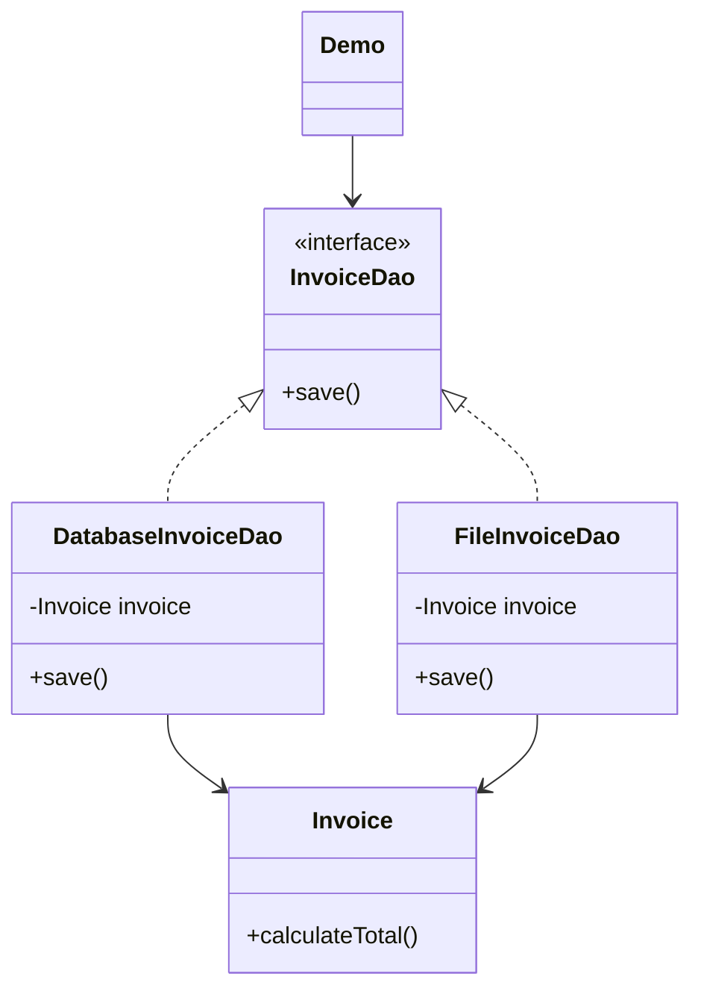

<div align="center">

# 🔓 O - Open/Closed Principle (OCP)

   

*Open for extension, closed for modification.*

</div>

---

## 📑 Table of contents

- [🎯 Intent](#-intent)
- [🧩 The problem & the solution](#-the-problem--the-solution)
- [🔷 Structure](#-structure)
- [👥 Participants](#-participants)
- [🧭 When to use it](#-when-to-use-it)
- [📊 Pros & cons](#-pros--cons)
- [🌍 Real-world examples](#-real-world-examples)
- [💻 Code](#-code)
  - [1. ❌ Problem - new save type means editing InvoiceDao](#ex1)
  - [2. ✅ Solution - interface + one class per save type](#ex2)

---

## 🎯 Intent

> A class should be **open for extension but closed for modification**.

## 🧩 The problem & the solution

| 😣 Problem | 💡 Solution |
|---|---|
| `InvoiceDao` started with `saveToDB()`. To save to a file, `saveToFile()` was added **inside the same class**, and a future `saveToMongoDB()` would need another edit (also in all derived classes, if any). Existing code is already tested and deployed in production, so every modification adds risk and requires re-testing the existing functionality. | Turn `InvoiceDao` into an interface with a single `save()` method. `DatabaseInvoiceDao` and `FileInvoiceDao` implement it, and any new kind of save is just a new class that implements the interface: an extension without modification. |

## 🔷 Structure



## 👥 Participants

| Role | Responsibility | In this repo |
|---|---|---|
| **Abstraction (closed for modification)** | Stable interface that callers depend on | `InvoiceDao` (interface) |
| **Extensions (open for extension)** | One class per kind of save; new ones are added here | `DatabaseInvoiceDao`, `FileInvoiceDao` |
| **Data** | The invoice being saved | `Invoice`, `Marker` |
| **Client** | Works through the `InvoiceDao` interface | `Demo` |

## 🧭 When to use it

| ✅ Use it when | ⚠️ Avoid it when |
|---|---|
| New behaviour is expected over time (another way to save, another format...) | The new functionality is added by editing a working class (`saveToFile()` inside `InvoiceDao`) |
| The existing code is already tested and deployed in production | You abstract a variation that will never happen (the interface only pays off when extensions really appear) |
| You want to add features without re-testing everything that already works |  |
| You want dynamic behaviour through interfaces and inheritance (polymorphism) |  |

## 📊 Pros & cons

| 👍 Pros | 👎 Cons |
|---|---|
| **Reduced risk:** existing tested code remains unchanged | More classes, plus an interface to maintain |
| **Better maintainability:** new features do not break existing functionality | The right abstraction has to be chosen up front |
| **Improved flexibility:** new behaviour is added without touching existing code |  |
| **Enhanced testability:** new extensions can be tested independently |  |
| **Supports polymorphism:** dynamic behaviour through interfaces and inheritance |  |

## 🌍 Real-world examples

- **Saving invoices (this folder):** database today, file next, and `saveToMongoDB()` later is just one more `InvoiceDao` implementation
- **Production code you cannot risk:** a deployed `InvoiceDao` stays untouched while new savers are added beside it

---

## 💻 Code

This folder has **2 examples** (11 Java files). Interfaces and abstract classes come first, the class with `main` comes last.

<a id="ex1"></a>

### 1. ❌ Problem - new save type means editing InvoiceDao

> `InvoiceDaoOld` only had `saveToDB()`; the new `InvoiceDao` had to be **modified** to add `saveToFile()`.

> ### ⚠️ Problems with this code
>
> - **Modification required:** every new type of save (for example `saveToMongoDB()`) means changing the existing `InvoiceDao`.
> - **Risk of breaking existing code:** the changes might introduce bugs in working functionality, in a class that is already deployed in production.
> - **Testing issues:** all existing functionality must be re-tested whenever a new save operation is added.

<details open>
<summary><b>📁 Files in this example</b></summary>

```text
Problem (Violates OCP)/
├── Demo.java
├── Invoice.java
├── InvoiceDao.java
├── InvoiceDaoOld.java
└── Marker.java
```

</details>

#### 📄 `Invoice.java`

<sub>class · 17 lines</sub>

```java
public class Invoice {

    private Marker marker;
    private int quantity;
    private int total;

    public Invoice(Marker marker, int quantity) {
        this.marker = marker;
        this.quantity = quantity;
    }

    // Responsibility 1: Calculate the total(business logic)
    public void calculateTotal() {
        System.out.println("Calculating total...");
        this.total = this.marker.price * this.quantity;
    }
}
```

#### 📄 `InvoiceDao.java`

<sub>class · 22 lines</sub>

```java
// Responsibility: Managing Database Operations and File Operations
// BAD: This class violates OCP - needs modification for every new kind of save function
public class InvoiceDao {

    Invoice invoice;

    public InvoiceDao(Invoice invoice) {
        this.invoice = invoice;
    }

    public void saveToDB() {
        // Save into the DB the invoice
        System.out.println("Saving to DB...");
    }

    // BAD: This design violates OCP
    // Every time we add a new save function, we need to modify the existing InvoiceDao class
    public void saveToFile() {
        // Save into the file
        System.out.println("Saving to file...");
    }
}
```

#### 📄 `InvoiceDaoOld.java`

<sub>class · 14 lines</sub>

```java
// Responsibility: Managing Database Operations only
public class InvoiceDaoOld {

    Invoice invoice;

    public InvoiceDaoOld(Invoice invoice) {
        this.invoice = invoice;
    }

    public void saveToDB() {
        // Save into the DB the invoice
        System.out.println("Saving to DB...");
    }
}
```

#### 📄 `Marker.java`

<sub>class · 13 lines</sub>

```java
public class Marker {
    String name;
    String color;
    int price;
    int year;

    public Marker(String name, String color, int price, int year) {
        this.name = name;
        this.color = color;
        this.price = price;
        this.year = year;
    }
}
```

#### 📄 `Demo.java`

<sub>class · 15 lines</sub>

```java
// Usage example - showing the problem
public class Demo {
    public static void main(String[] args) {
        Invoice invoice = new Invoice(new Marker("name", "color", 10, 2020), 10);
        invoice.calculateTotal();

        InvoiceDao databaseFileSave = new InvoiceDao(invoice);
        databaseFileSave.saveToDB(); // Save to DB
        databaseFileSave.saveToFile(); // Save to File

        // Problem: If we want to add a new function like saveToMongoDB(),
        // we need to modify InvoiceDao and all its derived classes(if exists)
        // This violates the "closed for modification" part of OCP
    }
}
```

<details>
<summary><b>▶️ How to compile and run this example</b></summary>

```bash
# run from the repository root
mkdir -p out
find "SOLID Principles/2. Open Closed Principle/Problem (Violates OCP)" -name "*.java" -print0 | xargs -0 javac -d out
java -cp out Demo
```

</details>

---

<a id="ex2"></a>

### 2. ✅ Solution - interface + one class per save type

> `InvoiceDao` is an interface; `DatabaseInvoiceDao` and `FileInvoiceDao` implement `save()`. The file saver was added **without modifying** anything.

> ### ✅ Open for extension, closed for modification
>
> - **Open for extension:** new save functions can be added as new classes.
> - **Closed for modification:** the existing code remains unchanged.
>
> **Summary:** OCP relies on abstraction and well-defined interfaces. Systems built this way can evolve and expand without compromising existing functionality, which makes them more robust, maintainable and scalable and reduces the risk of introducing defects during changes.

<details open>
<summary><b>📁 Files in this example</b></summary>

```text
Solution (Follows OCP)/
├── DatabaseInvoiceDao.java
├── Demo.java
├── FileInvoiceDao.java
├── Invoice.java
├── InvoiceDao.java
└── Marker.java
```

</details>

#### 📄 `InvoiceDao.java`

<sub>interface · 4 lines</sub>

```java
// GOOD: Following OCP using interfaces and polymorphism
public interface InvoiceDao {
    public void save();
}
```

#### 📄 `DatabaseInvoiceDao.java`

<sub>class · 15 lines</sub>

```java
// Concrete implementation for DatabaseInvoiceDao
public class DatabaseInvoiceDao implements InvoiceDao {
    Invoice invoice;

    public DatabaseInvoiceDao(Invoice invoice) {
        // set the invoice
        this.invoice = invoice;
    }

    @Override
    public void save() {
        // Save into the DB the invoice
        System.out.println("Saving to DB...");
    }
}
```

#### 📄 `FileInvoiceDao.java`

<sub>class · 17 lines</sub>

```java
// Concrete implementation for FileInvoiceDao
// NEW File Save Operation: An extension without modification!
public class FileInvoiceDao implements InvoiceDao {

    Invoice invoice;

    public FileInvoiceDao(Invoice invoice) {
        // set the invoice
        this.invoice = invoice;
    }

    @Override
    public void save() {
        // Save into the file the invoice
        System.out.println("Saving to file...");
    }
}
```

#### 📄 `Invoice.java`

<sub>class · 17 lines</sub>

```java
public class Invoice {

    private Marker marker;
    private int quantity;
    private int total;

    public Invoice(Marker marker, int quantity) {
        this.marker = marker;
        this.quantity = quantity;
    }

    // Responsibility 1: Calculate the total(business logic)
    public void calculateTotal() {
        System.out.println("Calculating total...");
        this.total = this.marker.price * this.quantity;
    }
}
```

#### 📄 `Marker.java`

<sub>class · 13 lines</sub>

```java
public class Marker {
    String name;
    String color;
    int price;
    int year;

    public Marker(String name, String color, int price, int year) {
        this.name = name;
        this.color = color;
        this.price = price;
        this.year = year;
    }
}
```

#### 📄 `Demo.java`

<sub>class · 17 lines</sub>

```java
// Usage demonstrating OCP compliance
public class Demo {
    public static void main(String[] args) {
        Invoice invoice = new Invoice(new Marker("name", "color", 10, 2020), 10);
        invoice.calculateTotal();

        InvoiceDao databaseInvoiceDao = new DatabaseInvoiceDao(invoice);
        databaseInvoiceDao.save(); // Save to DB

        InvoiceDao fileInvoiceDao = new FileInvoiceDao(invoice);
        fileInvoiceDao.save(); // Save to File

        // The system is:
        // - OPEN for extension (new save functions can be added)
        // - CLOSED for modification (existing code remains unchanged)
    }
}
```

<details>
<summary><b>▶️ How to compile and run this example</b></summary>

```bash
# run from the repository root
mkdir -p out
find "SOLID Principles/2. Open Closed Principle/Solution (Follows OCP)" -name "*.java" -print0 | xargs -0 javac -d out
java -cp out Demo
```

</details>

---

<div align="center">

[◀ Single Responsibility](../1.%20Single%20Responsibility%20Principle/README.md) &nbsp;·&nbsp; [📚 All principles](../PRINCIPLES.md)

</div>
