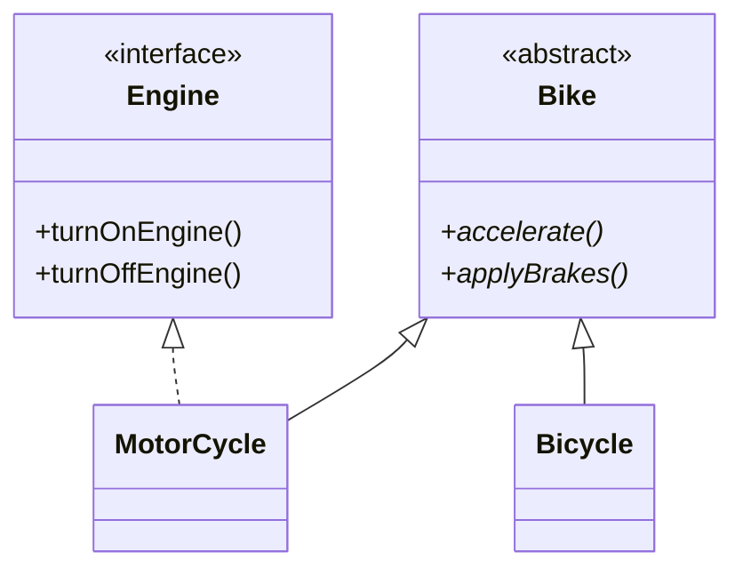
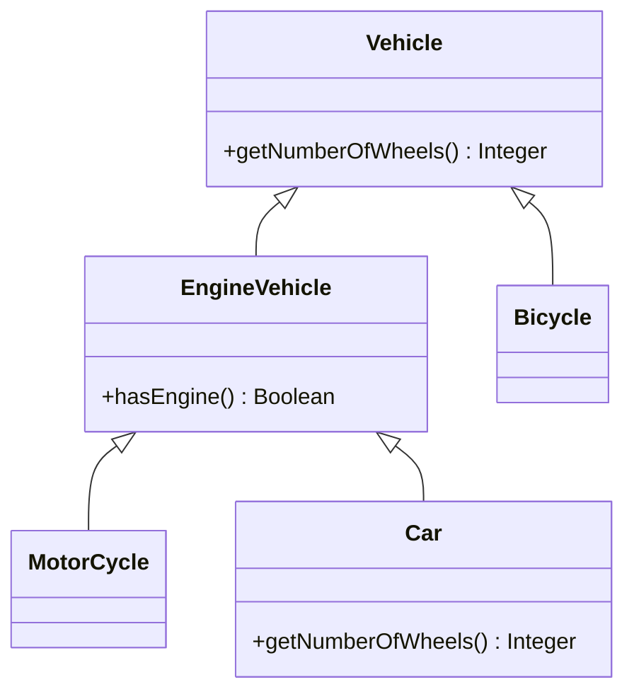

<div align="center">

# 🔁 L - Liskov Substitution Principle (LSP)

   

*Subclasses must be usable wherever their parent is expected.*

</div>

---

## 📑 Table of contents

- [🎯 Intent](#-intent)
- [🧩 The problem & the solution](#-the-problem--the-solution)
- [🔷 Structure](#-structure)
- [👥 Participants](#-participants)
- [🧭 When to use it](#-when-to-use-it)
- [📊 Pros & cons](#-pros--cons)
- [🌍 Real-world examples](#-real-world-examples)
- [💻 Code](#-code)
  - [1. ❌ Problem 1 - Bicycle breaks the Bike contract](#ex1)
  - [2. ❌ Problem 2 - Bicycle returns null for hasEngine()](#ex2)
  - [3. ✅ Solution 1 - Bike + Engine interface](#ex3)
  - [4. ✅ Solution 2 - Vehicle and EngineVehicle](#ex4)

---

## 🎯 Intent

> The **objects of a superclass should be replaceable with objects of its subclasses without breaking the application**. If class B is a subtype of class A, we should be able to replace objects of A with B without breaking the behaviour of the program. A subclass should extend the capability of the parent class, not narrow it down.

## 🧩 The problem & the solution

| 😣 Problem | 💡 Solution |
|---|---|
| **Example 1:** the `Bike` interface forces `turnOnEngine()` and `turnOffEngine()`, but not all bikes have engines (e-bikes and bicycles). `Bicycle` throws an `AssertionError`, so client code cannot safely treat all `Bike` subclasses the same way. **Example 2:** `Vehicle.hasEngine()` returns `true`, but `Bicycle` overrides it to return `null`, so the client crashes with a `NullPointerException` as soon as a `Bicycle` is added to the list. | **Example 1:** keep only what every bike can do in the abstract class `Bike` (`accelerate()`, `applyBrakes()`) and move the engine behaviour into a separate `Engine` interface that only `MotorCycle` implements. **Example 2:** keep only generic methods in `Vehicle` and put `hasEngine()` in a new `EngineVehicle` subclass, so a `Bicycle` simply cannot be asked about an engine (a compile-time error instead of a runtime crash). |

## 🔷 Structure

**Example 1 - Bike**



**Example 2 - Vehicle**



## 👥 Participants

| Role | Responsibility | In this repo |
|---|---|---|
| **Base type (the contract)** | Only the behaviour that **every** subtype can really do | `Bike`, `Vehicle` |
| **Capability interface / intermediate class** | Extra behaviour that only some subtypes have | `Engine`, `EngineVehicle` |
| **Substitutable subclasses** | Honour the contract of the parent, never narrow it | `MotorCycle`, `Bicycle`, `Car` |
| **Client** | Uses the base type without knowing the subclass | `Demo`, `SolutionDemo` |

## 🧭 When to use it

| ✅ Use it when | ⚠️ Avoid it when |
|---|---|
| Client code uses a base type (`Bike`, `Vehicle`) and must work with **any** subclass | A subclass throws an exception for an inherited method (`Bicycle.turnOnEngine()` throws `AssertionError`) |
| Subclasses are added later and must not break existing code | A subclass changes the meaning of an inherited method (`Bicycle.hasEngine()` returns `null`, so the caller gets a `NullPointerException`) |
| Some subclasses lack a capability: model it in a separate interface or subclass instead of forcing it on everyone | A subclass narrows the parent's capability instead of extending it (the PDF calls this *strengthening preconditions*) |

## 📊 Pros & cons

| 👍 Pros | 👎 Cons |
|---|---|
| **Prevents fragile code:** subclass behaviour cannot violate what the parent promised | More types (an abstract class plus an interface, or an extra intermediate class) |
| **Improves flexibility:** classes can be substituted without breaking the parent contract | You must decide up front what is truly common to **all** subtypes |
| **Improved maintainability:** changes to subclasses do not break existing code |  |
| **Promotes code reusability:** base classes are reused and new subclasses are created without modifying existing code |  |

## 🌍 Real-world examples

- **Bikes (this folder):** a motorcycle has an engine, while bicycles (and e-bikes) behave differently, so engine methods cannot live on `Bike`
- **Vehicles (this folder):** motorcycles, cars and bicycles in one `List<Vehicle>`; a bicycle must not break the loop that asks about wheels or engines

---

## 💻 Code

This folder has **4 examples** (20 Java files). Interfaces and abstract classes come first, the class with `main` comes last.

<a id="ex1"></a>

### 1. ❌ Problem 1 - Bicycle breaks the Bike contract

> `Bike` forces engine methods, so `Bicycle` throws `AssertionError`. Running `Demo` crashes at `bicycle.turnOnEngine()` on purpose.

> ### ⚠️ Problems with this code
>
> - Not all bikes have engines (e-bikes and bicycles), but the base type forces the `turnOnEngine()` method.
> - `Bicycle` throws an exception, violating the expected contract.
> - Client code cannot safely treat all `Bike` subclasses uniformly.

<details open>
<summary><b>📁 Files in this example</b></summary>

```text
Problem 1 Bike (Violates LSP)/
├── Bicycle.java
├── Bike.java
├── Demo.java
└── MotorCycle.java
```

</details>

#### 📄 `Bike.java`

<sub>interface · 11 lines</sub>

```java
// BAD: This design violates LSP
public interface Bike {

    void turnOnEngine();

    void turnOffEngine();

    void accelerate();

    void applyBrakes();
}
```

#### 📄 `Bicycle.java`

<sub>class · 38 lines</sub>

```java
// This class violates LSP!
public class Bicycle implements Bike {
    String brand;
    Boolean hasGears;
    int speed;

    public Bicycle(String brand, Boolean hasGears, int speed) {
        this.brand = brand;
        this.hasGears = hasGears;
        this.speed = speed;
    }

    // LSP Violation: Strengthening preconditions
    // Bicycle changes the behavior of turnOnEngine
    @Override
    public void turnOnEngine() {
        throw new AssertionError("Detail Message: Bicycle has no engine!");
    }

    // Bicycle changes the behavior of turnOffEngine
    @Override
    public void turnOffEngine() {
        throw new AssertionError("Detail Message: Bicycle has no engine!");
    }

    @Override
    public void accelerate() {
        this.speed = this.speed + 10; // increase the speed
        System.out.println("Bicycle Speed: " + this.speed);
    }

    @Override
    public void applyBrakes() {
        this.speed = this.speed - 5; // decrease the speed
        System.out.println("Bicycle Speed: " + this.speed);
    }

}
```

#### 📄 `MotorCycle.java`

<sub>class · 35 lines</sub>

```java
// Subclass of Bike - implements all Bike class behavior
public class MotorCycle implements Bike {
    String company;
    boolean isEngineOn;
    int speed;

    public MotorCycle(String company, int speed) {
        this.company = company;
        this.speed = speed;
    }

    @Override
    public void turnOnEngine() {
        this.isEngineOn = true; // turn on the engine!
        System.out.println("Engine is ON!");
    }

    @Override
    public void turnOffEngine() {
        this.isEngineOn = false; // turn off the engine!
        System.out.println("Engine is OFF!");
    }

    @Override
    public void accelerate() {
        this.speed = this.speed + 10; // increase the speed
        System.out.println("MotorCycle Speed: " + this.speed);
    }

    @Override
    public void applyBrakes() {
        this.speed = this.speed - 5; // decrease the speed
        System.out.println("MotorCycle Speed: " + this.speed);
    }
}
```

#### 📄 `Demo.java`

<sub>class · 20 lines</sub>

```java
// Usage example - demonstrates the LSP violations
public class Demo {
    public static void main(String[] args) {
        // create the objects
        MotorCycle motorCycle = new MotorCycle("HeroHonda", 10);
        Bicycle bicycle = new Bicycle("Hercules", true, 10);

        // use the objects
        // Works fine with MotorCycle - implements all Bike class behavior
        motorCycle.turnOnEngine();
        motorCycle.accelerate();
        motorCycle.applyBrakes();
        motorCycle.turnOffEngine();
        // Client expects to be able to see the same behavior with Bicycle
        bicycle.turnOnEngine(); // fails to implement Bike class behavior
        bicycle.accelerate();
        bicycle.applyBrakes();
        bicycle.turnOffEngine(); // fails to implement Bike class behavior
    }
}
```

<details>
<summary><b>▶️ How to compile and run this example</b></summary>

```bash
# run from the repository root
mkdir -p out
find "SOLID Principles/3. Liskov Substitution Principle/Problem 1 Bike (Violates LSP)" -name "*.java" -print0 | xargs -0 javac -d out
java -cp out Demo
```

</details>

---

<a id="ex2"></a>

### 2. ❌ Problem 2 - Bicycle returns null for hasEngine()

> Adding a `Bicycle` to a `List<Vehicle>` makes the loop throw a `NullPointerException` on purpose.

<details open>
<summary><b>📁 Files in this example</b></summary>

```text
Problem 2 Vehicle (Violates LSP)/
├── Bicycle.java
├── Car.java
├── MotorCycle.java
├── Vehicle.java
└── ViolationDemo.java
```

</details>

#### 📄 `Bicycle.java`

<sub>class · 5 lines</sub>

```java
public class Bicycle extends Vehicle {
    public Boolean hasEngine() {
        return null;
    }
}
```

#### 📄 `Car.java`

<sub>class · 10 lines</sub>

```java
public class Car extends Vehicle {
    @Override
    public Integer getNumberOfWheels() {
        return 4;
    }

    public String getSpecifications() {
        return "Car has " + this.getNumberOfWheels() + " wheels and has engine: " + this.hasEngine();
    }
}
```

#### 📄 `MotorCycle.java`

<sub>class · 6 lines</sub>

```java
public class MotorCycle extends Vehicle {

    public String getSpecifications() {
        return "MotorCycle has " + this.getNumberOfWheels() + " wheels and has engine: " + this.hasEngine();
    }
}
```

#### 📄 `Vehicle.java`

<sub>class · 9 lines</sub>

```java
public class Vehicle {
    public Integer getNumberOfWheels() {
        return 4;
    }

    public Boolean hasEngine() {
        return true;
    }
}
```

#### 📄 `ViolationDemo.java`

<sub>class · 24 lines</sub>

```java
import java.util.ArrayList;
import java.util.List;

// Usage example - Violation of Liskov Substitution
public class ViolationDemo {
    public static void main(String[] args) {
        // Happy Flow
        List<Vehicle> vehicleList = new ArrayList<>();
        vehicleList.add(new MotorCycle());
        vehicleList.add(new Car());
        for (Vehicle vehicle : vehicleList) {
            System.out.println(vehicle.hasEngine().toString());
        }
        // Add Bicycle - Violation of LSP
        List<Vehicle> vehicleList2 = new ArrayList<>();
        vehicleList2.add(new MotorCycle());
        vehicleList2.add(new Car());
        vehicleList2.add(new Bicycle());
        for (Vehicle vehicle : vehicleList2) {
            System.out.println(vehicle.hasEngine().toString()); // throws NPE
            // Client code will break for Bicycle
        }
    }
}
```

<details>
<summary><b>▶️ How to compile and run this example</b></summary>

```bash
# run from the repository root
mkdir -p out
find "SOLID Principles/3. Liskov Substitution Principle/Problem 2 Vehicle (Violates LSP)" -name "*.java" -print0 | xargs -0 javac -d out
java -cp out ViolationDemo
```

</details>

---

<a id="ex3"></a>

### 3. ✅ Solution 1 - Bike + Engine interface

> `Bike` has only `accelerate()` and `applyBrakes()`; `MotorCycle` adds the `Engine` interface, `Bicycle` does not need it.

> ### ✅ Key benefits of the refactored code
>
> - **Prevents fragile code:** subclass behaviour no longer violates what the parent promised.
> - **Improves flexibility:** classes can be substituted without breaking the parent contract.
> - **Improved maintainability:** changes to subclasses do not break existing code.
> - **Promotes code reusability:** new subclasses can be created without modifying existing code.

<details open>
<summary><b>📁 Files in this example</b></summary>

```text
Solution 1 Bike (Follows LSP)/
├── Bicycle.java
├── Bike.java
├── Demo.java
├── Engine.java
└── MotorCycle.java
```

</details>

#### 📄 `Bike.java`

<sub>abstract class · 8 lines</sub>

```java
abstract class Bike {

    // All Bikes can do these things
    public abstract void accelerate();

    public abstract void applyBrakes();

}
```

#### 📄 `Engine.java`

<sub>interface · 5 lines</sub>

```java
public interface Engine {
    void turnOnEngine();

    void turnOffEngine();
}
```

#### 📄 `Bicycle.java`

<sub>class · 27 lines</sub>

```java
// GOOD: Following LSP
// Subclass of Bike - implements all Bike class behavior
// As Bicycles do not have engines, we need not implement Engine interface
public class Bicycle extends Bike {

    String brand;
    Boolean hasGears;
    int speed;

    public Bicycle(String brand, Boolean hasGears, int speed) {
        this.brand = brand;
        this.hasGears = hasGears;
        this.speed = speed;
    }

    @Override
    public void accelerate() {
        this.speed = this.speed + 10; // increase the speed
        System.out.println("Bicycle Speed: " + this.speed);
    }

    @Override
    public void applyBrakes() {
        this.speed = this.speed - 5; // decrease the speed
        System.out.println("Bicycle Speed: " + this.speed);
    }
}
```

#### 📄 `MotorCycle.java`

<sub>class · 33 lines</sub>

```java
// Subclass of Bike - implements all Bike class behavior
public class MotorCycle extends Bike implements Engine {
    String company;
    boolean isEngineOn;
    int speed;

    public MotorCycle(String company, int speed) {
        this.company = company;
        this.speed = speed;
    }

    @Override
    public void turnOnEngine() {
        this.isEngineOn = true; // turn on the engine!
        System.out.println("Engine is ON!");
    }

    @Override
    public void turnOffEngine() {
        this.isEngineOn = false; // turn off the engine!
        System.out.println("Engine is OFF!");
    }

    public void accelerate() {
        this.speed = this.speed + 10; // increase the speed
        System.out.println("MotorCycle Speed: " + this.speed);
    }

    public void applyBrakes() {
        this.speed = this.speed - 5; // decrease the speed
        System.out.println("MotorCycle Speed: " + this.speed);
    }
}
```

#### 📄 `Demo.java`

<sub>class · 18 lines</sub>

```java
// Usage of LSP-compliant design
public class Demo {
    public static void main(String[] args) {
        // create the objects
        MotorCycle motorCycle = new MotorCycle("HeroHonda", 10);
        Bicycle bicycle = new Bicycle("Hercules", true, 10);

        // use the objects
        // Works fine with MotorCycle - implements all Bike class behavior
        motorCycle.turnOnEngine();
        motorCycle.accelerate();
        motorCycle.applyBrakes();
        motorCycle.turnOffEngine();
        // Works fine with Bicycle - implements all Bike class behavior
        bicycle.accelerate();
        bicycle.applyBrakes();
    }
}
```

<details>
<summary><b>▶️ How to compile and run this example</b></summary>

```bash
# run from the repository root
mkdir -p out
find "SOLID Principles/3. Liskov Substitution Principle/Solution 1 Bike (Follows LSP)" -name "*.java" -print0 | xargs -0 javac -d out
java -cp out Demo
```

</details>

---

<a id="ex4"></a>

### 4. ✅ Solution 2 - Vehicle and EngineVehicle

> `Vehicle` has generic methods only; `hasEngine()` lives in `EngineVehicle`. Adding a `Bicycle` to a `List<EngineVehicle>` is a **compile-time error**.

> **Summary:** LSP upholds the integrity of your class hierarchy, so extending functionality or creating new subclasses will not disrupt the program's existing behaviour. It keeps your code clean, modular and safe to evolve.

<details open>
<summary><b>📁 Files in this example</b></summary>

```text
Solution 2 Vehicle (Follows LSP)/
├── Bicycle.java
├── Car.java
├── EngineVehicle.java
├── MotorCycle.java
├── SolutionDemo.java
└── Vehicle.java
```

</details>

#### 📄 `Bicycle.java`

<sub>class · 2 lines</sub>

```java
public class Bicycle extends Vehicle {
}
```

#### 📄 `Car.java`

<sub>class · 6 lines</sub>

```java
public class Car extends EngineVehicle {
    @Override
    public Integer getNumberOfWheels() {
        return 4;
    }
}
```

#### 📄 `EngineVehicle.java`

<sub>class · 5 lines</sub>

```java
public class EngineVehicle extends Vehicle {
    public Boolean hasEngine() {
        return true;
    }
}
```

#### 📄 `MotorCycle.java`

<sub>class · 3 lines</sub>

```java
public class MotorCycle extends EngineVehicle {

}
```

#### 📄 `Vehicle.java`

<sub>class · 6 lines</sub>

```java
public class Vehicle {
    // Include generic methods
    public Integer getNumberOfWheels() {
        return 2;
    }
}
```

#### 📄 `SolutionDemo.java`

<sub>class · 21 lines</sub>

```java
import java.util.ArrayList;
import java.util.List;

public class SolutionDemo {
    public static void main(String[] args) {
        List<Vehicle> vehicleList = new ArrayList<>();
        vehicleList.add(new MotorCycle());
        vehicleList.add(new Car());
        vehicleList.add(new Bicycle());
        for (Vehicle vehicle : vehicleList) {
            System.out.println(vehicle.getNumberOfWheels().toString());
        }
        List<EngineVehicle> vehicleList2 = new ArrayList<>();
        vehicleList2.add(new MotorCycle());
        vehicleList2.add(new Car());
        // vehicleList2.add(new Bicycle()); // compile time error - cannot add Bicycle
        for (Vehicle vehicle : vehicleList2) {
            // System.out.println(vehicle.hasEngine()); // compile time error - cannot access hasEngine
        }
    }
}
```

<details>
<summary><b>▶️ How to compile and run this example</b></summary>

```bash
# run from the repository root
mkdir -p out
find "SOLID Principles/3. Liskov Substitution Principle/Solution 2 Vehicle (Follows LSP)" -name "*.java" -print0 | xargs -0 javac -d out
java -cp out SolutionDemo
```

</details>

---

<div align="center">

[◀ Open/Closed](../2.%20Open%20Closed%20Principle/README.md) &nbsp;·&nbsp; [📚 All principles](../PRINCIPLES.md) &nbsp;·&nbsp; [Interface Segregation ▶](../4.%20Interface%20Segregation%20Principle/README.md)

</div>
