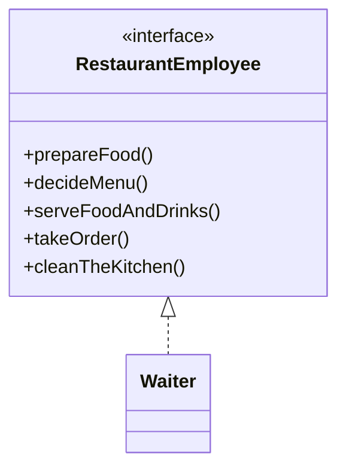
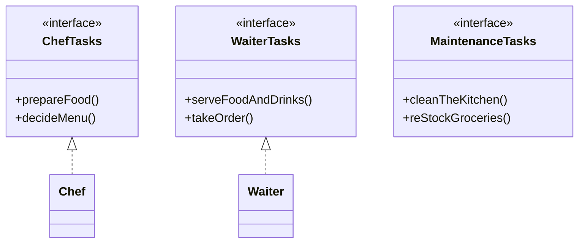

<div align="center">

# ✂️ I - Interface Segregation Principle (ISP)

   

*Many small, focused interfaces beat one fat interface.*

</div>

---

## 📑 Table of contents

- [🎯 Intent](#-intent)
- [🧩 The problem & the solution](#-the-problem--the-solution)
- [🔷 Structure](#-structure)
- [👥 Participants](#-participants)
- [🧭 When to use it](#-when-to-use-it)
- [📊 Pros & cons](#-pros--cons)
- [🌍 Real-world examples](#-real-world-examples)
- [💻 Code](#-code)
  - [1. ❌ Problem - Waiter forced to implement chef and cleaning tasks](#ex1)
  - [2. ✅ Solution - ChefTasks, WaiterTasks and MaintenanceTasks](#ex2)

---

## 🎯 Intent

> **Clients should not be forced to depend on interfaces they don't use.** Instead of one large interface with many methods, it is better to have multiple smaller, focused interfaces. A client should NOT have to implement unnecessary functions it does not need.

## 🧩 The problem & the solution

| 😣 Problem | 💡 Solution |
|---|---|
| `RestaurantEmployee` is a *fat interface* with five methods (`prepareFood`, `decideMenu`, `serveFoodAndDrinks`, `takeOrder`, `cleanTheKitchen`). A `Waiter` is forced to implement `prepareFood()`, `decideMenu()` and `cleanTheKitchen()`, which make no sense for a waiter, so they throw `AssertionError`. | Split the fat interface into focused ones: `ChefTasks`, `WaiterTasks` and `MaintenanceTasks`. `Chef` implements only `ChefTasks` and `Waiter` implements only `WaiterTasks`, so nobody implements methods it does not support. |

## 🔷 Structure

**Before - one fat interface**



**After - focused interfaces**



## 👥 Participants

| Role | Responsibility | In this repo |
|---|---|---|
| **Fat interface (the problem)** | One large interface that forces every implementer to define unused methods | `RestaurantEmployee` |
| **Focused interfaces** | Small interfaces grouped by one kind of work | `ChefTasks`, `WaiterTasks`, `MaintenanceTasks` |
| **Implementers** | Implement only the interfaces they really support | `Chef`, `Waiter` |
| **Client** | Depends only on the methods it uses | `SolutionDemo` |

## 🧭 When to use it

| ✅ Use it when | ⚠️ Avoid it when |
|---|---|
| An interface has many methods and some implementers need only a few of them | Splitting an interface that every implementer uses completely (more interfaces with no benefit) |
| Implementers contain empty methods or methods that throw (`AssertionError`) |  |
| Different entities should implement multiple interfaces only when they support those features |  |
| Warning signs from the PDF: low cohesion, large or "fat" interfaces, empty methods and challenging testing scenarios |  |

## 📊 Pros & cons

| 👍 Pros | 👎 Cons |
|---|---|
| Prevents bloated classes: each class implements only the interfaces it uses | More interfaces to name and organise |
| No forced dependencies on irrelevant functionality | A role that does several jobs implements several interfaces |
| Cleaner, more maintainable design and code |  |
| Different restaurant employees can implement multiple interfaces only when they support those features |  |

## 🌍 Real-world examples

- **Restaurant staff (this folder):** chefs prepare food and decide the menu, waiters take orders and serve, maintenance cleans the kitchen and restocks groceries
- **One employee, many roles:** a class can implement `ChefTasks` and `MaintenanceTasks` together if it supports both

---

## 💻 Code

This folder has **2 examples** (9 Java files). Interfaces and abstract classes come first, the class with `main` comes last.

<a id="ex1"></a>

### 1. ❌ Problem - Waiter forced to implement chef and cleaning tasks

> `Waiter implements RestaurantEmployee` and has to provide `prepareFood()`, `decideMenu()` and `cleanTheKitchen()` that only throw. `ViolationDemo` crashes at `prepareFood()` on purpose.

> ### ⚠️ Problems with this code
>
> - Classes are forced to implement methods they do not support.
> - Results in `AssertionError` being thrown.
> - Code becomes bloated with empty or error-throwing methods.
> - Violates the principle that clients should not depend on unused interfaces.

<details open>
<summary><b>📁 Files in this example</b></summary>

```text
Problem (Violates ISP)/
├── RestaurantEmployee.java
├── ViolationDemo.java
└── Waiter.java
```

</details>

#### 📄 `RestaurantEmployee.java`

<sub>interface · 15 lines</sub>

```java
// BAD: This class violates ISP
// This is a fat interface
// One large interface forcing all implementers to define unused methods
public interface RestaurantEmployee {

    void prepareFood();

    void decideMenu();

    void serveFoodAndDrinks();

    void takeOrder();

    void cleanTheKitchen();
}
```

#### 📄 `Waiter.java`

<sub>class · 33 lines</sub>

```java
// BAD: This class violates ISP(clients shouldn't depend on unused interfaces)
// Bloated class with empty or error-throwing methods
// This Waiter is forced to implement methods it doesn't need
public class Waiter implements RestaurantEmployee {
    @Override
    public void takeOrder() {
        System.out.println("Taking order...");
    }

    @Override
    public void serveFoodAndDrinks() {
        System.out.println("Serving food and drinks...");
    }

    @Override
    public void cleanTheKitchen() {
        // Forced to implement but doesn't make sense for a waiter
        throw new AssertionError("Detail Message: Waiter cannot clean the kitchen!");
    }

    @Override
    public void prepareFood() {
        // Forced to implement but doesn't make sense for a waiter
        throw new AssertionError("Detail Message: Waiter cannot prepare food!");
    }

    @Override
    public void decideMenu() {
        // Forced to implement but doesn't make sense for a waiter
        throw new AssertionError("Detail Message: Waiter cannot decide the menu!");
    }

}
```

#### 📄 `ViolationDemo.java`

<sub>class · 14 lines</sub>

```java
// Usage example - showing the problem
public class ViolationDemo {
    public static void main(String[] args) {
        Waiter waiter = new Waiter();
        // Works fine
        waiter.takeOrder();
        waiter.serveFoodAndDrinks();

        // These will throw exceptions
        waiter.prepareFood(); // forced implementation
        waiter.decideMenu(); // forced implementation
        waiter.cleanTheKitchen(); // forced implementation
    }
}
```

<details>
<summary><b>▶️ How to compile and run this example</b></summary>

```bash
# run from the repository root
mkdir -p out
find "SOLID Principles/4. Interface Segregation Principle/Problem (Violates ISP)" -name "*.java" -print0 | xargs -0 javac -d out
java -cp out ViolationDemo
```

</details>

---

<a id="ex2"></a>

### 2. ✅ Solution - ChefTasks, WaiterTasks and MaintenanceTasks

> `Chef` and `Waiter` implement only their own focused interface, so every method does real work.

> **Summary:** ISP keeps classes focused by making them implement only the methods they need. To spot potential violations, look for low cohesion, large or *fat* interfaces, empty methods and challenging testing scenarios. Recognising these signs early lets you refactor towards a modular, flexible design.

<details open>
<summary><b>📁 Files in this example</b></summary>

```text
Solution (Follows ISP)/
├── Chef.java
├── ChefTasks.java
├── MaintenanceTasks.java
├── SolutionDemo.java
├── Waiter.java
└── WaiterTasks.java
```

</details>

#### 📄 `ChefTasks.java`

<sub>interface · 6 lines</sub>

```java
// GOOD: This follows ISP - Multiple focused interfaces following ISP
public interface ChefTasks {
    void prepareFood();

    void decideMenu();
}
```

#### 📄 `MaintenanceTasks.java`

<sub>interface · 6 lines</sub>

```java
// GOOD: This follows ISP - Multiple focused interfaces following ISP
public interface MaintenanceTasks {
    void cleanTheKitchen();

    void reStockGroceries();
}
```

#### 📄 `WaiterTasks.java`

<sub>interface · 6 lines</sub>

```java
// GOOD: This follows ISP - Multiple focused interfaces following ISP
public interface WaiterTasks {
    void serveFoodAndDrinks();

    void takeOrder();
}
```

#### 📄 `Chef.java`

<sub>class · 14 lines</sub>

```java
// GOOD: This class follows ISP
// Now classes only implement what they actually need - Clean implementations
public class Chef implements ChefTasks {

    @Override
    public void prepareFood() {
        System.out.println("Preparing food...");
    }

    @Override
    public void decideMenu() {
        System.out.println("Deciding menu...");
    }
}
```

#### 📄 `Waiter.java`

<sub>class · 13 lines</sub>

```java
// GOOD: This class follows ISP
// Now classes only implement what they actually need - Clean implementations
public class Waiter implements WaiterTasks {
    @Override
    public void serveFoodAndDrinks() {
        System.out.println("Serving food and drinks...");
    }

    @Override
    public void takeOrder() {
        System.out.println("Taking order...");
    }
}
```

#### 📄 `SolutionDemo.java`

<sub>class · 17 lines</sub>

```java
// Usage example - Following ISP
public class SolutionDemo {
    public static void main(String[] args) {
        // Create the objects
        // Now classes only implement what they actually support
        Chef chef = new Chef();
        Waiter waiter = new Waiter();

        // Use the objects
        // These work perfectly - no forced implementations
        chef.prepareFood();
        chef.decideMenu();
        // These work perfectly - no forced implementations
        waiter.takeOrder();
        waiter.serveFoodAndDrinks();
    }
}
```

<details>
<summary><b>▶️ How to compile and run this example</b></summary>

```bash
# run from the repository root
mkdir -p out
find "SOLID Principles/4. Interface Segregation Principle/Solution (Follows ISP)" -name "*.java" -print0 | xargs -0 javac -d out
java -cp out SolutionDemo
```

</details>

---

<div align="center">

[◀ Liskov Substitution](../3.%20Liskov%20Substitution%20Principle/README.md) &nbsp;·&nbsp; [📚 All principles](../PRINCIPLES.md) &nbsp;·&nbsp; [Dependency Inversion ▶](../5.%20Dependency%20Inversion%20Principle/README.md)

</div>
