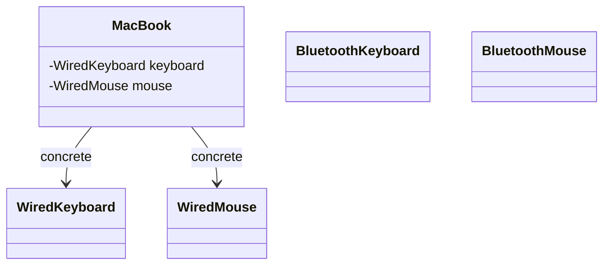
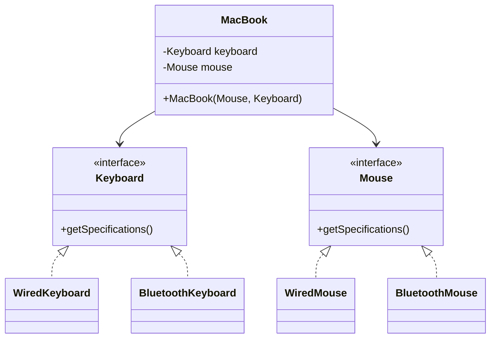

<div align="center">

# 🔄 D - Dependency Inversion Principle (DIP)

   

*Depend on abstractions, not on concrete classes.*

</div>

---

## 📑 Table of contents

- [🎯 Intent](#-intent)
- [🧩 The problem & the solution](#-the-problem--the-solution)
- [🔷 Structure](#-structure)
- [👥 Participants](#-participants)
- [🧭 When to use it](#-when-to-use-it)
- [📊 Pros & cons](#-pros--cons)
- [🌍 Real-world examples](#-real-world-examples)
- [💻 Code](#-code)
  - [1. ❌ Problem - MacBook is hard-wired to wired parts](#ex1)
  - [2. ✅ Solution - MacBook depends on Keyboard and Mouse](#ex2)

---

## 🎯 Intent

> **High-level components should not depend on low-level components directly; instead, they should depend on abstractions.** Classes should depend on interfaces rather than concrete classes. Additionally, abstractions should not depend on details; details should depend on abstractions.

## 🧩 The problem & the solution

| 😣 Problem | 💡 Solution |
|---|---|
| `MacBook` (a high-level module) takes a `WiredKeyboard` and a `WiredMouse` (low-level modules) directly. It is **tightly coupled** to those concrete classes, so a `MacBook` with a `BluetoothKeyboard` and `BluetoothMouse` cannot be created without modifying `MacBook`, and it is difficult to test in isolation. | `MacBook` depends on the `Keyboard` and `Mouse` interfaces and receives them through its constructor (**dependency injection**). Wired and Bluetooth parts both implement those interfaces, so any combination can be injected without changing `MacBook`. |

## 🔷 Structure

**Before - high-level depends on low-level**



**After - both depend on the abstractions**



## 👥 Participants

| Role | Responsibility | In this repo |
|---|---|---|
| **High-level module** | Uses parts through abstractions only | `MacBook` |
| **Abstractions** | The contract both sides depend on | `Keyboard`, `Mouse` |
| **Low-level modules (details)** | Concrete implementations that depend on the abstractions | `WiredKeyboard`, `BluetoothKeyboard`, `WiredMouse`, `BluetoothMouse` |
| **Client** | Creates the parts and injects them via the constructor | `DemoSolution` |

## 🧭 When to use it

| ✅ Use it when | ⚠️ Avoid it when |
|---|---|
| A high-level class uses parts that may vary (wired or Bluetooth) | The high-level class creates or accepts concrete classes directly (`MacBook(WiredKeyboard, WiredMouse)`) |
| You want to inject different parts without changing the high-level class | You introduce interfaces for dependencies that will never be replaced |
| You want to test the high-level class in isolation by injecting mocks |  |
| New parts should be addable without touching existing code |  |

## 📊 Pros & cons

| 👍 Pros | 👎 Cons |
|---|---|
| `BluetoothKeyboard` and `BluetoothMouse` depend only on the `Keyboard` and `Mouse` abstractions | More interfaces to design and maintain |
| Any different MacBook parts can be injected without changing `MacBook` | Someone (here `DemoSolution`) must create and wire the concrete objects |
| Easy to mock for testing |  |
| New MacBook parts can be added without touching existing code |  |

## 🌍 Real-world examples

- **Laptop parts (this folder):** a `MacBook` built with a wired keyboard and mouse, or with a Bluetooth keyboard and mouse, using the same `MacBook` class
- **Testing:** a mock `Keyboard` or `Mouse` can be injected to test `MacBook` without any real device

---

## 💻 Code

This folder has **2 examples** (16 Java files). Interfaces and abstract classes come first, the class with `main` comes last.

<a id="ex1"></a>

### 1. ❌ Problem - MacBook is hard-wired to wired parts

> `MacBook(WiredKeyboard, WiredMouse)` depends on concrete classes. The Bluetooth `MacBook` line in `DemoViolation` has to stay commented out, because it would not compile.

> ### ⚠️ Problems with this code
>
> - `MacBook` is tightly coupled to `WiredKeyboard` and `WiredMouse`.
> - You cannot create `MacBook` objects with different parts without modifying the `MacBook` class.
> - It is difficult to test `MacBook` in isolation.
> - The high-level module `MacBook` depends on the low-level modules `WiredKeyboard` and `WiredMouse`.

<details open>
<summary><b>📁 Files in this example</b></summary>

```text
Problem (Violates DIP)/
├── BluetoothKeyboard.java
├── BluetoothMouse.java
├── DemoViolation.java
├── Keyboard.java
├── MacBook.java
├── Mouse.java
├── WiredKeyboard.java
└── WiredMouse.java
```

</details>

#### 📄 `Keyboard.java`

<sub>interface · 3 lines</sub>

```java
public interface Keyboard {
    void getSpecifications();
}
```

#### 📄 `Mouse.java`

<sub>interface · 3 lines</sub>

```java
public interface Mouse {
    void getSpecifications();
}
```

#### 📄 `BluetoothKeyboard.java`

<sub>class · 22 lines</sub>

```java
// Low-level module - concrete implementation
public class BluetoothKeyboard implements Keyboard {
    private final String connectionType;
    private final String company;
    private final String modelVersion;
    private final String color;

    public BluetoothKeyboard(String connectionType, String company, String modelVersion, String color) {
        this.connectionType = connectionType;
        this.company = company;
        this.modelVersion = modelVersion;
        this.color = color;
    }

    public void getSpecifications() {
        System.out.println("===> Bluetooth Keyboard");
        System.out.println("Connection Type: " + connectionType);
        System.out.println("Company: " + company);
        System.out.println("Model Version: " + modelVersion);
        System.out.println("Color: " + color);
    }
}
```

#### 📄 `BluetoothMouse.java`

<sub>class · 22 lines</sub>

```java
// Low-level module - concrete implementation
public class BluetoothMouse implements Mouse {
    private final String connectionType;
    private final String company;
    private final String modelVersion;
    private final String color;

    public BluetoothMouse(String connectionType, String company, String modelVersion, String color) {
        this.connectionType = connectionType;
        this.company = company;
        this.modelVersion = modelVersion;
        this.color = color;
    }

    public void getSpecifications() {
        System.out.println("===> Bluetooth Mouse");
        System.out.println("Connection Type: " + connectionType);
        System.out.println("Company: " + company);
        System.out.println("Model Version: " + modelVersion);
        System.out.println("Color: " + color);
    }
}
```

#### 📄 `MacBook.java`

<sub>class · 20 lines</sub>

```java
// VIOLATION OF DIP
// High-level module directly depending on low-level module
public class MacBook {
    private final WiredKeyboard keyboard;
    private final WiredMouse mouse;

    // Direct dependency on concrete class
    public MacBook(WiredKeyboard wiredKeyboard, WiredMouse wiredMouse) {
        keyboard = wiredKeyboard; // Tight coupling
        mouse = wiredMouse; // Tight coupling
    }

    public Mouse getMouse() {
        return mouse;
    }

    public Keyboard getKeyboard() {
        return keyboard;
    }
}
```

#### 📄 `WiredKeyboard.java`

<sub>class · 22 lines</sub>

```java
// Low-level module - concrete implementation
public class WiredKeyboard implements Keyboard {
    private final String connectionType;
    private final String company;
    private final String modelVersion;
    private final String color;

    public WiredKeyboard(String connectionType, String company, String modelVersion, String color) {
        this.connectionType = connectionType;
        this.company = company;
        this.modelVersion = modelVersion;
        this.color = color;
    }

    public void getSpecifications() {
        System.out.println("===> Wired Keyboard");
        System.out.println("Connection Type: " + connectionType);
        System.out.println("Company: " + company);
        System.out.println("Model Version: " + modelVersion);
        System.out.println("Color: " + color);
    }
}
```

#### 📄 `WiredMouse.java`

<sub>class · 22 lines</sub>

```java
// Low-level module - concrete implementation
public class WiredMouse implements Mouse {
    private final String connectionType;
    private final String company;
    private final String modelVersion;
    private final String color;

    public WiredMouse(String connectionType, String company, String modelVersion, String color) {
        this.connectionType = connectionType;
        this.company = company;
        this.modelVersion = modelVersion;
        this.color = color;
    }

    public void getSpecifications() {
        System.out.println("===> Wired Mouse");
        System.out.println("Connection Type: " + connectionType);
        System.out.println("Company: " + company);
        System.out.println("Model Version: " + modelVersion);
        System.out.println("Color: " + color);
    }
}
```

#### 📄 `DemoViolation.java`

<sub>class · 20 lines</sub>

```java
public class DemoViolation {
    public static void main(String[] args) {

        // create keyboard and mouse objects
        WiredKeyboard wiredKeyboard = new WiredKeyboard("USB", "Dell", "F602", "Grey");
        WiredMouse wiredMouse = new WiredMouse("USB", "Dell", "F602", "Grey");
        BluetoothKeyboard bluetoothKeyboard = new BluetoothKeyboard("Bluetooth", "Logitech", "G102", "Black");
        BluetoothMouse bluetoothMouse = new BluetoothMouse("Bluetooth", "Logitech", "G102", "Black");

        // create macbook
        MacBook macBookWithWiredParts = new MacBook(wiredKeyboard, wiredMouse);
        macBookWithWiredParts.getKeyboard().getSpecifications();
        macBookWithWiredParts.getMouse().getSpecifications();

        // create macbook with bluetooth keyboard and mouse
        // MacBook macBookWithBluetoothParts = new MacBook(bluetoothKeyboard, bluetoothMouse);
        // cannot create macbook with bluetooth keyboard and mouse because
        // macbook depends on wired keyboard and mouse - tight coupling - violation of DIP
    }
}
```

<details>
<summary><b>▶️ How to compile and run this example</b></summary>

```bash
# run from the repository root
mkdir -p out
find "SOLID Principles/5. Dependency Inversion Principle/Problem (Violates DIP)" -name "*.java" -print0 | xargs -0 javac -d out
java -cp out DemoViolation
```

</details>

---

<a id="ex2"></a>

### 2. ✅ Solution - MacBook depends on Keyboard and Mouse

> `MacBook(Mouse, Keyboard)` receives its parts through the constructor, so `DemoSolution` builds one MacBook with wired parts and another with Bluetooth parts.

> **Summary:** this is true dependency inversion because the high-level module (`MacBook`) and the low-level modules (`BluetoothKeyboard`, `BluetoothMouse`, `WiredKeyboard`, `WiredMouse`) **both depend on the same abstractions** (`Keyboard` and `Mouse`), and the abstractions do not depend on any concrete implementation details.

<details open>
<summary><b>📁 Files in this example</b></summary>

```text
Solution (Follows DIP)/
├── BluetoothKeyboard.java
├── BluetoothMouse.java
├── DemoSolution.java
├── Keyboard.java
├── MacBook.java
├── Mouse.java
├── WiredKeyboard.java
└── WiredMouse.java
```

</details>

#### 📄 `Keyboard.java`

<sub>interface · 3 lines</sub>

```java
public interface Keyboard {
    void getSpecifications();
}
```

#### 📄 `Mouse.java`

<sub>interface · 3 lines</sub>

```java
public interface Mouse {
    void getSpecifications();
}
```

#### 📄 `BluetoothKeyboard.java`

<sub>class · 22 lines</sub>

```java
// Low-level module - concrete implementation
public class BluetoothKeyboard implements Keyboard {
    private final String connectionType;
    private final String company;
    private final String modelVersion;
    private final String color;

    public BluetoothKeyboard(String connectionType, String company, String modelVersion, String color) {
        this.connectionType = connectionType;
        this.company = company;
        this.modelVersion = modelVersion;
        this.color = color;
    }

    public void getSpecifications() {
        System.out.println("===> Bluetooth Keyboard");
        System.out.println("Connection Type: " + connectionType);
        System.out.println("Company: " + company);
        System.out.println("Model Version: " + modelVersion);
        System.out.println("Color: " + color);
    }
}
```

#### 📄 `BluetoothMouse.java`

<sub>class · 22 lines</sub>

```java
// Low-level module - concrete implementation
public class BluetoothMouse implements Mouse {
    private final String connectionType;
    private final String company;
    private final String modelVersion;
    private final String color;

    public BluetoothMouse(String connectionType, String company, String modelVersion, String color) {
        this.connectionType = connectionType;
        this.company = company;
        this.modelVersion = modelVersion;
        this.color = color;
    }

    public void getSpecifications() {
        System.out.println("===> Bluetooth Mouse");
        System.out.println("Connection Type: " + connectionType);
        System.out.println("Company: " + company);
        System.out.println("Model Version: " + modelVersion);
        System.out.println("Color: " + color);
    }
}
```

#### 📄 `MacBook.java`

<sub>class · 21 lines</sub>

```java
// Following DIP
// High-level module uses abstraction
public class MacBook {
    private final Keyboard keyboard;
    private final Mouse mouse;

    // Abstraction - defines contract
    // Dependency injection through constructor
    public MacBook(Mouse mouse, Keyboard keyboard) {
        this.keyboard = keyboard; // Works with any kind of keyboard and mouse
        this.mouse = mouse;
    }

    public Mouse getMouse() {
        return mouse;
    }

    public Keyboard getKeyboard() {
        return keyboard;
    }
}
```

#### 📄 `WiredKeyboard.java`

<sub>class · 22 lines</sub>

```java
// Low-level module - concrete implementation
public class WiredKeyboard implements Keyboard {
    private final String connectionType;
    private final String company;
    private final String modelVersion;
    private final String color;

    public WiredKeyboard(String connectionType, String company, String modelVersion, String color) {
        this.connectionType = connectionType;
        this.company = company;
        this.modelVersion = modelVersion;
        this.color = color;
    }

    public void getSpecifications() {
        System.out.println("===> Wired Keyboard");
        System.out.println("Connection Type: " + connectionType);
        System.out.println("Company: " + company);
        System.out.println("Model Version: " + modelVersion);
        System.out.println("Color: " + color);
    }
}
```

#### 📄 `WiredMouse.java`

<sub>class · 22 lines</sub>

```java
// Low-level module - concrete implementation
public class WiredMouse implements Mouse {
    private final String connectionType;
    private final String company;
    private final String modelVersion;
    private final String color;

    public WiredMouse(String connectionType, String company, String modelVersion, String color) {
        this.connectionType = connectionType;
        this.company = company;
        this.modelVersion = modelVersion;
        this.color = color;
    }

    public void getSpecifications() {
        System.out.println("===> Wired Mouse");
        System.out.println("Connection Type: " + connectionType);
        System.out.println("Company: " + company);
        System.out.println("Model Version: " + modelVersion);
        System.out.println("Color: " + color);
    }
}
```

#### 📄 `DemoSolution.java`

<sub>class · 22 lines</sub>

```java
// Usage example - following DIP
public class DemoSolution {
    public static void main(String[] args) {
        // create keyboard and mouse objects
        WiredKeyboard wiredKeyboard = new WiredKeyboard("USB", "Dell", "F602", "Grey");
        WiredMouse wiredMouse = new WiredMouse("USB", "Dell", "F602", "Grey");
        BluetoothKeyboard bluetoothKeyboard = new BluetoothKeyboard("Bluetooth", "Logitech", "G102", "Black");
        BluetoothMouse bluetoothMouse = new BluetoothMouse("Bluetooth", "Logitech", "G102", "Black");

        // Can easily create macbooks with different combinations of keyboard and mouse

        // create macbook with wired keyboard and mouse
        MacBook macBookWithWiredParts = new MacBook(wiredMouse, wiredKeyboard);
        macBookWithWiredParts.getKeyboard().getSpecifications();
        macBookWithWiredParts.getMouse().getSpecifications();

        // create macbook with bluetooth keyboard and mouse
        MacBook macBookWithBluetoothParts = new MacBook(bluetoothMouse, bluetoothKeyboard);
        macBookWithBluetoothParts.getKeyboard().getSpecifications();
        macBookWithBluetoothParts.getMouse().getSpecifications();
    }
}
```

<details>
<summary><b>▶️ How to compile and run this example</b></summary>

```bash
# run from the repository root
mkdir -p out
find "SOLID Principles/5. Dependency Inversion Principle/Solution (Follows DIP)" -name "*.java" -print0 | xargs -0 javac -d out
java -cp out DemoSolution
```

</details>

---

<div align="center">

[◀ Interface Segregation](../4.%20Interface%20Segregation%20Principle/README.md) &nbsp;·&nbsp; [📚 All principles](../PRINCIPLES.md)

</div>
