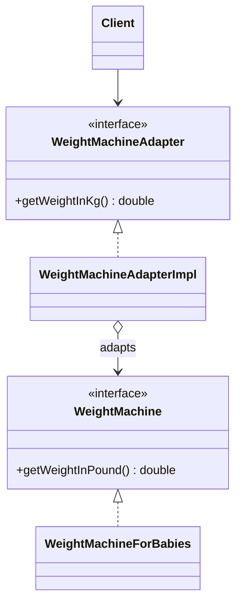

<div align="center">

# 🔌 Adapter Design Pattern

   

*Make incompatible interfaces work together.*

</div>

---

## 📑 Table of contents

- [🎯 Intent](#-intent)
- [🧩 The problem & the solution](#-the-problem--the-solution)
- [🔷 Structure](#-structure)
- [👥 Participants](#-participants)
- [🧭 When to use it](#-when-to-use-it)
- [📊 Pros & cons](#-pros--cons)
- [🌍 Real-world examples](#-real-world-examples)
- [💻 Code](#-code)
  - [1. Implementation](#ex1)

---

## 🎯 Intent

> Convert the interface of a class into another interface the client expects.

## 🧩 The problem & the solution

| 😣 Problem | 💡 Solution |
|---|---|
| The weighing machine reports weight in **pounds**, but the application expects **kilograms**. You cannot (or should not) change the machine's code. | `WeightMachineAdapterImpl` wraps the existing `WeightMachine` and converts its output, so the client only sees the adapter interface. |

## 🔷 Structure



## 👥 Participants

| Role | Responsibility | In this repo |
|---|---|---|
| **Target** | Interface the client wants | `WeightMachineAdapter` |
| **Adapter** | Translates calls | `WeightMachineAdapterImpl` |
| **Adaptee** | Existing class with the incompatible interface | `WeightMachine`, `WeightMachineForBabies` |
| **Client** | Works only with the Target | `Main` |

## 🧭 When to use it

| ✅ Use it when | ⚠️ Avoid it when |
|---|---|
| You must reuse a class whose interface does not match | You own both sides and can simply change one interface |
| Integrating legacy or third-party code you cannot modify |  |

## 📊 Pros & cons

| 👍 Pros | 👎 Cons |
|---|---|
| Reuses existing code without modifying it | Extra layer of indirection |
| Single Responsibility: conversion logic lives in one class | Too many adapters can clutter the design |

## 🌍 Real-world examples

- `Arrays.asList()`, `InputStreamReader`
- Payment-gateway wrappers
- Unit / currency converters

---

## 💻 Code

This folder has **1 example** (5 Java files). Interfaces and abstract classes come first, the class with `main` comes last.

<a id="ex1"></a>

### 1. Implementation

<details open>
<summary><b>📁 Files in this example</b></summary>

```text
1. Adapter Design Pattern/
├── Adaptee/
│   ├── WeightMachine.java
│   └── WeightMachineForBabies.java
├── Adapter/
│   ├── WeightMachineAdapter.java
│   └── WeightMachineAdapterImpl.java
└── Client/
    └── Main.java
```

</details>

#### 📄 `Adaptee/WeightMachine.java`

<sub>interface · 7 lines</sub>

```java
package LowLevelDesign.DesignPatterns.AdapterDesignPattern.Adaptee;

public interface WeightMachine {

    //return the weight in Pound
    public double getWeightInPound();
}
```

#### 📄 `Adapter/WeightMachineAdapter.java`

<sub>interface · 6 lines</sub>

```java
package LowLevelDesign.DesignPatterns.AdapterDesignPattern.Adapter;

public interface WeightMachineAdapter {

    public double getWeightInKg();
}
```

#### 📄 `Adaptee/WeightMachineForBabies.java`

<sub>class · 8 lines</sub>

```java
package LowLevelDesign.DesignPatterns.AdapterDesignPattern.Adaptee;

public class WeightMachineForBabies implements WeightMachine{
    @Override
    public double getWeightInPound() {
        return 28;
    }
}
```

#### 📄 `Adapter/WeightMachineAdapterImpl.java`

<sub>class · 22 lines</sub>

```java
package LowLevelDesign.DesignPatterns.AdapterDesignPattern.Adapter;

import LowLevelDesign.DesignPatterns.AdapterDesignPattern.Adaptee.WeightMachine;

public class WeightMachineAdapterImpl implements WeightMachineAdapter{

    WeightMachine weightMachine;

    public WeightMachineAdapterImpl(WeightMachine weightMachine) {
        this.weightMachine = weightMachine;
    }

    @Override
    public double getWeightInKg() {

        double weightInPound = weightMachine.getWeightInPound();

        //Convert it to KGs
        double weightInKg = weightInPound * .45;
        return weightInKg;
    }
}
```

#### 📄 `Client/Main.java`

<sub>class · 14 lines</sub>

```java
package LowLevelDesign.DesignPatterns.AdapterDesignPattern.Client;

import LowLevelDesign.DesignPatterns.AdapterDesignPattern.Adaptee.WeightMachineForBabies;
import LowLevelDesign.DesignPatterns.AdapterDesignPattern.Adapter.WeightMachineAdapter;
import LowLevelDesign.DesignPatterns.AdapterDesignPattern.Adapter.WeightMachineAdapterImpl;

public class Main {

    public static void main(String args[]){

        WeightMachineAdapter weightMachineAdapter = new WeightMachineAdapterImpl(new WeightMachineForBabies());
        System.out.println(weightMachineAdapter.getWeightInKg());
    }
}
```

<details>
<summary><b>▶️ How to compile and run this example</b></summary>

```bash
# run from the repository root
mkdir -p out
find "Structural Design Pattern/1. Adapter Design Pattern" -name "*.java" -print0 | xargs -0 javac -d out
java -cp out LowLevelDesign.DesignPatterns.AdapterDesignPattern.Client.Main
```

</details>

---

<div align="center">

[📚 All patterns](../PATTERNS.md) &nbsp;·&nbsp; [Bridge ▶](../2.%20Bridge%20Design%20Pattern/README.md)

</div>
