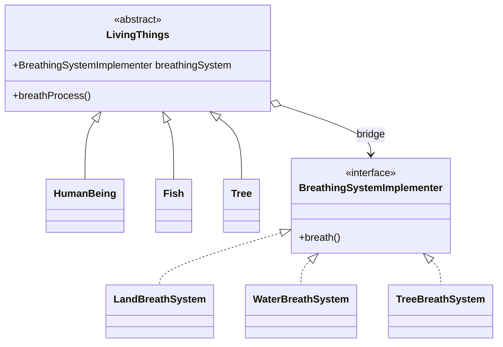

<div align="center">

# 🌉 Bridge Design Pattern

   

*Decouple an abstraction from its implementation.*

</div>

---

## 📑 Table of contents

- [🎯 Intent](#-intent)
- [🧩 The problem & the solution](#-the-problem--the-solution)
- [🔷 Structure](#-structure)
- [👥 Participants](#-participants)
- [🧭 When to use it](#-when-to-use-it)
- [📊 Pros & cons](#-pros--cons)
- [🌍 Real-world examples](#-real-world-examples)
- [💻 Code](#-code)
  - [1. Implementation](#ex1)

---

## 🎯 Intent

> Split a class into two independent hierarchies, **abstraction** and **implementation**, so they can evolve separately.

## 🧩 The problem & the solution

| 😣 Problem | 💡 Solution |
|---|---|
| `LivingThings` (human, fish, tree) all *breathe*, but in different ways. Subclassing every combination (`HumanLandBreath`, `FishWaterBreath`, ...) explodes the class count. | `LivingThings` holds a reference to a `BreathingSystemImplementer`. New living things and new breathing systems are added independently. |

## 🔷 Structure



## 👥 Participants

| Role | Responsibility | In this repo |
|---|---|---|
| **Abstraction** | High-level control, holds the bridge | `LivingThings` |
| **Refined Abstractions** | Variants of the abstraction | `HumanBeing`, `Fish`, `Tree` |
| **Implementor** | Interface for the implementation side | `BreathingSystemImplementer` |
| **Concrete Implementors** | Actual implementations | `LandBreathSystem`, `WaterBreathSystem`, `TreeBreathSystem` |
| **Client** | Wires abstraction to implementation | `BridgeMain` |

## 🧭 When to use it

| ✅ Use it when | ⚠️ Avoid it when |
|---|---|
| Two dimensions of variation (what it is x how it works) | There is only one implementation |
| You want to switch implementations at runtime | The hierarchy is small and stable |
| To avoid a Cartesian-product class explosion |  |

## 📊 Pros & cons

| 👍 Pros | 👎 Cons |
|---|---|
| Both sides extend independently | More up-front design |
| Hides implementation details from clients | Can be over-engineering for simple cases |
| Fewer subclasses |  |

## 🌍 Real-world examples

- JDBC (`Driver` bridges `Connection` API to vendors)
- UI toolkits (window abstraction x platform renderer)
- Remote controls x devices

---

## 💻 Code

This folder has **1 example** (9 Java files). Interfaces and abstract classes come first, the class with `main` comes last.

<a id="ex1"></a>

### 1. Implementation

<details open>
<summary><b>📁 Files in this example</b></summary>

```text
2. Bridge Design Pattern/
├── BreathingSystemImplementer.java
├── BridgeMain.java
├── Fish.java
├── HumanBeing.java
├── LandBreathSystem.java
├── LivingThings.java
├── Tree.java
├── TreeBreathSystem.java
└── WaterBreathSystem.java
```

</details>

#### 📄 `BreathingSystemImplementer.java`

<sub>interface · 11 lines</sub>

```java
package com.bridgedesignpattern;

//implementer
public interface BreathingSystemImplementer {

    void breath();

}


//don't cofuse as it is a interface and named it as Implementer . This is just the name given to this element in bridge design pattern
```

#### 📄 `LivingThings.java`

<sub>abstract class · 13 lines</sub>

```java
package com.bridgedesignpattern;

public abstract class LivingThings {

    public BreathingSystemImplementer breathingSystem;

    public LivingThings(BreathingSystemImplementer breathingSystem) {
        this.breathingSystem=breathingSystem;
    }

     abstract public void breathProcess();

}
```

#### 📄 `Fish.java`

<sub>class · 17 lines</sub>

```java
package com.bridgedesignpattern;

//refined abstractions
public class Fish extends LivingThings{

    public Fish(BreathingSystemImplementer breathingSystem) {
        super(breathingSystem);

    }

    @Override
    public void breathProcess() {
        breathingSystem.breath();
    }


}
```

#### 📄 `HumanBeing.java`

<sub>class · 17 lines</sub>

```java
package com.bridgedesignpattern;


//refined abstractions
public class HumanBeing extends LivingThings{

    public HumanBeing(BreathingSystemImplementer breathingSystem) {
        super(breathingSystem);

    }

    @Override
    public void breathProcess() {
        breathingSystem.breath();
    }

}
```

#### 📄 `LandBreathSystem.java`

<sub>class · 17 lines</sub>

```java
package com.bridgedesignpattern;

//concrete implementers
public class LandBreathSystem implements BreathingSystemImplementer {

    @Override
    public void breath() {
        String breathingOnLand="""
                Breathing through nose
                Inhaling Oxygen
                Exhaling CO2
                """;
        System.out.println(breathingOnLand);

    }

}
```

#### 📄 `Tree.java`

<sub>class · 17 lines</sub>

```java
package com.bridgedesignpattern;

//refined abstractions
public class Tree extends LivingThings{

    public Tree(BreathingSystemImplementer breathingSystem) {
        super(breathingSystem);

    }

    @Override
    public void breathProcess() {
        breathingSystem.breath();
    }


}
```

#### 📄 `TreeBreathSystem.java`

<sub>class · 17 lines</sub>

```java
package com.bridgedesignpattern;

//concrete implementer
public class TreeBreathSystem implements BreathingSystemImplementer {

    @Override
    public void breath() {
        String breathingInWater="""
                Breathing through grills
                Inhaling Oxygen
                Exhaling CO2
                """;
        System.out.println(breathingInWater);

    }

}
```

#### 📄 `WaterBreathSystem.java`

<sub>class · 17 lines</sub>

```java
package com.bridgedesignpattern;

//concrete implementers
public class WaterBreathSystem implements BreathingSystemImplementer {

    @Override
    public void breath() {
        String breathingOfTree="""
                Breathing through leaves
                Exhaling Oxygen
                Inhaling CO2
                """;
        System.out.println(breathingOfTree);

    }

}
```

#### 📄 `BridgeMain.java`

<sub>class · 13 lines</sub>

```java
package com.bridgedesignpattern;

public class BridgeMain {

    public static void main(String[] args) {
        HumanBeing human = new HumanBeing(new LandBreathSystem());
        human.breathProcess();
        LivingThings fish= new Fish(new WaterBreathSystem());
        fish.breathProcess();

    }

}
```

<details>
<summary><b>▶️ How to compile and run this example</b></summary>

```bash
# run from the repository root
mkdir -p out
find "Structural Design Pattern/2. Bridge Design Pattern" -name "*.java" -print0 | xargs -0 javac -d out
java -cp out com.bridgedesignpattern.BridgeMain
```

</details>

---

<div align="center">

[◀ Adapter](../1.%20Adapter%20Design%20Pattern/README.md) &nbsp;·&nbsp; [📚 All patterns](../PATTERNS.md) &nbsp;·&nbsp; [Composite ▶](../3.%20Composite%20Design%20Pattern/README.md)

</div>
