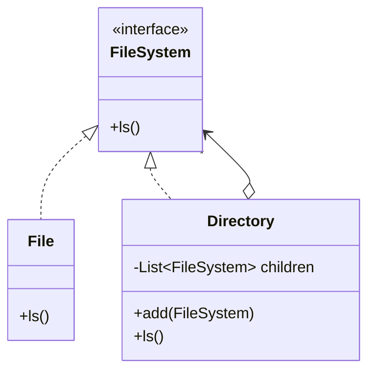

<div align="center">

# 🌳 Composite Design Pattern

   

*Treat single objects and groups of objects uniformly.*

</div>

---

## 📑 Table of contents

- [🎯 Intent](#-intent)
- [🧩 The problem & the solution](#-the-problem--the-solution)
- [🔷 Structure](#-structure)
- [👥 Participants](#-participants)
- [🧭 When to use it](#-when-to-use-it)
- [📊 Pros & cons](#-pros--cons)
- [🌍 Real-world examples](#-real-world-examples)
- [💻 Code](#-code)
  - [1. ❌ Problem - special-casing files and directories](#ex1)
  - [2. ✅ Solution 1 - File system](#ex2)
  - [3. ✅ Solution 2 - Calculator](#ex3)

---

## 🎯 Intent

> Compose objects into **tree structures** and let clients treat individual objects and compositions the same way.

## 🧩 The problem & the solution

| 😣 Problem | 💡 Solution |
|---|---|
| A file system has files and directories that contain more files and directories. Client code full of `instanceof` checks just to ask 'how big is this?' is ugly and fragile. | Give leaves (`File`) and containers (`Directory`) the same interface (`FileSystem`). A directory simply delegates to its children. |

## 🔷 Structure



## 👥 Participants

| Role | Responsibility | In this repo |
|---|---|---|
| **Component** | Common interface | `FileSystem`, `ArithmeticExpression` |
| **Leaf** | Has no children | `File`, `Number` |
| **Composite** | Stores children and delegates | `Directory`, `Expression` |
| **Client** | Uses only the component interface | `Main` |

## 🧭 When to use it

| ✅ Use it when | ⚠️ Avoid it when |
|---|---|
| Part-whole hierarchies (folders, menus, org charts, expressions) | The structure is flat |
| Clients should ignore the difference between a leaf and a group | Leaves and composites have very different behaviour |

## 📊 Pros & cons

| 👍 Pros | 👎 Cons |
|---|---|
| Uniform handling of leaf and group | Can make the design too general |
| Easy to add new component types | Hard to restrict what a composite may contain |
| Natural recursion |  |

## 🌍 Real-world examples

- Swing / JavaFX component trees
- HTML DOM
- File systems, expression trees

---

## 💻 Code

This folder has **3 examples** (12 Java files). Interfaces and abstract classes come first, the class with `main` comes last.

<a id="ex1"></a>

### 1. ❌ Problem - special-casing files and directories

> `File` and `Directory` are unrelated classes, so the client must treat them separately.

<details open>
<summary><b>📁 Files in this example</b></summary>

```text
ProblemStatement/
├── Directory.java
├── File.java
└── Main.java
```

</details>

#### 📄 `Directory.java`

<sub>class · 32 lines</sub>

```java
package LowLevelDesign.DesignPatterns.CompositeDesignPattern.ProblemStatement;

import java.util.ArrayList;
import java.util.List;

public class Directory {
    String directoryName;
    List<Object> objectList;

    public Directory(String name){
        this.directoryName = name;
        objectList = new ArrayList<>();
    }

    public void add(Object object) {
        objectList.add(object);
    }

    public void ls(){
        System.out.println("Directory Name: " + directoryName);
        for(Object obj: objectList) {

            if(obj instanceof File) { //Problem :Have to put condition
                // and instances at each and every Time
                ((File) obj).ls();
            }
            else if(obj instanceof Directory) {
                ((Directory) obj).ls();
            }
        }
    }
}
```

#### 📄 `File.java`

<sub>class · 14 lines</sub>

```java
package LowLevelDesign.DesignPatterns.CompositeDesignPattern.ProblemStatement;

public class File {

    String fileName;

    public File(String name){
        this.fileName = name;
    }

    public void ls(){
        System.out.println("file name " + fileName);
    }
}
```

#### 📄 `Main.java`

<sub>class · 20 lines</sub>

```java
package LowLevelDesign.DesignPatterns.CompositeDesignPattern.ProblemStatement;

public class Main {

    public static void main(String args[]){

        Directory movieDirectory = new Directory("Movie");

        File border = new File("Border");
        movieDirectory.add(border);

        Directory comedyMovieDirectory = new Directory("ComedyMovie");
        File hulchul = new File("Hulchul");
        comedyMovieDirectory.add(hulchul);
        movieDirectory.add(comedyMovieDirectory);

        movieDirectory.ls();

    }
}
```

<details>
<summary><b>▶️ How to compile and run this example</b></summary>

```bash
# run from the repository root
mkdir -p out
find "Structural Design Pattern/3. Composite Design Pattern/ProblemStatement" -name "*.java" -print0 | xargs -0 javac -d out
java -cp out LowLevelDesign.DesignPatterns.CompositeDesignPattern.ProblemStatement.Main
```

</details>

---

<a id="ex2"></a>

### 2. ✅ Solution 1 - File system

> `File` and `Directory` share `FileSystem`; a directory just forwards to children.

<details open>
<summary><b>📁 Files in this example</b></summary>

```text
Solution1WithCompositeDesign File System/
├── Directory.java
├── File.java
├── FileSystem.java
└── Main.java
```

</details>

#### 📄 `FileSystem.java`

<sub>interface · 5 lines</sub>

```java
package LowLevelDesign.DesignPatterns.CompositeDesignPattern.Solution1WithCompositeDesign;

public interface FileSystem {
    public void ls();
}
```

#### 📄 `Directory.java`

<sub>class · 27 lines</sub>

```java
package LowLevelDesign.DesignPatterns.CompositeDesignPattern.Solution1WithCompositeDesign;

import java.util.ArrayList;
import java.util.List;

public class Directory implements FileSystem {

    String directoryName;
    List<FileSystem> fileSystemList;

    public Directory(String name){
        this.directoryName = name;
        fileSystemList = new ArrayList<>();
    }

    public void add(FileSystem fileSystemObj) {
        fileSystemList.add(fileSystemObj);
    }

    public void ls(){
        System.out.println("Directory name " + directoryName);

        for(FileSystem fileSystemObj : fileSystemList){
            fileSystemObj.ls();
        }
    }
}
```

#### 📄 `File.java`

<sub>class · 13 lines</sub>

```java
package LowLevelDesign.DesignPatterns.CompositeDesignPattern.Solution1WithCompositeDesign;

public class File implements FileSystem{
    String fileName;

    public File(String name){
        this.fileName = name;
    }

    public void ls(){
        System.out.println("file name " + fileName);
    }
}
```

#### 📄 `Main.java`

<sub>class · 19 lines</sub>

```java
package LowLevelDesign.DesignPatterns.CompositeDesignPattern.Solution1WithCompositeDesign;

public class Main {
    public static void main(String []args){

       Directory movieDirectory = new Directory("Movie");

        FileSystem border = new File("Border");
        movieDirectory.add(border);

       Directory comedyMovieDirectory = new Directory("ComedyMovie");
       File hulchul = new File("Hulchul");
        comedyMovieDirectory.add(hulchul);
        movieDirectory.add(comedyMovieDirectory);

        movieDirectory.ls();

    }
}
```

<details>
<summary><b>▶️ How to compile and run this example</b></summary>

```bash
# run from the repository root
mkdir -p out
find "Structural Design Pattern/3. Composite Design Pattern/Solution1WithCompositeDesign File System" -name "*.java" -print0 | xargs -0 javac -d out
java -cp out LowLevelDesign.DesignPatterns.CompositeDesignPattern.Solution1WithCompositeDesign.Main
```

</details>

---

<a id="ex3"></a>

### 3. ✅ Solution 2 - Calculator

> `Number` is a leaf and `Expression` is a composite of two `ArithmeticExpression`s, so any expression tree evaluates recursively.

<details open>
<summary><b>📁 Files in this example</b></summary>

```text
Solution2WithCompositeDesign Calculator Design/
├── ArithmeticExpression.java
├── Expression.java
├── Main.java
├── Number.java
└── Operation.java
```

</details>

#### 📄 `ArithmeticExpression.java`

<sub>interface · 6 lines</sub>

```java
package LowLevelDesign.DesignPatterns.CompositeDesignPattern.Solution2WithCompositeDesign;

public interface ArithmeticExpression {

    public int evaluate();
}
```

#### 📄 `Operation.java`

<sub>enum · 9 lines</sub>

```java
package LowLevelDesign.DesignPatterns.CompositeDesignPattern.Solution2WithCompositeDesign;

public enum Operation {

    ADD,
    SUBTRACT,
    MULTIPLY,
    DIVIDE;
}
```

#### 📄 `Expression.java`

<sub>class · 37 lines</sub>

```java
package LowLevelDesign.DesignPatterns.CompositeDesignPattern.Solution2WithCompositeDesign;

public class Expression implements ArithmeticExpression {

    ArithmeticExpression leftExpression;
    ArithmeticExpression rightExpression;
    Operation operation;

    public Expression(ArithmeticExpression leftPart, ArithmeticExpression rightPart, Operation operation){
        this.leftExpression = leftPart;
        this.rightExpression = rightPart;
        this.operation = operation;
    }

    public int evaluate(){

        int value = 0;
        switch (operation){

            case ADD:
                value = leftExpression.evaluate() + rightExpression.evaluate();
                break;
            case SUBTRACT:
                value = leftExpression.evaluate() - rightExpression.evaluate();
                break;
            case DIVIDE:
                value = leftExpression.evaluate() / rightExpression.evaluate();
                break;
            case MULTIPLY:
                value = leftExpression.evaluate() * rightExpression.evaluate();
                break;
        }

       System.out.println("Expression value is :" + value);
        return value;
    }
}
```

#### 📄 `Number.java`

<sub>class · 14 lines</sub>

```java
package LowLevelDesign.DesignPatterns.CompositeDesignPattern.Solution2WithCompositeDesign;

public class Number implements ArithmeticExpression{
    int value;

    public Number(int value){
        this.value = value;
    }

    public int evaluate(){
        System.out.println("Number value is :" + value);
        return value;
    }
}
```

#### 📄 `Main.java`

<sub>class · 33 lines</sub>

```java
package LowLevelDesign.DesignPatterns.CompositeDesignPattern.Solution2WithCompositeDesign;

public class Main {

    public static void main(String args[]){

        //2*(1+7)

       /*

                         *
                       /   \
                     2      +
                           / \
                          1   7

        */


        ArithmeticExpression two = new Number(2);

        ArithmeticExpression one = new Number(1);
        ArithmeticExpression seven = new Number(7);

        ArithmeticExpression addExpression = new Expression(one,seven, Operation.ADD);

        ArithmeticExpression parentExpression = new Expression(two,addExpression, Operation.MULTIPLY);

        System.out.println(parentExpression.evaluate());


    }
}
```

<details>
<summary><b>▶️ How to compile and run this example</b></summary>

```bash
# run from the repository root
mkdir -p out
find "Structural Design Pattern/3. Composite Design Pattern/Solution2WithCompositeDesign Calculator Design" -name "*.java" -print0 | xargs -0 javac -d out
java -cp out LowLevelDesign.DesignPatterns.CompositeDesignPattern.Solution2WithCompositeDesign.Main
```

</details>

---

<div align="center">

[◀ Bridge](../2.%20Bridge%20Design%20Pattern/README.md) &nbsp;·&nbsp; [📚 All patterns](../PATTERNS.md) &nbsp;·&nbsp; [Decorator ▶](../4.%20Decorator%20Design%20Pattern/README.md)

</div>
