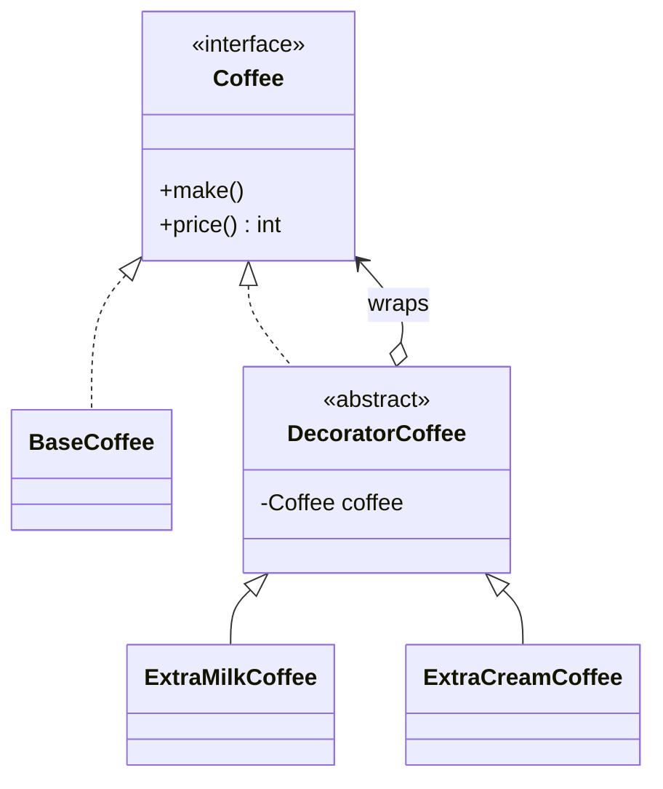

<div align="center">

# 🎁 Decorator Design Pattern

   

*Add behaviour to objects dynamically by wrapping them.*

</div>

---

## 📑 Table of contents

- [🎯 Intent](#-intent)
- [🧩 The problem & the solution](#-the-problem--the-solution)
- [🔷 Structure](#-structure)
- [👥 Participants](#-participants)
- [🧭 When to use it](#-when-to-use-it)
- [📊 Pros & cons](#-pros--cons)
- [🌍 Real-world examples](#-real-world-examples)
- [💻 Code](#-code)
  - [1. 💡 Pizza shop](#ex1)
  - [2. 💡 Coffee shop](#ex2)

---

## 🎯 Intent

> Attach additional responsibilities to an object **at runtime** as a flexible alternative to subclassing.

## 🧩 The problem & the solution

| 😣 Problem | 💡 Solution |
|---|---|
| A coffee (or pizza) can have any combination of extras. One subclass per combination (`CoffeeWithMilkAndCream`, ...) is impossible to maintain. | Decorators implement the same interface as the object they wrap, delegate to it, and add their own behaviour (and cost) on top. Stack as many as you like. |

## 🔷 Structure



## 👥 Participants

| Role | Responsibility | In this repo |
|---|---|---|
| **Component** | Common interface | `Coffee`, `BasePizza` |
| **Concrete Component** | The object being decorated | `BaseCoffee`, `Margherita`, `Farmhouse`, `VegDelight` |
| **Decorator** | Wraps a component, same interface | `DecoratorCoffee`, `ToppingDecorator` |
| **Concrete Decorators** | Add one feature each | `ExtramilkCoffee`, `ExtraCreamCoffee`, `ExtraCheeseDecorator`, `MushroomDecorator` |

## 🧭 When to use it

| ✅ Use it when | ⚠️ Avoid it when |
|---|---|
| Add or remove responsibilities dynamically | Order of wrapping matters and is easy to get wrong |
| Subclassing would cause a class explosion | A few fixed variants are enough |
| Features should be combinable in any order |  |

## 📊 Pros & cons

| 👍 Pros | 👎 Cons |
|---|---|
| More flexible than inheritance | Lots of small objects |
| Single Responsibility per decorator | Debugging long wrapper chains is harder |
| Combine behaviours at runtime |  |

## 🌍 Real-world examples

- `BufferedReader(new FileReader(...))` in Java I/O
- `Collections.unmodifiableList`
- Servlet filters / middleware

---

## 💻 Code

This folder has **2 examples** (14 Java files). Interfaces and abstract classes come first, the class with `main` comes last.

<a id="ex1"></a>

### 1. 💡 Pizza shop

> Base pizzas (`Margherita`, `Farmhouse`, `VegDelight`) topped with `ExtraCheeseDecorator` and `MushroomDecorator`.

<details open>
<summary><b>📁 Files in this example</b></summary>

```text
Decorator Design Pattern Pizza Shop/
├── Decorator/
│   ├── ExtraCheeseDecorator.java
│   ├── MushroomDecorator.java
│   └── ToppingDecorator.java
├── Pizza/
│   ├── BasePizza.java
│   ├── Farmhouse.java
│   ├── Margherita.java
│   └── VegDelight.java
└── Main.java
```

</details>

#### 📄 `Decorator/ToppingDecorator.java`

<sub>abstract class · 7 lines</sub>

```java
package Decorator;

import Pizza.BasePizza;

public abstract class ToppingDecorator extends BasePizza {

}
```

#### 📄 `Pizza/BasePizza.java`

<sub>abstract class · 5 lines</sub>

```java
package Pizza;

public abstract class BasePizza {
    public abstract int  cost();
}
```

#### 📄 `Decorator/ExtraCheeseDecorator.java`

<sub>class · 15 lines</sub>

```java
package Decorator;
import Pizza.BasePizza;

public class ExtraCheeseDecorator extends ToppingDecorator{
    BasePizza basePizza;

    public ExtraCheeseDecorator(BasePizza basePizza) {
        this.basePizza = basePizza;
    }

    @Override
    public int cost() {
        return this.basePizza.cost()+10;
    }
}
```

#### 📄 `Decorator/MushroomDecorator.java`

<sub>class · 16 lines</sub>

```java
package Decorator;

import Pizza.BasePizza;

public class MushroomDecorator extends ToppingDecorator{
    BasePizza basePizza;

    public MushroomDecorator(BasePizza basePizza) {
        this.basePizza = basePizza;
    }

    @Override
    public int cost() {
        return basePizza.cost()+15;
    }
}
```

#### 📄 `Pizza/Farmhouse.java`

<sub>class · 8 lines</sub>

```java
package Pizza;

public class Farmhouse extends BasePizza{
    @Override
    public int cost() {
        return 200;
    }
}
```

#### 📄 `Pizza/Margherita.java`

<sub>class · 10 lines</sub>

```java
package Pizza;

import Pizza.BasePizza;

public class Margherita extends BasePizza {
    @Override
    public int cost() {
        return 100;
    }
}
```

#### 📄 `Pizza/VegDelight.java`

<sub>class · 10 lines</sub>

```java
package Pizza;

import Pizza.BasePizza;

public class VegDelight extends BasePizza {
    @Override
    public int cost() {
        return 120;
    }
}
```

#### 📄 `Main.java`

<sub>class · 17 lines</sub>

```java
import Decorator.ExtraCheeseDecorator;
import Decorator.MushroomDecorator;
import Pizza.BasePizza;
import Pizza.Margherita;

public class Main {
    public static void main(String []args){
        //Margherita+ExtraCheese
        BasePizza Pizza1=new ExtraCheeseDecorator(new Margherita());
       System.out.println("Pizza1 cost is: "+Pizza1.cost());

        //Mushroom+Margherita+ExtraCheese
        BasePizza Pizza2=new MushroomDecorator( new ExtraCheeseDecorator(new Margherita()));
        System.out.println("Pizza2 cost is: "+Pizza2.cost());

    }
}
```

<details>
<summary><b>▶️ How to compile and run this example</b></summary>

```bash
# run from the repository root
mkdir -p out
find "Structural Design Pattern/4. Decorator Design Pattern/Decorator Design Pattern Pizza Shop" -name "*.java" -print0 | xargs -0 javac -d out
java -cp out Main
```

</details>

---

<a id="ex2"></a>

### 2. 💡 Coffee shop

> A `BaseCoffee` wrapped by `ExtramilkCoffee` and `ExtraCreamCoffee` decorators, each adding cost.

<details open>
<summary><b>📁 Files in this example</b></summary>

```text
DecoratorPattern Coffee shop/
├── Coffee/
│   ├── BaseCoffee.java
│   └── Coffee.java
├── Decorator/
│   ├── DecoratorCoffee.java
│   ├── ExtraCreamCoffee.java
│   └── ExtramilkCoffee.java
└── Main.java
```

</details>

#### 📄 `Coffee/Coffee.java`

<sub>interface · 9 lines</sub>

```java
package com.DecoratorPattern.Coffee;

public interface Coffee {

    void make();
    int price();


}
```

#### 📄 `Decorator/DecoratorCoffee.java`

<sub>abstract class · 18 lines</sub>

```java
package com.DecoratorPattern.Decorator;

import com.DecoratorPattern.Coffee.Coffee;

public abstract class DecoratorCoffee implements Coffee {

    protected Coffee coffee;
    DecoratorCoffee(Coffee coffee){
        this.coffee=coffee;
    }

    @Override
    public abstract void make();

    @Override
    public abstract int price();

}
```

#### 📄 `Coffee/BaseCoffee.java`

<sub>class · 17 lines</sub>

```java
package com.DecoratorPattern.Coffee;

public class BaseCoffee  implements Coffee {

    @Override
    public void make() {
        System.out.print("normal coffee");

    }

    @Override
    public int price() {
        return 50;

    }

}
```

#### 📄 `Decorator/ExtraCreamCoffee.java`

<sub>class · 25 lines</sub>

```java
package com.DecoratorPattern.Decorator;

import com.DecoratorPattern.Coffee.Coffee;

public class ExtraCreamCoffee extends DecoratorCoffee {

    public ExtraCreamCoffee(Coffee coffe) {
        super(coffe);

    }

    @Override
    public void make() {
        coffee.make();
        System.out.println(" + extra cream added to the normal coffee");

    }

    @Override
    public int price() {

        return coffee.price()+50;
    }

}
```

#### 📄 `Decorator/ExtramilkCoffee.java`

<sub>class · 23 lines</sub>

```java
package com.DecoratorPattern.Decorator;

import com.DecoratorPattern.Coffee.Coffee;

public class ExtramilkCoffee extends DecoratorCoffee {

    public ExtramilkCoffee(Coffee coffe){
        super(coffe);
    }
    @Override
    public void make() {
        coffee.make();
        System.out.println(" + extra milk added to the normal coffee");

    }

    @Override
    public int price() {

        return coffee.price()+20;
    }

}
```

#### 📄 `Main.java`

<sub>class · 35 lines</sub>

```java
package com.DecoratorPattern;


import com.DecoratorPattern.Decorator.ExtraCreamCoffee;
import com.DecoratorPattern.Coffee.BaseCoffee;
import com.DecoratorPattern.Coffee.Coffee;
import com.DecoratorPattern.Decorator.ExtramilkCoffee;

public class Main {

    public static void main(String[] args) {
        System.out.println("Base coffe details ");

        Coffee c=new BaseCoffee();
        c.make();
        System.out.println(c.price());

        System.out.println("exta milk coffee details");
        ExtramilkCoffee em=new ExtramilkCoffee(c);
        em.make();
        System.out.println(em.price());

        System.out.println("extra cream coffee details");
        ExtraCreamCoffee ec=new ExtraCreamCoffee(c);
        ec.make();
        System.out.println(ec.price());

        System.out.println("coffee with extra cream and extra milk");
        Coffee emc=new ExtraCreamCoffee(new ExtramilkCoffee(new BaseCoffee()));
        emc.make();
        System.out.println(emc.price());

    }

}
```

<details>
<summary><b>▶️ How to compile and run this example</b></summary>

```bash
# run from the repository root
mkdir -p out
find "Structural Design Pattern/4. Decorator Design Pattern/DecoratorPattern Coffee shop" -name "*.java" -print0 | xargs -0 javac -d out
java -cp out com.DecoratorPattern.Main
```

</details>

---

<div align="center">

[◀ Composite](../3.%20Composite%20Design%20Pattern/README.md) &nbsp;·&nbsp; [📚 All patterns](../PATTERNS.md) &nbsp;·&nbsp; [Facade ▶](../5.%20Fascade%20Design%20Pattern/README.md)

</div>
