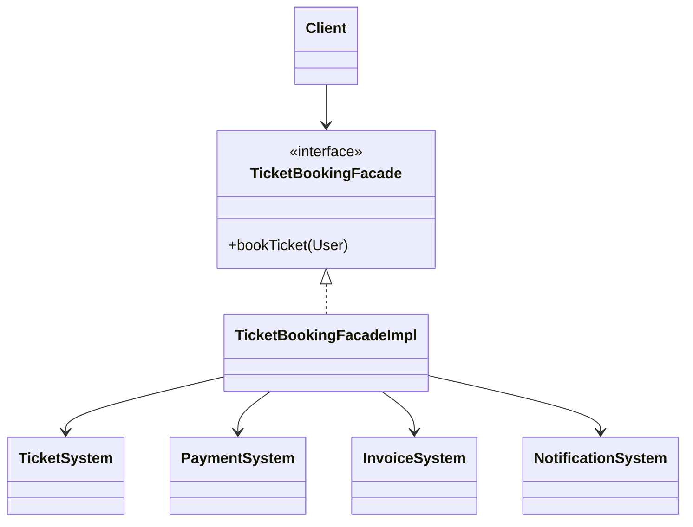

<div align="center">

# 🏛️ Facade Design Pattern

   

*One simple entry point to a complex subsystem.*

</div>

---

## 📑 Table of contents

- [🎯 Intent](#-intent)
- [🧩 The problem & the solution](#-the-problem--the-solution)
- [🔷 Structure](#-structure)
- [👥 Participants](#-participants)
- [🧭 When to use it](#-when-to-use-it)
- [📊 Pros & cons](#-pros--cons)
- [🌍 Real-world examples](#-real-world-examples)
- [💻 Code](#-code)
  - [1. Implementation](#ex1)

---

## 🎯 Intent

> Provide a **unified, simplified interface** to a set of interfaces in a subsystem.

## 🧩 The problem & the solution

| 😣 Problem | 💡 Solution |
|---|---|
| Booking a ticket needs the ticket, payment, invoice and notification systems, in the right order. Every client repeating that sequence is error-prone and tightly coupled. | `TicketBookingFacade` exposes a single `bookTicket()` that orchestrates all subsystems internally. |

## 🔷 Structure



## 👥 Participants

| Role | Responsibility | In this repo |
|---|---|---|
| **Facade** | Simple API that hides the subsystem | `TicketBookingFacade`, `TicketBookingFacadeImpl` |
| **Subsystem classes** | Do the real work | `TicketSystem`, `PaymentSystem`, `InvoiceSystem`, `NotificationSystem` |
| **Client** | Talks only to the facade | `Main` |

## 🧭 When to use it

| ✅ Use it when | ⚠️ Avoid it when |
|---|---|
| A subsystem is complex and clients need only common tasks | Clients really need fine-grained control of each subsystem |
| You want to layer a system and reduce dependencies |  |

## 📊 Pros & cons

| 👍 Pros | 👎 Cons |
|---|---|
| Simpler API for clients | Facade can become a god object |
| Loose coupling to the subsystem | Hides power features if over-simplified |
| One place for orchestration logic |  |

## 🌍 Real-world examples

- Service layers in web apps
- `javax.faces.context.FacesContext`
- SDK wrappers (`PaymentService.pay()`)

---

## 💻 Code

This folder has **1 example** (8 Java files). Interfaces and abstract classes come first, the class with `main` comes last.

<a id="ex1"></a>

### 1. Implementation

<details open>
<summary><b>📁 Files in this example</b></summary>

```text
facadepattern Ticket Availabilty/
├── InvoiceSystem.java
├── Main.java
├── NotificationSystem.java
├── PaymentSystem.java
├── TicketBookingFacade.java
├── TicketBookingFacadeImpl.java
├── TicketSystem.java
└── User.java
```

</details>

#### 📄 `TicketBookingFacade.java`

<sub>interface · 7 lines</sub>

```java
package com.facadepattern;

public interface TicketBookingFacade {

    void bookTicket(User user);

}
```

#### 📄 `InvoiceSystem.java`

<sub>class · 9 lines</sub>

```java
package com.facadepattern;

public class InvoiceSystem {

    public void generateInvoice(String id) {
        System.out.println("invoice is generated for the user id "+id);
    }

}
```

#### 📄 `NotificationSystem.java`

<sub>class · 9 lines</sub>

```java
package com.facadepattern;

public class NotificationSystem {

    public void sendNotification(String email) {
        System.out.println("Notification sent to "+email);
    }

}
```

#### 📄 `PaymentSystem.java`

<sub>class · 9 lines</sub>

```java
package com.facadepattern;

public class PaymentSystem {

    public void paymentStatus(String id) {
        System.out.println("payment done for the id "+id);
    }

}
```

#### 📄 `TicketBookingFacadeImpl.java`

<sub>class · 35 lines</sub>

```java
package com.facadepattern;

public class TicketBookingFacadeImpl implements TicketBookingFacade {

    private TicketSystem ticketSystem;
    private PaymentSystem paymentSystem;
    private InvoiceSystem invoiceSystem;
    private NotificationSystem notificationSystem;


    public TicketBookingFacadeImpl() {
        this.ticketSystem=new TicketSystem();
        this.paymentSystem=new PaymentSystem();
        this.invoiceSystem=new InvoiceSystem();
        this.notificationSystem=new NotificationSystem();

    }


    @Override
    public void bookTicket(User user) {

        if(ticketSystem.checkTicketAvailability(user.getNoOfTickets())) {
        paymentSystem.paymentStatus(user.getId());
        invoiceSystem.generateInvoice(user.getId());
        notificationSystem.sendNotification(user.getEmail());
        }
        else
        {
            System.out.println(user.getNoOfTickets()+" tickets are not available");
        }

    }

}
```

#### 📄 `TicketSystem.java`

<sub>class · 17 lines</sub>

```java
package com.facadepattern;

public class TicketSystem {

    private static final int TOTAL_TICKETS=50;


    public boolean checkTicketAvailability(int ticketsNeeded) {
        int ticketsLeft=TOTAL_TICKETS-ticketsNeeded;
        if(ticketsLeft<=0) {
            return false;
        }
        return true;
    }


}
```

#### 📄 `User.java`

<sub>class · 48 lines</sub>

```java
package com.facadepattern;

public class User {

    private String id;
    private String name;
    private String email;
    private int noOfTickets;


    public User() {
        super();
    }
    public User(String id, String name, String email,int noOfTickets ) {
        super();
        this.id = id;
        this.name = name;
        this.email = email;
        this.noOfTickets=noOfTickets;
    }

    public String getId() {
        return id;
    }
    public void setId(String id) {
        this.id = id;
    }
    public String getName() {
        return name;
    }
    public void setName(String name) {
        this.name = name;
    }
    public String getEmail() {
        return email;
    }
    public void setEmail(String email) {
        this.email = email;
    }

    public int getNoOfTickets() {
        return noOfTickets;
    }
    public void setNoOfTickets(int noOfTickets) {
        this.noOfTickets = noOfTickets;
    }

}
```

#### 📄 `Main.java`

<sub>class · 40 lines</sub>

```java
package com.facadepattern;

public class Main {

    public static void main(String[] args) {


        /*
         * If we don't make use of Facade Design Pattern Client has to deal with the all
         * the classes and methods that requires for ticket booking
         */


        /*
         * User user=new User("121","kavan", "kavan@gmail.com",2); TicketSystem ts=new
         * TicketSystem(); boolean ticketAvailability =
         * ts.checkTicketAvailability(user.getNoOfTickets()); if(ticketAvailability) {
         * PaymentSystem ps=new PaymentSystem(); ps.paymentStatus(user.getId());
         * InvoiceSystem is=new InvoiceSystem(); is.generateInvoice(user.getId());
         * NotificationSystem ns= new NotificationSystem();
         * ns.sendNotification(user.getEmail()); }
         */


        /*
         * By making use of Facade Design pattern we can reduce the client work ,just by
         * making the client to call a method in Facade class which take care of the
         * required steps to book tickets
         */

          User user2=new User("121","kavan", "kavan@gmail.com",52); TicketBookingFacade
          ticketBooking=new TicketBookingFacadeImpl(); ticketBooking.bookTicket(user2);


    }

}
```

<details>
<summary><b>▶️ How to compile and run this example</b></summary>

```bash
# run from the repository root
mkdir -p out
find "Structural Design Pattern/5. Fascade Design Pattern/facadepattern Ticket Availabilty" -name "*.java" -print0 | xargs -0 javac -d out
java -cp out com.facadepattern.Main
```

</details>

---

<div align="center">

[◀ Decorator](../4.%20Decorator%20Design%20Pattern/README.md) &nbsp;·&nbsp; [📚 All patterns](../PATTERNS.md) &nbsp;·&nbsp; [Flyweight ▶](../6.%20Flyweight%20Design%20Pattern/README.md)

</div>
