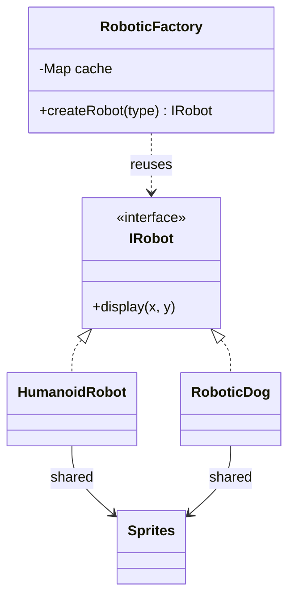

<div align="center">

# 🪶 Flyweight Design Pattern

   

*Share common state to support huge numbers of objects.*

</div>

---

## 📑 Table of contents

- [🎯 Intent](#-intent)
- [🧩 The problem & the solution](#-the-problem--the-solution)
- [🔷 Structure](#-structure)
- [👥 Participants](#-participants)
- [🧭 When to use it](#-when-to-use-it)
- [📊 Pros & cons](#-pros--cons)
- [🌍 Real-world examples](#-real-world-examples)
- [💻 Code](#-code)
  - [1. ❌ Problem - every robot owns its sprite](#ex1)
  - [2. ✅ Solution - Robot clone](#ex2)
  - [3. ✅ Solution - Word processor](#ex3)

---

## 🎯 Intent

> Use sharing to support **large numbers of fine-grained objects** efficiently.

## 🧩 The problem & the solution

| 😣 Problem | 💡 Solution |
|---|---|
| A game with thousands of robots, or a document with millions of characters, stores the same heavy data (sprites, glyph shapes) in every object and runs out of memory. | Split state in two: **intrinsic** (shared, immutable, e.g. sprite) and **extrinsic** (unique, e.g. x/y position). A factory caches and reuses the shared part. |

## 🔷 Structure



## 👥 Participants

| Role | Responsibility | In this repo |
|---|---|---|
| **Flyweight** | Interface that receives extrinsic state | `IRobot`, `ILetter` |
| **Concrete Flyweight** | Stores shared (intrinsic) state | `HumanoidRobot`, `RoboticDog`, `DocumentCharacter` |
| **Flyweight Factory** | Creates and caches flyweights | `RoboticFactory`, `LetterFactor` |
| **Client** | Supplies extrinsic state | `Main` |

## 🧭 When to use it

| ✅ Use it when | ⚠️ Avoid it when |
|---|---|
| Huge number of similar objects | Few objects, or objects with little shareable data |
| Much of the object state can be made extrinsic |  |
| Memory is the bottleneck |  |

## 📊 Pros & cons

| 👍 Pros | 👎 Cons |
|---|---|
| Large memory savings | More complex code |
| Shared objects are immutable and thread-safe | Trades CPU (computing extrinsic state) for memory |

## 🌍 Real-world examples

- `String` pool, `Integer.valueOf()` cache
- Text editors (glyph objects)
- Tile maps and particle systems in games

---

## 💻 Code

This folder has **3 examples** (13 Java files). Interfaces and abstract classes come first, the class with `main` comes last.

<a id="ex1"></a>

### 1. ❌ Problem - every robot owns its sprite

> Each `Robot` stores its own heavy `Sprites`, so memory grows with the robot count.

<details open>
<summary><b>📁 Files in this example</b></summary>

```text
Problem/
├── Main.java
├── Robot.java
└── Sprites.java
```

</details>

#### 📄 `Robot.java`

<sub>class · 16 lines</sub>

```java
public class Robot {
    int coordinateX; ////Extrinsic Data:changes based on client input and differs from one object to another
    int coordinateY;//Extrinsic Data
    String type;//Intrinsic DATA : shared among objects and remain same once defined one value
    //Humanoid or Robotic Dog
    Sprites body;//Intrinsic DATA
    //small 2d bitmap(graphic element) heavy object or too much costly

    public Robot(int coordinateX, int coordinateY, String type, Sprites body) {
        this.coordinateX = coordinateX;
        this.coordinateY = coordinateY;
        this.type = type;
        this.body = body;
    }
    //getters and setters
}
```

#### 📄 `Sprites.java`

<sub>class · 2 lines</sub>

```java
public class Sprites {
}
```

#### 📄 `Main.java`

<sub>class · 26 lines</sub>

```java
public class Main {
    public static  void main (String []args){
        int x=0;
        int y=0;
        for(int i=0;i<500000;i++){
            Sprites humanoidSprites=new Sprites();
            Robot humanoidRoboticObject=new Robot(x+i,y+i,"HUMANOID",humanoidSprites);

        }
        for(int i=0;i<500000;i++){
            Sprites roboticDogSprites=new Sprites();
            Robot RoboticDogObject=new Robot(x+i,y+i,"ROBOTIC_DOGS",roboticDogSprites);

        }
    }
}

//Total 10 lakhs objects are created and each  takes 31KB
//Total Memory=31GB but if user have only 8GB or 16GB memory than crashed will happen
//Creation of Object is Expensive

//Solution:
//From Object remove all the Extrinsic data and keep Intrinsic data (This object calledFlyWeight Object)
//This Flyweight class can be Immutable
//Extrinsic Data can be passed to the flyweight class in method parameter
//once the flyweight Object is created, It is Cached and reused whenever required
```

<details>
<summary><b>▶️ How to compile and run this example</b></summary>

```bash
# run from the repository root
mkdir -p out
find "Structural Design Pattern/6. Flyweight Design Pattern/Problem" -name "*.java" -print0 | xargs -0 javac -d out
java -cp out Main
```

</details>

---

<a id="ex2"></a>

### 2. ✅ Solution - Robot clone

> `RoboticFactory` caches `HumanoidRobot` / `RoboticDog` and shares one `Sprites` per type.

<details open>
<summary><b>📁 Files in this example</b></summary>

```text
Robot Clone/
├── Robot/
│   ├── HumanoidRobot.java
│   ├── IRobot.java
│   ├── RoboticDog.java
│   └── Sprites.java
├── Main.java
└── RoboticFactory.java
```

</details>

#### 📄 `Robot/IRobot.java`

<sub>interface · 6 lines</sub>

```java
package LowLevelDesign.DesignPatterns.FlyWeightPattern.Robot;

public interface IRobot {

    public void display(int x, int y);
}
```

#### 📄 `Robot/HumanoidRobot.java`

<sub>class · 28 lines</sub>

```java
package LowLevelDesign.DesignPatterns.FlyWeightPattern.Robot;

public class HumanoidRobot implements IRobot {

    private String type;
    private Sprites body; //small 2d bitmap (graphic element)

    public HumanoidRobot(String type, Sprites body){
        this.type = type;
        this.body = body;
    }

    public String getType() {
        return type;
    }

    public Sprites getBody() {
        return body;
    }

    @Override
    public void display(int x, int y) {

        //use the humanoid sprites object
        // and X and Y coordinate to render the image.

    }
}
```

#### 📄 `Robot/RoboticDog.java`

<sub>class · 28 lines</sub>

```java
package LowLevelDesign.DesignPatterns.FlyWeightPattern.Robot;

public class RoboticDog implements IRobot {

    private String type;
    private Sprites body; //small 2d bitmap (graphic element)

    public RoboticDog(String type, Sprites body){
        this.type = type;
        this.body = body;
    }

    public String getType() {
        return type;
    }

    public Sprites getBody() {
        return body;
    }

    @Override
    public void display(int x, int y) {

        //use the Robotic Dog sprites object
        // and X and Y coordinate to render the image.

    }
}
```

#### 📄 `Robot/Sprites.java`

<sub>class · 4 lines</sub>

```java
package LowLevelDesign.DesignPatterns.FlyWeightPattern.Robot;

public class Sprites {
}
```

#### 📄 `RoboticFactory.java`

<sub>class · 36 lines</sub>

```java
package LowLevelDesign.DesignPatterns.FlyWeightPattern;

import LowLevelDesign.DesignPatterns.FlyWeightPattern.Robot.HumanoidRobot;
import LowLevelDesign.DesignPatterns.FlyWeightPattern.Robot.IRobot;
import LowLevelDesign.DesignPatterns.FlyWeightPattern.Robot.RoboticDog;
import LowLevelDesign.DesignPatterns.FlyWeightPattern.Robot.Sprites;

import java.util.HashMap;
import java.util.Map;

public class RoboticFactory {

    private static Map<String, IRobot> roboticObjectCache = new HashMap<>();

    public static IRobot createRobot(String robotType){

        if(roboticObjectCache.containsKey(robotType)){
            return roboticObjectCache.get(robotType);
        }
        else {
            if(robotType == "HUMANOID"){
                Sprites humanoidSprite = new Sprites();
                IRobot humanoidObject = new HumanoidRobot(robotType, humanoidSprite);
                roboticObjectCache.put(robotType, humanoidObject);
                return humanoidObject;
            }
            else if(robotType == "ROBOTICDOG"){
                Sprites roboticDogSprite = new Sprites();
                IRobot roboticDogObject = new RoboticDog(robotType, roboticDogSprite);
                roboticObjectCache.put(robotType, roboticDogObject);
                return roboticDogObject;
            }
        }
        return null;
    }
}
```

#### 📄 `Main.java`

<sub>class · 23 lines</sub>

```java
package LowLevelDesign.DesignPatterns.FlyWeightPattern;

import LowLevelDesign.DesignPatterns.FlyWeightPattern.Robot.IRobot;

public class Main {

    public static void main(String args[]){

        IRobot humanoidRobot1 = RoboticFactory.createRobot("HUMANOID");
        humanoidRobot1.display(1,2);


        IRobot humanoidRobot2 = RoboticFactory.createRobot("HUMANOID");
        humanoidRobot2.display(10,30);

        IRobot roboDog1 = RoboticFactory.createRobot("ROBOTICDOG");
        roboDog1.display(2,9);

        IRobot roboDog2 = RoboticFactory.createRobot("ROBOTICDOG");
        roboDog2.display(11,19);

    }
}
```

<details>
<summary><b>▶️ How to compile and run this example</b></summary>

```bash
# run from the repository root
mkdir -p out
find "Structural Design Pattern/6. Flyweight Design Pattern/Robot Clone" -name "*.java" -print0 | xargs -0 javac -d out
java -cp out LowLevelDesign.DesignPatterns.FlyWeightPattern.Main
```

</details>

---

<a id="ex3"></a>

### 3. ✅ Solution - Word processor

> `LetterFactor` hands out one shared `ILetter` per character; position and style are passed in as extrinsic state.

<details open>
<summary><b>📁 Files in this example</b></summary>

```text
wordProcessor/
├── DocumentCharacter.java
├── ILetter.java
├── LetterFactor.java
└── Main.java
```

</details>

#### 📄 `ILetter.java`

<sub>interface · 6 lines</sub>

```java
package LowLevelDesign.DesignPatterns.FlyWeightPattern.wordProcessor;

public interface ILetter {

    public void display(int row, int column);
}
```

#### 📄 `DocumentCharacter.java`

<sub>class · 24 lines</sub>

```java
package LowLevelDesign.DesignPatterns.FlyWeightPattern.wordProcessor;

public class DocumentCharacter implements ILetter{

    private char character;
    private String fontType;
    private int size;

    DocumentCharacter(char character, String fontType, int size){
        this.character = character;
        this.fontType = fontType;
        this.size = size;

    }

    //only getter methods

    @Override
    public void display(int row, int column) {

        //display the character of particular font and size
        //at given location
    }
}
```

#### 📄 `LetterFactor.java`

<sub>class · 22 lines</sub>

```java
package LowLevelDesign.DesignPatterns.FlyWeightPattern.wordProcessor;

import java.util.HashMap;
import java.util.Map;

public class LetterFactor {

    private static Map<Character, ILetter> characterCache = new HashMap<>();

    public static ILetter crateLetter(char characterValue){

        if(characterCache.containsKey(characterValue)){
            return characterCache.get(characterValue);
        }
        else {

            DocumentCharacter characterObj = new DocumentCharacter(characterValue, "Arial", 10);
            characterCache.put(characterValue, characterObj);
            return characterObj;
        }
    }
}
```

#### 📄 `Main.java`

<sub>class · 24 lines</sub>

```java
package LowLevelDesign.DesignPatterns.FlyWeightPattern.wordProcessor;

public class Main {

    public static void main(String args[]){

        /*
            this is the data we want to write into the word processor.

            Total = 58 characters
            t = 7 times
            h = 3 times
            a = 3 times and so on...

         */

        ILetter object1 = LetterFactor.crateLetter('t');
        object1.display(0,0);

        ILetter object2 = LetterFactor.crateLetter('t');
        object1.display(0,6);

    }
}
```

<details>
<summary><b>▶️ How to compile and run this example</b></summary>

```bash
# run from the repository root
mkdir -p out
find "Structural Design Pattern/6. Flyweight Design Pattern/wordProcessor" -name "*.java" -print0 | xargs -0 javac -d out
java -cp out LowLevelDesign.DesignPatterns.FlyWeightPattern.wordProcessor.Main
```

</details>

---

<div align="center">

[◀ Facade](../5.%20Fascade%20Design%20Pattern/README.md) &nbsp;·&nbsp; [📚 All patterns](../PATTERNS.md) &nbsp;·&nbsp; [Proxy ▶](../7.%20Proxy%20Design%20Pattern/README.md)

</div>
