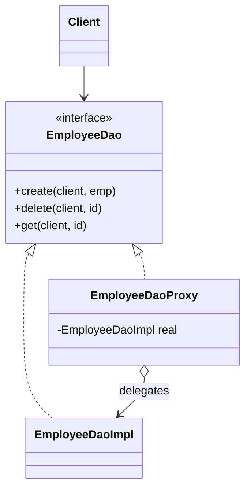

<div align="center">

# 🛡️ Proxy Design Pattern

   

*A stand-in that controls access to another object.*

</div>

---

## 📑 Table of contents

- [🎯 Intent](#-intent)
- [🧩 The problem & the solution](#-the-problem--the-solution)
- [🔷 Structure](#-structure)
- [👥 Participants](#-participants)
- [🧭 When to use it](#-when-to-use-it)
- [📊 Pros & cons](#-pros--cons)
- [🌍 Real-world examples](#-real-world-examples)
- [💻 Code](#-code)
  - [1. 💡 Protection proxy - User vs ADMIN](#ex1)
  - [2. 💡 Filtering proxy - Website](#ex2)

---

## 🎯 Intent

> Provide a **surrogate or placeholder** for another object to control access to it.

## 🧩 The problem & the solution

| 😣 Problem | 💡 Solution |
|---|---|
| Only ADMIN may create or delete employees (USER may only read), and some web sites must be blocked. Putting those checks inside the real object mixes responsibilities. | A proxy implements the same interface as the real object, performs the extra work (access check, URL filtering) and forwards the call to the real object only when allowed. |

## 🔷 Structure



## 👥 Participants

| Role | Responsibility | In this repo |
|---|---|---|
| **Subject** | Common interface | `EmployeeDao`, `WebPage` |
| **Real Subject** | Does the real work | `EmployeeDaoImpl`, `WebPageImpl` |
| **Proxy** | Controls access and delegates | `EmployeeDaoProxy`, `WebPageProxy` |
| **Client** | Uses the subject interface | `Client`, `Main` |

## 🧭 When to use it

| ✅ Use it when | ⚠️ Avoid it when |
|---|---|
| Access control (protection proxy) | No extra behaviour is needed around the object |
| Filtering / blocking requests |  |
| Lazy initialisation, caching, logging, remote access |  |

## 📊 Pros & cons

| 👍 Pros | 👎 Cons |
|---|---|
| Control over the object without changing it | Extra layer of indirection |
| Checks happen before the real object is touched | Slight response-time overhead |
| Open/Closed |  |

## 🌍 Real-world examples

- Spring AOP / `java.lang.reflect.Proxy`
- Hibernate lazy loading
- Reverse proxies and API gateways

---

## 💻 Code

This folder has **2 examples** (9 Java files). Interfaces and abstract classes come first, the class with `main` comes last.

<a id="ex1"></a>

### 1. 💡 Protection proxy - User vs ADMIN

> `EmployeeDaoProxy` lets only ADMIN `create` / `delete`, lets ADMIN and USER `get`, and throws *Access Denied* otherwise.

<details open>
<summary><b>📁 Files in this example</b></summary>

```text
Proxy Pattern with User and ADMIN/
├── Client.java
├── EmployeeDao.java
├── EmployeeDaoImpl.java
├── EmployeeDaoProxy.java
└── EmployeeDo.java
```

</details>

#### 📄 `EmployeeDao.java`

<sub>interface · 6 lines</sub>

```java
public interface EmployeeDao {
    public void create(String client,EmployeeDo obj) throws Exception;
    public void delete (String client,int employeeID) throws Exception;
    public EmployeeDo get(String client,int employeeId) throws Exception;

}
```

#### 📄 `EmployeeDaoImpl.java`

<sub>class · 20 lines</sub>

```java
public class EmployeeDaoImpl implements EmployeeDao{
    @Override
    public void create(String client, EmployeeDo obj) throws Exception {
        //create a new row
        System.out.println("Created new row in the Employee table");
    }

    @Override
    public void delete(String client, int employeeID) throws Exception {
     //delete a row
        System.out.println("Deleted a row with EmployeeID: "+employeeID);
    }

    @Override
    public EmployeeDo get(String client, int employeeId) throws Exception {
        //fetch row
        System.out.println("Fetching Data from the DB");
        return new EmployeeDo();
    }
}
```

#### 📄 `EmployeeDaoProxy.java`

<sub>class · 34 lines</sub>

```java
public class EmployeeDaoProxy implements EmployeeDao{
    EmployeeDao employeeDao;

    public EmployeeDaoProxy() {
        this.employeeDao = new EmployeeDaoImpl();
    }

    @Override
    public void create(String client, EmployeeDo obj) throws Exception {
        if(client.equals("ADMIN")){
            employeeDao.create(client,obj);
            return;
        }
        throw new Exception("Access Denied");
    }

    @Override
    public void delete(String client, int employeeID) throws Exception {
        if(client.equals("ADMIN")){
            employeeDao.delete(client,employeeID);
            return;
        }
        throw new Exception("Access Denied");
    }

    @Override
    public EmployeeDo get(String client, int employeeId) throws Exception {
        if(client.equals("ADMIN")||client.equals("USER")){
           return employeeDao.get(client,employeeId);

        }
        throw new Exception("Access Denied");
    }
}
```

#### 📄 `EmployeeDo.java`

<sub>class · 14 lines</sub>

```java
public class EmployeeDo {
    String client;
    int employeeID;
EmployeeDo(){}


    public String getClient() {
        return client;
    }

    public int getEmployeeID() {
        return employeeID;
    }
}
```

#### 📄 `Client.java`

<sub>class · 16 lines</sub>

```java
public class Client {
    public static void main(String[] args){
        try{
//            EmployeeDao empTableObj=new EmployeeDaoProxy();
//            empTableObj.create("USER",new EmployeeDo());
//            System.out.println("Operation Successful");


            EmployeeDao empTableObj=new EmployeeDaoProxy();
            empTableObj.create("ADMIN",new EmployeeDo());
            System.out.println("Operation Successful");
        }catch (Exception e){
            System.out.println(e.getMessage());
        }
    }
}
```

<details>
<summary><b>▶️ How to compile and run this example</b></summary>

```bash
# run from the repository root
mkdir -p out
find "Structural Design Pattern/7. Proxy Design Pattern/Proxy Pattern with User and ADMIN" -name "*.java" -print0 | xargs -0 javac -d out
java -cp out Client
```

</details>

---

<a id="ex2"></a>

### 2. 💡 Filtering proxy - Website

> `WebPageProxy` checks the URL against a blocked list and only then calls the real `WebPageImpl.renderPage()`.

<details open>
<summary><b>📁 Files in this example</b></summary>

```text
proxypattern With Website/
├── Main.java
├── WebPage.java
├── WebPageImpl.java
└── WebPageProxy.java
```

</details>

#### 📄 `WebPage.java`

<sub>interface · 7 lines</sub>

```java
package com.proxypattern;

public interface WebPage {

    void renderPage(String url) throws Exception;

}
```

#### 📄 `WebPageImpl.java`

<sub>class · 13 lines</sub>

```java
package com.proxypattern;

public class WebPageImpl implements WebPage {


    @Override
    public void renderPage(String url) throws Exception {

        System.out.println("url "+url +" is rendered successfully");

    }

}
```

#### 📄 `WebPageProxy.java`

<sub>class · 39 lines</sub>

```java
package com.proxypattern;

import java.util.ArrayList;
import java.util.List;

public class WebPageProxy implements WebPage{

    private WebPage webPage;


    public WebPageProxy() {
        webPage=new WebPageImpl();
    }

    private static List<String> blockedList;

    //Initializing and adding some blocked url's to the list
    static {
        blockedList=new ArrayList<>();
        blockedList.add("block1.com");
        blockedList.add("block2.com");
        blockedList.add("block3.com");
        blockedList.add("block4.com");

    }

    @Override
    public void renderPage(String url) throws Exception {
        if(blockedList.contains(url)) {
            throw new Exception("the url "+url+" you are requested is blocked ");
        }
        else {
            webPage.renderPage(url);
        }


    }

}
```

#### 📄 `Main.java`

<sub>class · 20 lines</sub>

```java
package com.proxypattern;

public class Main {

    public static void main(String[] args) {
        WebPage wp=new WebPageProxy();
        try {
//			wp.renderPage("abc.com");
//			System.out.println("process successfully completed");

            wp.renderPage("block1.com");
            System.out.println("process successfully completed");
        } catch (Exception e) {
            System.out.println(e.getMessage());
            e.printStackTrace();
        }

    }

}
```

<details>
<summary><b>▶️ How to compile and run this example</b></summary>

```bash
# run from the repository root
mkdir -p out
find "Structural Design Pattern/7. Proxy Design Pattern/proxypattern With Website" -name "*.java" -print0 | xargs -0 javac -d out
java -cp out com.proxypattern.Main
```

</details>

---

<div align="center">

[◀ Flyweight](../6.%20Flyweight%20Design%20Pattern/README.md) &nbsp;·&nbsp; [📚 All patterns](../PATTERNS.md) &nbsp;·&nbsp; [Visitor ▶](../8.%20Visitor%20Design%20Pattern/README.md)

</div>
